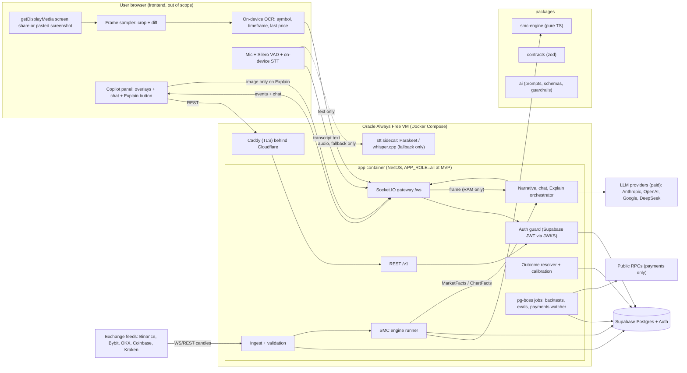

# A01: Architecture Overview

**Product:** SMC Copilot (browser-based, Google Meet-style Smart Money Concepts trading assistant)
**Set:** A (complete backend, full product vision)
**Status:** Planning document, v2.0, 2026-10-10 (revision of v1.0 after the "crypto-first, $0 infrastructure, wallet identity, voice" decisions)
**Read with:** A02 (realtime/media/voice), A03 (market data), A04 (SMC engine), A05 (AI layer), A06 (schema), A07 (API), A08 (platform), A09 (risk/compliance), A10 (roadmap). The shippable subset is in Set B (B01 to B06).

> Planning only. No production code. Schemas, interfaces, and contract sketches are included where they remove ambiguity.
> Prices and limits were checked by web search on 2026-10-10 and the sources are listed in A03, A05 and A08. Where sources disagreed or I could not confirm something, it is marked **[verify]**.

---

## 0. What changed in v2 (and why it matters)

| Your decision | Consequence in this plan |
|---|---|
| **Crypto-first public launch**, forex later | Free exchange feeds (Binance, Bybit, OKX, Coinbase, Kraken) replace the paid forex feed. Forex stays a **seam** (asset class + provider interface + licence gate), not a launch item. A03, A10 |
| **Pay only for Supabase and AI models** | Every other service is a free tier or open source, each with a written exit path (section 1.2). Hosting moves from Railway to Oracle Cloud Always Free + Cloudflare free. Billing moves from a payment processor to on-chain stablecoin payments. A08 |
| **International users, no country attachment** | UTC everywhere, USD/stablecoin pricing, no country-specific processors, no country-specific legal text. Compliance is written jurisdiction-neutral with a counsel checklist. A09 |
| **Voice interaction, open-source speech-to-text** | In-browser VAD + STT first (zero server cost), CPU STT sidecar as fallback. Replies are text. A02 section 6 |
| **Zero retention of screen frames** | Frames exist only in memory (browser, then server RAM, then the model provider's API call). Never written to disk, storage or logs. A02, A05 section 12 |
| **Wallet-first identity, email optional** | Supabase Auth "Sign in with Web3" (Ethereum + Solana). All user data hangs off one account that can link several wallets and, optionally, an email. A06, A07 |
| **"Explain this chart" + screen sharing** | A first-class, user-triggered job (J7) that works on a shared screen **or** an uploaded/pasted screenshot. A05 section 8, A07 |
| **Compare Supabase vs Railway Postgres** | Section 5.2 below (four options, scored). Recommendation: hosted Supabase |

**Honest answer to "is v1 concrete enough?"** v1 was concrete on architecture, contracts, schema and plan, but had five gaps that v2 closes: (1) market-data adapters were described, not specified message-by-message; (2) there was no worked numeric example of the engine; (3) no first-day build checklist (env vars, repo bootstrap); (4) AI and voice acceptance thresholds were not numeric; (5) no requirement-to-document traceability. See `00-AUDIT-AND-TRACEABILITY.md` at the plan root.

---

## 1. What we are building

A user opens a session in the browser, connects a wallet (or, optionally, an email), shares their charting window (TradingView, a broker terminal, anything) or drops in a screenshot, and gets live, explainable SMC analysis next to it: market structure, BOS/CHoCH, order blocks, fair value gaps, liquidity, premium/discount, multi-timeframe bias, scenario narratives. They can **talk to it** (speech-to-text) or type, and press **Explain this chart** at any moment.

**Hard product constraints (they shape every design choice below):**

1. **The user is always in control.** No autonomous order placement, ever. Every output is decision support.
2. **No certainty language.** Every forward-looking statement is a *scenario* with an invalidation level, a historically-grounded probability range, and a confidence label.
3. **Numbers come from the engine, words come from the model.** The AI never originates a price level, a probability, or a risk figure.
4. **Deterministic where possible.** The SMC engine is a pure, replayable function. The same candles and the same strategy version always produce the same output.
5. **Voice never confirms anything that matters.** Voice can ask, explain and navigate; the execution gate (A04 section 11) can only be confirmed by an explicit on-screen action.

### 1.1 Lineage: the Auto Pilot PRD

This is the same pipeline family as the SNC Pilot PRD (0-first_prd_smc_copilot_app.md), with one deliberate inversion: Auto Pilot automates a decision process, SMC Copilot **assists a human**. reuse its best ideas directly:

| Auto Pilot idea | How it appears here |
|---|---|
| Observation is not a rule (`OBSERVED/HYPOTHESIS/CONFIRMED_RULE`) | Every SMC rule in A04 carries a status and a backtest reference before it can feed scoring |
| Hard filters vs soft scores | A04 section 8, same semantics |
| Machine-readable reason codes | Every rejected or downgraded setup stores codes; the AI explains the codes |
| Strategy versioning, no in-place edits | `strategy_versions` table; every setup row stores the version |
| Decision journal including non-trades | `setups` stores every candidate, including rejected ones |
| No silent learning | Research findings never alter production config without a new version |
| Execution gate is a separate layer | Here the gate is always a human confirmation (A04 section 11) |

### 1.2 The cost policy: what is allowed to cost money

**Rule:** the only paid line items are **(1) Supabase** and **(2) AI model APIs**. Everything else must be open source or a free tier, and every free tier must have a written exit path, because free tiers change (Oracle cut its Always Free ARM allowance in June 2026, see A08 section 1).

| Layer | Choice | Cost | Fragility of the free tier | Exit path if it disappears |
|---|---|---|---|---|
| Database + Auth | Supabase (Free for dev, **Pro $25/mo from beta**) | **Paid (allowed)** | Free plan pauses after 1 week idle and has no backups, hence Pro for anything with users | Plain Postgres + `pg_dump`; auth is behind `AuthProvider` (section 5.4) |
| AI models | Anthropic / OpenAI / Google / DeepSeek APIs | **Paid (allowed)** | n/a | Router is provider-agnostic (A05 section 10) |
| Compute (API, worker, engine, STT sidecar) | Oracle Cloud Always Free Ampere A1 (2 OCPU, 12 GB) in a non-US region, Docker Compose | $0 | **Medium-high** (allowance was halved in 2026; idle-reclaim rule) | Same Docker image runs on any Linux box: second Oracle region, a spare home machine behind a Cloudflare Tunnel, or (only with your approval) a $4-6 VPS. A08 section 1.3 |
| Edge, DNS, WAF, static hosting, bot check | Cloudflare Free (DNS, proxy, Pages, Turnstile, Tunnel) | $0 | Low | Any DNS + Caddy |
| Market data | Public exchange WebSocket/REST feeds (Binance, Bybit, OKX, Coinbase, Kraken) via thin adapters + CCXT (MIT) | $0 | Medium (terms and geo-blocks change) | Four independent venues; replay from stored candles; adapters are pluggable |
| Speech-to-text | Silero VAD (MIT) + Moonshine / Whisper in the browser; Parakeet TDT v3 on the CPU sidecar | $0 | Low (open weights) | Models are files we can pin and mirror |
| Chart text reading (symbol, timeframe, last price) | Open-source OCR in the browser (PaddleOCR via onnxruntime-web, MIT) | $0 | Low | Tesseract.js (Apache-2.0) as alternative |
| Errors / metrics / logs | Sentry free Developer plan, Grafana Cloud free, Pino JSON logs | $0 | Medium | Self-host GlitchTip + Prometheus/Loki on the VM |
| CI/CD | GitHub Actions (public repo free; private repo 2,000 free min/month) | $0 | Low | Any CI; the pipeline is a few scripts |
| Backups beyond Supabase's | Weekly encrypted `pg_dump` to Cloudflare R2 (10 GB free) and Oracle Object Storage (20 GB free-only tenancy) | $0 | Low | Any S3-compatible bucket |
| Email (optional sign-in channel only) | Supabase Auth custom SMTP via Brevo free (300/day) or Resend free (3,000/month, 100/day) | $0 | Medium | Swap SMTP; email is optional by design |
| Billing (when you charge) | On-chain stablecoin payments verified by our own watcher | $0 + network fees paid by the payer | Low | BTCPay Server (MIT) self-hosted for BTC/Lightning |
| Domain name | A free `*.pages.dev` subdomain at MVP; a real domain is about $10/year when you want one | $0 now | n/a | n/a |

---

## 2. The key architectural question: where do prices come from?

Screen sharing delivers **pixels**, not data. Three options:

| Dimension | 1. Feed as source of truth, screen for context | 2. Vision-only (read the chart from frames) | 3. Hybrid (recommended) |
|---|---|---|---|
| Price accuracy | Exact (exchange candles) | Approximate; error depends on axis-label anchoring (to be measured in spike S1) | Exact for supported symbols; approximate and *labeled* otherwise |
| History depth | Unlimited (we store it) | Only what is on screen | Unlimited for supported symbols |
| Determinism / testability | Full (replayable) | Poor (non-deterministic, drift with themes/indicators) | Full for the engine; vision isolated behind validation |
| Cost per session-hour | $0 (free exchange feeds) | Roughly $0.02 (cheap vision model) to $0.4+ per hour at 60 frames/hr | **$0 for context extraction** (OCR in the browser); LLM vision only when the user presses Explain |
| Market coverage | Venues we connect | Any chart the user can display | Feed markets precisely; everything else in "approximate mode" |
| Latency | Sub-second from candle close | 2 to 6 s per frame | Engine sub-second; OCR and vision off the hot path |
| Legal / licensing | Per-venue terms (A03 section 2.3) | Gray area: reading a third-party display, but no redistribution of the feed | Raw ticks never leave the server; frames processed ephemerally |
| Failure mode | User views a symbol we do not support | Hallucinated levels | Mismatch detection catches wrong symbol/venue |

**Decision: hybrid, with a strict hierarchy, and (new in v2) OCR before vision.**

1. **Feed = truth.** All structure, zones, scores and levels are computed from exchange candles.
2. **Screen = context + verification, read by open-source OCR in the browser first.** The client crops the chart header and the price axis, runs OCR locally, and sends only the *text* (symbol, timeframe, venue label, last-price tag, visible axis labels) to the server. We reconcile the last price against our feed. A mismatch beyond tolerance raises `FEED_MISMATCH` ("you may be viewing a different venue or symbol"). No image leaves the browser for this step, and it costs nothing.
3. **Vision LLM = on demand.** Used only when (a) the user presses **Explain this chart**, (b) OCR confidence is low and the user has not picked a symbol manually, or (c) the user asks about their own drawings. In approximate mode (no feed) it never produces a numeric trade plan, only qualitative commentary with levels flagged "read from pixels, approximate".
4. **Manual override always exists.** A symbol/timeframe picker is the primary fallback; OCR and vision are conveniences, not dependencies.

Rejected: *browser extension that scrapes TradingView's DOM*. It would give exact numbers but is fragile, conflicts with TradingView's terms around programmatic consumption **[verify current terms]**, and does not work for other apps.

Details: transport, sampling and voice in A02, venues and licensing in A03, vision/OCR/Explain pipeline in A05.

---

## 3. System diagram



**Process model.** One codebase, one database, two logical roles:

- **api role:** stateless HTTP and Socket.IO gateway.
- **worker role:** ingest, engine, AI orchestration, jobs. Each instrument/timeframe stream is owned by exactly one worker at a time (A03 section 8).

At MVP both roles run in **one process** (`APP_ROLE=all`, B02) on the single free VM, and they split in milestone M6 without code changes, because they already communicate only through an event-bus interface and the database. The STT sidecar is a separate container so heavy CPU work can never block the engine's event loop.

---

## 4. Technology decisions

| Concern | Choice | Alternatives rejected | Why |
|---|---|---|---|
| Language/framework | TypeScript 5.x + NestJS 11 | Fastify-only, Go, Python/FastAPI | You already ship NestJS; DI + modules map cleanly to pipeline stages; one language end to end with the frontend contracts |
| Monorepo | pnpm workspaces + Turborepo | Nx, Yarn workspaces | Lightest tooling that gives task caching and a dependency graph |
| ORM/migrations | Drizzle ORM + drizzle-kit, plus hand-written SQL migrations for partitions/functions | Prisma, TypeORM | Drizzle stays close to SQL (partitioned tables, `ON CONFLICT`, `COPY`) |
| Validation/contracts | Zod, shared `packages/contracts`, `nestjs-zod` | class-validator, JSON-Schema-first | One schema source for REST, WS events, and LLM structured outputs |
| Realtime to browser | Socket.IO on NestJS gateway | Raw `ws`, Supabase Realtime, LiveKit data channels | Rooms, acks and reconnection with state recovery out of the box |
| Screen media | **Client-side frame sampling over the same WebSocket**; no SFU | LiveKit SFU, mediasoup | Zero media-server cost; we need *stills*, not video (A02) |
| Voice | **Silero VAD + on-device STT in the browser; CPU STT sidecar fallback; text replies** | LiveKit voice agents, Web Speech API, paid STT (Deepgram, OpenAI Whisper API, Google STT) | Open source, $0 per minute, audio never leaves the device in the normal path. The Web Speech API is not open source and Chrome's implementation sends audio to a cloud service **[verify]** |
| Chart text reading | **OCR in the browser (PaddleOCR PP-OCRv6 via onnxruntime-web)** | Vision LLM on every frame | Free, private, deterministic enough for symbol/timeframe/price labels; measured in spike S1 |
| Jobs/queues | `pg-boss` (Postgres) until M6; BullMQ + a self-hosted Valkey/Redis container on the same VM after | Upstash Redis (pay per command), Temporal, SQS | Avoids a second datastore; Redis on our own VM costs nothing |
| Database + Auth | **Supabase Postgres + Supabase Auth**, see section 5 | MongoDB Atlas, Railway Postgres, self-hosted Postgres | Relational integrity, bundled auth with native wallet sign-in, RLS |
| Identity | **Supabase Auth "Sign in with Web3" (Ethereum + Solana, EIP-4361 message), email optional via `updateUser`** | Custom SIWE/SIWS in NestJS, Clerk, Auth0, Privy/Dynamic/Web3Auth | Free, no extra vendor, JWT works with RLS; behind an `AuthProvider` interface so we can later add chains Supabase lacks (Bitcoin, TON) |
| Cache/pub-sub | None until M6, then Valkey on the VM | Redis cloud | Not needed for a single process |
| Hosting | **Oracle Cloud Always Free (Ampere A1 2 OCPU / 12 GB, non-US region) + Docker Compose + Caddy; Cloudflare in front** | Railway ($5+ per month, no free plan for always-on), Fly.io, Render free (sleeps), Cloudflare Workers (cannot host the long-lived engine) | $0 and enough RAM; fragility documented in A08 section 1.3 |
| Observability | Pino JSON logs, OpenTelemetry, Sentry free, Grafana Cloud free | Datadog | Cost |
| Market data | Direct adapters for Binance, Bybit, OKX, Coinbase, Kraken; CCXT for REST metadata and backfill | Paid aggregators (CoinAPI, Kaiko), TradingView feeds | $0; four venues give cross-validation for free (A03 V7) |
| LLMs | Claude Haiku 5.5 / Sonnet 5.5 / Opus 5.5, with Gemini Flash, GPT-5.x mini and DeepSeek V4.1 Flash as eval-gated alternatives, behind a provider-agnostic router | Single-vendor lock-in | Best quality per job, chosen by evals not hype (A05 section 2) |
| Billing | **Stablecoin (USDC/USDT) on-chain payments, prepaid periods, own watcher** | Stripe, Paddle, Lemon Squeezy, Paystack | No processor fees or fixed costs, no business-entity or country coupling, consistent with wallet identity (A08 section 7) |

---

## 5. Database decision

### 5.1 Postgres (Supabase) over MongoDB Atlas

| Criterion | Postgres | MongoDB Atlas | Verdict |
|---|---|---|---|
| **Candle / time-series storage** | Monthly range partitions; at launch volumes (10 symbols x 1m x 1 year about 5M rows, about 0.6 GB incl. index, my estimate) trivial | Native time-series collections compress better | Mongo nicer for pure candles, irrelevant at our volume |
| **Relational integrity** | FKs from strategy_version to setup to plan to gate to trade to journal; transactional writes across them | No cross-collection FK; denormalization needed | **Postgres wins decisively**: auditability of "why was this shown" is a core requirement |
| **Analytics/evals** | SQL window functions, `FILTER`, `percentile_cont`; calibration queries are trivial | Heavier aggregation pipelines | Postgres |
| **Auth with wallet sign-in** | Bundled (Supabase Web3) | None: needs a vendor or custom code | **Supabase** |
| **Multi-tenancy** | Row-Level Security keyed on `auth.uid()` | App-level checks only | Supabase |
| **Vector search (later)** | `pgvector` | Atlas Vector Search | Tie |
| **Cost** | Free for dev; Pro $25/mo (8 GB DB, 250 GB egress, 100k MAU, $10 compute credit) | M0 free but limited; Pro from the closed beta (M5) onward | Supabase |
| **Portability** | Plain Postgres underneath | Proprietary query model | Postgres |

### 5.2 Supabase vs Railway Postgres vs self-hosting (the comparison you asked for)

Four real options. Prices are from the vendors' pages on 2026-10-10.

**Facts used:**
- **Supabase Free:** 500 MB DB, shared CPU, 500 MB RAM, project **pauses after 1 week of inactivity**, no automatic backups. **Pro:** from $25/month, 8 GB disk included ($0.125/GB after), 250 GB egress, 100k MAU, **$10 compute credit** (covers one Micro instance: 1 GB RAM, 60 direct / 200 pooler connections), daily backups kept 7 days, point-in-time recovery is a **$100/month** add-on, never pauses.
- **Railway:** Hobby $5/month (includes $5 of usage), Pro $20/month. Metered: RAM $10 per GB-month, CPU $20 per vCPU-month, volume $0.15 per GB-month, egress $0.05 per GB. Hobby caps a service volume at **5 GB**. A Postgres service is "just a container with a volume": no included backups, auth, dashboard or RLS tooling beyond what you install.
- **Oracle Always Free VM:** 2 OCPU / 12 GB ARM shared with the app, 200 GB block storage total, 10 TB egress, $0.

| Criterion (weight) | A. **Supabase hosted** (Free for dev, Pro at beta) | B. **Postgres on Railway** (template, Hobby/Pro) | C. **Self-managed Postgres on the Oracle VM** | D. **Self-hosted Supabase stack** on the Oracle VM |
|---|---|---|---|---|
| Monthly cost for this project | $0 dev, **$25** from beta (+$10 per extra compute step) | Metered on real usage; for 1 GB RAM + 0.5 vCPU always on + 5 GB volume that is about $10 + $10 + $0.75, and the $5 plan fee is credited against it, so **about $10 to 25** (Pro plan needed above the Hobby volume cap) | **$0** | **$0** |
| Wallet auth (Sign in with Web3) | **Built in** | You build/host it (gotrue self-host or custom SIWE/SIWS) | You build it | Built in (self-hosted gotrue) |
| Backups / recovery | Daily 7-day backups on Pro; PITR $100/mo optional | **You** schedule `pg_dump`/WAL; Railway volume snapshots vary by plan **[verify]** | You (cron + R2) | You (cron + R2) |
| RLS, dashboard, SQL editor, pooler | Yes (Supavisor pooler, 200 connections on Micro) | Install your own pooler (PgBouncer) | Install your own | Included |
| Ops burden | Lowest | Medium (upgrades, extensions, tuning, monitoring) | **Highest** (same VM as the app, OOM and noisy-neighbour risk, disk full is an outage) | Highest (about 10 containers, 4 to 8 GB RAM, upgrades) |
| Blast radius | DB failure is independent of the app VM | Independent of the app VM | **DB and app share fate** (reclaim, reboot, disk) | Shares fate |
| Latency to app | Same-region pooler, low ms (pick the Supabase region next to the VM) | Public network from the VM, low ms | Localhost | Localhost |
| Lock-in | Low (plain Postgres + JWT; guardrails in 5.4) | Lowest | Lowest | Low |
| Capacity headroom | Raise compute in minutes | Raise resources in minutes | Capped by the free VM | Capped by the free VM |
| Fit with the $0 rule | Allowed (you said Supabase is fine) | **Breaks the rule** (a second paid vendor) | Fits | Fits |
| Risk if the free VM is reclaimed | App down, **data safe** | App down, data safe | **Data at risk** (restore from last dump) | Data at risk |

**Scored for this project** (1 = poor, 5 = excellent; weights in brackets):

| | Weight | A. Supabase | B. Railway PG | C. Self-managed on VM | D. Self-hosted Supabase |
|---|---|---|---|---|---|
| Data safety / backups | 5 | 5 | 3 | 2 | 2 |
| Time to ship (wallet auth + RLS ready) | 4 | 5 | 2 | 2 | 3 |
| Total cost | 3 | 3 | 3 | 5 | 5 |
| Operational burden for a solo builder | 4 | 5 | 3 | 1 | 1 |
| Independence from the free VM | 4 | 5 | 5 | 1 | 1 |
| Portability | 2 | 4 | 5 | 5 | 4 |
| **Weighted total (max 110)** | | **102** | **74** | **51** | **53** |

**Recommendation: A. Supabase hosted.** Reasons, in order: (1) your data lives away from the one component with the weakest SLA (the free VM); (2) wallet sign-in, JWT and RLS are already there, saving weeks; (3) $25/month is about the same as an equivalent Railway database once you add backups and auth yourself, and it saves that work; (4) it satisfies your own "only Supabase is paid" rule. You already know the other path: you have migrated an app **off** Supabase to Railway and self-hosted the full Supabase stack there, so this recommendation is not ignorance of that route. It simply does not pay off here because this product has no workload that needs Railway-style control (no custom extensions, no huge write volume), and the DB is the one thing worth paying a little to protect.

**When to revisit:** move to B/C only if (a) Supabase egress or compute costs exceed about $100/month for a database that a $40 box would serve, or (b) you need an extension Supabase does not offer. The exit costs about a day (section 5.4).

**Practical notes:**
- Use **Free** while building (accept the weekly pause; a keep-alive ping is tempting but is not needed, just resume it). Upgrade to **Pro the day real users or beta testers arrive**, because Free has no backups.
- Supabase direct connections are IPv6; use the **pooler (session mode, IPv4)** from the VM, or enable IPv6 on the VM's VCN. B02 section 3.3.
- Pick the Supabase region **in the same geography as the VM** (for example Frankfurt with Oracle's Frankfurt region).
- Do not use Supabase Realtime (we run Socket.IO), so the 500-connection Realtime quota never matters.

### 5.3 Decision

**Supabase Postgres, one database, designed around it.** Time-series stays in Postgres with monthly partitions and a retention policy (A06). If candle volume ever outgrows Postgres (hundreds of instruments of 1-second data), the escape hatch is moving *only* `candles` to ClickHouse or TimescaleDB while everything relational stays put. TimescaleDB is **not** planned on Supabase because Supabase has been deprecating it on newer Postgres versions **[verify]**; native partitioning needs no extension.

### 5.4 Portability guardrails (cheap insurance)

Keep Supabase-specific features at the edges so the database can move to any Postgres without a rewrite:

- Authentication goes through an `AuthProvider` interface (`verifyToken(jwt) -> Principal`). Supabase JWKS is one implementation. Wallet addresses are mirrored into our own `wallet_identities` table (A06 section 3), so identity does not live only inside `auth.users`.
- RLS policies are written as plain SQL in migrations; the API also enforces tenancy in code (defense in depth), so RLS is a second lock rather than the only one.
- File storage is not used at all (zero-retention frames, no uploads), so there is no storage lock-in.
- No business logic in Supabase Edge Functions.

### 5.5 Redis: add only when justified

| Need | MVP | Full version |
|---|---|---|
| Job queue | `pg-boss` | BullMQ (needs Redis) |
| Cross-instance WebSocket fan-out | Not needed (single process) | Socket.IO Redis adapter |
| Rate limiting counters | In-memory | Redis |
| Hot candle cache | Postgres is fast enough | Optional |

Hosting for Redis: a **Valkey/Redis container on the same VM** ($0). Do not use pay-per-command hosted Redis with BullMQ (blocking reads punish per-command pricing).

---

## 6. Monorepo layout

```text
smc-copilot/
├─ apps/
│  ├─ api/                    # NestJS: REST + Socket.IO gateway (stateless)
│  │  └─ src/{auth,wallets,sessions,markets,setups,explain,voice,journal,payments,admin,gateway,health}
│  ├─ worker/                 # NestJS standalone app: ingest, engine, ai, jobs
│  │  └─ src/{ingest,analysis,narrative,explain,outcomes,backtest,evals,payments-watcher,notify}
│  ├─ stt/                    # STT sidecar container (CPU fallback; Node + sherpa-onnx or Python onnx-asr, decided in spike S3)
│  └─ web/                    # frontend (later; consumes packages/contracts)
├─ packages/
│  ├─ smc-engine/             # PURE TS, zero I/O, zero Nest imports
│  │  └─ src/{candles,swings,structure,fvg,orderblocks,liquidity,ranges,mtf,
│  │         setups,scoring,filters,plan,chartfacts,state,index}.ts
│  ├─ contracts/              # zod schemas + inferred types (REST DTOs, WS events,
│  │                          #   LLM output schemas, engine facts, voice, OCR payloads)
│  ├─ market-data/            # venue adapters behind MarketDataProvider
│  │  └─ src/{binance,bybit,okx,coinbase,kraken,replay,fx-stub}
│  ├─ ai/                     # prompts (versioned), router, guardrails, cost meter
│  ├─ capture-kit/            # BROWSER library: screen sampler, OCR worker (PaddleOCR/onnxruntime-web), VAD + STT workers,
│  │                          #   glossary correction, voice command grammar; emits text-only payloads from contracts (no pixels or audio leave the device)
│  ├─ db/                     # drizzle schema, SQL migrations, RLS, seeds
│  ├─ config/                 # tsconfig, biome, env schema (zod)
│  └─ testing/                # golden datasets, replay harness, fixtures, voice/OCR eval sets
├─ infra/                     # docker-compose (app, stt, caddy, optional valkey), CI, backup scripts
├─ docs/                      # these planning documents
├─ turbo.json
├─ pnpm-workspace.yaml
└─ package.json
```

**Dependency rules (enforced with a lint rule such as `eslint-plugin-boundaries` or Biome restricted imports):**

```text
smc-engine  -> contracts only
market-data -> contracts only
ai          -> contracts only
db          -> contracts only
capture-kit -> contracts only (runs in the browser; no Node APIs)
apps/*      -> anything in packages/*
packages/*  -> never apps/*
```

**Turborepo pipeline:** `build` (topological), `typecheck`, `lint`, `test` (Vitest), `engine:replay` (runs golden datasets, fails on any diff), `db:migrate`.

**Why the engine is a separate pure package:** it runs identically in the worker (live), the backtester, the eval harness, CI golden tests, and potentially the browser. Purity is what makes "same input, same output" testable.

---

## 7. Core contracts (sketch)

These are shared by every document. Full versions are in `packages/contracts`.

```ts
// Time and identity
type Timeframe = '1m'|'5m'|'15m'|'30m'|'1h'|'4h'|'1d';
type InstrumentId = string;            // uuid; an instrument is (venue, market type, symbol)
type StrategyVersionId = string;       // pins engine config for reproducibility
type AssetClass = 'CRYPTO' | 'FX';     // FX is a seam; not served at launch

interface Candle {
  instrumentId: InstrumentId; tf: Timeframe;
  openTime: number;                    // epoch ms UTC, candle OPEN time
  o: number; h: number; l: number; c: number; v: number;
  closed: boolean;                     // only closed candles feed the engine
  providerId: string;                  // venue adapter that produced it
}

// The engine is a reducer: no clocks, no randomness, no I/O.
interface EngineStep {
  (state: EngineState, candle: Candle, cfg: StrategyConfig):
    { state: EngineState; events: EngineEvent[] };
}

// The one thing the AI is allowed to see about the market.
interface MarketFacts {
  asOf: number; instrumentId: InstrumentId; strategyVersionId: StrategyVersionId;
  htfBias: { tf: Timeframe; trend: 'BULL'|'BEAR'|'RANGE'; lastBreak: BreakFact|null };
  levels: LevelFact[];                 // every price the narrative may mention has an id
  zones: ZoneFact[];
  setups: SetupFact[];                 // with scores, reason codes, scenarios
  warnings: WarningCode[];
}

// "Explain this chart": deterministic facts for exactly what the user is looking at.
interface ChartFacts extends MarketFacts {
  view: { tf: Timeframe; venue: string; symbol: string; resolvedBy: 'OCR'|'PICKER'|'VISION' };
  visible?: { priceMin: number; priceMax: number; fromTime?: number; toTime?: number }; // from OCR axis labels
  feedMatch: { status: 'MATCH'|'MISMATCH'|'UNVERIFIED'; deltaPct?: number };
}

// Identity: wallet first, email optional.
interface Principal {
  userId: string;                      // Supabase auth user id
  wallets: { chain: 'evm'|'solana'; address: string; primary: boolean }[];
  email?: string;                      // optional, verified if present
  workspaceId: string;
  roles: ('user'|'admin')[];
}
```

**Grounding rule (detailed in A05):** a narrative may only reference prices by `levelId`/`zoneId`; the server substitutes the number. If the model emits an id that is not in `MarketFacts`/`ChartFacts`, the output is rejected and regenerated.

---

## 8. Cross-cutting concerns

| Concern | Approach | Where specified |
|---|---|---|
| **Determinism** | Engine = pure reducer; config is data; timestamps come from candles, not wall-clock | A04 |
| **No look-ahead** | Swings are only "confirmed" `R` bars after the pivot; every event stores `confirmedAt` | A04 section 3 |
| **Idempotency** | Candle upsert keyed on (instrument, tf, open_time); events keyed on (instrument, tf, type, anchor_time, strategy_version); queue jobs use deterministic ids | A03, A06 |
| **Versioning** | `strategy_versions.config` is immutable jsonb; setups, scenarios and AI calls store the version and the prompt version | A04, A05, A06 |
| **Tenancy** | `workspace_id` on every user-owned row, RLS plus API checks | A06, A08 |
| **Zero retention of frames and audio** | Frames and audio are processed in memory only; nothing is written to disk, a bucket or a log; a CI test fails the build if a frame/audio buffer reaches a persistence API | A02 section 9, A05 section 12 |
| **Jurisdiction neutrality** | UTC timestamps, USD/stablecoin prices, no country-specific processors or legal text, i18n-ready strings | A09 |
| **Observability** | `correlation_id` created at candle close or user message, carried through events, logs and `ai_calls` | A08 |
| **Cost control** | Per-user AI budget meter, on-change gating, caching, model routing, on-device OCR/STT | A05, A08 |
| **Fail-safe defaults** | Stale feed leads to "analysis paused" banner, never to stale advice; AI outage leads to deterministic overlays only | A02, A05 |

---

## 9. Assumptions

1. Solo or very small team using AI coding agents, so managed services and few moving parts win over theoretical elegance.
2. Launch audience is retail crypto traders on desktop browsers (Chromium first; Safari/Firefox screen capture works but is quirkier, and Safari/Firefox have weaker WebGPU, so the STT fallback matters).
3. Average active usage of **10 session-hours per user per month**, with **5% of users concurrent at peak** (used for all capacity and cost tables).
4. Launch universe: the 10 most liquid USDT-quoted spot and perpetual pairs on the primary venue; more on demand (A03 section 4.4).
5. Frontend is out of scope; API and WebSocket contracts (A07) are the interface.
6. Users are international; the server is hosted outside the US because some exchanges block US IP ranges **[verify per venue]**.

## 10. Open questions (each has a default; the plan proceeds on the default)

1. **Primary exchange for launch.** Default: Binance (largest liquidity, no-key market-data endpoints), cross-checked against Bybit and OKX. Change if you expect most users to chart on another venue.
2. **Free-compute fallback decision.** If Oracle's free VM is unavailable in your chosen region (capacity) or reclaimed, default is "try another region, then a home machine behind a Cloudflare Tunnel". A $4-6 VPS is the last resort and **needs your explicit approval** because it breaks the $0 rule.
3. **Spoken replies (text-to-speech).** Default: off. Kokoro-82M (Apache-2.0) in the browser is the planned open-source option (A02 section 6.7).
4. **Languages for voice at launch.** Default: English first, with Whisper-based fallback for other languages; widen after the voice eval (A05 section 14).
5. **Chat/voice transcript retention.** Default: keep transcripts in the user's chat thread for 90 days, user-deletable at any time; audio never stored.
