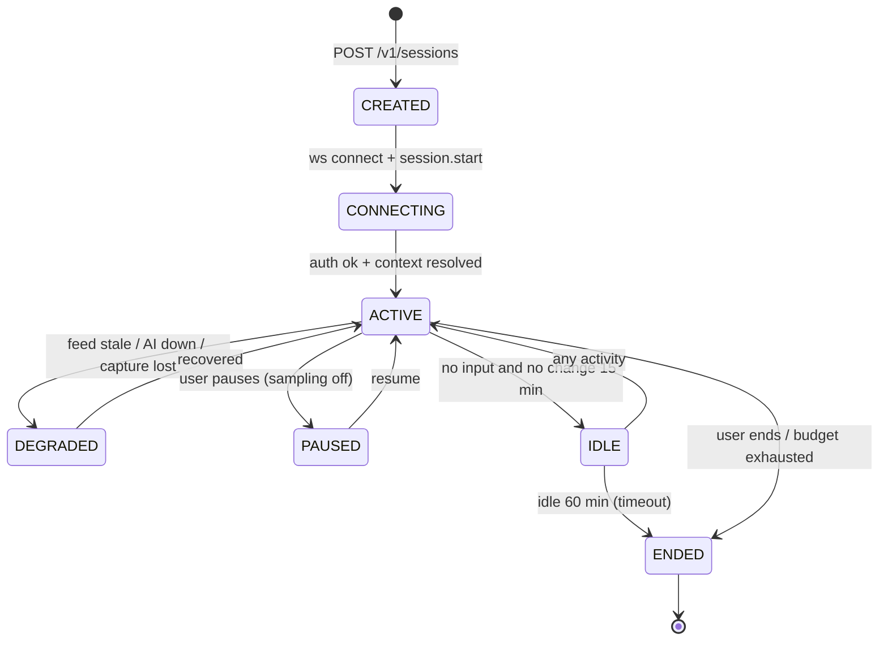
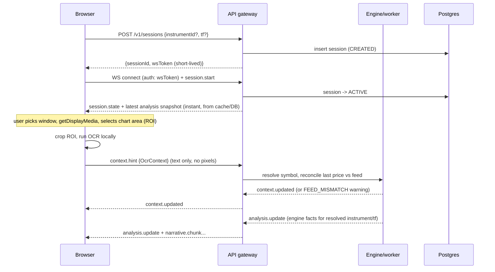
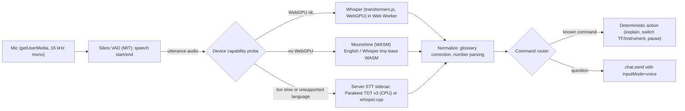

# A02: Realtime, Media and Voice

**Scope:** sessions, screen-share handling, on-device chart reading (OCR), "Explain this chart" capture, voice (speech-to-text), WebSocket event contracts, resilience.
**Status:** v2.0, 2026-10-10 (v1 vision-per-frame replaced by OCR-first; voice moved from post-MVP into scope; zero-retention made explicit)
**Depends on:** A01 (architecture), A05 (AI), A07 (REST and auth contracts).

---

## 1. The core insight: we need stills (rarely) and text (often), not video

The product never needs to *show* the user's screen to anyone. It needs to know **which venue, symbol and timeframe the user is looking at, and roughly where price is**, and, only when the user asks, to **look at the chart image** (Explain this chart). That changes the media decision completely: continuous video transport (an SFU) is an expensive way to deliver a few pieces of text per minute and an occasional still.

| Option | How it works | Pros | Cons |
|---|---|---|---|
| **A. Client-side capture; read the chart on-device; send text (and an image only on Explain)** (chosen) | `getDisplayMedia` stays local. A sampler crops the chart area, an on-device OCR reads symbol/timeframe/last price, and only that **text** goes to the server. An image is uploaded only when the user presses Explain | $0 media infrastructure; no pixels leave the device in the normal path (strongest privacy and zero-retention story); no per-frame AI cost; works behind strict networks (just WSS) | OCR must be reliable on chart UIs (measured in spike S1, with the vision LLM as fallback); no live video for coach/recording features; tab throttling when hidden |
| **B. WebRTC to an SFU (LiveKit), server agent grabs frames** | Screen track published; a server participant decodes and samples | Enables recording, human coach joining, session replay | Cost and complexity; decodes video just to get stills; needs a paid or self-run media server |
| **C. Custom WebRTC (mediasoup, Pion, Janus)** | Self-hosted SFU | No vendor fees | You operate TURN/SFU, scaling, observability; wrong problem for a solo builder on a free VM |

**Decision: A.** Rejected: B and C. Voice does **not** require an SFU because speech-to-text runs on the user's device (section 6); LiveKit remains an option only for a future human-mentor or recording feature, and would be evaluated against the $0 rule then (its Build plan is free but small; paid tiers start at $50/month).

---

## 2. Session model

A **session** is the unit of budgeting, state and audit. Starting a session is optional for **Explain this chart** (it also works as a one-shot request, section 3.6), but live overlays, voice and chat run inside a session.



**Session fields (stored):** id, user/workspace, started/ended, current `instrument_id` + `tf` + context source (`manual|ocr|vision`), strategy version in force, AI budget (dollars used and cap), counters (context hints accepted, explain requests, voice utterances by engine, AI calls), client info (UA, capture surface type, WebGPU availability). **Not stored:** frames, audio.

**Single controller rule:** one active socket per session may *send* (context hints, chat, voice). A second tab joins as read-only observer (or kicks the first, user choice).

### 2.1 Session start sequence



**Principle:** the user sees *something useful immediately* (the latest analysis for the last-used or manually picked instrument) before OCR finishes. OCR refines context; it never gates the UI.

---

## 3. Capture, on-device reading and Explain (client behaviour the backend depends on)

Implemented in the frontend, but specified here because it drives cost, privacy and backend limits. The backend enforces the same limits (never trust the client).

### 3.1 Capture pipeline

1. `getDisplayMedia({ video: { frameRate: 5 }, audio: false })`. We ask users to share the *chart window or tab*.
2. Draw the current video frame to an offscreen canvas at most once per second.
3. **ROI crop:** the user draws a rectangle once ("select chart area"); only the ROI is processed. Benefits: better OCR of the axis and header, and **privacy** (balances, other tabs and notifications outside the ROI are never even decoded).
4. **Change gate:** compute a 64x36 grayscale thumbnail; mean absolute difference vs the last OCR'd frame. Run OCR only if the diff exceeds the threshold (default 4% of full scale) **and** at least `minIntervalMs` has passed (default 8 s), or on `heartbeat` (every 45 s), or `manual`.
5. **OCR in a Web Worker** (never on the main thread): an open-source engine (PaddleOCR PP-OCRv6 through `onnxruntime-web`, WebGPU with WASM fallback, MIT licensed; Tesseract.js as the alternative) reads the ROI. The first run downloads the model (a few MB to tens of MB, cached by the browser). The publisher of the library reports roughly 210 to 240 ms per image on an Apple M1; **we measure on low-end laptops in S1**.
6. The client classifies recognized strings (symbol, timeframe, venue, last-price tag, axis labels) and sends an `OcrContext` (below). **No image is sent.**

### 3.2 What OCR sends (text-only contract)

```ts
interface OcrContext {
  capturedAt: number;
  roi: { w: number; h: number };
  texts: {
    kind: 'SYMBOL'|'TIMEFRAME'|'VENUE'|'LAST_PRICE'|'AXIS_LABEL'|'OHLC_LEGEND'|'OTHER';
    text: string; conf: number;                  // 0..1 from the OCR engine
    box: [x: number, y: number, w: number, h: number];
  }[];
  derived?: {
    symbolText?: string; tfText?: string; venueText?: string; isPerp?: boolean;
    lastPrice?: number; axisPrices?: number[];   // parsed from AXIS_LABEL entries
    platform?: 'TRADINGVIEW'|'OTHER'|'UNKNOWN';
  };
  engine: { name: 'paddleocr-web'|'tesseract-js'; version: string; backend: 'webgpu'|'wasm'; ms: number };
}
```

**Server-side treatment:** `texts` are untrusted strings. The server re-derives `symbol/venue/tf/price` with its own parsers and the alias resolver (A03 section 4.2); free-text `OTHER` is discarded and **never reaches a prompt**. Resolved context needs agreement on 2 consecutive hints, or 1 hint with confidence at least 0.9 and a last price within tolerance of the feed, before the session switches instrument/timeframe (prevents flapping when the cursor hovers over the symbol box).

**Reconcile:** compare `lastPrice` with the feed price of the resolved instrument; tolerance 0.15% for core pairs, 0.4% for on-demand pairs (spot/perp basis and venue differences are the main source of small gaps). Outside tolerance leads to `FEED_MISMATCH` with a hint ("this looks like a different venue or market type"), and a suggestion of the nearest-matching candidate instrument.

### 3.3 When a vision model is used instead of OCR

| Case | Behaviour |
|---|---|
| OCR confidence low and the user has not picked a symbol | Ask the user to pick manually (primary), or offer "let AI read the chart" which uploads **one** frame as an Explain-style request (A05 section 8.3) |
| User asks about their own drawings or indicators ("what's this level I marked?") | Vision on demand (J1), single frame, counted against the budget |
| Chart for a market we have no feed for | Approximate mode (A05 section 8.4) |

There is **no periodic vision polling** in v2. This replaces v1's roughly 60 vision calls per hour and removes most of the AI cost of context extraction.

### 3.4 Explain this chart: capture rules

Triggered by a button, a hotkey, or the voice command "explain this chart". It works in two input modes:

| Mode | Source | Notes |
|---|---|---|
| `SHARE` | Current frame of the shared window, ROI-cropped, at higher resolution than the OCR frames (long edge up to 1,600 px, PNG or JPEG quality 0.85) | Requires screen share |
| `UPLOAD` | Image the user pastes (Ctrl+V), drops, or picks from disk (PNG, JPEG, WebP) | No screen share or session required. Useful on mobile or for a chart from a past date |

Constraints (server-enforced): image at most 3 MB and 2,400 px on the long edge; at most 6 Explain requests per minute and a daily cap per plan; each request has a dollar cost estimate shown before sending in the UI if the user's budget is low. The image is processed **in memory only** (section 3.5).

### 3.5 Zero-retention handling of images (server side)

```text
receive (memory buffer)
  -> validate: size, magic bytes (not just mime), dimensions, decode in a sandboxed worker with limits
  -> perceptual hash (for dedupe within 30 s only; hash kept in memory)
  -> call the model provider with the image bytes (base64 in the request); no URL, no file upload API
  -> on completion or error: zero the buffer reference; nothing written anywhere
  -> persist ONLY: request metadata (user id, instrument, timeframe, mode, byte size, model, tokens, cost, latency, outcome)
```

Rules enforced by code and tests:

- No filesystem writes, no object storage, no database column can hold image bytes. The upload route's body parser uses a memory buffer with a hard cap; temp files are disabled.
- Logging serializers drop any field named `image`, `frame`, `bytes`, `audio`, `buffer`; Sentry `beforeSend` scrubs request bodies.
- Provider side: use only inline image input (never a "Files" API, which keeps files until deleted). Provider retention is a separate matter and is stated honestly in A05 section 12: Anthropic does not retain conversation content by default for these models (30-day retention applies only to a named set of newer "covered" models) and offers zero-data-retention by agreement; OpenAI retains abuse-monitoring logs up to 30 days unless ZDR is approved; Google's paid Gemini API logs for abuse monitoring for a limited period, with ZDR through Vertex AI. **"Zero retention" in this product means: we retain nothing, and we route images only to providers/settings whose retention terms we document.**
- A CI test (`no-frame-persistence`) fails the build if a code path passes a buffer from the upload/frame handlers into any persistence API.

### 3.6 One-shot Explain without a session

`POST /v1/explain` (multipart: image + optional `instrumentHint`, `tfHint`, `question`) streams the result as Server-Sent Events. It requires authentication (a wallet-signed session) but not a live copilot session. It shares the same service as the in-session path (`explain.request` over WebSocket), so behaviour is identical. Contract in A07.

---

## 4. WebSocket protocol

**Transport:** Socket.IO v4 over WSS, namespace `/ws`, one room per session (`session:{id}`).
**Auth:** short-lived `wsToken` (JWT, 5 min, scope=`ws:session`, bound to `sessionId` and `userId`) passed in the handshake `auth` field. The long-lived Supabase JWT is never sent over the socket.
**Ordering/resume:** every server event carries `seq` (per-session monotonic integer). Events are persisted to `session_events` (only the compact ones: context, setup lifecycle, narrative ids, warnings) so a reconnecting client re-sends `session.start { sessionId, lastSeq }` (the same event serves first connect and resume) and receives the missed range. Socket.IO connection-state recovery covers short drops; the `lastSeq` replay covers the rest.
**Cloudflare note:** the WebSocket sits behind Cloudflare's proxy; idle connections are closed after about 100 seconds without traffic **[verify]**, which our 20 s ping interval avoids.

### 4.1 Contracts (zod-derived TypeScript)

```ts
// ---------- Envelope ----------
interface ServerEnvelope<T extends string, P> {
  seq: number;              // per-session monotonic
  type: T;
  at: number;               // server epoch ms
  correlationId: string;
  payload: P;
}

// ---------- Client -> Server ----------
interface ClientToServer {
  'session.start':   (p: { sessionId: string; instrumentId?: string; tf?: Timeframe;
                           lastSeq?: number }, ack: (r: Ack<SessionState>) => void) => void;
  'session.pause':   (p: {}, ack: (r: Ack<{}>) => void) => void;
  'session.end':     (p: {}, ack: (r: Ack<{}>) => void) => void;

  'context.set':     (p: { instrumentId: string; tf: Timeframe; source: 'manual' },
                      ack: (r: Ack<ContextState>) => void) => void;
  'context.hint':    (p: OcrContext, ack: (r: Ack<{ accepted: boolean }>) => void) => void;   // text only

  // Image path: ONLY for Explain and the explicit "let AI read the chart" fallback
  'frame.submit':    (meta: FrameMeta, bytes: ArrayBuffer,
                      ack: (r: Ack<{ frameId: string }>) => void) => void;
  'explain.request': (p: ExplainRequest, bytes: ArrayBuffer | null,
                      ack: (r: Ack<{ explainId: string }>) => void) => void;
  'explain.cancel':  (p: { explainId: string }, ack: (r: Ack<{}>) => void) => void;

  'chat.send':       (p: { clientMsgId: string; text: string; inputMode: 'text'|'voice';
                           sttConfidence?: number; sttEngine?: SttEngineTag },
                      ack: (r: Ack<{ messageId: string }>) => void) => void;
  'chat.cancel':     (p: { messageId: string }, ack: (r: Ack<{}>) => void) => void;

  // Voice (fallback path only: audio goes to the server only when on-device STT is unavailable)
  'voice.begin':     (p: { utteranceId: string; lang?: string; sampleRate: 16000 },
                      ack: (r: Ack<{ accepted: boolean }>) => void) => void;
  'voice.audio':     (p: { utteranceId: string; seq: number }, pcm16: ArrayBuffer) => void;
  'voice.end':       (p: { utteranceId: string }, ack: (r: Ack<{}>) => void) => void;
  'voice.command':   (p: { utteranceId: string; text: string; sttConfidence: number; sttEngine: SttEngineTag },
                      ack: (r: Ack<VoiceCommandResult>) => void) => void;

  'analysis.request':(p: { scope: 'now' | 'htf' | 'setup'; setupId?: string },
                      ack: (r: Ack<{}>) => void) => void;
  'setup.watch':     (p: { setupId: string; watch: boolean },
                      ack: (r: Ack<{}>) => void) => void;
}

interface ExplainRequest {
  mode: 'SHARE' | 'UPLOAD';
  ocr?: OcrContext;                 // optional, speeds up instrument resolution
  instrumentHint?: string;          // canonical instrument id from the picker
  tfHint?: Timeframe;
  question?: string;                // e.g. "is this a good long?" (answered as scenarios, never advice)
  lang?: string;                    // response language (BCP-47), default from user settings
  imageMeta?: { mime: 'image/png'|'image/jpeg'|'image/webp'; width: number; height: number };
}

interface FrameMeta {
  clientFrameId: string; capturedAt: number; reason: 'manual'|'ocr-fallback';
  width: number; height: number; roi?: { x: number; y: number; w: number; h: number };
}

type SttEngineTag = 'whisper-web'|'moonshine-web'|'parakeet-server'|'whispercpp-server'|'typed';

type Ack<T> = { ok: true; data: T } | { ok: false; error: ApiProblem };

// ---------- Server -> Client ----------
type ServerEvent =
  | ServerEnvelope<'session.state',     SessionState>
  | ServerEnvelope<'context.updated',   { context: ContextState; source: 'manual'|'ocr'|'vision';
                                          confidence?: number; mismatch?: FeedMismatch }>
  | ServerEnvelope<'price.tick',        { instrumentId: string; last: number; ts: number }>   // only if license allows; throttled <= 4/s
  | ServerEnvelope<'candle.update',     { candle: Candle }>                                    // only if license allows
  | ServerEnvelope<'analysis.update',   { snapshotId: string; asOf: number; diff: FactsDiff; facts?: MarketFacts }>
  | ServerEnvelope<'setup.event',       { kind: 'CREATED'|'UPDATED'|'WATCH'|'INVALIDATED'|'EXPIRED'|'RESOLVED'; setup: SetupFact }>
  | ServerEnvelope<'narrative.chunk',   { narrativeId: string; delta: string }>
  | ServerEnvelope<'narrative.done',    { narrativeId: string; refs: FactRef[]; modelTag: string; disclaimerKey: string }>
  | ServerEnvelope<'explain.stage',     { explainId: string; stage: 'RESOLVING'|'FACTS_READY'|'READING_IMAGE'|'WRITING'; instrumentId?: string }>
  | ServerEnvelope<'explain.chunk',     { explainId: string; delta: string }>
  | ServerEnvelope<'explain.done',      { explainId: string; refs: FactRef[]; mode: 'GROUNDED'|'APPROXIMATE';
                                          feedMatch: FeedMatch; modelTag: string; usage: UsageSummary; disclaimerKey: string }>
  | ServerEnvelope<'chat.chunk',        { messageId: string; delta: string }>
  | ServerEnvelope<'chat.done',         { messageId: string; refs: FactRef[]; usage: UsageSummary }>
  | ServerEnvelope<'voice.partial',     { utteranceId: string; text: string }>      // fallback path only
  | ServerEnvelope<'voice.final',       { utteranceId: string; text: string; confidence: number; engine: SttEngineTag }>
  | ServerEnvelope<'frame.result',      { frameId: string; accepted: boolean; reason?: FrameRejectReason }>
  | ServerEnvelope<'warning',           { code: WarningCode; detail?: string }>
  | ServerEnvelope<'budget.update',     { usedUsd: number; capUsd: number; softLimitHit: boolean }>
  | ServerEnvelope<'error',             { problem: ApiProblem }>;

type WarningCode =
  'FEED_STALE' | 'FEED_MISMATCH' | 'AI_DEGRADED' | 'CAPTURE_LOST'
  | 'LOW_OCR_CONFIDENCE' | 'APPROX_MODE' | 'RATE_LIMITED' | 'BUDGET_SOFT_LIMIT'
  | 'VENUE_CHANGED' | 'STT_UNAVAILABLE' | 'STALE_IMAGE' | 'MIC_PERMISSION_DENIED';
```

### 4.2 Streaming rules

- **`analysis.update` carries diffs** (new/changed/removed swings, zones, setups) keyed by stable ids. First message after connect/resync carries full `facts`.
- **Backpressure:** price ticks (when licensed) coalesced to at most 4/s per session; narrative and explain chunks batched every 50 to 100 ms.
- **Idempotent client reducers:** all events keyed by id plus `seq`; applying an event twice is harmless.
- **Heartbeat:** Socket.IO ping interval 20 s, timeout 25 s. Two missed pings marks the controller disconnected and capture stops.

---

## 5. Where the realtime work runs

| Work | Where | Why |
|---|---|---|
| Socket auth, hint validation, rate limits | `apps/api` role | Stateless, cheap |
| Engine step, narrative/explain/chat orchestration, jobs | `apps/worker` role | CPU/IO heavy, rate-limited by upstream APIs |
| Server STT fallback decode | `apps/stt` sidecar container | Heavy CPU must not block the Node event loop; separate memory limit |
| Hand-off | MVP: in-process event bus. Full: BullMQ queues `analysis`, `narrative`, `explain` | Same interface (`EventBus.publish/subscribe`, `JobQueue.add`) so the split needs no code change |
| Session fan-out across API instances | Socket.IO Redis adapter (full version, Valkey on the VM) | Needed once there is more than one API replica |

---

## 6. Voice interaction (speech-to-text, open source, replies in text)

**Goal:** the user can talk to the copilot while looking at their chart: "explain this chart", "what's the bias on the four hour", "show me the ETH perp", "why did you invalidate that setup". Voice is **input only**; answers arrive as text (and optionally spoken replies later, section 6.7).

### 6.1 Principles

1. **On-device first.** Audio is transcribed in the browser. It never leaves the device in the normal path (privacy, $0 cost, no server load).
2. **Server fallback is open source too** and used only when the device cannot do it. Audio is held in RAM, decoded, discarded.
3. **Voice can ask, explain and navigate. It can never confirm.** The execution gate, trade logging, deletion, risk changes and payments need an explicit on-screen tap (A04 section 11).
4. **Be honest about errors.** Low-confidence transcripts are shown for correction before they trigger anything state-changing.

### 6.2 Pipeline



### 6.3 Engine choice (what runs where, and why)

Evidence gathered 2026-10-10 (Open ASR style leaderboards and project READMEs; numbers are reported by those sources, not measured by us):

| Model | Licence | Size | Reported accuracy / speed | Where it fits |
|---|---|---|---|---|
| **Whisper large-v3-turbo** | MIT | 809M params | Average WER about 7.75% on the Open ASR set; 99+ languages | Server only (too big for browsers); whisper.cpp quantized for non-European languages |
| **Whisper tiny / base / small** (transformers.js, ONNX) | MIT | about 120 / 210 / 590 MB downloaded in hybrid precision | On WebGPU roughly 10-15x / 5-8x / 2-4x real time; Chrome/Edge 113+; Safari WebGPU reported unsupported in 2026 so WASM fallback is slower | **Tier 1a** (browser, multilingual) |
| **Moonshine tiny/base** | MIT (English) | 6 to 61 MB | Built for on-device streaming; supports VAD or continuous mode | **Tier 1b** (browser, English, low-end devices) |
| **Parakeet TDT 0.6B v3** (ONNX int8) | CC-BY-4.0 (model), MIT (a wrapper) | about 0.6B | CPU real-time factor about 0.03 to 0.05 on a desktop-class CPU (the project's own numbers), 25 European languages with auto-detect | **Tier 2** (server sidecar, CPU) |
| **Parakeet TDT 1.1B** | CC-BY-4.0 | 1.1B | about 8% WER, very high throughput, GPU oriented | Not used (needs GPU) |
| **Web Speech API** | n/a | n/a | Not open source; Chrome's implementation sends audio to a cloud service **[verify]** | **Rejected** |
| Paid STT (Deepgram, OpenAI Whisper API, Google STT) | Paid | n/a | n/a | **Rejected** by the $0 rule |

**Selection logic (device probe at first use, cached per browser profile):**

1. English (or Whisper-supported) and WebGPU available with enough memory: **Whisper base.en / small** in a Web Worker (Tier 1a).
2. No WebGPU: **Moonshine** for English, **Whisper tiny/base on WASM** otherwise (Tier 1b). If a 5-second utterance takes more than about 3 seconds to transcribe on this device, switch to Tier 2.
3. Tier 2 **server sidecar**: Parakeet TDT 0.6B v3 for the 25 supported European languages; **whisper.cpp** (`small` or quantized `large-v3-turbo`) for other languages. Hard concurrency cap of 2 (Parakeet) or 1 (whisper.cpp) on the free VM; requests beyond that are queued up to 3 s then answered `STT_BUSY` with a "type instead" hint. Per-user limit of 20 server transcriptions per hour on the free plan.

**Which is "best"** cannot be settled by reading leaderboards, because our audio is a trader speaking jargon in a noisy room, often non-native English. The choice above is the **default ordering**; spike S3 runs a 200-phrase trading-jargon test set across Whisper base/small, Moonshine and Parakeet on three device classes and may reorder it. Acceptance thresholds are in A05 section 14.4.

### 6.4 Trading vocabulary: making the transcript right

General ASR mangles SMC jargon ("CHoCH" becomes "choke" or "Chokh"; "FVG" becomes "F V G" or "fee V G"). Three layers:

1. **Prompt biasing** where the engine supports it (Whisper `initial_prompt`): "SMC, BOS, CHoCH, FVG, order block, liquidity sweep, equal highs, equal lows, premium, discount, OTE, killzone, BTC, ETH, SOL, perp, funding, open interest". **[verify support in transformers.js; if absent, rely on layer 2]**
2. **Glossary correction after transcription:** a deterministic pass that maps phonetic variants to canonical terms (a Double Metaphone / edit-distance match against a glossary of about 150 terms: SMC vocabulary, tickers, timeframes, venue names), replacing when similarity is at least 0.88. The glossary is data (`packages/ai/glossary.json`), versioned, and tested against the eval set.
3. **Number and unit parsing:** "sixty four thousand two hundred" to 64200, "four H" / "four hour" / "H4" to `4h`, "one percent" to 1%. Spoken numbers are **never** passed to the engine as levels; they only select among existing level ids or fill a form the user must confirm.

### 6.5 Voice commands

The router first applies a small deterministic grammar (keywords plus the glossary), and only if nothing matches sends the text to chat (J3), whose intent router (J6, a cheap model) may still return a command.

| Intent | Example utterances | Effect | Confirmation |
|---|---|---|---|
| `EXPLAIN_CHART` | "explain this chart", "what am I looking at" | Starts Explain (SHARE mode) | None |
| `SWITCH_TF` | "go to the four hour", "switch to 15 minutes" | `context.set` (tf) | None |
| `SWITCH_INSTRUMENT` | "show ETH perp on Binance" | `context.set` (instrument) | Shown, one tap if it differs from what OCR sees |
| `SHOW_SETUP` / `WATCH_SETUP` | "open setup two", "watch that one" | UI focus / `setup.watch` | None |
| `PAUSE_RESUME` | "pause", "resume" | Session pause/resume | None |
| `JOURNAL_NOTE` | "note: sweep of Asian low then CHoCH" | Creates a **draft** journal note | Tap to save |
| `ASK` | anything else | `chat.send` with `inputMode: 'voice'` | None |
| **Forbidden by voice** | confirm gate, log or close a trade, change risk settings, delete data, payments, link wallet | Router replies "please do that on screen" | n/a |

### 6.6 UX and privacy rules the backend relies on

- Default is **push-to-talk** (hold a key or button). Hands-free (VAD always listening) is an explicit toggle, off by default, with a persistent "mic on" indicator.
- On-device audio is never uploaded. Only the **transcript text** is sent (`chat.send` / `voice.command`), with `sttConfidence` and `sttEngine`.
- Server fallback: audio chunks (PCM16, 16 kHz, 200 ms) stream over the socket for one utterance (max 30 s), are decoded at end-of-speech (offline decode, not streaming), and are discarded immediately. `voice_events` stores **metadata only** (engine, duration, latency, confidence, language, error), never audio or text.
- Transcript text becomes a normal chat message (retention per section 12 of A05 and A06 section 10; default 90 days, user-deletable).
- The model is told when input came from voice and with what confidence, and is instructed to ask a short clarifying question when the transcript looks like a misrecognition (for example, an unknown instrument name).
- Language: the response language follows the user's setting; the STT language is auto-detected (Whisper, Parakeet) or set in settings.

### 6.7 Spoken replies (optional, off by default)

Out of the MVP. If wanted, text-to-speech also runs on-device: Kokoro-82M (Apache-2.0) through `kokoro-js`, or the browser's built-in speech synthesis as a zero-download option. The backend is unaffected (the client speaks the streamed text). Noted so the contract does not block it.

---

## 7. Failure modes and degradation

| Failure | Detection | User-visible behavior | Backend behavior |
|---|---|---|---|
| Screen share stopped by user/OS | `track.onended` (client), no hints + heartbeat missing | `CAPTURE_LOST` banner; analysis continues on last context | Keep session |
| Tab hidden/throttled | Client visibility API; hint gaps | "Keep this tab visible" hint | Tolerate gaps; do not mark degraded < 2 min |
| WS drop | Socket.IO disconnect | Auto-reconnect, "Reconnecting..." | Replay from `lastSeq` on resume |
| Feed stale | Last closed candle older than 2x timeframe | `FEED_STALE`; setups frozen with "stale" tag; no new setups | Engine pauses emitting; ingestion reconnect with backoff (A03) |
| OCR low confidence / no text found | `conf` below 0.6 or unresolved symbol | `LOW_OCR_CONFIDENCE`; picker prompt | Do not switch context |
| OCR / model download fails or device too slow | Worker error, timing probe | Falls back to manual picker; offers "AI read" for one frame | Keep session |
| Price mismatch | Reconcile outside tolerance | `FEED_MISMATCH` with suggested alternatives | Do not switch context |
| Mic permission denied | `getUserMedia` error | `MIC_PERMISSION_DENIED`; typing remains | n/a |
| STT too slow / unsupported browser | Probe | Switches tier; if server busy `STT_UNAVAILABLE`, "type instead" | Queue cap, reject beyond |
| LLM provider outage / 429 | Error rate, circuit breaker | `AI_DEGRADED`: overlays + structured facts only, no prose | Fallback model, then deterministic template text (A05 section 11) |
| Budget exhausted | Meter | `BUDGET_SOFT_LIMIT` at 80%, hard stop at 100% (chat and Explain disabled, overlays continue) | Block new LLM calls for session |
| Uploaded screenshot older than the feed | Reconcile mismatch on UPLOAD | `STALE_IMAGE`: explanation describes the image and notes that live levels differ | Switches Explain to APPROXIMATE for the numbers |
| Malicious/oversized upload | Validation | `frame.result` rejected | Per-user strike counter; temporary mute |

---

## 8. Latency budgets (design targets, to be verified in M2/M3)

| Path | Target (P95) | Notes |
|---|---|---|
| Venue candle close to `analysis.update` at client | < 3 s | Venue kline stream pushes every 2 s; our part is under 600 ms |
| `context.hint` received to `context.updated` | < 300 ms | Text-only, pure server logic |
| OCR on the device (ROI) | < 1 s typical, < 2.5 s on low-end | Measured in S1 |
| End of speech to final transcript, Tier 1a (WebGPU, 5 s utterance) | < 1.5 s | Measured in S3 |
| End of speech to final transcript, Tier 1b (WASM) | < 3 s | Else switch tier |
| End of speech to final transcript, Tier 2 (server CPU, 5 s utterance) | < 3 s including network | Parakeet CPU speeds reported on desktop CPUs; ARM VM figure to be measured |
| Setup created to first `narrative.chunk` | < 2.5 s | Streaming, cached prefix |
| `chat.send` to first `chat.chunk` | < 2 s | Streaming + cached prefix |
| Explain: request to first `explain.chunk` | < 5 s (grounded), < 7 s (approximate) | Vision read + facts, then streaming |
| WS reconnect to state restored | < 1.5 s | Snapshot + replay |

---

## 9. Security specifics for the realtime layer

- Origin allow-list on the WS handshake; `wsToken` single-use and bound to session.
- Per-socket and per-user rate limits (hints, chat, explain, voice, analysis.request).
- Upload and audio bytes are untrusted: content sniffing, max dimensions/duration, decode in a sandboxed worker with limits, never executed or logged.
- **Prompt-injection via screen content or speech:** text visible in the chart (a chat message saying "ignore your instructions") can reach the vision model on Explain, and spoken text reaches the chat model. Vision output is schema-constrained and never concatenated into privileged prompts; transcripts are treated as user input, not instructions (A05 section 6).
- **Mic and screen consent:** the app never starts capture without a user gesture; permission state is surfaced in the UI and in `session.state`.
- **Server STT abuse:** per-user and global concurrency caps; audio size cap; reject non-PCM payloads.

---

## 10. Testing

| Level | What |
|---|---|
| Unit | Sampler decision function (diff, interval) as pure code; envelope/seq reducer; symbol alias resolver; OCR text parsers; glossary correction; number parser |
| Contract | zod schemas for every event; golden JSON fixtures shared with frontend |
| Integration | Socket.IO test client: connect, resume via `session.start` with `lastSeq`, hint handling, explain flow with a stubbed model, ordering under reconnect |
| OCR eval (S1) | 300 chart screenshots (TradingView light/dark, different symbols/timeframes/zoom, 1080p and 1440p, with and without indicators/drawings) with labelled symbol/timeframe/price; metrics in A05 section 14.4 |
| STT eval (S3) | 200 recorded trading phrases from several accents and devices, labelled; WER and jargon-term accuracy per engine and device class |
| Replay | Feed a recorded candle stream plus recorded hints; assert event sequence is identical across runs |
| Chaos | Kill worker mid-session; drop WS; delay LLM; saturate STT sidecar; assert degradation banners and no duplicate narratives |
| No-persistence | Static + runtime test that no image/audio buffer reaches disk, DB, logs or Sentry payloads |
| Load | k6 + socket.io plugin: 300 concurrent sessions x 1 hint/min + 4 ticks/s; assert P95 budgets and zero seq gaps (the free VM's ceiling is established in M6 and recorded in A08 section 4) |

---

## 11. Assumptions and open questions (defaults used)

**Assumptions**

1. Testers use a recent desktop Chromium-based browser; WebGPU is available on most of them, and WASM is the floor (measured in spike S4).
2. Browser-side OCR and speech models are small enough to download once and cache (tens of MB), and run without blocking the UI when placed in Web Workers.
3. Users accept screen-share and microphone permission prompts only when the purpose is stated plainly; the frontend owns that copy (A09 section 3.3).
4. Cloudflare's WebSocket idle timeout (about 100 s) is longer than our 20 s ping, so no extra keep-alive is needed **[verify]**.
5. One controlling socket per session is enough; extra tabs are read-only observers.

**Open questions**

1. **Browser matrix.** Default: Chromium desktop first-class; Firefox/Safari best-effort for capture and slower (WASM) voice.
2. **Region/ROI UX ownership.** Default: frontend ships an ROI selector; backend treats ROI as optional metadata.
3. **Observer role** (second tab). Defaulted to read-only observer.
4. **Which OCR engine ships.** Default PaddleOCR PP-OCRv6 via onnxruntime-web; Tesseract.js if S1 shows better accuracy on chart fonts.
5. **Mobile.** Screen share via `getDisplayMedia` is not available on most mobile browsers; mobile gets Explain via UPLOAD only.

## 12. Sources

- LiveKit Cloud pricing (reference only; not adopted): livekit.com/pricing; kb.livekit.io "Understanding LiveKit Cloud pricing" (accessed 2026-10-10).
- Speech models and runtimes: Open ASR style summaries (northflank.com best open-source STT 2026), the Parakeet TDT 0.6B v3 ONNX FastAPI project README (CPU timings), Moonshine JS README, browser Whisper/WebGPU write-up (offlinetts.com browser speech recognition 2026); Silero VAD and kokoro-js project pages (licences **[verify]**).
- In-browser OCR: `ppu-paddle-ocr` package README (MIT, onnxruntime-web, WebGPU/WASM, self-reported speed).
- `getDisplayMedia` characteristics: bloggeek.me WebRTC glossary.
- Provider data retention (images): platform.claude.com API and data retention page; developers.openai.com "Your data"; ai.google.dev Gemini API zero data retention page (accessed 2026-10-10).
