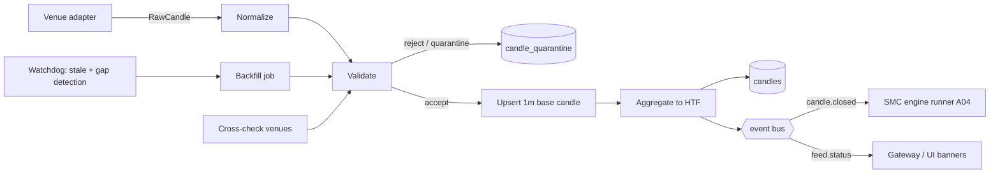

# A03: Market Data Layer

**Set:** A (full product) | **Status:** Planning document, v2.0, 2026-10-10 (rewritten crypto-first, $0 data)
**Depends on:** A01 (hybrid decision, contracts, cost policy). **Feeds:** A04 (engine consumes only what this layer emits), A06 (tables), A08 (cost), A09 (licensing risk).

> Limits and endpoints below were gathered from vendor documentation pages on 2026-10-10 where a fetch succeeded; where a page did not state a number, the figure is marked **[verify]** and comes from my prior knowledge of the API. Exchange terms and geo-restrictions change; the spike list at the end of this document (S2, S5) turns every **[verify]** into a recorded fact before launch.

---

## 1. Purpose and boundaries

This layer turns "an exchange says the price moved" into **closed, validated, gap-free candles** in Postgres and a stream of `candle.closed` events. It owns:

- venue adapters (one interface, many exchanges)
- normalization (symbols, timestamps, decimals)
- validation and data-quality scoring
- aggregation of base candles into higher timeframes
- gap detection and backfill
- stale-feed detection
- stream ownership across workers
- licensing enforcement (what may leave the server)

It does **not** compute any SMC concept (A04) and never calls an LLM (A05).

**Rule that protects everything downstream:** the engine only ever sees `closed = true` candles that passed validation. A forming candle is shown to the UI as a "live tick" (when licence allows) but never feeds structure logic (otherwise swings repaint, and backtests stop matching live behaviour).

**What the user's chart is, and is not.** The user's chart (TradingView or other) is **their** display of **their** chosen venue. We never use it as a data source; we use it as a *pointer* (which venue, symbol, timeframe, last price) and a *check* (does our feed agree with what they see).

---

## 2. Provider landscape (crypto-first, all free)

### 2.1 Comparison

| Venue | Markets we use | Access | Limits (as found) | Closed-candle signal | Notes and caveats | Role |
|---|---|---|---|---|---|---|
| **Binance** | Spot, USDⓈ-M perpetuals | Public, no key. Market-data-only hosts: `wss://data-stream.binance.vision:443`, `https://data-api.binance.vision` (spot). Standard: `wss://stream.binance.com:9443` / `:443`. Perps: `wss://fstream.binance.com`, `https://fapi.binance.com` **[verify]** | Kline stream pushes every 2,000 ms (1,000 ms for 1s). Connection valid 24 h; server pings every 20 s. 1,024 streams per connection and 5 incoming messages/s **[verify]**; about 6,000 request-weight/min/IP on spot REST **[verify]**; WS API page states 300 connection attempts per 5 minutes per IP | `k.x == true` | **Blocks US-located IPs (HTTP 451)**, so host outside the US. Largest liquidity | **PRIMARY** (analysis venue for MVP) |
| **Bybit** | Spot, USDT linear perps | Public v5: `wss://stream.bybit.com/v5/public/{spot,linear}`, REST `/v5/market/kline` | Do not exceed 500 connections per 5 minutes per domain; ping every 20 s; spot subscribe args max 10 per request | `confirm == true` | Restricts some jurisdictions; test from the chosen VM region | **CROSSCHECK** (perps), analysis venue later |
| **OKX** | Spot, USDT swaps | Public: `wss://ws.okx.com:8443/ws/v5/business` for candles **[verify host]**, REST `/api/v5/market/candles`, `/history-candles` | 3 connection requests/s per IP; sub/unsub/login 480 per connection per hour; connection closes after 30 s without traffic, so send `ping` (string) | `confirm == "1"` | Candle channel naming `candle1m` | **CROSSCHECK** (swaps) |
| **Coinbase** (Advanced Trade) | USD spot | Public WS `wss://advanced-trade-ws.coinbase.com`; public REST candles | 8 connections/s and 8 unauthenticated messages/s per IP | WS `candles` channel is **5-minute** granularity **[verify]**, so 1m comes from REST polling | USD quote differs from USDT pairs | **CROSSCHECK** (spot, polled) |
| **Kraken** | USD/EUR spot | Public WS v2 `wss://ws.kraken.com/v2` channel `ohlc`; REST `/0/public/OHLC` | Up to 720 candles per REST response **[verify]** | No flag: a new `interval_begin` closes the previous candle | Uses `XBT` for BTC in REST | **CROSSCHECK** (spot) |
| **Hyperliquid** (perp DEX) | Perps | Public info API + WS candles | Limits not confirmed **[verify]** | WS candle updates | Different user base; useful later | Later |
| **CCXT** (library, MIT) | 100+ exchanges | npm `ccxt`; WebSocket support ("CCXT Pro") is a free part of it | Inherits each exchange's limits | n/a | Used for **REST metadata and backfill** (markets, precision, pagination), not for the hot stream | Tooling |
| **data.binance.vision** | Binance bulk daily/monthly kline zips with SHA256 checksums | Static files | n/a | n/a | Repository licence is MIT; the **data's** commercial terms are not stated on the page, so treat as research/backtest only **[verify]** | Offline research |
| Free aggregators (CoinGecko Demo, CryptoCompare free) | Prices, OHLC | API key | Tight limits, delayed or coarse | n/a | Not suited to 1-minute real-time structure analysis | Rejected |

**Rejected: paid crypto aggregators (CoinAPI, Kaiko, CoinDesk Data).** They violate the $0 rule and are only worth it if exchange terms prove too restrictive (then budget the line explicitly).
**Rejected: scraping TradingView or exchange web charts.** Fragile, terms-of-service risk.
**Rejected: one venue only.** Every adapter implements the same interface; the cross-check venues exist so a bad Binance print cannot create a setup (rule V7).

### 2.2 Decision per stage

| Stage | Analysis venue(s) | Cross-check | Cost |
|---|---|---|---|
| **M0 to M2 (dev)** | Binance spot + Binance USDⓈ-M perp, 4 symbols | Bybit linear for BTC, ETH | $0 |
| **MVP / closed beta** | Binance spot + perp, 10 core symbols | Bybit linear + OKX swap (BTC, ETH, SOL) | $0 |
| **Public launch** | Add Bybit and OKX as **analysis** venues so users on those venues get matching wicks; Coinbase/Kraken for spot USD charts | Mutual | $0 |
| **Forex (later, section 2.4)** | Provider chosen after a licence quote or BYO feed | n/a | Not planned |

**Why venue matching matters for SMC.** Liquidity sweeps are wick-level events; the same BTC "low" differs by tens of dollars across venues and between spot and perp. We analyze the venue the user is actually charting, and tell them which venue the overlays are based on.

### 2.3 Licensing design rules (these are code requirements, not legal footnotes)

1. **Raw-data egress is gated by `license_class`.** For `INTERNAL_ONLY` instruments the API and WebSocket send only **derived** objects (zones, levels, scenarios, structure events). The A02 events `price.tick` and `candle.update`, and any REST candle endpoint (A07), are **suppressed**; the user's own chart already shows raw prices, so UX cost is nil. `DISPLAY_OK` instruments (terms reviewed and recorded) and `BYO_ONLY` data (the user's own feed, shown only to that user) may emit them.
2. **Default for every new venue is `INTERNAL_ONLY` until a `venue_terms` record exists** (url, retrieved date, short summary, reviewer decision). Spike S5 reviews Binance, Bybit, OKX, Coinbase and Kraken terms for a commercial app that shows derived signals and, optionally, candles; the outcome flips `license_class` by configuration, not by code. **[verify; this is the main licensing task for a public launch]**
3. **Entitlements.** Every instrument row carries `license_class`; the API refuses to serve an instrument to a workspace that is not entitled to it (A06, A07). In the crypto-first launch every workspace is entitled to every crypto instrument.
4. **Attribution.** If a venue requires an attribution string, `instruments.attribution` is returned with every payload that includes a price.
5. **BYO feed isolation.** Not used at launch. If forex later runs through a user's own broker token, it is stored encrypted (A08), used only for that user's sessions, and its candles are keyed by `workspace_id`.
6. **Audit.** `feed_usage` counts requests and symbols per venue per day so a terms question or a rate-limit incident can be investigated.

### 2.4 Forex later: the seam, and what would have to be true

Forex is deliberately **not** in the launch. The seam is preserved so adding it is a configuration and adapter task, not a rewrite:

- `instruments.asset_class` already allows `FX`; the `fx-stub` adapter in `packages/market-data` implements the interface and throws `NOT_ENABLED`.
- Calendars (A04 section 9) support closed-market handling and the 17:00 New York day rollover; they are present in the schema but unused for crypto.
- **Gate to enable:** a data source whose terms allow displaying derived analytics to the public, **or** a bring-your-own-feed design where each user's own broker token supplies data under their own licence.

| Candidate (for later) | Status | Condition |
|---|---|---|
| Twelve Data | Standard plans are for own use; external display needs a Business plan priced by quote | Written quote **[verify]** |
| OANDA v20 | API licence is internal-use-only; account required | Only as BYO feed with OANDA's confirmation |
| Massive (formerly Polygon.io) | Redistribution needs a Business/Enterprise contract | Quote |
| Dukascopy downloads | Personal/non-commercial | Offline backtests only |

None of these is needed for the crypto-first launch, and none costs anything until you decide to enable forex.

---

## 3. Provider adapter interface

One interface per venue, implemented in `packages/market-data/src/<venue>`. The worker depends only on the interface.

```ts
interface MarketDataProvider {
  readonly id: ProviderId;                     // 'binance' | 'bybit' | 'okx' | 'coinbase' | 'kraken' | 'replay' | 'fx-stub'
  readonly capabilities: {
    streamsClosedCandles: boolean;             // true: venue tells us when a candle closes
    nativeTimeframes: Timeframe[];             // what we can request directly
    maxHistoryBars: Record<Timeframe, number>;
    supportsTicks: boolean;
    licenseClass: LicenseClass;                // default INTERNAL_ONLY until venue_terms recorded
  };

  // Live
  subscribe(spec: SubscriptionSpec, sink: CandleSink): Promise<Subscription>;
  // Historical (backfill and warmup)
  fetchCandles(req: FetchRequest): AsyncIterable<RawCandle[]>;
  // Metadata (tick size, precision, status) used to build the instrument master
  fetchMarkets(): Promise<VenueMarket[]>;
  // Health
  health(): ProviderHealth;                    // connected, lastMessageAt, errorRate, rateLimitRemaining
}

interface SubscriptionSpec {
  venueSymbol: string;                         // as the venue names it, e.g. 'BTCUSDT', 'BTC-USDT-SWAP'
  marketType: 'SPOT' | 'PERP';
  tf: Timeframe;                               // base timeframe (normally '1m')
  includeForming: boolean;
}

interface RawCandle {                          // venue-shaped, untrusted
  venueSymbol: string; marketType: 'SPOT'|'PERP'; tf: Timeframe;
  openTimeMs: number; o: string|number; h: string|number; l: string|number; c: string|number;
  v?: string|number; closed?: boolean; receivedAtMs: number; raw?: unknown;
}

interface CandleSink {
  onRaw(c: RawCandle): void;                   // goes into the validation stage
  onStatus(s: 'CONNECTED'|'DISCONNECTED'|'RECONNECTING'|'RATE_LIMITED'|'GEO_BLOCKED'|'AUTH_ERROR', detail?: string): void;
}
```

**Adapter rules**

- Adapters never write to the database and never aggregate. They only translate, heartbeat and reconnect.
- Reconnect with capped exponential backoff and jitter (1s, 2s, 4s, ... 60s max). After reconnect, the adapter signals `RECONNECTED` and the gap-backfill job (section 6.2) runs.
- **Proactively rotate** connections before the venue's lifetime limit (Binance: 24 h): open the new connection, wait for its first message, then close the old one, so rotation creates no gap.
- `GEO_BLOCKED` (HTTP 451/403 on connect) is a distinct status that raises a high-severity alert, because it means the VM's IP range is blocked and fixing it means moving region, not retrying.
- A `replay` adapter reads a stored dataset and emits candles at configurable speed. It is how the backtester, CI and demo mode run through the *same* pipeline as live data.
- No venue credentials are needed (public data only). The adapter code has no code path that can place an order.

### 3.1 Message-level specifications (what each adapter must handle)

These are the shapes the adapters parse. They are the contract for the fixtures in section 12.

**Binance (spot and perp), combined stream**

```text
URL    wss://data-stream.binance.vision:443/stream?streams=btcusdt@kline_1m/ethusdt@kline_1m
SUB    (dynamic)  {"method":"SUBSCRIBE","params":["solusdt@kline_1m"],"id":7}
MSG    {"stream":"btcusdt@kline_1m","data":{"e":"kline","E":1760000000123,"s":"BTCUSDT",
         "k":{"t":1760000000000,"T":1760000059999,"s":"BTCUSDT","i":"1m","f":1,"L":2,
              "o":"64000.10","c":"64010.00","h":"64020.50","l":"63990.00","v":"12.345",
              "n":321,"x":false,"q":"790000.1","V":"6.1","Q":"390000.2","B":"0"}}}
CLOSED k.x == true   (the last update for that open time, T is close time)
REST   GET /api/v3/klines?symbol=BTCUSDT&interval=1m&startTime=..&endTime=..&limit=1000
       -> [[openTime,"o","h","l","c","vol",closeTime,"quoteVol",trades,"takerBase","takerQuote","0"], ...]
PERP   same shapes on fstream.binance.com / fapi.binance.com (limit up to 1500 per request) [verify]
```

**Bybit v5**

```text
URL    wss://stream.bybit.com/v5/public/linear
SUB    {"op":"subscribe","args":["kline.1.BTCUSDT"]}      PING {"op":"ping"} every 20 s
MSG    {"topic":"kline.1.BTCUSDT","type":"snapshot","ts":1760000000123,
        "data":[{"start":1760000000000,"end":1760000059999,"interval":"1","open":"64000.1",
                 "close":"64010","high":"64020.5","low":"63990","volume":"12.3",
                 "turnover":"790000","confirm":false,"timestamp":1760000000120}]}
CLOSED data[i].confirm == true
REST   GET /v5/market/kline?category=linear&symbol=BTCUSDT&interval=1&start=..&limit=1000
       -> result.list = [[startTime,o,h,l,c,volume,turnover], ...]  (NEWEST FIRST: reverse it)
```

**OKX**

```text
URL    wss://ws.okx.com:8443/ws/v5/business
SUB    {"op":"subscribe","args":[{"channel":"candle1m","instId":"BTC-USDT-SWAP"}]}
PING   the literal string "ping" (reply "pong") if 25 s pass without traffic
MSG    {"arg":{"channel":"candle1m","instId":"BTC-USDT-SWAP"},
        "data":[["1760000000000","64000.1","64020.5","63990","64010","123","1.2","790000","0"]]}
        fields: ts,o,h,l,c,vol,volCcy,volCcyQuote,confirm
CLOSED confirm == "1"
REST   GET /api/v5/market/candles?instId=..&bar=1m&limit=300    (recent)
       GET /api/v5/market/history-candles?instId=..&bar=1m&after=<ts>  (older)  NEWEST FIRST
```

**Kraken v2**

```text
URL    wss://ws.kraken.com/v2
SUB    {"method":"subscribe","params":{"channel":"ohlc","symbol":["BTC/USD"],"interval":1}}
MSG    {"channel":"ohlc","type":"update","data":[{"symbol":"BTC/USD","open":64000.1,"high":64020.5,
        "low":63990,"close":64010,"volume":12.3,"trades":321,"interval_begin":"2026-10-10T12:00:00.000000Z","interval":1}]}
CLOSED when a message arrives with a NEWER interval_begin; the previous candle's last values are final
REST   GET /0/public/OHLC?pair=XBTUSD&interval=1&since=<unix s>   (pair names differ from WS)
```

**Coinbase (1m via REST polling)**

```text
REST   GET https://api.coinbase.com/api/v3/brokerage/market/products/BTC-USD/candles
          ?start=<unix s>&end=<unix s>&granularity=ONE_MINUTE        (public market endpoint [verify])
Poll   every 5 s after the minute boundary, only for CROSSCHECK symbols; WS 'candles' is 5-minute only [verify]
```

**Normalization notes that bite in practice**

| Topic | Rule |
|---|---|
| Ordering | Bybit and OKX REST return newest first; Binance returns oldest first. The adapter always emits oldest first |
| Open vs close time | Everything is converted to **open time, epoch ms UTC**. Binance `t`, Bybit `start`, OKX `ts`, Kraken `interval_begin` are all open times |
| Strings | All prices arrive as strings or numbers; parse once with a decimal-safe routine, store `numeric(20,8)` |
| Volume | Binance `v` is base-asset volume; Bybit `volume` base; OKX `vol` is contracts for swaps and `volCcy` is base **[verify per instrument]**. Store `volume_base` and `volume_quote` where available; the engine uses volume only as a soft feature |
| Perp vs spot | Different instruments (`marketType`). Never mixed in one candle series |
| Contract rollover | Perpetuals do not roll; quarterly futures are out of scope |

---

## 4. Instruments and symbol normalization

### 4.1 Instrument master

An **instrument is a (venue, market type, symbol)**: `BINANCE:SPOT:BTCUSDT` and `BINANCE:PERP:BTCUSDT` are different series.

```ts
interface Instrument {
  id: InstrumentId;                  // uuid
  venue: 'BINANCE'|'BYBIT'|'OKX'|'COINBASE'|'KRAKEN'|'FX_STUB';
  marketType: 'SPOT'|'PERP';
  canonical: string;                 // 'BINANCE:PERP:BTCUSDT'
  display: string;                   // 'BTC/USDT Perpetual'
  assetClass: 'CRYPTO'|'FX';         // FX is a seam
  base: string; quote: string;
  pricePrecision: number;            // decimals for display and rounding
  tickSize: number;                  // for equal highs/lows tolerance and stops
  lotSize?: number;
  calendarId: string;                // 'CRYPTO_24_7' for all launch instruments
  dayRollover: { tz: 'UTC'; hour: 0 };  // crypto daily candle opens 00:00 UTC
  licenseClass: LicenseClass;
  attribution?: string;
  active: boolean;
}
interface InstrumentAlias {          // many-to-one
  instrumentId: InstrumentId;
  providerId: ProviderId;
  venueSymbol: string;               // 'BTCUSDT', 'BTC-USDT-SWAP', 'XBT/USD'
  priority: number;                  // lower = preferred
  role: 'PRIMARY'|'FALLBACK'|'CROSSCHECK';
}
```

Instrument metadata (tick size, precision) is loaded from each venue's `exchangeInfo`/instruments endpoint at boot and refreshed daily; a changed tick size writes a new `instrument_versions` row rather than editing history.

### 4.2 Alias resolution for OCR, vision and manual input

The same resolver serves the OCR extractor (A02, A05), the vision fallback and the manual picker. It must understand how charting apps label symbols.

| What the chart shows | Resolves to |
|---|---|
| `BINANCE:BTCUSDT`, `BTCUSDT`, header "Bitcoin / TetherUS · 15 · Binance" | `BINANCE:SPOT:BTCUSDT` |
| `BINANCE:BTCUSDT.P`, `BTCUSDT.P`, "Perpetual Contract" | `BINANCE:PERP:BTCUSDT` |
| `BYBIT:BTCUSDT.P` | `BYBIT:PERP:BTCUSDT` |
| `OKX:BTCUSDT.P`, `BTC-USDT-SWAP` | `OKX:PERP:BTCUSDT` |
| `COINBASE:BTCUSD`, `BTC-USD` | `COINBASE:SPOT:BTCUSD` |
| `KRAKEN:XBTUSD` | `KRAKEN:SPOT:BTCUSD` |
| `BTCUSD` with no venue | Ambiguous: candidate list; the UI asks once and remembers per session |

The resolver normalizes (uppercase, strip separators, strip `.P`/`PERP`, map `XBT` to `BTC`), then scores candidates by (a) explicit venue text, (b) perp marker, (c) quote asset, (d) last-price proximity to each candidate's live price (a strong disambiguator, since spot/perp and USD/USDT differ by only 0.01 to 0.3% while different assets differ completely).

### 4.3 Calendars and sessions

All launch instruments use calendar `CRYPTO_24_7`: no market-closed state, no holidays. SMC time context uses fixed **UTC session windows** (Asia, London, New York with killzones, A04 section 9) that apply to crypto as well, because crypto liquidity follows the same global desks. `market_calendars` stays in the schema for the forex seam (closed hours, holidays, 17:00 New York rollover).

### 4.4 Universe and on-demand symbols

| Tier | Definition | Subscription | Default size |
|---|---|---|---|
| **Core** | Most liquid USDT pairs on the primary venue (spot and perp), configured in `universe.core` | Always on, state kept warm, outcome resolver runs | 10 at MVP, 20 at launch |
| **On-demand** | Any other supported USDT pair a user charts | Subscribed while a session uses it plus 5 minutes; history seeded on first use | Capped at 30 concurrent at MVP |
| **Unsupported** | Venue/pair we do not connect | None. The copilot runs in approximate mode with a clear banner (A05 section 8.4) | n/a |

Capacity: one Binance connection carries up to 1,024 streams **[verify]**, so 50 symbols x (spot + perp) x 1m is 100 streams on a single connection. The real bound is VM memory for engine state (about 100 to 300 KB per instrument-timeframe, an estimate to validate in M2), not the feed.

---

## 5. Ingest pipeline



### 5.1 Normalize

- Timestamps to **epoch ms UTC of the candle open** (section 3.1).
- Decimals parsed from strings to numbers (prices rounded to `pricePrecision + 2`; stored as `numeric(20,8)`).
- Volume: crypto has real volume. Store `v` and `volume_kind` (`REAL`, `TICK`, `NONE`); `REAL` for all launch venues.
- Symbol mapped via `InstrumentAlias` to `instrumentId`. Unmapped symbols are dropped and counted.

### 5.2 Validate (hard rules reject, soft rules flag)

| # | Rule | Type | On failure |
|---|---|---|---|
| V1 | `l <= min(o,c) <= max(o,c) <= h` | Hard | Quarantine, reason `BAD_OHLC` |
| V2 | All prices finite and > 0 | Hard | Quarantine `NON_POSITIVE` |
| V3 | `openTime` aligned to the timeframe boundary (UTC) | Hard | Quarantine `MISALIGNED` |
| V4 | `openTime` not in the future (allow 2 s clock skew) | Hard | Quarantine `FUTURE_TS` |
| V5 | Not a duplicate with *different* values after the candle is closed | Hard | Keep first, log `CONFLICTING_DUPLICATE`, raise alert |
| V6 | Range sanity: `(h - l) / c` below the cap (default 15% for 1m on core pairs, 30% on on-demand pairs) | Soft | Accept, flag `SPIKE_SUSPECT`, exclude from sweep detection until cross-check agrees |
| V7 | Close vs cross-check venue (same market type) within tolerance (0.15% core pairs, 0.4% on-demand) | Soft | Accept, flag `CROSSCHECK_DIVERGENCE` |
| V8 | Zero-range candles on liquid pairs | Soft | Flag `FLAT_CANDLE` (stale-feed signal) |
| V9 | Sequence: open of candle n within tolerance of close of candle n-1 (crypto is continuous) | Soft | Flag `GAP_PRICE` |

Flags are stored in `candles.flags` (bitmask). The engine reads flags: `SPIKE_SUSPECT` candles can contribute to structure but **cannot** be the sole basis of a liquidity-sweep event (A04). This keeps a bad print (a single-venue flash wick, common on thin pairs) from fabricating a setup. Because several venues are free, V7 is available for every core pair at no cost.

### 5.3 Aggregation to higher timeframes

**Decision: ingest 1-minute base candles (stream) and build 5m, 15m, 30m, 1h, 4h, 1d ourselves.**

| Option | Pros | Cons | Verdict |
|---|---|---|---|
| Subscribe to each timeframe natively | No aggregation code | Multiplies streams; boundaries can differ between venues; a venue switch would not match history | Rejected |
| **Aggregate from 1m ourselves** | One stream per symbol; boundaries are *ours* and identical across venues | Needs complete 1m data; gap handling matters | **Chosen** |
| Query HTF via REST on each close | Simple | Rate-limit heavy, higher latency | Used only for the nightly reconciliation |

Rules:

- An HTF candle closes when its last constituent 1m candle closes **and** all constituents are present. If a constituent is missing, the HTF candle is held `PENDING` until backfill resolves it or a timeout (default 90 s) marks it `INCOMPLETE`, which the engine treats as a data-quality warning, not as truth.
- Boundaries: 4h candles open at 00, 04, 08, 12, 16, 20 UTC; 1d at 00:00 UTC; the weekly open is Monday 00:00 UTC (used as a context level, not a base timeframe).
- Aggregation is a pure function in `packages/market-data` (`aggregate(c1m[], tf) -> Candle`), unit-tested against each venue's native HTF candles.
- **Nightly reconciliation:** fetch the venue's native 1h/4h/1d candles for the last 7 days and diff against ours. Differences above tolerance open a data-quality incident (`dq_incidents`) visible in the admin dashboard.

### 5.4 Cross-check source

For core symbols a second venue adapter runs in `CROSSCHECK` role at 1m resolution (same market type: Binance perp vs Bybit linear vs OKX swap; Binance spot vs Coinbase/Kraken spot where quote assets allow). It never writes `candles`; it feeds V7. If the primary fails, a cross-check venue can be promoted to primary **for context only**; analysis is flagged "venue changed" because wick-level structure may differ (section 6.3).

---

## 6. Resilience

### 6.1 Stale-feed detection (watchdog)

Per `(instrument)` the watchdog tracks `lastMessageAt` and `lastClosedCandleAt`.

| Condition | Threshold (default) | Action |
|---|---|---|
| No message on a liquid core pair | 15 s | Status `DEGRADED`, start parallel REST poll of the latest 1m candle |
| No closed candle by close time + 20 s | per timeframe | `STALE`, publish `feed.status`, UI shows "Analysis paused: data delayed" |
| Venue connection down | immediate | Reconnect loop; switch to fallback venue after 60 s (for context only) |
| Repeated `FLAT_CANDLE` on a liquid pair | 3 in a row | Treat as stale |
| `GEO_BLOCKED` | immediate | Page the operator; this is an IP-range problem |

**Fail-safe:** while an instrument is `STALE` or `DEGRADED`, the engine still processes arriving candles but **no new setup alerts or trade plans are published**; the copilot shows the last known overlays greyed with "as of" time. Stale data never produces fresh advice (A01 section 8).

### 6.2 Gap detection and backfill

- On every accepted 1m candle, compare with the previous stored candle: if `openTime - prev.openTime > 1 minute`, record a gap `(instrument, from, to)` in `candle_gaps` (crypto has no closed hours, so every missing minute is a gap).
- On reconnect or startup, enqueue `backfill` for `[lastStoredClose, now]`.
- Backfill job: `fetchCandles` from the primary (Binance returns up to 1,000 candles per call at request weight 2 **[verify]**, so a year of 1m for one symbol is about 526 calls), then fallback venue if the primary lacks data (flagged as a different venue); results go through the same validator and upsert (idempotent on the primary key), then re-aggregate affected HTF candles, then emit `candle.backfilled` so the engine **recomputes from the earliest affected candle** (A04 section 12).
- Backfill respects the venue rate limiter (section 8.2); a priority lane protects live fetches.

### 6.3 Venue failover

- Each instrument has ordered aliases (`PRIMARY`, `FALLBACK`). Switching is automatic after the failure threshold and **sticky for at least 15 minutes** to avoid flapping.
- `candles.provider_id` is stored per row. The engine config records a "data basis" (`providerId` at the time) in `setups`, so a later analysis can tell which feed produced a setup. A cross-venue switch raises a `VENUE_CHANGED` warning to the user because wicks differ across venues.

---

## 7. Warmup (history on session start)

When a session opens on an instrument, the engine needs history to be meaningful (swing structure needs hundreds of bars on each timeframe).

| TF | Warm-up bars | Source |
|---|---|---|
| 1m | 1,500 | DB, then venue REST if missing |
| 5m / 15m | 1,000 | DB |
| 1h | 800 | DB |
| 4h | 500 | DB |
| 1d | 400 | DB |

- Engine state per `(instrument, strategyVersion)` is **persisted as a snapshot** (`engine_snapshots`, A06) at each HTF close. Session start loads the latest snapshot and replays only candles after it. Fresh instruments replay from the warm-up window.
- First-time subscription of a new instrument triggers a `history.seed` job: fetch the warm-up window from the venue (free; costs a few dozen requests), then start the live stream.
- Hard caps on history requested per user action and per day protect venue rate limits (section 8.2).

---

## 8. Ownership, scaling and quotas

### 8.1 Who owns which stream

One stream per `(venue, instrument)` exists **once globally**, not per user or per web instance. Sessions on the same symbol share the same candles.

| Phase | Mechanism |
|---|---|
| MVP (one process) | In-process `StreamRegistry`; reference counting by active sessions. A stream starts when the first session subscribes and stops 5 minutes after the last leaves |
| Full (several workers) | **Leases** in Postgres (`stream_leases` row with `owner_id`, `expires_at`, renewed every 10 s using `UPDATE ... WHERE expires_at < now() OR owner_id = $me`) or Redis `SET NX PX`. Lease expiry hands the stream to another worker; the new owner runs backfill |

Always-on **core** instruments stay subscribed 24/7 so the engine keeps state warm and the outcome resolver (A04 section 13) can close scenarios when nobody is watching. Because the exchange feeds are free, core size is limited by VM memory and engine CPU, not by cost.

### 8.2 Venue quota manager

A token bucket per venue (in-memory at MVP, Redis in full) shared by live, backfill and seed jobs.

| Lane | Priority | Notes |
|---|---|---|
| Live REST fallback poll | 1 | Never starved |
| Gap backfill | 2 | Bounded batch size |
| Warmup seed | 3 | Spread out |
| Nightly reconcile | 4 | Runs in the quiet window (daily 03:00 UTC) |

Venue weights are configured next to each adapter (for example Binance klines weight 2 **[verify]**). A `rate_limit_remaining` gauge alerts at 20% and triggers **load-shed mode** at 10% (drop on-demand symbols, keep core).

### 8.3 Fan-out to sessions

`candle.closed` is published once on the event bus; the gateway looks up which sessions watch that instrument and the engine runner emits per-session overlays (A04, A07). Sessions never connect to exchanges.

---

## 9. Events and queues

| Event | Producer | Consumers | Idempotency key |
|---|---|---|---|
| `candle.closed` | Aggregator | Engine runner, outcome resolver, cache | `(instrument, tf, openTime)` |
| `candle.backfilled` | Backfill job | Engine runner (recompute), reconcile | `(instrument, tf, from, to)` |
| `feed.status` | Watchdog / adapters | Gateway, admin, engine (gates alerts) | `(instrument, status, since)` |
| `dq.incident` | Validator / reconcile | Admin, alerting | `(instrument, rule, window)` |

| Queue (pg-boss at MVP, BullMQ later) | Job | Concurrency |
|---|---|---|
| `md.backfill` | Gap fill | 2 per venue |
| `md.seed` | Warmup history | 1 per venue |
| `md.reconcile` | Nightly HTF diff | 1 |
| `md.retention` | Partition drop / archive | 1 |

The live path (adapter to event) is **in memory and synchronous per instrument** to protect latency; the database write happens in the same handler before the event is emitted (write-then-publish), so a consumer reading the DB after the event always sees the candle.

---

## 10. Storage, retention and volume

Tables are defined in A06 (`venues`, `venue_terms`, `candles`, `candle_quarantine`, `candle_gaps`, `dq_incidents`, `instruments`, `instrument_aliases`, `market_calendars`, `stream_leases`, `feed_usage`). Operational numbers (my estimates, about 110 bytes per row including index):

| Item | Estimate |
|---|---|
| 20 instruments x 1m x 1 year | about 10.5M rows, about 1.2 GB |
| 20 instruments x HTF (5m to 1d) x 1 year | about 3.0M rows, about 0.33 GB |
| MVP: 10 core instruments (spot + perp = 20 series) x 1m x 1 year | about 10.5M rows, about 1.2 GB (fits in Supabase Pro's 8 GB; does **not** fit the 500 MB Free plan once a full year is loaded, so on Free load 30 to 60 days) |
| Retention policy | 1m: 180 days hot (about 0.6 GB for 20 series), older 1m exported to compressed files in Cloudflare R2 free storage on demand; HTF: forever |

Writes: about 20 to 40 inserts per minute plus HTF roll-ups, trivial for Postgres. Batch the quarantine and flag writes.

---

## 11. Latency budget (candle close to engine input)

| Step | Budget | Notes |
|---|---|---|
| Venue emits closed 1m candle | up to about 2 s after the minute (Binance kline stream updates every 2 s) | Outside our control |
| Normalize + validate | under 2 ms | In memory |
| DB upsert | 5 to 20 ms (same-region Supabase pooler) | Single-row, indexed PK |
| Aggregate HTF + event publish | under 10 ms | |
| **Total our contribution** | **under 50 ms p95** | Alert if p95 over 150 ms |

Because the Binance kline stream updates every 2 s, a candle's `x=true` message can arrive up to about 2 s after the minute boundary; the "20 s after close" stale threshold has ample margin. End-to-end (candle close to overlay in the browser) is budgeted in A04 section 14 and A02 section 8.

---

## 12. Testing

| Test | Method |
|---|---|
| **Recorded fixtures** | Spike S2 records 24 h of raw frames from each venue (all message types, pings, reconnects) into `packages/testing/fixtures/<venue>/`; adapters are tested by replaying the raw frames through a fake socket and asserting the emitted `RawCandle`s match a hand-checked table |
| Aggregation correctness | Property tests: random 1m streams aggregate to HTF candles whose OHLCV match a reference implementation; fixed boundary fixtures (00:00 UTC, 4h edges) |
| Validator | Table-driven cases for V1 to V9 including venue-specific malformed payloads |
| Gap and backfill | Replay adapter with deliberately dropped minutes; assert detection, backfill, and that engine output after backfill equals output from a gap-free run |
| Failover | Chaos test: kill primary socket mid-session; assert status transitions, sticky window and no duplicate candles |
| Rotation | Simulate the 24 h connection lifetime; assert no missing minute across rotation |
| Idempotency | Feed the same dataset twice; row count and hashes unchanged |
| Licence guard | Contract test: no API route or WS event returns raw OHLCV for an instrument whose `license_class` forbids it |
| Reconciliation | Run against a recorded week of venue HTF candles; assert differences stay within tolerance |
| Soak | 24 h replay at 60x with 20 instruments; memory flat, no leaked subscriptions |

---

## 13. Cost summary for this layer (monthly, USD)

| Stage | Cost | Notes |
|---|---|---|
| Dev / MVP / beta | **$0** | Public exchange endpoints, no keys |
| Public crypto launch | **$0**, subject to the S5 terms review | If a venue's terms forbid commercial display, fall back to derived-only egress (already the default) or drop that venue |
| Forex (later) | Not budgeted | Enabling forex is a separate decision with a vendor quote (section 2.4) |

The v1 plan carried a forex licence as "the largest uncertainty in the whole plan". Under crypto-first it is removed from the launch budget entirely.

---

## 14. Assumptions

1. 1-minute base timeframe is enough for the SMC use case (lowest chart timeframe supported is 1m; sub-minute is out of scope).
2. Core universe of 10 symbols at MVP and 20 at launch, each as spot and perp where available.
3. Cross-check venues are only run for core symbols.
4. Derived-only egress (no raw OHLCV to the browser) is acceptable to the product until the S5 terms review allows more.
5. The VM is located in a region that none of the five venues blocks (verified in S2 before choosing the Oracle home region, which cannot be changed later).

## 15. Open questions (defaults used)

1. **Analysis venue at launch:** default Binance spot + perp. If your early users chart mostly on Bybit or OKX, promote those to analysis venues in M6.
2. **Do you want a candle chart inside the Copilot panel?** Default: no (overlays and level lists only; the user has their own chart). If yes, S5 must first confirm `DISPLAY_OK` for the venues shown.
3. **Terms review (S5):** record Binance, Bybit, OKX, Coinbase and Kraken terms for commercial apps showing derived signals. Email the exchanges' API support if the terms are ambiguous.
4. **Retention of 1m beyond 180 days:** default is export to R2 on demand; confirm whether any backtest needs more.

## Sources

- Binance market-data-only endpoints (`data-api.binance.vision`, `data-stream.binance.vision`): developers.binance.com/en/docs/products/spot/faqs/market_data_only
- Binance Spot WebSocket Market Streams (endpoints, kline payload, update speed): developers.binance.com/docs/binance-spot-api-docs/web-socket-streams
- Binance WebSocket API general information (300 connection attempts per 5 minutes per IP, 24 h validity, 20 s pings): developers.binance.com/docs/binance-spot-api-docs/websocket-api/general-api-information
- Binance public bulk data repository (MIT repository licence, kline intervals, checksums): github.com/binance/binance-public-data
- Bybit v5 WebSocket connect (endpoints, 500 connections per 5 minutes, 20 s ping, 10 args per spot subscription): bybit-exchange.github.io/docs/v5/ws/connect
- OKX WebSocket overview (3 connection requests/s, 480 requests per connection per hour, 30 s idle rule): okx.com/docs-v5
- Coinbase Advanced Trade WebSocket rate limits (8/s per IP): docs.cdp.coinbase.com/coinbase-app/advanced-trade-apis/websocket/websocket-rate-limits
- CCXT Pro described as a free part of CCXT: docs.ccxt.com/docs/pro
- Reports that Binance blocks US-located servers (HTTP 451): community threads on Linode, Railway, Vercel and OutSystems forums
- Twelve Data, Massive, OANDA, Dukascopy: carried over from v1 research, relevant only to the later forex seam **[verify at enablement]**
