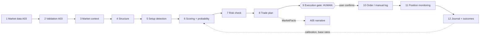
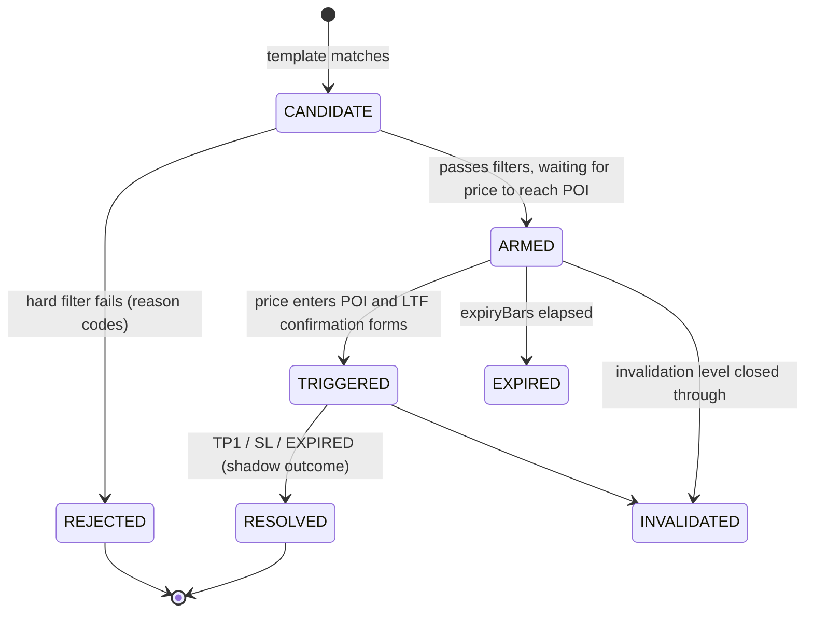

# A04: SMC Engine and Decision Pipeline

**Set:** A (full product) | **Status:** Planning document, v2.0, 2026-10-10 (crypto-first: 24/7 calendar, UTC sessions, perp-aware risk; engine logic is asset-agnostic and unchanged in substance)
**Depends on:** A01 (contracts, principles), A03 (closed, validated candles). **Feeds:** A05 (`MarketFacts` is the only market input to the AI), A06 (tables), A07 (API/events), A09 (risk and regulation).

> Honest framing first. SMC concepts (order blocks, FVG, liquidity sweeps, CHoCH) are *discretionary* trading ideas. There is no peer-reviewed proof that they produce a durable edge. This engine makes them **precise, reproducible and measurable**; it does not make them predictive. Every rule below ships as a **hypothesis** with an explicit status (section 8.5) and is judged by measured outcomes, never by belief. The product's promise is "consistent, explainable analysis with honest base rates", not "accurate forecasts".

---

## 1. Pipeline map and stage contracts

The 12 stages from the brief, mapped to modules. Stages 1 and 2 live in A03; stages 3 to 8 are the pure `packages/smc-engine` package plus thin Nest wrappers; stages 9 to 12 are stateful services.



| # | Module (Nest provider / package) | Purpose | Typed input | Typed output | Emits |
|---|---|---|---|---|---|
| 1 | `ingest` (A03) | Get candles | provider messages | `RawCandle` | `candle.raw` |
| 2 | `validation` (A03) | Reject bad data | `RawCandle` | `Candle` + flags | `candle.closed`, `dq.incident` |
| 3 | `context` (`smc-engine/context`) | ATR, volatility regime, session, spread, HTF snapshot | `Candle`, `InstrumentSpec`, `CalendarSpec` | `MarketContext` | none (state) |
| 4 | `structure` (`smc-engine/{swings,structure,fvg,orderblocks,liquidity,ranges,mtf}`) | Swings, BOS/CHoCH, zones, liquidity, premium/discount, MTF bias | `Candle`, `MarketContext`, `EngineState` | `EngineEvent[]`, new `EngineState` | `structure.*`, `zone.*`, `liquidity.*` |
| 5 | `setups` (`smc-engine/setups`) | Detect candidate setups from templates | `EngineState`, events | `SetupCandidate[]` | `setup.candidate` |
| 6 | `scoring` (`smc-engine/{filters,scoring}` + `ProbabilityService`) | Hard filters, soft score, historical base rate | `SetupCandidate`, `BaseRateTable` | `ScoredSetup` | `setup.scored`, `setup.rejected` |
| 7 | `risk` (`RiskService`) | Account-aware risk checks and position size | `ScoredSetup`, `RiskProfile` | `RiskCheckResult` | `risk.checked` |
| 8 | `plan` (`smc-engine/plan`) | Entry zone, stop, targets, scenarios, invalidation | `ScoredSetup`, `RiskCheckResult` | `TradePlan` | `plan.ready` |
| 9 | `gate` (`GateService`) | Human confirmation, nothing automatic | `TradePlan`, user action | `GateDecision` | `gate.confirmed/declined/expired` |
| 10 | `orders` (`OrderService`, adapters) | Manual trade log (MVP), read-only import, user-authorized routing (later) | `GateDecision` | `TradeRecord` / `OrderTicket` | `order.*` |
| 11 | `positions` (`PositionMonitor`) | Watch logged trades against the plan, never edit orders | `TradeRecord`, candles | `PositionEvent` | `position.*` |
| 12 | `journal` (`JournalService`, `OutcomeResolver`) | Record everything including rejects; resolve outcomes; feed calibration | all of the above | `JournalEntry`, `SetupOutcome` | `outcome.resolved` |

**Boundaries.** Stages 3 to 6 and 8 are pure functions (`(state, input, cfg) => (state, output)`) with zero I/O so the backtester, CI golden tests and live worker run identical code. Stages 7, 9 to 12 are services because they touch user data and the database.

---

## 2. Engine architecture

### 2.1 The reducer

```ts
type EngineState = {
  v: number;                              // state schema version
  instrumentId: InstrumentId;
  perTf: Record<Timeframe, TfState>;      // candle window, swings, structure, zones, liquidity
  mtf: MtfState;                          // cross-TF bias derived from perTf
  setups: SetupState[];                   // lifecycle (section 8.1)
  lastCandleOpenTime: Record<Timeframe, number>;
};

type TfState = {
  window: CandleLite[];                   // bounded ring (e.g. last 600 bars)
  atr14: number; atrPercentile: number;
  swings: { internal: Swing[]; external: Swing[] };   // bounded, most recent N
  structure: { internal: StructureState; external: StructureState };
  fvgs: Fvg[]; orderBlocks: OrderBlock[]; pools: LiquidityPool[];
  range: DealingRange | null;
};

function step(state: EngineState, candle: Candle, cfg: StrategyConfig):
  { state: EngineState; events: EngineEvent[] };
```

- **No I/O, no clock, no randomness, no globals.** All time comes from `candle.openTime`.
- **Bounded memory.** Only active zones and the last N swings are retained; expired items are emitted as events and dropped, so state size is O(1) and snapshots stay small (about tens of KB, my estimate).
- **Multi-timeframe ordering.** Candles for different TFs of the same instrument are fed in *timestamp order of their close*. A 1h candle that closes at 10:00 is processed *before* the 5m candle that opens at 10:00. This guarantees LTF logic only ever sees HTF state that was already closed (section 7.3).
- **Events carry identity.** `eventId = sha1(instrumentId|tf|type|anchorOpenTime|strategyVersionId)`. Re-running the same candles yields the same ids, which makes upserts idempotent.

### 2.2 Strategy config (immutable, versioned)

```ts
interface StrategyConfig {
  strategyVersionId: string; schemaVersion: number;
  timeframes: { analysis: Timeframe[]; bias: Timeframe[]; entry: Timeframe[] };
  swings: { internal: { L: number; R: number }; external: { L: number; R: number } };
  atr: { period: number };
  break: { requireCloseBeyond: boolean; bufferAtrMult: number };
  displacement: { bodyAtrMult: number; requireFvg: boolean };
  fvg: { minSizeAtrMult: number; mitigation: 'TOUCH'|'CLOSE_THROUGH' };
  ob: { zoneBasis: 'WICK'|'BODY'; requireDisplacement: boolean; maxAgeBars: number };
  liquidity: { equalTolAtrMult: number; sweepMinAtrMult: number; sweepConfirmBars: number };
  range: { basis: 'EXTERNAL_LEG'; oteLow: number; oteHigh: number };   // 0.62 / 0.79
  sessions: SessionDef[];
  setups: { enabled: SetupTemplateId[]; expiryBars: Record<Timeframe, number> };
  filters: HardFilterConfig;
  scoring: { weights: Record<FeatureId, number>; gradeCuts: [number, number] };
  risk: { minRR: number; stopBufferAtrMult: number; maxStopAtrMult: number; minStopAtrMult: number };
  rules: Record<RuleId, { status: 'OBSERVED'|'HYPOTHESIS'|'VALIDATED'; backtestId?: string }>;
}
```

Defaults (starting hypotheses, **to be tuned by section 15, not asserted**): internal swings L=R=3, external L=R=10 on every TF; ATR period 14; displacement body at least 1.5 x ATR or an FVG left behind; equal-level tolerance 0.1 x ATR; sweep must exceed the level by at least 0.05 x ATR and close back inside within 3 bars; OTE 0.62 to 0.79.

**Immutability:** a config is inserted once into `strategy_versions`. Changing anything creates a new version. Setups, outcomes and base-rate tables are keyed by version, so numbers from different configs never mix (lineage: Auto Pilot "no in-place edits").

---

## 3. Swings and the no-look-ahead rule

### 3.1 Pivot definition (unambiguous)

A **swing high** at bar `i` exists iff:

- `high[i] > high[j]` for every `j` in `[i-L, i-1]` (strictly greater than the left side), and
- `high[i] >= high[j]` for every `j` in `[i+1, i+R]` (not exceeded on the right).

Swing low is the mirror. **Tie rule:** if equal highs occur on the right, the *earlier* bar is the pivot and the later equal bar is recorded as an equal-high liquidity candidate (section 6), not a second swing.

### 3.2 Confirmation time (the look-ahead guard)

A pivot at bar `i` becomes *known* only when bar `i+R` closes. The `Swing` object stores:

```ts
interface Swing { kind: 'HIGH'|'LOW'; level: number; barOpenTime: number; confirmedAt: number; }
// confirmedAt = openTime(i+R) + tfMs   (the close of the confirming bar)
```

Every downstream event (BOS, OB, setup) is stamped `eventTime >= confirmedAt` of everything it depends on. The live system cannot cheat because it simply does not have the future candles; the **backtester cannot cheat either** because it uses the same `step` reducer and feeds candles one at a time. A CI property test enforces this (section 15.1).

### 3.3 Why two swing scales

| Scale | Used for | Typical role |
|---|---|---|
| **Internal** (L=R=3) | Entry-timeframe confirmation (LTF CHoCH), micro structure | Triggers |
| **External / swing** (L=R=10) | Trend definition, dealing range, HTF bias, liquidity targets | Context |

Alternatives rejected: ZigZag by percentage (repaints, instrument-specific thresholds) and ATR-based swing filters (viable later as config `swings.mode`; fractal pivots are simpler to reason about and to test).

---

## 4. Market structure: trend, BOS, CHoCH

Run per timeframe and per swing scale. All breaks are **close-based** by default (`break.requireCloseBeyond = true`): a wick through a level is a *sweep* (section 6), not a break.

State: `trend ∈ {BULL, BEAR, UNDEFINED}`, `lastSwingHigh`, `lastSwingLow`, `protectedLow` (bull) or `protectedHigh` (bear), `legOrigin`.

| Event | Condition (bull examples; bear is the mirror) | Effect |
|---|---|---|
| **Initial trend** | First confirmed `HH+HL` pair gives `BULL`; `LH+LL` gives `BEAR` | Sets trend |
| **BOS up** (continuation) | `trend=BULL` and a candle **closes** above `lastSwingHigh.level + buffer` | Emit `BOS_UP`; new `legOrigin`; `protectedLow` = lowest confirmed swing low between the broken high's bar and the breaking bar (if none confirmed yet, the raw lowest low in that span, flagged `provisional`) |
| **CHoCH down** (character change) | `trend=BULL` and a candle **closes** below `protectedLow.level - buffer` | Emit `CHOCH_DOWN`; `trend=BEAR`; `protectedHigh` = highest high of the leg that broke the protected low |
| **CHoCH up** | `trend=BEAR` and a close above `protectedHigh` | `trend=BULL` |
| **Sweep (no break)** | Wick beyond a swing, close back inside | Handled in section 6; does not change trend |

Each structure event stores: `brokenSwingId`, `breakCandleOpenTime`, `displacement` (bool and body/ATR ratio), `internal|external`, `tf`. These feed OB detection, setup templates and the explanation (AI quotes the event, not the chart).

**Edge cases handled explicitly:**

- Two breaks in one candle (gap open through several swings): emit one event for the nearest swing and mark `multiBreak=true`.
- Inside bars and doji at the break: break rule uses close only; no special-casing.
- Gaps: crypto trades 24/7 so true gaps are rare (exchange maintenance, thin on-demand pairs, or a venue switch). A candle whose open differs from the previous close by more than the V9 tolerance may break levels; it is flagged `GAP_BREAK` and downgraded in scoring (section 8.3), because a gap is not a displacement you could have traded. (This matters far more for forex, where weekends create real gaps; the rule is kept because the forex seam exists.)
- `provisional` protected lows are upgraded when a later swing confirms, emitting `structure.protected_updated`.

---

## 5. Zones: fair value gaps and order blocks

### 5.1 Fair value gap (FVG)

Three candles `i-2, i-1, i`. **Bullish FVG** iff `low[i] > high[i-2]`; gap = `(high[i-2], low[i])`. **Bearish** iff `high[i] < low[i-2]`; gap = `(high[i], low[i-2])`.

- Confirmed at the **close of candle `i`**.
- Ignore if `size < fvg.minSizeAtrMult x ATR` (noise filter).
- Properties: `top`, `bottom`, `ce = (top+bottom)/2` (consequent encroachment), `createdAt`, `displacement` flag if candle `i-1` body >= `displacement.bodyAtrMult x ATR`.
- Lifecycle: `OPEN` to `TESTED` (price trades into it) to `FILLED` (price trades through `ce` under mode TOUCH, or closes through the far edge under CLOSE_THROUGH) to `INVERTED` (closes through and then retests from the other side, usable as support/resistance). Each transition emits `zone.fvg.*` with the candle that caused it.
- Expiry: after `ob.maxAgeBars` x (a multiplier per TF) or when filled.

### 5.2 Order block (OB)

**Bullish OB** = the **last bearish candle** (close < open) before an upward leg that (a) produced a BOS/CHoCH up and (b) shows displacement (a following candle with body >= `displacement.bodyAtrMult x ATR`, or an FVG formed in the leg). Search window: from the leg's origin swing low up to the break candle. If several bearish candles qualify, the last one before the first displacement candle is chosen (deterministic).

- Zone: `[low, high]` of that candle if `zoneBasis=WICK`, `[min(o,c)... max(o,c)]` if `BODY`.
- Created at the close of the **break candle** (we can only know the OB mattered once the break happened). `createdAt = break.confirmedAt`.
- Lifecycle: `FRESH` (not revisited) to `TESTED` (price re-enters; count touches) to `MITIGATED` (price closes through the far side) to `BREAKER` (a mitigated OB retested from the opposite side, optional template).
- **Quality fields** for scoring: `touches`, `displacementRatio`, `hasFvgInLeg`, `sweptLiquidityBefore` (a sweep within K bars before the origin), `ageBars`, `sizeAtr`.

**Honest limitation:** OB selection (last opposite candle vs. a "mean threshold" vs. "propulsion block") differs between SMC teachers. The config exposes `ob.zoneBasis` and the detection rule is versioned; the backtest harness (section 15) can compare variants with out-of-sample data instead of picking by taste.

---

## 6. Liquidity and sweeps

### 6.1 Pools

| Pool type | Definition | Source |
|---|---|---|
| `EQH` / `EQL` | Two or more confirmed swing highs (lows) within `liquidity.equalTolAtrMult x ATR` of each other, not yet swept | Swings (external and internal) |
| `SWING_HIGH/LOW` | Unswept external swing extremes | Swings |
| `SESSION_HL` | Asia/London/NY session high and low, previous-session extremes | Sessions (section 9) |
| `PDH/PDL`, `PWH/PWL` | Previous day/week high and low (UTC rollover: day opens 00:00 UTC, week opens Monday 00:00 UTC) | Candles |
| `OPEN_LEVELS` | Daily, weekly and monthly opening prices. Not liquidity in the strict sense but widely used reaction levels in crypto; included as **context levels** (can be cited by the explanation, can be TP candidates only when marked `useAsTarget`) | Candles |

Each pool has an id, `level`, `side` (above price = buy-side liquidity, below = sell-side), `strength` (count of touches/equal members), `createdAt`, `status` (`INTACT`, `SWEPT`, `RUN`).

### 6.2 Sweep vs run

- **Sweep:** a candle's wick exceeds the pool level by at least `sweepMinAtrMult x ATR` **and** price closes back inside within `sweepConfirmBars` bars (default 3). Emit `LIQ_SWEEP` with `sweepExtreme` (the wick extreme, used for invalidation levels).
- **Run:** a close beyond the pool that is not reversed within `sweepConfirmBars`: pool becomes `RUN` and the break is handled by structure logic.
- Sweep confirmation is delayed by up to `sweepConfirmBars`, so the event is stamped at the confirmation bar's close (again, no look-ahead).
- A candle flagged `SPIKE_SUSPECT` (A03 V6) **cannot** be the sole basis of a sweep until the cross-check source agrees.

### 6.3 Crypto-specific context (hooks, not in the MVP)

Perpetual futures venues publish free data that crypto traders treat as context: **funding rate**, **open interest**, **long/short ratio** and **liquidation feeds**. They are potential soft features (`fundingExtreme`, `oiExpansionOnSweep`, `liquidationCluster`) and extra liquidity pools (estimated liquidation clusters). They are **not** part of the first strategy version: each would enter as `OBSERVED` (weight 0) and only gain weight after the section 15.3 protocol. The adapter interface (A03 section 3) leaves room for a second data type per venue; the engine contract (`MarketContext`) already allows optional inputs. Deferred to roadmap M7.

---

## 7. Premium / discount, dealing range, multi-timeframe

### 7.1 Dealing range

For each TF: the range is the most recent **external leg** that produced the current trend's last structure break (low to high for bull, high to low for bear). Equilibrium `EQ = 0.5`. Price above EQ is **premium**, below is **discount**. OTE band = `[oteLow, oteHigh]` retracement (default 0.62 to 0.79) measured from the leg extreme.

`premiumDiscount(price)` returns `{ zone: 'PREMIUM'|'DISCOUNT'|'EQ', pct: 0..1 }` with respect to the range of the TF in question.

### 7.2 Multi-timeframe model

| Role | Default TFs | What it provides |
|---|---|---|
| **Bias** (HTF) | 1d and 4h external structure | `htfBias.trend`, last break, dealing range, HTF liquidity targets |
| **Intermediate** | 1h | Structure alignment, POI selection |
| **Entry** (LTF) | 15m, 5m (internal structure) | Trigger (LTF CHoCH inside the POI), precise zones |

Bias resolution: `BULL` if 1d and 4h external trends agree bull; `BEAR` if both bear; otherwise `RANGE/MIXED` (setups allowed but labeled "no clear HTF bias" and scored lower).

### 7.3 Alignment rules (no look-ahead across TFs)

An LTF decision at time `t` may only use HTF state **as of the last HTF candle closed at or before `t`**. The `mtf` reducer snapshots HTF state at each HTF close and exposes `htfAt(t)`. Candle processing order (section 2.1) enforces this structurally; a unit test feeds shuffled-arrival candles and asserts identical output.

---

## 8. Setup detection, filters, scoring, probability

### 8.1 Setup lifecycle



Every state transition is an event with reason codes and is stored (rejected setups included: the decision journal is a first-class product feature and the dataset for improvement).

### 8.2 Setup templates (v1 set)

| Template | Narrative | Required components | Direction |
|---|---|---|---|
| **T1 Sweep, CHoCH, retest** (reversal) | Liquidity swept, internal CHoCH against the sweep, price returns to the OB/FVG created by the CHoCH leg | `LIQ_SWEEP` then `CHOCH` (entry TF internal) then a fresh OB or FVG in the leg, POI in OTE/discount-or-premium side | Against prior move |
| **T2 BOS, pullback to POI** (continuation) | HTF-aligned BOS, pullback into the leg's OB/FVG in discount (long) or premium (short) | `BOS` in bias direction, unmitigated OB/FVG, price in correct half of the range | With HTF bias |
| **T3 HTF POI reaction** (optional, post-MVP) | Price reaches an HTF OB/FVG; LTF confirms | HTF zone + LTF CHoCH | Either |

Templates are pure functions `detect(state, events, cfg) => SetupCandidate[]`. Each candidate lists its components by id so the explanation can cite them.

```ts
interface SetupCandidate {
  setupId: string;                    // deterministic hash
  template: 'T1'|'T2'|'T3'; direction: 'LONG'|'SHORT';
  instrumentId: InstrumentId; entryTf: Timeframe; biasTf: Timeframe;
  components: { kind: 'SWEEP'|'CHOCH'|'BOS'|'OB'|'FVG'|'POOL'|'RANGE'; id: string }[];
  poi: { top: number; bottom: number; zoneId: string };
  invalidation: { level: number; basis: 'OB_FAR_EDGE'|'SWEEP_EXTREME'|'PROTECTED_SWING' };
  createdAt: number;                  // candle close time
}
```

### 8.3 Hard filters vs soft scores (same semantics as Auto Pilot)

**Hard filters** reject outright and attach machine-readable reason codes. **Soft features** add or subtract score; none can rescue a hard failure.

| Filter | Default | Reason code |
|---|---|---|
| Data quality OK for instrument (not `STALE`/`DEGRADED`) | required | `DATA_STALE` |
| No `SPIKE_SUSPECT`/`INCOMPLETE` candle in the setup's key components | required | `DATA_SUSPECT` |
| POI fresh (not mitigated) | required | `POI_MITIGATED` |
| Entry in correct half of range (long in discount, short in premium) | on for T2, optional for T1 | `WRONG_PD_SIDE` |
| Stop distance within `[minStopAtrMult, maxStopAtrMult] x ATR` | on | `STOP_TOO_TIGHT` / `STOP_TOO_WIDE` |
| Reward:risk to TP1 at least `risk.minRR` after assumed spread | on (default 1.5) | `RR_TOO_LOW` |
| Spread / volatility regime acceptable | on | `SPREAD_WIDE`, `VOL_EXTREME` |
| Not inside a configured high-impact news window | off until a calendar source exists (post-MVP) | `NEWS_WINDOW` |
| Setup not older than `expiryBars` | on | `SETUP_EXPIRED` |

**Soft features** (each normalized to 0..1, weighted, summed to 0..100):

| Feature | Meaning |
|---|---|
| `htfAlignment` | Direction agrees with 1d/4h bias (1), mixed (0.4), counter (0) |
| `sweepPresent` | Liquidity sweep before the origin of the leg |
| `displacementStrength` | Leg body/ATR ratio, capped |
| `fvgConfluence` | FVG overlaps or sits inside the POI |
| `obFreshness` | `FRESH` (1), `TESTED` once (0.6), more (0.2) |
| `killzone` | Entry time in a configured session window |
| `rrQuality` | RR to TP1 and TP2, diminishing returns |
| `zoneSize` | POI size relative to ATR (huge zones score lower) |
| `targetClarity` | Distance to next opposing liquidity is meaningful |
| `gapBreakPenalty` | Negative if the structure break was a gap |
| `weekendLiquidity` | Small negative when the setup forms on Saturday/Sunday UTC (thinner books, more stop-run behaviour). A hypothesis, weight starts small |

Grade: `A` >= cut2, `B` >= cut1, else `C`. Weights start as equal-ish hypotheses (**not** learned and not claimed to be optimal).

### 8.4 Probability: base rates, not predictions

The product never says "this setup has a 78% chance". It says what **history** says about *similar* setups:

```ts
interface HistoricalStat {
  cohort: { strategyVersionId: string; assetClass: string; template: string; grade: 'A'|'B'|'C'; direction?: 'LONG'|'SHORT' };
  window: { from: number; to: number; source: 'LIVE_SHADOW'|'BACKTEST' };
  n: number;                                   // resolved setups in cohort
  rate: number;                                // fraction reaching TP1 before invalidation
  ci95: [number, number];                      // Wilson interval (or Beta posterior)
  avgR: number|null; medianMAE_R: number|null; medianMFE_R: number|null;
  sufficient: boolean;                         // n >= minN (default 30)
}
```

- Estimator: Wilson interval for the rate; a Beta(a, b) prior shrunk toward the pooled rate of the parent cohort (grade-all) when n is small, to prevent a 3-for-3 cohort showing 100%.
- `sufficient=false` when `n < 30`: the API returns `historical: null` and a reason `INSUFFICIENT_HISTORY`. **No probability is shown.** The UI shows "not enough history yet".
- Backtest and live-shadow cohorts are reported separately and labeled. Backtest numbers carry a mandatory disclaimer (in-sample risk, section 15.3).
- **Confidence label** is rule-based: `HIGH` if sufficient, CI width under 0.15, data quality clean, and live-shadow n >= 30; `MEDIUM` if sufficient but CI wider or backtest-only; `LOW` otherwise. It is never the language model's opinion.
- Calibration tracking (section 13.4): once real outcomes accumulate, we publish internally whether "the cohorts we labeled 45% actually hit 45%".

### 8.5 Rule status (observation is not a rule)

Every detector and every scoring feature has a `rules[ruleId].status`:

| Status | Meaning | Allowed effect |
|---|---|---|
| `OBSERVED` | Seen in examples, not tested | Shown as context only, weight 0 |
| `HYPOTHESIS` | Codified, backtest pending or inconclusive | May be shown, weight small, labeled "unvalidated" |
| `VALIDATED` | Passed out-of-sample tests with the pre-registered criteria in section 15.3 | Full weight, eligible for probability display |

Promotion requires a new `strategy_version` and a stored `backtestId`. Nothing is promoted automatically (lineage: no silent learning).

---

## 9. Sessions and time context

`SessionDef { id: 'ASIA'|'LONDON'|'NY_AM'|'NY_PM'; tz: string; start: 'HH:mm'; end: 'HH:mm'; killzone?: {start, end} }`. For crypto the defaults are **fixed UTC windows with no DST shifts**, so the same rule gives the same answer all year and for users anywhere: Asia 00:00 to 08:00 UTC (reference range); London killzone 07:00 to 10:00 UTC; New York killzone 12:00 to 15:00 UTC. **[verify the exact killzone times you want; they are conventions that vary between SMC teachers.]** Strategy versions may instead use an IANA zone (for example `America/New_York`) for traders who follow New York-clock killzones; the code is DST-aware in that case. Sessions are computed from candle time (no `new Date()` of now). The UI shows times in the user's own time zone; the engine never does.

Session context produces: current session, session high/low so far (liquidity pools), whether the setup sits in a killzone (soft feature), and minutes since session open.

---

## 10. Risk check and trade plan

### 10.1 Risk check (stage 7)

Inputs: `ScoredSetup` and the user's `RiskProfile` (optional; the product works without it).

```ts
interface RiskProfile {
  accountCurrency: string; balance?: number;
  riskPerTradePct: number;              // default 1.0
  maxRiskPerTradePct: number;           // hard warning cap, default 2.0
  dailyLossLimitPct?: number; weeklyLossLimitPct?: number;
  maxOpenRiskPct?: number;              // sum across logged open trades
  contractSpec: {                       // from the instrument master (A03 section 4.1)
    marketType: 'SPOT' | 'PERP';
    quantityStep: number; minNotional?: number;
  };
  leverage?: number;                    // user-entered, perps only; used for the liquidation check
  takerFeeBps?: number;                 // default 5 bps per side, editable
}
interface RiskCheckResult {
  ok: boolean;
  positionSize?: { lots?: number; units?: number; riskAmount: number; basis: 'STOP_DISTANCE' };
  warnings: RiskWarning[];              // codes only
}
type RiskWarning = 'RISK_ABOVE_CAP' | 'DAILY_LOSS_NEAR' | 'DAILY_LOSS_HIT' | 'OPEN_RISK_HIGH'
                 | 'CORRELATED_EXPOSURE' | 'SIZE_UNAVAILABLE' | 'LEVERAGE_HIGH'
                 | 'LIQUIDATION_BEFORE_STOP';
```

Size formula (informational): `riskAmount / stopDistance` in base-asset units (spot or linear USDT perp), rounded down to `quantityStep`, then reduced by the fee-adjusted risk. Warnings are **advice-free flags**; the product never says "take this size", only "at 1% risk and this stop, size would be X".

**Liquidation check (perps).** If the user entered a leverage, the engine computes an *approximate* isolated-margin liquidation price (for a long: `entry x (1 - 1/leverage + maintenanceMarginRate)`; mirror for shorts) and raises `LIQUIDATION_BEFORE_STOP` when the liquidation price lies between entry and the planned stop (the position would be closed by the venue before the stop is reached). Maintenance-margin tiers differ by venue and size **[verify per venue]**, so the figure is labelled approximate and the user is told to check their venue's own calculator. It is pure arithmetic on user-supplied inputs, not a recommendation.

**Correlation warning:** a small static group table (for example `CRYPTO_MAJORS` = BTC, ETH, SOL, BNB, XRP; majors move together far more often than not) to flag same-direction exposure across logged trades; recomputing rolling correlations is post-MVP.

### 10.2 Trade plan (stage 8)

```ts
interface TradePlan {
  planId: string; setupId: string; strategyVersionId: string;
  direction: 'LONG'|'SHORT';
  entry: { type: 'LIMIT_ZONE'; top: number; bottom: number; refPrice: number; refBasis: 'OB_50'|'FVG_CE'|'EDGE' };
  stop: { price: number; basis: string; bufferAtr: number };       // invalidation + buffer + spread
  targets: { id: string; price: number; levelId: string; rr: number; label: 'TP1'|'TP2' }[];
  scenarios: {
    primary: ScenarioFact;               // thesis and condition for it to be "playing out"
    alternate: ScenarioFact;             // what it looks like if it fails
  };
  invalidation: { level: number; rule: string };   // "close beyond this = thesis void"
  assumptions: { spread: number; slippage: number; feeBps: number; fillModel: 'TOUCH_PLUS_TICK' };
  stats: HistoricalStat | null;          // section 8.4
  confidence: 'LOW'|'MEDIUM'|'HIGH';
  disclaimers: DisclaimerCode[];
}
```

Rules:

- **Entry** defaults to the zone midpoint (OB 50% or FVG CE) with the zone edges shown as a range; users pick their style on the frontend.
- **Stop** = invalidation level beyond the far edge of the POI (or the sweep extreme for T1) + `stopBufferAtrMult x ATR` + assumed spread.
- **Targets** are *levels from the pool list*, never arbitrary RR multiples: TP1 = nearest opposing liquidity pool giving at least `minRR`; TP2 = next HTF pool. RR is derived, not chosen.
- **Scenarios** are structured facts; the model (A05) only narrates them. The alternate scenario is mandatory; a plan without one is invalid (schema enforces).
- The plan contains **no certainty language fields**; `confidence` is the rule-based label from section 8.4.

---

## 11. Execution gate and order scope

### 11.1 The gate (stage 9)

The gate is the architectural expression of "the user is always in control".

- Any action with market consequences (logging a trade, importing a position from a read-only connection, routing an order) requires an explicit user command carrying a `planId` and a **gate token**: server-issued, single-use, bound to `(userId, planId, planVersion, snapshot hash of entry/stop/targets)`, expiring in 60 s.
- If the plan changed (new candle moved the POI status, invalidation hit, data went stale) before confirmation, the token is void and the user sees a "plan changed, review again" diff.
- There is **no code path** from `plan.ready` to an order that does not pass through a user-initiated `gate.confirm`. Enforced by types (`OrderService.place(req: ConfirmedGateRequest)`, where only `GateService` can construct that type) and by an integration test that greps the module graph.
- Every confirmation, decline and expiry is journaled with the plan snapshot.

### 11.2 Scope levels (MVP versus full)

| Level | What it does | In MVP? | Technical approach | Regulatory / liability flags |
|---|---|---|---|---|
| **L0 Manual trade log** | User says "I took this" and enters actual fill, size, SL, TP; system monitors and journals | **Yes** | Form plus `trade_records` | Lowest. Still: keep outputs impersonal and general (A09) |
| **L1 Read-only account connection** | Import positions/fills to auto-journal and monitor | No (M7) | (a) Exchange **read-only API key** (Binance/Bybit/OKX keys created with trading and withdrawal disabled); (b) for on-chain perp venues whose positions are public by address (for example Hyperliquid **[verify]**), a **linked wallet address needs no secret at all**. Forex later: broker read-only tokens | Handles credentials in case (a): encrypted at rest, read-only scope enforced by refusing keys that report trade/withdraw permission, revocation UI. Data-protection obligations (GDPR/UK GDPR and equivalents) |
| **L2 User-authorized order routing** | User confirms in the gate; backend submits the order | No (M9, behind a feature flag, after legal review) | Adapter `OrderPort`: exchange API with a **trade-only key (never withdrawal permission)**, or, for on-chain venues, **the user's own wallet signs each order**, which is a natural human gate; idempotency key per gate token; bracket orders with the plan's SL/TP | **Highest.** Routing or transmitting orders can fall under regulated activity (for example "reception and transmission of orders", introducing/arranging) depending on jurisdiction; personalized plans can resemble investment advice (for example the FCA's case against a trading-education firm whose signals were treated as regulated advice). Needs counsel before enabling; likely requires the broker's own app/OAuth flow and a clear user-owned-account model. Liability for slippage, outages and duplicate orders sits with the product unless contractually limited |

**Defaults:** MVP ships L0 only. L1 and L2 are designed (ports, tables, gate types) but not built. This is not a technical limit; it is a risk and cost decision (A09).

### 11.3 Order and trade records (stage 10)

```ts
interface TradeRecord {
  tradeId: string; workspaceId: string; planId?: string; setupId?: string;
  source: 'MANUAL'|'EXCHANGE_READONLY'|'ONCHAIN_READONLY'|'ROUTED';
  instrumentId: InstrumentId; direction: 'LONG'|'SHORT';
  fills: { time: number; price: number; size: number }[];
  stop?: number; targets?: number[];
  status: 'OPEN'|'CLOSED'|'CANCELLED';
  closeReason?: 'TP'|'SL'|'MANUAL'|'EXPIRED'|'UNKNOWN';
  realizedR?: number; notes?: string;
}
```

For L2 the `OrderPort` interface is `place(confirmed: ConfirmedGateRequest): Promise<OrderAck>`, `cancel(id)`, `positions()`. The adapter never modifies stops or targets on its own.

---

## 12. State persistence, recompute and replay

- **Snapshots.** `engine_snapshots(instrument_id, strategy_version_id, as_of, state jsonb)` at each 1h close and at shutdown. Restart loads the latest snapshot and replays candles after `as_of`.
- **Recompute on backfill.** When `candle.backfilled` arrives (A03), the engine reloads the snapshot before the earliest affected candle, replays forward, and diffs events against stored ones: removed events are marked `retracted` with a `revision` counter, new ones are inserted. The UI receives `engine.revision` so overlays update visibly instead of silently changing. Setups already `RESOLVED` are never rewritten; they get a `data_revised` flag.
- **Determinism check.** A nightly job replays the last 7 days from scratch and compares the event-stream hash with the stored one. Any mismatch is an incident (indicates a non-deterministic bug or an unannounced candle revision).
- **Session view vs global engine.** The engine runs **once per (instrument, strategyVersion)**, not per user. A user session subscribes to its outputs and may set a personal `RiskProfile` and display options. Per-user custom strategy versions are post-MVP (they multiply compute and the base-rate cohorts).

---

## 13. Position monitoring, outcomes, journal, calibration

### 13.1 Position monitor (stage 11)

For each `OPEN` trade record the monitor evaluates every closed candle on the trade's entry TF (and a tick price for proximity alerts):

| Event | Condition |
|---|---|
| `position.near_stop` / `near_target` | Price within a configured fraction of ATR of SL/TP |
| `position.tp_hit` / `sl_hit` | Closed candle (or tick) crossed the level; sets close reason if the user logs the close |
| `position.thesis_degraded` | Opposing internal CHoCH on entry TF, or POI mitigated against the position |
| `position.invalidated` | Plan invalidation level closed through |
| `position.stale_data` | Feed stale: monitoring paused and the user is told |

**It never changes an order.** It informs; the user acts. Notifications: WebSocket in-session, email/push later (A08).

### 13.2 Shadow outcomes (the calibration dataset)

Every setup that reached `ARMED` gets a **shadow outcome** whether or not any user traded it. This is what makes honest base rates possible.

Resolution rules (deterministic, versioned in `outcome_rules_version`):

1. **Fill:** a long limit at `refPrice` fills if a later candle's `low <= refPrice` (short: `high >=`), plus one tick of adverse slippage, the assumed spread, and the taker fee (default 5 bps per side) applied to realized R. No fill before expiry gives `NO_FILL` (excluded from win rate, counted separately as "fill rate").
2. **Resolution order within a candle:** if one candle's range touches both stop and TP1, assume **stop first** (pessimistic) unless a lower-timeframe series available in the DB resolves the order. The ambiguity rate is tracked per cohort.
3. **Outcomes:** `TP1_FIRST`, `SL_FIRST`, `INVALIDATED_BEFORE_FILL`, `EXPIRED_OPEN`, `NO_FILL`. Store `maxFavorableR`, `maxAdverseR`, `barsToResolution`, and realized R at TP1/TP2 or at stop.
4. Outcomes are computed once data is complete; a data revision triggers recomputation and a flag.

### 13.3 Journal (stage 12)

`journal_entries` link: setup, plan snapshot, gate decisions, trade record, shadow outcome, user notes/tags, optional user-uploaded screenshot (frames are not retained by default, A02/A09), and the AI review (A05, batch). Rejected setups are first-class rows: the "why was nothing shown" question is answerable from the journal with reason codes.

### 13.4 Calibration

Nightly job computes, per cohort and per strategy version: reliability table (predicted bucket vs realized frequency), Brier score and log loss for the displayed historical rates against realized outcomes, drift versus backtest. Output goes to `calibration_reports` and an admin view. A cohort whose live-shadow rate falls outside its backtest CI by a configured margin triggers `status = UNDER_REVIEW`: the UI hides its probability until reviewed. This closes the loop without silent learning.

---

## 14. Latency budget and failure modes

### 14.1 Budget (1m candle close to overlays in the browser)

| Step | p95 target |
|---|---|
| A03 ingest, validate, persist, publish | 50 ms |
| Engine `step` for the instrument across active TFs (incremental, O(window) worst case) | 20 ms |
| Setup detection + filters + scoring + plan | 15 ms |
| Persist events and setups (batched) | 25 ms |
| Gateway fan-out to sessions | 30 ms |
| **Overlay update after provider's closed candle arrives** | **about 150 ms** |
| AI narrative (async, never blocks overlays) | 3 to 6 s |

Engine cost is dominated by recomputation of a few zones, so it stays microsecond to low-millisecond in practice (my expectation; confirm by benchmark in M2).

### 14.2 Failure modes

| Failure | Detection | Behaviour |
|---|---|---|
| Stale or gappy feed | A03 watchdog | No new setups or alerts; overlays greyed; banner |
| Late/out-of-order candle | Sequence check in the runner | Buffer up to 2 bars; otherwise trigger recompute path |
| Engine exception on a candle | try/catch per instrument | Quarantine candle, alert, keep previous state, mark instrument `ENGINE_FAULT`; no crash loop |
| Non-deterministic output | Nightly replay hash | Incident, block promotion of strategy versions |
| Zero-history cohort | `sufficient=false` | No probability; wording per A05 |
| Plan changed during gate | Snapshot hash mismatch | Token void; show diff |
| Duplicate confirm / double click | Gate token single-use | Second call returns the first result |
| Venue API error (L1/L2) | Adapter error classification | Surface verbatim to user; never auto-retry order placement (idempotency key + manual retry) |
| Clock skew | n/a: no wall clock in engine | Non-issue by design |

---

## 15. Testing and evaluation

### 15.1 Unit and property tests (Vitest)

| Test | Purpose |
|---|---|
| **No look-ahead property** | For random datasets: truncate future candles at index `t`; events with `eventTime <= t` must be identical to the full-run events up to `t` |
| **Determinism** | Same candles + config run twice gives byte-identical event stream |
| **Scale/shift invariance** | Multiply all prices by k or add offset (where meaningful): structure events unchanged (ATR-relative tolerances) |
| **Hand-drawn fixtures** | About 30 small candle sets with expected swings/BOS/CHoCH/FVG/OB coordinates encoded by you (human-labeled truth) |
| **Tie and edge cases** | Equal highs, gap opens, doji breaks, multi-break candles |
| **Filters** | Table-driven: each hard filter rejects with the right code |
| **Gate** | No path to order without token; expiry; plan-changed |

### 15.2 Golden replay regression

Curated real datasets (for example 3 months of BTCUSDT and ETHUSDT 1m, spot and perp, plus SOLUSDT, taken from the venue REST history through the A03 backfill path; `data.binance.vision` bulk files are research-only until their terms are confirmed) live in `packages/testing/golden`. The hand-built worked example in section 15.5 is golden fixture 0. CI runs the engine over them and compares the event-stream hash plus summary counts (events per type, setups per day). Intentional changes require a new strategy version and an updated golden file in the same PR.

### 15.3 Backtest and validation protocol (to avoid fooling ourselves)

- **Walk-forward splits by time**: tune on period A, validate on B, final test on C, never touching C during design.
- **Pre-register** acceptance criteria per rule before looking at C (example: net expectancy after costs above 0 with lower CI bound above 0 for the cohort, at least N setups, positive in at least X of Y rolling windows).
- **Record the number of trials** (parameter variants tried) and apply a multiple-testing haircut or report it; many variants on one history will find a spurious edge.
- **Include costs**: spread, slippage, and the pessimistic intrabar rule from 13.2.
- **Report CIs** (bootstrap on trades) and drawdown, not only averages.
- Output: `backtest_runs` with config hash, data range, trials count, results; the status promotion in 8.5 must reference one.
- Disclosure: backtest results are shown to users only with the label "historical simulation, not a forecast" (A09).

### 15.4 Labeled evaluation of detection quality

You hand-label (or crowd-label) swings, BOS/CHoCH and OB on a sample of charts; the harness reports precision/recall of detectors versus labels per config. This measures *detector faithfulness to SMC definitions*, which is separate from *profitability* (15.3).

### 15.5 Worked example (golden fixture 0): a T1 long, end to end with numbers

This example exists so the rules above can be checked by hand and by test. The candles are synthetic (BTCUSDT-like 15-minute bars on 2026-10-12, UTC) and are stored as `set-a/fixtures/a04-worked-example-t1-candles.json`. Parameters used here (chosen for readability, **not** the shipped defaults): internal swings L=R=2, ATR fixed at 100 (a real run computes ATR14; fixing it keeps the arithmetic checkable), `equalTolAtrMult=0.1`, `sweepMinAtrMult=0.05`, `fvg.minSizeAtrMult=0.25`, displacement body at least 1.5 ATR, `ob.zoneBasis=WICK`, OTE 0.62 to 0.79, `stopBufferAtrMult=0.1`, assumed spread 5, tick 0.1. The numbers below were produced by a throwaway reference script that implements the section 3 to 8 rules literally; the real engine must reproduce them exactly.

| idx | open (UTC) | O | H | L | C |
|---|---|---|---|---|---|
| 0 | 03:00 | 64400 | 64420 | 64340 | 64360 |
| 1 | 03:15 | 64360 | 64380 | 64300 | 64330 |
| 2 | 03:30 | 64330 | 64450 | 64320 | 64430 |
| 3 | 03:45 | 64430 | 64440 | 64330 | 64350 |
| 4 | 04:00 | 64350 | 64360 | 64260 | 64280 |
| 5 | 04:15 | 64280 | 64290 | 64150 | 64170 |
| 6 | 04:30 | 64170 | 64250 | 64120 | 64230 |
| 7 | 04:45 | 64230 | 64300 | 64200 | 64210 |
| 8 | 05:00 | 64210 | 64240 | 64100 | 64120 |
| 9 | 05:15 | 64120 | 64180 | 64030 | 64150 |
| 10 | 05:30 | 64150 | 64230 | 64140 | 64200 |
| 11 | 05:45 | 64200 | 64210 | 64060 | 64090 |
| 12 | 06:00 | 64090 | 64150 | 64020 | 64120 |
| 13 | 06:15 | 64120 | 64190 | 64080 | 64170 |
| 14 | 06:30 | 64170 | 64180 | 64040 | 64060 |
| 15 | 06:45 | 64060 | 64100 | 64050 | 64080 |
| 16 | 07:00 | 64080 | 64120 | 63960 | 64100 |
| 17 | 07:15 | 64100 | 64110 | 64040 | 64060 |
| 18 | 07:30 | 64060 | 64330 | 64050 | 64320 |
| 19 | 07:45 | 64320 | 64400 | 64270 | 64380 |
| 20 | 08:00 | 64380 | 64390 | 64230 | 64250 |
| 21 | 08:15 | 64250 | 64270 | 64150 | 64170 |
| 22 | 08:30 | 64170 | 64180 | 64065 | 64150 |
| 23 | 08:45 | 64150 | 64300 | 64140 | 64290 |
| 24 | 09:00 | 64290 | 64420 | 64280 | 64410 |
| 25 | 09:15 | 64410 | 64470 | 64390 | 64460 |

**Events, in the order the engine emits them** (time = close of the confirming candle; nothing is known earlier):

| # | Time (UTC) | Event | Detail |
|---|---|---|---|
| 1 | 04:15 | `SWING_HIGH` confirmed | idx 2, level 64450 (confirmed by idx 4 close) |
| 2 | 05:30 | `SWING_HIGH` confirmed | idx 7, level 64300: a lower high (LH) |
| 3 | 06:00 | `SWING_LOW` confirmed | idx 9, level 64030 |
| 4 | 06:45 | `SWING_LOW` confirmed | idx 12, level 64020: a lower low (LL), so internal trend becomes **BEAR**, `protectedHigh` = 64300. Also an **EQL pool** forms: lows 64030 and 64020 differ by 10, within `0.1 x ATR`; pool level 64020 (lowest member), strength 2 |
| 5 | 07:15 | `LIQ_SWEEP` | idx 16: low 63960 is 60 below the pool (0.6 ATR, above the 0.05 ATR minimum) and the candle closes back above (64100); `sweepExtreme` = 63960 |
| 6 | 07:45 | `CHOCH_UP` | idx 18 closes at 64320, above the protected high 64300; body 260 = 2.6 ATR, so `displacement = true`. Trend becomes BULL. The break candle's close is when the OB becomes valid |
| 7 | 07:45 | `OB_BULL` created | Last bearish candle before the displacement candle within the leg: idx 17 (O 64100, C 64060). WICK zone [64040, 64110], size 70 = 0.7 ATR |
| 8 | 08:00 | `FVG_BULL` confirmed | Candles idx 17, 18, 19: `low[19]=64270 > high[17]=64110`; gap [64110, 64270], size 160 = 1.6 ATR. It sits directly above the OB (touching at 64110) |
| 9 | 08:00 | `SETUP_CANDIDATE` T1 LONG | Components: sweep (5), CHoCH (6), OB (7), FVG (8). Leg: 63960 to 64400, range 440, **OTE** zone [64052.4, 64127.2], which overlaps the OB. Entry price in the range = (64075 - 63960)/440 = 0.26, i.e. **discount** |
| 10 | 08:00 | `SETUP_ARMED`, `PLAN_READY` | All hard filters pass (below) |

**Plan numbers (stage 8):**

| Item | Value | How |
|---|---|---|
| Entry zone | [64040, 64110], `refPrice` 64075 | OB 50% |
| Stop | 63945 | `sweepExtreme` 63960 - 0.1 ATR (10) - spread (5) |
| Risk per unit | 130 = 1.3 ATR | within [0.5, 3] ATR: filter passes |
| TP1 | 64450 (`levelId` = swing high idx 2) | nearest unswept opposing pool giving at least 1.5 R: RR = (64450-64075)/130 = **2.88** |
| TP2 | 64900 (a 4h swing high taken from the HTF state; assumed for the example) | RR = **6.35** |
| Invalidation | close below 63960 | "thesis void" |
| Alternate scenario | price closes back below the OB low (64040) and takes out 63960: the sweep was not a reversal; look to the next sell-side pool | mandatory field |

**Hard filters:** data quality OK; no suspect candles in the components; POI fresh (never revisited); correct half of the range (discount for a long); stop within bounds; RR 2.88 at least 1.5; setup age 0 bars. **Soft score (illustrative weights, not the shipped ones; they sum to 100):**

| Feature | Value (0..1) | Weight | Points |
|---|---|---|---|
| `htfAlignment` (assume 4h and 1d both bull) | 1.00 | 20 | 20.0 |
| `sweepPresent` | 1.00 | 15 | 15.0 |
| `displacementStrength` (min(2.6/3, 1)) | 0.87 | 15 | 13.0 |
| `fvgConfluence` (adjacent, not overlapping) | 0.50 | 10 | 5.0 |
| `obFreshness` (FRESH) | 1.00 | 10 | 10.0 |
| `killzone` (07:00 to 10:00 UTC London) | 1.00 | 10 | 10.0 |
| `rrQuality` (min(2.88/3, 1)) | 0.96 | 10 | 9.6 |
| `zoneSize` (0.7 ATR) | 1.00 | 5 | 5.0 |
| `targetClarity` | 0.60 | 5 | 3.0 |
| **Total** | | 100 | **90.6** (grade A with cuts at 60 and 75) |

**Probability:** the cohort (T1, grade A, LONG, this strategy version) has no resolved history yet, so the plan carries `stats: null`, reason `INSUFFICIENT_HISTORY`, and `confidence: LOW`. The user sees the structure, levels and scenarios, but **no percentage**. This is the correct behaviour on day one.

**What happens next in the data:** idx 22 (08:30) trades down to 64065, at or below `refPrice` 64075: **fill** (shadow outcome `FILLED`, entry 64075.1 with one tick of slippage). The stop at 63945 is never touched. idx 25 (09:15) trades up to 64470, at or above TP1 64450: **`TP1_FIRST`**. Realized R at TP1 = (64450 - 64075.1) / (64075.1 - 63945) = **2.88** before fees. Other zones in the data (a small bearish FVG at idx 5 and idx 22, bullish FVGs at idx 24 and 25) exist but belong to no T1 candidate and are ignored.

**Gate behaviour on this example:** if the user presses "I took this" at 08:20 the server issues a token bound to the plan hash (entry, stop, targets); if a new candle changed the plan before confirmation (for example a new swing becomes a closer TP1), the token is void and the diff is shown (section 11.1).

---

## 16. Assumptions

1. A single global engine per `(instrument, strategyVersion)`; user customization limited to risk profile and display.
2. Entry TFs 5m and 15m, bias 4h and 1d, for the first strategy version.
3. Liquid majors and large-cap crypto first; thin on-demand pairs use wider tolerances (A03 V6/V7) and are labelled lower quality.
4. Volume is available (real exchange volume) but is not used in the first strategy version; volume-based features enter as `OBSERVED` after the section 15.3 protocol.
5. News-calendar filtering is deferred; the hook exists (`NEWS_WINDOW`).

## 17. Open questions

1. **Which setups should the first strategy version include?** Default: T1 and T2 only. Do you have a strict personal SMC rulebook (OB definition, killzones, entry model) that should replace the defaults? Providing it makes the hypothesis set match your style.
2. **Killzone definitions and timezone convention** (section 9).
3. **Hand-labeling capacity:** can you label about 30 to 50 charts for 15.4, or should labeling be crowd-sourced from beta users?
4. **Is L1 (read-only exchange or wallet connection) wanted before public launch?** Default: after.
5. **Crypto context data** (funding, open interest, liquidations; section 6.3): wanted in the first release after the MVP, or later? Default: later (M7).
6. **News filters** (post-MVP): free economic calendar APIs have licensing limits **[verify]**, and crypto-specific events (token unlocks, exchange listings) have no standard free source.
