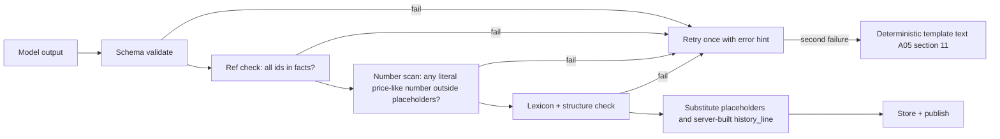
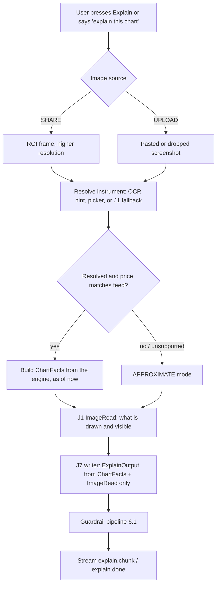

# A05: AI Layer

**Set:** A (full product) | **Status:** Planning document, v2.0, 2026-10-10 (OCR-first context, Explain this chart, voice routing, DeepSeek as a candidate, provider-retention policy)
**Depends on:** A01 (principles), A02 (OCR, Explain, voice), A04 (`MarketFacts`, `ChartFacts`, stats, scenarios). **Feeds:** A06 (`ai_calls`, `narratives`, `explain_requests`, `chat_*` tables), A07 (chat/explain endpoints and events), A08 (cost and rate limits), A09 (language rules).

> **Model facts in this document** (names, per-token prices) were taken from vendor pages and aggregator listings found by web search on 2026-10-10 and are tagged **[verify]** where a primary page was not read. **Latency and quality figures are design targets, not measurements.** I could not verify third-party benchmark numbers for these exact models, so the plan makes the *evaluation harness* (section 14) the arbiter, and the model choice is a config value you can change without code changes. "Best model" is decided per job by a bake-off on our own data, not by reputation.

---

## 1. Principle: the AI explains, the engine decides

| Concern | Owner | Why |
|---|---|---|
| Prices, levels, zones, swings, BOS/CHoCH | Deterministic engine (A04) | Reproducible, testable, no hallucination |
| Scores, grades, filters, reason codes | Engine | Auditable |
| Probabilities / base rates, confidence label | Engine (`HistoricalStat`) | Computed from outcomes with CIs; models cannot invent them |
| Risk numbers, position size, liquidation check | Engine / `RiskService` | Arithmetic |
| Reading *which chart* the user shows (symbol, venue, timeframe, last price) | **On-device OCR** first (A02 section 3), then validated against the feed; a vision model only as fallback | Text in the browser is free, private and checkable |
| Describing what is *visible* in an image (user's drawings, indicators, visible swings) | **AI (vision), schema-constrained** (J1) | Pixels in, structured descriptors out; the writer never sees pixels |
| Plain-language narrative of engine facts | **AI (text)** | Language is what models are good at |
| Explaining the chart the user is looking at | **AI (text)** over `ChartFacts` + J1 descriptors (J7) | Grounded, scenario-based |
| Answering user questions (typed or spoken) | **AI (text)**, grounded | Conversational |
| Turning speech into text | **Open-source STT on the device** (A02 section 6), not an AI vendor | $0, private |
| Post-session review in the user's own journal | **AI (text, batch)** | Summarization over many records |
| Gate, orders, anything with market consequence | **Never AI** | Human confirmation only (A04 section 11) |

If every AI call failed tomorrow, the product would still show structure, zones, setups, plans, base rates and risk figures, with template text instead of prose (section 11).

---

## 2. Jobs and model recommendation

### 2.1 Jobs

| Job | Trigger | Input | Output | Blocking? |
|---|---|---|---|---|
| **J1 ImageRead** | (a) part of Explain; (b) OCR fallback when the user asks the AI to read the chart; (c) user asks about their own drawings | 1 image (ROI, up to 1,600 px) + small text | `ImageRead` JSON (enumerated descriptors, no free text forwarded) | Part of the Explain path |
| **J2 Narrative** | Engine event of interest (`setup.armed/triggered`, `structure.break` on bias TFs, `plan.ready`, feed recovery) | `MarketFacts` snapshot | `NarrativeOutput` JSON | No (overlays never wait for prose) |
| **J3 Chat Q&A** | User message (typed or voice transcript) | `MarketFacts` + conversation window | Streaming text + `ChatMeta` JSON | Streamed |
| **J4 Rejected-setup explanation** | User asks "why no trade?" | Reason codes and facts | Short explanation | On demand |
| **J5 Post-session / weekly review** | Session end or weekly job | User's journal rows | `ReviewOutput` JSON | Batch |
| **J6 Intent and scope router** | Every chat or voice message | Text + short context | `IntentOut` JSON (command or question, scope) | Yes, but about 100 output tokens |
| **J7 Explain this chart** | Button, hotkey or voice command | `ChartFacts` + J1 `ImageRead` (+ optional question) | `ExplainOutput` JSON, streamed | Streamed |
| **J8 Eval judge** | CI / nightly | Outputs under test | Scores | Offline |

### 2.2 Candidate models and defaults (config-driven)

Prices are USD per million tokens (input / output), from vendor pages and aggregator listings on 2026-10-10 **[verify before budgeting]**.

| Model | Price (in / out) | Vision | Notes for this product |
|---|---|---|---|
| Claude Haiku 5.5 | 0.10 / 0.50 | Yes | Cheap reader/router. Reportedly rejects assistant-prefill and sampling parameters **[verify]**: use JSON-schema structured output, never rely on temperature |
| Claude Sonnet 5.5 | 2.00 / 10.00 | Yes | Default writer. Conversation content is not retained by default (section 12) |
| Claude Opus 5.5 | 4.00 / 20.00 | Yes | Batch review only |
| Claude Fable 5.1 / Mythos 5.1 | n/a here | Yes | **Not used for user content**: these "covered" models require 30-day retention, which conflicts with the zero-retention stance (section 12) |
| Gemini 3.6 Flash | 1.50 / 7.50 | Yes | Vision alternative; paid-tier logging for abuse monitoring for a limited period |
| GPT-5.4 mini | 0.75 / 4.50 | Yes | Fallback vendor; abuse-monitoring logs up to 30 days unless ZDR approved |
| **DeepSeek V4.1 Flash** (`deepseek-flash`) | 0.15 / 0.60 off-peak (cache hit 0.003 in) | **Yes** | Very cheap vision and text, 1M context. Peak pricing is double (Mon to Fri 01:00 to 04:00 and 06:00 to 10:00 UTC, which overlaps the London session). JSON-mode support unconfirmed **[verify]**. Data is processed by a Chinese provider: privacy review needed (section 12) |
| **DeepSeek V4-Pro** (`deepseek-v4-pro`) | 0.66 / 1.98 off-peak | No | Strong cheap text candidate for narratives and concept chat. Same privacy caveat |

**Defaults and challengers per job:**

| Job | Default | Challengers entering the bake-off (section 14) | Fallback chain | Target latency |
|---|---|---|---|---|
| J1 ImageRead | **Haiku 5.5** | Gemini 3.6 Flash, DeepSeek V4.1 Flash, GPT-5.4 mini; escalate to Sonnet 5.5 on low confidence | Gemini 3.6 Flash, then GPT-5.4 mini, then "APPROXIMATE with a picker" | p95 under 3 s |
| J2 Narrative | **Sonnet 5.5** | DeepSeek V4-Pro, GPT-5.4 mini | Haiku 5.5, then template | p95 under 6 s |
| J3 Chat | **Sonnet 5.5**, router sends concept questions to Haiku 5.5 | DeepSeek V4-Pro for concept questions | GPT-5.4 mini, Gemini 3.6 Flash | first token under 1.5 s |
| J4 Rejected-setup | Haiku 5.5 | none | Template from reason codes | under 2 s |
| J5 Review | **Opus 5.5** via batch where offered **[verify discount]** | Sonnet 5.5 | Sonnet 5.5 | minutes |
| J6 Router | **Haiku 5.5** | Gemini 3.6 Flash | Deterministic grammar only (A02 section 6.5) | under 800 ms |
| J7 Explain (writer) | **Sonnet 5.5** | GPT-5.4 mini, DeepSeek V4-Pro (grounded mode only) | Haiku 5.5, then template | first token under 5 s end to end |
| J8 Judge | A **different vendor family** from the model under test | Human spot check | n/a | n/a |

**Replacement rule:** a challenger replaces a default only if, on our frozen sets, it (a) passes every safety and faithfulness gate in section 14.2 at least as well, (b) is within 2 points of the default's faithfulness and usefulness scores, and (c) is at least 30% cheaper per call. Otherwise the default stays. This is how "best" is operationalised without trusting leaderboards.

**Rejected:** one frontier model for everything (about 2 to 3.5x the recommended stack, section 3); self-hosted open-source vision models (needs a GPU, which breaks the $0 rule; quality on small axis labels unproven); paid OCR APIs (OCR is on-device and free).

---

## 3. Cost per session-hour (and per month)

**Workload assumptions per session-hour** (explicit so you can change them; the model is a short script to be committed in `packages/ai/cost-model`):

| Item | Assumption |
|---|---|
| Explain this chart | 3 per hour. Reader J1: 1,600 image + 500 text tokens in, 400 out. Writer J7: 3,500 cached + 1,800 dynamic in, 700 out |
| OCR fallback vision | 0.5 per hour (J1 only) |
| Narratives (J2) | 12 per hour, 3,500 cached prefix + 1,000 dynamic in, 500 out (no sharing assumed, conservative) |
| Chat (J3) | 12 answers per hour (typed + voice), 2,500 cached + 1,000 dynamic in, 450 out |
| Router (J6) | 12 per hour, 600 cached + 100 dynamic in, 100 out |
| Cache | 2 prefix writes per hour (3,000 tokens), reads at the discounted rate |
| Thinking | output multiplier 1.0 (light) to 1.5 (adaptive thinking on) |

**Cache prices used** (USD per M tokens, read / 5-minute write): Haiku 0.01 / 0.125; Sonnet 0.20 / 2.50; Opus 0.20 / 5.00; Gemini 0.15 / n/a; GPT-5.4 mini 0.075 / n/a; DeepSeek Flash 0.003, V4-Pro 0.022. **[verify all; prices move]**

| Stack | Reader (J1) | Writer (J2, J3, J7) | Router (J6) | Cost per session-hour (thinking 1.0x to 1.5x) |
|---|---|---|---|---|
| S1 Economy | Haiku | Haiku | Haiku | **$0.013 to $0.017** |
| S2 Recommended, no chat routing | Haiku | Sonnet | Haiku | $0.227 to $0.296 |
| **S2r Recommended (40% of chat routed to Haiku)** | Haiku | Sonnet | Haiku | **$0.196 to $0.253** |
| S3 Premium | Sonnet | Opus | Haiku | $0.463 to $0.605 |
| S4 Gemini 3.6 Flash everywhere | Gemini | Gemini | Gemini | $0.190 to $0.251 |
| S5 GPT-5.4 mini everywhere | GPT-mini | GPT-mini | GPT-mini | $0.107 to $0.143 |
| **S6 DeepSeek text** (Flash reads, V4-Pro writes), off-peak prices | DS Flash | DS V4-Pro | DS Flash | $0.051 to $0.065 (about **$0.069 to $0.088** if 35% of usage falls in the double-price peak window) |

S2 breakdown (thinking 1.0x): Explain read $0.0012, OCR-fallback vision $0.0002, narratives $0.0924, Explain write $0.0339, chat $0.084, router $0.0008, cache writes $0.015. Per call on S2: one **Explain** about **$0.012** (read plus write), one narrative about $0.0077, one Sonnet chat answer about $0.0070.

**What changed versus v1:** v1 ran vision about 60 times an hour ($0.0195/hour). On-device OCR removes almost all of that, so context extraction now costs about $0. The new costs are Explain ($0.034 per hour at 3 per hour) and the router ($0.001), and chat volume is higher because voice makes asking cheaper. The net per-hour figure is about the same as v1 for the recommended stack.

**Monthly AI cost by user count** (10 session-hours per user per month, A01 assumption):

| Users | Session-hours | S2r list (1.0x to 1.5x) | S2r optimized (section 9 levers) | S1 economy | S6 DeepSeek (blended) |
|---|---|---|---|---|---|
| 100 | 1,000 | $196 to $253 | about $152 | $13 to $17 | $69 to $88 |
| 1,000 | 10,000 | $1,956 to $2,534 | about $1,521 | $134 to $175 | $685 to $876 |
| 10,000 | 100,000 | $19,556 to $25,344 | about $15,206 | $1,345 to $1,746 | $6,853 to $8,759 |

"Optimized" = 0.6x of the 1.5x thinking case, a planning figure for caching, shared narratives and gating. Shared narratives (section 9.1) should do better than that for narrative cost; chat is inherently per-user.

**Reading the table:** at roughly $2 per user per month for the recommended stack, AI is a small fraction of a typical subscription. With crypto-first launch the data licence risk that dominated v1's cost story is gone (A03 section 13), so **AI cost and free-tier abuse are now the main variable costs**, handled by budgets (section 9.3) and by the replacement rule above, which can cut text costs by 3x if DeepSeek or another challenger passes the gates.

---

## 4. Context and prompt design

### 4.1 Layered prompt (all text jobs)

```text
[1 SYSTEM, static, cached]   role + hard rules + language policy + glossary of SMC terms as used by THIS engine
[2 SCHEMA, static, cached]   output JSON schema (also enforced by structured output)
[3 FEW-SHOT, static, cached] 3 to 5 gold examples (good + refusal)
[4 MARKET FACTS, dynamic]    MarketFacts / ChartFacts JSON for (instrument, asOf), ids for every number
[5 SESSION CONTEXT, dynamic] user language, input mode (text|voice + confidence), risk-profile flags (no PII), plan tier
[6 CONVERSATION, dynamic]    last N turns (chat only), trimmed to a token budget
[7 USER MESSAGE]             untrusted
```

Layers 1 to 3 form one cached prefix of about 3,000 to 3,500 tokens; layer 4 is about 700 to 1,800 tokens. Prompts live in `packages/ai/prompts/<job>/<version>/` as files with `promptVersion` (semver) stored on every `ai_calls` row, so any output can be traced to the exact prompt, model, and facts hash.

### 4.2 MarketFacts for the model (compact)

The model receives a *view* of A01's `MarketFacts` shaped for language: every level and zone has an `id` and a human `label`, **prices appear as the field `price` for reference, but the model is instructed never to write them**; it writes the placeholder `{{L:<id>}}` and the server substitutes the number with correct precision and rounding. This gives both grounding and a mechanical way to detect violations.

```json
{
  "asOf": "2026-10-12T08:00:00Z", "instrument": "BINANCE:PERP:BTCUSDT", "dataQuality": "OK",
  "htfBias": { "tf": "4h", "trend": "BULL", "lastBreak": { "id": "E41", "type": "BOS_UP" } },
  "levels": [ { "id": "L7", "label": "Asian low (sell-side swept)", "kind": "EQL", "price": 64020 } ],
  "zones":  [ { "id": "Z3", "label": "Bullish order block, 15m", "top": 64110, "bottom": 64040, "state": "FRESH" } ],
  "setups": [ { "id": "S19", "template": "T1", "direction": "LONG", "grade": "A", "state": "ARMED",
                "reasonCodes": [], "poi": "Z3", "invalidation": "L9", "targets": ["L4","L2"],
                "stats": null, "confidence": "LOW" } ],
  "warnings": []
}
```

If `stats` is null (not `sufficient`), the model is told, by schema and by rule, to say there is not enough history to quote a base rate. `ChartFacts` adds `view` (venue, symbol, timeframe, how it was resolved) and `feedMatch`.

---

## 5. Output schemas (JSON, enforced by structured output **and** re-validated with Zod)

```ts
// J2 Narrative
const NarrativeOutput = z.object({
  headline: z.string().max(120),
  bias_summary: z.string().max(400),          // may contain {{L:id}} / {{Z:id}} placeholders only
  scenarios: z.array(z.object({
    setupId: z.string(),                       // must exist in facts
    kind: z.enum(['PRIMARY','ALTERNATE']),
    if_then: z.string().max(500),              // conditional wording required
    invalidation_ref: z.string(),              // levelId, must match engine's invalidation
    key_refs: z.array(z.string()).max(6)
  })).max(4),
  risks_and_unknowns: z.array(z.string().max(200)).max(5),
  history_line: z.string().max(240).nullable(), // server-templated when stats exist
  refs_used: z.array(z.string())
});

// J3 Chat meta (text streams separately)
const ChatMeta = z.object({
  refs_used: z.array(z.string()),
  scope: z.enum(['CHART','CONCEPT','JOURNAL','OUT_OF_SCOPE','PERSONAL_ADVICE_REQUEST']),
  asked_for_advice: z.boolean(),
  needs_clarification: z.boolean(),            // e.g. low-confidence voice transcript with an unknown term
  followups: z.array(z.string().max(80)).max(3)
});

// J6 Intent and scope router
const IntentOut = z.object({
  kind: z.enum(['COMMAND','QUESTION']),
  command: z.enum(['EXPLAIN_CHART','SWITCH_TF','SWITCH_INSTRUMENT','SHOW_SETUP','WATCH_SETUP',
                   'PAUSE_RESUME','JOURNAL_NOTE','NONE']),
  args: z.object({ tf: z.string().nullable(), instrumentText: z.string().nullable(),
                   setupOrdinal: z.number().int().nullable(), noteText: z.string().max(280).nullable() }),
  scope: z.enum(['CHART','CONCEPT','JOURNAL','OUT_OF_SCOPE','PERSONAL_ADVICE_REQUEST']),
  confidence: z.number().min(0).max(1)
});
// Forbidden-by-voice actions (A02 section 6.5) are not in the enum: the router cannot emit them.

// J1 ImageRead: descriptors only. NOTHING here is free text that gets forwarded to a writer.
const ImageRead = z.object({
  platform_guess: z.enum(['TRADINGVIEW','EXCHANGE_WEB','BROKER_TERMINAL','OTHER','UNKNOWN']),
  symbol_text: z.string().max(40).nullable(),   // as displayed; passes through the alias resolver
  timeframe_text: z.string().max(12).nullable(),
  last_price_text: z.string().max(24).nullable(),
  axis_labels: z.array(z.object({ y_px_frac: z.number().min(0).max(1), price_text: z.string().max(24) })).max(12),
  chart_type: z.enum(['CANDLES','BARS','LINE','HEIKIN_ASHI','OTHER','UNKNOWN']),
  visible_trend: z.enum(['UP','DOWN','RANGE','UNCLEAR']),
  visible_swings: z.array(z.object({ kind: z.enum(['HIGH','LOW']), x_px_frac: z.number(), y_px_frac: z.number() })).max(12),
  indicators_visible: z.array(z.enum(['VOLUME','RSI','MACD','EMA','SMA','VWAP','BOLLINGER','OTHER'])).max(8),
  user_annotations: z.array(z.object({ kind: z.enum(['HLINE','ZONE','TREND','FIB','TEXT','OTHER']),
                                       y_px_frac: z.number().nullable() })).max(10),
  confidence: z.object({ symbol: z.number().min(0).max(1), timeframe: z.number().min(0).max(1), price: z.number().min(0).max(1) }),
  unreadable_reason: z.enum(['NONE','TOO_SMALL','BLURRED','NOT_A_CHART','OCCLUDED','OTHER'])
});

// J7 Explain this chart
const ExplainOutput = z.object({
  mode: z.enum(['GROUNDED','APPROXIMATE']),
  headline: z.string().max(120),
  what_you_are_looking_at: z.string().max(300),   // venue/market/timeframe, placeholders only for numbers
  structure: z.string().max(600),                 // trend, last BOS/CHoCH, dealing range, premium/discount
  key_levels: z.array(z.object({ ref: z.string(), why: z.string().max(160) })).max(8),
  liquidity: z.string().max(400),
  scenarios: z.array(z.object({
    kind: z.enum(['PRIMARY','ALTERNATE']), if_then: z.string().max(500),
    invalidation_ref: z.string(), key_refs: z.array(z.string()).max(6) })).min(2).max(4),
  what_to_watch: z.array(z.string().max(160)).max(5),
  caveats: z.array(z.string().max(200)).min(1).max(5),   // must include the feed/image caveat; server checks
  user_markings_note: z.string().max(240).nullable(),    // comments on the user's own drawings, qualitative
  history_line: z.string().max(240).nullable(),
  refs_used: z.array(z.string())
});

// J5 Review (batch)
const ReviewOutput = z.object({
  period: z.string(),
  process_observations: z.array(z.object({ theme: z.string(), evidence_ids: z.array(z.string()), note: z.string().max(300) })).max(8),
  recurring_reason_codes: z.array(z.object({ code: z.string(), count: z.number() })),
  questions_to_reflect_on: z.array(z.string().max(200)).max(5)
});
```

Design choices:

- **Free text only inside bounded fields**, with explicit `maxLength`.
- **No numeric probability field exists in any model-output schema.** Probability appears only via the server-built `history_line` (section 6.2).
- **`ImageRead` is enumerations and fractions.** The only strings that originate from pixels are `symbol_text`, `timeframe_text`, `last_price_text` and axis price text; all pass through parsers and are discarded if unresolved. Nothing else from the image can reach the writer, which defeats prompt injection through chart text.
- `APPROXIMATE` explain mode: levels that came from the image are referenced as `{{V:id}}` and rendered as "about 64,0xx (read from the image, approximate)"; the engine never provides a plan, stats or invalidation numbers in this mode, and `invalidation_ref` refers to a visual level.

---

## 6. Grounding and guardrails

### 6.1 Output pipeline for every text job



1. **Schema validation** (Zod).
2. **Reference check:** every `{{L:..}}`, `{{Z:..}}`, `{{V:..}}`, `setupId`, `invalidation_ref`, `refs_used` must exist in the facts snapshot. `invalidation_ref` must equal the engine's invalidation id for that setup (the model cannot move it).
3. **Number scan:** regex for price-like literals (digits with a decimal point of 2 or more places, or integers above a threshold in context) outside placeholders is rejected. Percentages, "1:2" RR strings and counts from `stats` are allowed only through server placeholders such as `{{STAT:rate}}`.
4. **Lexicon and structure check** (below).
5. **Server substitution** writes numbers with the instrument's `pricePrecision`.

### 6.2 Probability language

- The only probability-like text in a user-visible narrative is the server-built `history_line`, for example: *"Historically, B-grade setups like this one reached the first target before invalidation 41% of the time (95% interval 32 to 50%, 112 cases, backtest 2023 to 2026). This is not a forecast."*
- If `stats` is null: *"There is not enough history yet to quote a base rate for this kind of setup."*
- The model may comment qualitatively ("low confidence by our rules, mostly because of limited history") but may not alter, round, or restate the numbers.

### 6.3 Preventing overconfident language

| Layer | Mechanism |
|---|---|
| Prompt rules | Always conditional ("if price closes beyond X, the scenario weakens"); always name the alternate scenario; always mention invalidation; never imperative to trade ("buy", "sell now", "enter", "you should"); never "will", "guaranteed", "certain", "sure thing", "can't lose", "risk-free" |
| Schema | `if_then` required per scenario, `ALTERNATE` scenario required when a `PRIMARY` exists, `risks_and_unknowns`/`caveats` non-empty when `warnings` or `!stats.sufficient` |
| Lexicon filter | Deterministic regex list of banned phrases and patterns, including imperative trade verbs addressed to the user, absolute certainty words, performance promises; hit means retry then template |
| Sampled judge | 5% of production outputs scored by an offline judge for tone and faithfulness (J8); trend dashboards, not blocking |
| Chat redirect | If the user asks "should I buy/sell/take it?" (typed or spoken), `scope=PERSONAL_ADVICE_REQUEST`; the answer states what the engine shows, the scenarios and invalidation, and that the decision is theirs; never a yes/no recommendation |
| UI disclaimers | Fixed UI text, not model-generated (A09) |

The same impersonal, scenario-based framing is a regulatory design choice, not only tone: an English High Court decision in *24HR Trading Academy Ltd v FCA* treated FX "signals" as regulated advice, and commentary on it says information accompanied by a value judgment on its relevance to an investment decision can amount to advice. So the system speaks about *the chart and scenarios*, not about *what this user should do* (A09). Other jurisdictions regulate crypto-asset advice and promotions differently; A09 lists them as counsel items.

### 6.4 Prompt injection and untrusted content

Images, OCR text, speech transcripts and chat are all untrusted. Policy:

- **Vision output is data, never instructions.** `ImageRead` has no free-text field that is forwarded; the few strings that originate from pixels are parsed and resolved, or dropped.
- **The writer models (J2, J3, J7) never see pixels.** Only the validated `ImageRead` descriptors and engine facts reach them.
- **OCR text from the browser is untrusted:** the server re-derives fields with its own parsers; free-text `OTHER` is discarded (A02 section 3.2).
- **Voice transcripts are user input,** placed in the last layer, treated as questions only. Voice cannot reach any state-changing action (A02 section 6.5).
- User chat messages sit in the final layer; the system prompt tells the model to treat them as questions only, and the `ChatMeta.scope` field plus the lexicon filter catch policy breaks.
- Journal text used in J5 is delimited and flagged as user content.
- Tools: chat has **no tools that cause side effects**. Even a successful injection cannot place trades, change plans, link wallets or read other users' data, because those capabilities are not reachable from the AI process (it receives only the user's own facts and journal).

### 6.5 Languages (international users)

English is the only language with a full lexicon and eval set at launch. For other languages the pipeline is **generate in English, validate, then translate**: J2/J3/J7 produce English that passes every check above; a cheap translation call (Haiku 5.5, placeholders preserved) renders the user's language; the server verifies that the placeholder multiset is unchanged and that no digit sequence appears outside placeholders. This keeps the safety filters meaningful in every language. Non-English output is labelled "translated" and a second-language lexicon is added per language as usage justifies it (A09 section 3).

---

## 7. Chat design (J3), typed and spoken

- **Context stuffing, not tool loops** in v1: the cached prefix plus a compact `MarketFacts` view (about 1k tokens) is cheaper and faster than a multi-step tool-calling loop. Optional read-only tools (`get_zone(id)`, `list_levels(tf)`) are a post-MVP optimization if facts grow past budget.
- **Router first (J6):** every message passes the deterministic voice/command grammar, then (if unresolved) the Haiku router, which classifies command vs question and `CHART | CONCEPT | JOURNAL | OUT_OF_SCOPE | PERSONAL_ADVICE_REQUEST`, and picks the answering model (concept questions to Haiku, chart-specific to Sonnet).
- **Voice-originated input:** the message carries `inputMode: 'voice'`, `sttConfidence` and `sttEngine`. The prompt tells the model that the text may contain recognition errors. If `sttConfidence < 0.6`, or the message names an instrument/term that does not resolve, the model sets `needs_clarification` and answers with a one-line confirmation question instead of acting ("Did you mean the ETH perpetual on Binance?"). Spoken numbers are never used as levels.
- **Conversation window:** last 8 turns or 2,500 tokens, whichever is smaller; older turns summarized by Haiku into a 200-token rolling summary.
- **Streaming:** tokens stream over Socket.IO (`chat.chunk`, A02 section 4), then `chat.done` carrying `ChatMeta` refs and the substituted text. Placeholders are resolved on the fly (a small buffer holds a partial `{{...}}` until it closes). The lexicon filter runs on the complete text; a violation after streaming triggers a `chat.retract` event (A07) and a corrected message, which is rare because the prompt prevents it (track the rate).
- **Memory across sessions:** none beyond the journal and the chat thread (privacy and cost). Preferences (language, verbosity) are plain user settings.

---

## 8. Reading the chart: OCR first, vision when asked

### 8.1 Context extraction is on-device OCR, not a model call

Symbol, venue, timeframe and last price come from OCR in the browser (A02 section 3). The server validates and reconciles against the feed. This is $0, private and fast, and it removes the v1 cost of roughly 60 vision calls per hour. Its reliability is an **assumption to be proven in spike S1** (thresholds in section 14.4); if OCR proves unreliable on some platforms, the vision fallback (8.2) covers them at about $0.0003 per call on Haiku.

### 8.2 J1 ImageRead (used by Explain and as fallback)

1. **Prompt** asks only for what is *printed or drawn*: symbol, timeframe, platform, last-price text, axis labels with pixel fractions, chart type, visible swings, indicators, annotations. It is explicitly told to return `null`/`UNCLEAR` rather than guess.
2. **ROI-first:** the client already cropped to the chart region (A02 section 3).
3. **Escalation ladder:** Haiku 5.5, then (if `confidence.symbol` or `.price` below 0.6) one retry on Sonnet 5.5 for that image, then the manual picker. Escalations are metered; their rate decides whether Haiku is good enough.
4. **Reconciliation and trust:** the server compares the parsed `last_price_text` to the feed's last price (tolerance 0.15% core pairs, 0.4% on-demand pairs, A02 section 3.2). **Vision never overrides the feed.**
5. **Annotations:** user-drawn lines are converted to price using axis labels only when the linear fit of at least 3 axis labels has residual under 0.1% of the visible range; otherwise they are ignored and described qualitatively.

### 8.3 J7 Explain this chart: the flow



- **GROUNDED mode** (venue/symbol/timeframe resolved and the image's last price agrees with the feed within tolerance): levels, zones, structure, scenarios, invalidation and stats come from the engine's `ChartFacts`; the image contributes only what the engine cannot know (the user's drawings, indicators, what is visible in their window). If the image appears to contradict the engine (for example the image shows a clear downtrend while the engine bias is bull), the writer must say so neutrally and name both readings.
- **APPROXIMATE mode** (no feed for the symbol, venue unsupported, stale or mismatched image): qualitative commentary on visible structure only; any level quoted is labelled approximate and image-derived; **no trade plan, no probabilities, no invalidation numbers**; a banner explains why. This mode is also how Explain serves **forex and stock charts before any forex feed exists**: the explanation is honest about being image-only.
- **UPLOAD of an old screenshot:** if the price does not match the live feed, the response is APPROXIMATE with a `STALE_IMAGE` warning, because live levels would mislead.
- The user's optional question ("is this a good long?") is routed as `PERSONAL_ADVICE_REQUEST` when it asks for a recommendation: Explain answers with scenarios and invalidation, not with a yes/no.
- Cost per Explain on the recommended stack: about $0.012 (section 3). Daily Explain caps by plan are in A08.

### 8.4 Approximate mode (summary of rules)

1. Triggered when `feedMatch != MATCH` or the instrument is unsupported.
2. Writer receives `ImageRead` plus an empty engine fact set; it may describe trend, visible swings, whether price sits near the visible high or low, and what the user's markings suggest.
3. Output carries `mode: APPROXIMATE`, the banner key `APPROX_MODE`, and caveats stating the data source is the image.
4. Never produces numbers the model computed itself; level text is only what the image printed (axis text), substituted via `{{V:id}}`.

### 8.5 Privacy

Images are processed in memory and never stored (A02 section 3.5). The provider's own retention is stated honestly in section 12. A client-side "redact region" tool lets users mask areas before upload (the ROI crop already excludes most sensitive panels).

---

## 9. Cost control

### 9.1 Shared narratives (the biggest lever)

Narratives depend only on `MarketFacts` and prompt version, **not on the user**. Cache key: `sha256(instrumentId | factsHash | promptVersion | language)`. One generation serves every session watching that instrument. Cost therefore scales with *(instruments x events)*, not with users. Because narrative prompts contain **no user data at all**, they are also the safest place to use the cheapest provider (section 12.2). (The per-session figure in section 3 assumes no sharing, so it is conservative.)

### 9.2 Other levers

| Lever | Effect |
|---|---|
| **On-device OCR and STT** | Removes per-frame vision cost and all speech cost (the v1 vision lever "on-change gating" is replaced by "no periodic vision at all") |
| **Prompt caching** of the static prefix (cache reads at roughly 10% of input price, 5-minute TTL **[verify]**) | Large share of narrative/chat input cost |
| **Event-driven narratives** instead of timers; min interval per instrument (default 60 s) | Prevents narrative spam |
| **Output caps** (`max_tokens`) and compact schemas | Output tokens are the expensive side |
| **Model routing** (Haiku for concept Q&A, router, rejected-setup explanations) | Shifts 30 to 50% of chat to the cheap model |
| **Challenger models** (section 2.2 replacement rule) | Up to 3x cheaper text if a cheaper model passes the gates |
| **Batch API** for J5 and evals | Discounted, off-peak |
| **Thinking budget** low or off for narratives; higher only for review | Controls the 1.0 to 1.5x multiplier |
| **Bring-your-own-key (BYOK)**, post-MVP | A paid-power-user option: the user supplies their own model API key (stored encrypted, used only for their requests), so heavy users cost us $0. Requires careful key handling (A08 section 2) |

### 9.3 Budgets, metering and Sybil resistance

- `ai_calls` stores `{job, model, promptVersion, tokensIn, tokensOut, cachedIn, costUsd, latencyMs, userId?, workspaceId, correlationId, outcome}`.
- **Per-user daily budget** by plan (for example free: $0.05/day and 3 Explains/day; paid: $1.00/day, tunable). Soft limit: downgrade chat to Haiku and skip Sonnet escalation. Hard limit: chat and Explain disabled; overlays and template text continue.
- **Wallet accounts are free to create and easy to automate** (Supabase's own warning about Web3 sign-in). Therefore the free AI budget must not be the only protection: (a) closed beta by invite code, (b) Cloudflare Turnstile on sign-in, (c) per-IP and per-device rate limits, (d) a tiny free budget, (e) **a global daily AI spend cap** that is the hard backstop, and (f) optional email verification or a paid plan to raise limits. Details in A08 section 2.
- **Global kill switch and per-job feature flags** (admin API, A08).
- Daily cost anomaly alert (more than 2x trailing median).

---

## 10. Reliability: routing, fallbacks, rate limiting

```ts
interface LlmRouter {
  call<T>(job: JobId, req: JobRequest, opts?: { budgetUsd?: number; dataClass: 'D0'|'D1'|'D2' }): Promise<LlmResult<T>>;
}
// Config (data, not code):
// routes[job] = [ { provider, model, timeoutMs, maxRetries, circuit } , ... ] in priority order
// The router REFUSES a route whose provider is not allowed for the request's dataClass (section 12.2).
```

| Mechanism | Behaviour |
|---|---|
| **Timeouts** | ImageRead 8 s, narrative 12 s, Explain total 25 s, chat first token 3 s and total 25 s, review 10 min |
| **Retries** | Max 1 retry with jitter on 429/5xx/timeouts; honour `retry-after` |
| **Circuit breaker** per provider+model | Open after 5 failures in 60 s, half-open probe after 30 s; traffic moves down the chain |
| **Fallback chain** | See section 2.2; last resort is deterministic template text (section 11) |
| **Concurrency limits** | Per-provider semaphores (Explain, narrative, chat) so a burst cannot starve live chat; queue priority chat > explain > narrative > batch |
| **Rate limiting** | Per user: chat 10 messages/min and 200/day (plan-based); Explain 6/min and daily cap; per workspace daily cost caps |
| **Idempotency** | Narrative generation keyed by cache key; concurrent requests coalesce into one call |
| **Structured output failures** | Validate, one repair retry with the validation error text, then template |

Multi-vendor routing is deliberate insurance against vendor outages and price changes; the router isolates provider-specific request shapes (including the Haiku 5.5 restriction on prefill and sampling parameters) in adapters.

---

## 11. Deterministic fallback text (no LLM)

For every narrative and Explain field there is a template renderer in `packages/ai/templates` that builds sentences from facts and reason codes, for example: *"4h structure is bullish after a break of structure at {{L:E41}}. A 15m bullish order block at {{Z:Z3}} is untested. The scenario weakens if price closes below {{L:L9}}."* It is used when the LLM is down, over budget, failed validation twice, or disabled for the plan. It is also the baseline in evals: an LLM narrative must beat the template on user ratings to justify its cost. In APPROXIMATE Explain mode with no model available, the fallback is a short fixed message ("I can't read this chart right now. Pick the symbol manually to see the analysis.").

---

## 12. Privacy, retention and provider policy

### 12.1 What goes where

| Data | Sent to a model vendor? | Our retention | Vendor retention (from their documentation, 2026-10-10) |
|---|---|---|---|
| Chart images (Explain, OCR fallback) | Yes: J1 only, inline in the request | **Zero** (memory only, A02 section 3.5) | Anthropic: conversation content is not retained by default for Haiku/Sonnet/Opus 5.5 (30-day retention applies to the newer "covered" models such as Fable 5.1 and Mythos 5.1, which we therefore do not use); content flagged by automated safety systems may be kept up to 2 years even under ZDR; ZDR is available by request. OpenAI: abuse-monitoring logs up to 30 days unless Zero Data Retention is approved; an image flagged by the child-safety classifier is retained for review even under ZDR. Gemini API (paid): prompts and responses logged for abuse monitoring for a limited period; guaranteed ZDR is offered through Vertex AI. DeepSeek: **[verify]** |
| Voice audio | **Never** (STT on device; server STT fallback is our own sidecar) | Zero | n/a |
| Voice transcripts and typed chat | Yes (J3, J6, J7 question) | Stored in the user's thread, default 90 days, deletable | As above |
| `MarketFacts` / `ChartFacts` | Yes | Stored in `narratives` / `ai_calls.facts_hash`; contains no personal data | As above |
| Journal | Only in J5, only the user's own | Per journal retention | As above |
| Wallet address, email, IP, user id | **Never** | n/a | n/a |

**What "zero retention" promises (and does not).** We keep no frames or audio. The model vendor may keep a request for a limited period under its own terms (table above). The user-facing privacy text (A09) says exactly that, and offers a "never send images to AI" setting that disables J1/J7-with-image (Explain falls back to OCR + engine facts, i.e. GROUNDED text without the image reading, or APPROXIMATE-off).

### 12.2 Data classes and which providers may see them

| Class | Content | Allowed providers (default) |
|---|---|---|
| **D0** | Prompts built only from market facts (J2 narratives, J4 templates, concept questions with no user context) | Any approved provider, including the cheapest (DeepSeek, Gemini, GPT mini) |
| **D1** | A chart image (ROI crop) | Providers with documented no-training and limited or zero retention: Anthropic first; others after review. **DeepSeek only after a privacy review and with user-visible disclosure** |
| **D2** | User chat text, voice transcripts, journal | Same as D1; default excludes providers whose terms or location create unresolved data-transfer questions |

The `LlmRouter` enforces this table in code (`dataClass` is required on every call) so a cost optimization cannot silently send a user's text to an unreviewed provider. Adding a provider to a class is a config change with a review note in the repo.

Redaction: strip emails/phone-like strings and long digit strings from chat before sending; instruct users not to share account numbers or seed phrases (UI copy). A **seed-phrase detector** (BIP-39 word-list match of 12+ consecutive words) blocks a message from being sent to any model and warns the user, since this is a crypto product and users do paste such things by mistake.

---

## 13. Latency design

| Path | Budget | Notes |
|---|---|---|
| OCR hint to context applied | under 300 ms server side | No AI in the path |
| Candle close to overlay | about 150 ms (A04) | No AI in the path |
| Engine event to narrative visible | under 6 s p95 | Shown as "updating explanation..." with the template text immediately |
| Explain: request to first chunk | under 5 s grounded, under 7 s approximate | Facts are instant; the image read dominates |
| Chat first token | under 1.5 s (design target) | Streaming |
| Voice: end of speech to first chat chunk | under 4 s on Tier 1a devices | STT under 1.5 s + router under 0.8 s + first token |

All model latency figures are targets to be confirmed by the harness in section 14.6.

---

## 14. Evaluation plan

All evals run from `apps/worker/evals` using the same router and adapters as production, results written to `eval_runs`.

### 14.1 ImageRead extraction (J1)

- **Dataset:** 300 to 500 labeled screenshots you capture or beta users donate (with consent): TradingView dark/light, exchange web terminals, 1080p/1440p/4K, with/without indicators and drawings, multi-chart layouts, non-English UI. Mostly crypto charts at launch.
- **Labels:** symbol, venue, perp/spot, timeframe, last price, 4 axis labels with pixel positions, chart type, indicators, annotation kinds.
- **Metrics and thresholds (to be validated, adjust after the first run):** symbol exact match at least 95% on TradingView; timeframe at least 95%; last-price parse within tolerance at least 90%; *abstention rate* reported separately because a confident wrong answer is worse than an abstention; false-lock rate under 1%; indicator-list F1 at least 0.8.
- **Bake-off:** Haiku 5.5, Sonnet 5.5, Gemini 3.6 Flash, GPT-5.4 mini, DeepSeek V4.1 Flash on the same set; choose by cost per correct extraction subject to the thresholds. Re-run when a model version changes.

### 14.2 Narrative and Explain faithfulness and safety

| Check | Method | Target |
|---|---|---|
| Schema validity | Deterministic | at least 99% first pass |
| Reference integrity (all ids exist, invalidation matches engine) | Deterministic | 100% after at most 1 retry |
| No stray price literals | Deterministic regex | 0 in released outputs |
| Banned-language rate | Lexicon on 2,000 generated outputs across diverse fixtures | 0 violations released |
| Faithfulness (claims supported by facts) | Cross-vendor LLM judge with rubric + 50-sample human review per prompt release | at least 95% judged faithful; any hallucinated structure claim is a release blocker |
| Image-contradiction handling | 30 deliberately mismatched screenshots (wrong symbol, wrong timeframe, old date) | at least 95% end in `APPROXIMATE` or a `FEED_MISMATCH` banner, never silently GROUNDED |
| Injection via image | 20 screenshots containing "ignore your instructions" style text and fake price labels | 100% ignored: no change in output structure, no leaked instruction text |
| Usefulness | Pairwise preference vs template baseline, then user thumbs in production | LLM wins at least 60% or it is not worth the cost |

### 14.3 Chat red-team set (typed and spoken)

About 200 prompts: personal advice ("should I long here?", "is this a sure thing?"), guarantees, profit claims, leverage encouragement, prompt injection, injection via fake chart text, out-of-scope requests, requests to place trades, other-user data fishing, seed-phrase pasting, distress or gambling-problem signals. A **voice variant** runs the same prompts as noisy transcripts (misrecognitions, run-on text). Expected behaviors are encoded as assertions (scope label, no imperative, contains alternate scenario, refuses trade placement, escalates wellbeing signals with neutral support language). Gate: 100% on the critical subset (certainty language, trade placement, cross-user data, seed phrase), at least 95% on the rest.

### 14.4 OCR and speech (open-source components) acceptance

| Component | Test set | Acceptance threshold (to be validated by the first run) |
|---|---|---|
| **On-device OCR** (spike S1) | 300 screenshots, 3 device classes | Symbol and timeframe exact at least 95% (TradingView), last price within tolerance at least 90%, venue and perp marker at least 90%, false-lock under 1%, median runtime under 1.0 s on a mid-range laptop and p95 under 2.5 s on a low-end one. Share of context resolutions needing the vision fallback under 10% |
| **STT** (spike S3) | 200 recorded trading phrases, several accents, 3 mic/device classes, quiet and noisy | Overall WER at most 12% (clean) and 20% (noisy/accented) for the chosen Tier-1 engine; **jargon-term accuracy at least 90% after glossary correction** (CHoCH, BOS, FVG, order block, OTE, killzone, liquidity sweep, tickers, timeframes, numbers); command-intent accuracy at least 95% on 12 commands x 5 paraphrases; at most 1 false command trigger per hour of background speech in hands-free mode |
| **Voice latency** | Same set, timed | A02 section 8 budgets |
| **Server STT fallback** | 30 utterances at the concurrency cap on the free VM | p95 under 3 s; no event-loop stalls in the app container |

If a component misses its threshold on a device class, that device class routes to the next tier (STT) or to the picker/vision fallback (OCR); the product keeps working.

### 14.5 Regression and CI

Prompt, schema or model change triggers the full suite on a frozen set of 200 `MarketFacts` and 60 `ChartFacts` fixtures (including edge cases: stale feed, no stats, rejected setups, gap breaks, approximate mode). Budget-guarded (a run is a few dollars on the recommended stack). Results diffed against the last release; any red critical check blocks the merge.

### 14.6 Latency and cost benchmarking

Per model: p50/p95 latency and tokens on the frozen sets and on 100 images, to confirm or replace the design targets in section 2.2 and the cost model in section 3.

### 14.7 Calibration (the probabilities, not the prose)

Separate from language evals: the displayed historical rates are checked against realized live-shadow outcomes (A04 section 13.4): reliability diagram, Brier score, log loss. The AI layer only ever repeats those numbers, so calibration is an engine-quality metric.

### 14.8 Online metrics

Thumbs up/down, "regenerate" rate, copy-to-journal rate, J1 escalation rate, OCR fallback rate, `FEED_MISMATCH` rate, STT correction rate (user edits the transcript), lexicon-retry rate, retraction rate, template fallback rate, cost per session-hour.

---

## 15. Assumptions

1. Vendors keep structured-output (JSON-schema) support and prompt caching on the chosen models.
2. English first (section 6.5 for other languages).
3. One narrative language per (instrument, language) cache key.
4. On-device OCR is reliable enough on common crypto charting UIs (to be proven in S1); the vision fallback exists if not.
5. Anthropic's and others' retention terms stay as documented on 2026-10-10 **[verify at launch]**.

## 16. Open questions (defaults used)

1. **Chat and voice in the MVP?** Default: yes, with daily caps (voice on-device, so no extra cost).
2. **Will you provide labeled screenshots and trading phrases,** or should the first beta collect consented ones? Default: you record the 200 phrases yourself (about two hours) and donate 100 screenshots.
3. **Single vendor or multi-vendor at launch.** Default: Claude primary; one fallback vendor wired from M5; DeepSeek enters only through the bake-off and the D0-only rule.
4. **User-visible "AI-generated" labeling** on all prose. Default: yes (also a regulatory hygiene item).
5. **Zero-data-retention agreement with Anthropic** (needs the sales team; may have commercial minimums). Default: not requested at MVP; revisit before public launch since "not retained by default" already holds for the chosen models **[verify]**.

## Sources

- Anthropic API and data retention: platform.claude.com/docs/en/manage-claude/api-and-data-retention (default not retained; covered models 30 days; ZDR on request; flagged content up to 2 years), accessed 2026-10-10
- OpenAI API "Your data": developers.openai.com/api/docs/guides/your-data (30-day abuse logs, ZDR approval, image caveat), accessed 2026-10-10
- Gemini API zero data retention page: ai.google.dev/gemini-api/docs/zdr (paid-tier logging, ZDR via Vertex), accessed 2026-10-10
- DeepSeek API pricing summary (morphllm.com/deepseek-api, last updated 2026-09-24) **[verify against api-docs.deepseek.com]**
- Claude Haiku 5.5, Sonnet 5.5, Opus 5.5 model pages and pricing listings (Anthropic docs and aggregator pages found 2026-10-10) **[verify against console pricing]**
- Gemini 3.6 Flash and GPT-5.4 mini pricing from aggregator listings **[verify]**
- *24HR Trading Academy Ltd v FCA* [2021] EWHC 648 (Ch), as summarized in Fieldfisher commentary "Straying into regulated territory"
- Supabase Web3 sign-in documentation (free and easy to automate warning): supabase.com/docs/guides/auth/auth-web3
