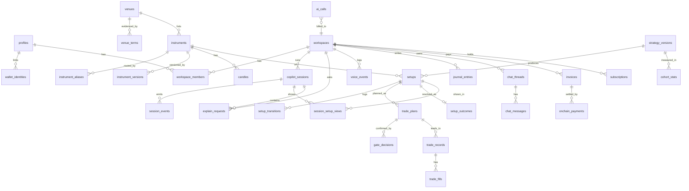
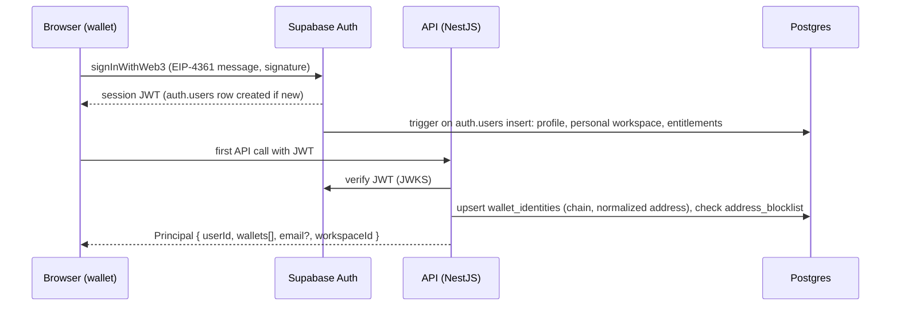

# A06: Database Schema (Supabase Postgres)

**Set:** A (full product) | **Status:** Planning document, v2.0, 2026-10-10 (wallet-first identity, venue-aware instruments, Explain and voice metadata, crypto billing; forex and country-specific payment tables removed)
**Depends on:** A01 (decision), A03 (market tables), A04 (engine/setup/outcome tables), A05 (AI tables). **Feeds:** A07 (API reads/writes), A08 (retention, backups, cost).
**Subset for MVP:** B03 (ready-to-run). This file is the full target schema.

> **The SQL in this document is not hand-typed.** It is inserted verbatim from the migration files in `set-b/sql/` (the same files B03 uses), so the document and the runnable code cannot drift. I applied all of it to a fresh local **PostgreSQL 16** with small shims for Supabase's `auth.users` and `auth.uid()`, then ran `tests/b03_smoke_test.sql`: 17 statements that must fail did fail (15 when only the MVP migrations are applied; the two invoice checks need `0010`) (bad address, duplicate wallet, second primary, voice-confirmed gate, bad OHLC, missing partition, immutable strategy config, duplicate cohort, RLS violations, and others) and nothing else failed. **Not exercised:** `pg_cron`, Supabase's real roles and PostgREST, and how Supabase populates `auth.users` / `auth.identities` for Web3 sign-in **[verify in a scratch project]**. Table and column names are the contract used by the other documents.

---

## 1. Conventions

| Topic | Rule |
|---|---|
| IDs | `uuid` with `gen_random_uuid()`; deterministic keys (event ids, setup keys) are `text` sha1 hex |
| Time | `timestamptz` in UTC. Candle `open_time` is the candle **open**. All sessions, day rollovers and weekly/monthly opens are UTC (no time-zone tables for crypto) |
| Prices | `numeric(20,8)`; volumes `numeric(28,8)`; fiat-style money `numeric(12,2)`; token amounts `numeric(38,0)` in atomic units |
| Enums | `text` + `CHECK (... in (...))`. Easier to migrate than Postgres enums |
| Instrument identity | **(venue, market type, symbol)**, canonical string `BINANCE:PERP:BTCUSDT`. Spot and perp are different series; candles are never mixed across them |
| Soft delete | Only where legally needed (`profiles.deleted_at`); otherwise hard delete with retention jobs |
| Tenancy | `workspace_id` on every user-owned row. A personal workspace is auto-created per user |
| Identity | One `profiles` row per Supabase Auth user. **Wallets are the primary login**; email is optional and lives only in `auth.users`. Several wallets can link to one profile |
| Global vs tenant | **Global tables** (venues, instruments, candles, engine events, setups, stats) have RLS enabled with **no policies** (deny to `anon`/`authenticated`); only the API/worker role reads them. **Tenant tables** have RLS policies as a second lock |
| Zero retention | No table has a column that can hold a screen frame, an uploaded image or audio. The only image-related columns are `image_bytes`, `image_width`, `image_height` (numbers) on `explain_requests`. A smoke-test query lists any column whose name looks like `image/frame/audio/blob` outside that allow-list |
| JSON | `jsonb` for versioned payloads (config, plan, facts), never for fields you filter on frequently |
| Naming | snake_case, plural table names, FK columns `<table>_id` |

---

## 2. Entity overview



Tables marked **full only** (`subscriptions`, `invoices`, `onchain_payments`, `chain_cursors`, `stream_leases`, `exchange_connections`, `outbox`) live in `upgrade/0010_full_product_additions.sql` and are described in section 8.2. Everything else is in the MVP migrations.

---

## 3. Identity, tenancy, wallets, invites (`0001_identity.sql`)

**How wallet-first login maps to tables**



| Decision | Reason |
|---|---|
| `wallet_identities` mirrors the wallet that Supabase authenticated, written by the API (idempotent upsert), not by a trigger | Supabase's internal representation of Web3 identities may change **[verify]**; our own table is the contract used by payments, sanctions screening and portability (A01 section 5.4) |
| Address normalization is stored: EVM lowercase hex (display form is EIP-55 checksum), Solana base58 as-is | A unique index on `(chain, address_norm)` stops one wallet from owning two accounts. Case-sensitivity bugs are the classic cause of duplicate accounts |
| Partial unique indexes ignore unlinked wallets | A wallet can be re-linked to another account after the first owner unlinks it |
| Only one primary wallet per user (partial unique index) | Billing and display need one deterministic wallet |
| Email is not a column in our tables | It is optional and lives in `auth.users`; linking an email later uses Supabase's `updateUser` (A07). Notifications check for it before choosing the EMAIL channel |
| `address_blocklist` + `profiles.blocked_at` | Sanctions screening against public lists (A09). The API refuses blocked wallets before issuing a Principal |
| `invite_codes` + `redeem_invite()` | Free wallet accounts are trivially automated; invites are the first Sybil defense (A08 section 2). `signup.open` is a feature flag |
| `invite_codes.grants` is merged into the redeemer's `entitlements.limits` by `redeem_invite()` | Invited testers need more than the tiny public free budget; default grant is a $1.00/day AI budget. The grant is data, so each code can differ |
| Free-tier limits live in `entitlements.limits` (set by `handle_new_user`) | Defaults here: 3 Explains and 40 chat answers per day, 60 voice utterances per day, $0.05/day AI budget. Tunable per workspace without a migration |

```sql
-- 0001_identity.sql
-- Profiles, wallet identities, workspaces, membership, entitlements, invites, address blocklist, signup trigger
-- SMC Copilot MVP schema (Set B03, v2). Subset of Set A06; names and columns are identical so Set A upgrades are additive.

-- 1.1 Users. Supabase Auth owns auth.users (wallet sign-in creates the row; email is optional and may be NULL).
create table profiles (
  id            uuid primary key references auth.users(id) on delete cascade,
  display_name  text,                          -- NULL for wallet-only users; UI shows a shortened address
  locale        text not null default 'en',
  timezone      text not null default 'UTC',
  disclaimer_accepted_at timestamptz,          -- A09: must be set before first session
  disclaimer_version     text,
  age_confirmed_at       timestamptz,          -- 18+ self-attestation (A09 section 4.3)
  invite_redeemed_at     timestamptz,          -- closed-beta / Sybil gate; API refuses feature endpoints until set
  blocked_at    timestamptz,                   -- sanctions or abuse block (A09, A08 section 2)
  block_reason  text,
  created_at    timestamptz not null default now(),
  deleted_at    timestamptz
);

-- 1.2 Wallets mirrored from Supabase Auth so identity is portable and queryable (A01 section 5.4).
-- Written by the API on first authenticated request after verifying the Supabase JWT/identity (idempotent upsert).
create table wallet_identities (
  id            uuid primary key default gen_random_uuid(),
  user_id       uuid not null references profiles(id) on delete cascade,
  chain         text not null check (chain in ('evm','solana')),
  address_norm  text not null,                 -- evm: lowercase 0x + 40 hex; solana: base58 as-is (case-sensitive)
  address_display text not null,               -- EIP-55 checksum form for evm; same as norm for solana
  is_primary    boolean not null default false,
  linked_at     timestamptz not null default now(),
  last_login_at timestamptz,
  unlinked_at   timestamptz,
  check (
    (chain = 'evm'    and address_norm ~ '^0x[0-9a-f]{40}$') or
    (chain = 'solana' and address_norm ~ '^[1-9A-HJ-NP-Za-km-z]{32,44}$')
  )
);
create unique index wallet_identities_addr_uq on wallet_identities (chain, address_norm) where unlinked_at is null;
create unique index wallet_identities_one_primary on wallet_identities (user_id) where is_primary and unlinked_at is null;
create index on wallet_identities (user_id);

-- 1.3 Sanctions / abuse blocklist (public lists such as OFAC SDN digital-currency addresses are loaded by a job; A09)
create table address_blocklist (
  chain         text not null check (chain in ('evm','solana')),
  address_norm  text not null,
  source        text not null,                 -- 'OFAC_SDN','MANUAL'
  listed_at     timestamptz not null default now(),
  note          text,
  primary key (chain, address_norm)
);

create table workspaces (
  id         uuid primary key default gen_random_uuid(),
  name       text not null,
  kind       text not null default 'personal' check (kind in ('personal','team')),
  owner_id   uuid not null references profiles(id),
  plan       text not null default 'free' check (plan in ('free','pro','team')),
  created_at timestamptz not null default now()
);

create table workspace_members (
  workspace_id uuid not null references workspaces(id) on delete cascade,
  user_id      uuid not null references profiles(id) on delete cascade,
  role         text not null default 'member' check (role in ('owner','admin','member')),
  created_at   timestamptz not null default now(),
  primary key (workspace_id, user_id)
);
create index on workspace_members (user_id);

-- Feature entitlements resolved from plan + overrides (read by API on session start)
create table entitlements (
  workspace_id uuid primary key references workspaces(id) on delete cascade,
  limits       jsonb not null default '{}',     -- see handle_new_user for the free-tier defaults
  features     jsonb not null default '{}',
  updated_at   timestamptz not null default now()
);

-- Helper used by RLS policies
create or replace function is_member(ws uuid) returns boolean
language sql stable security definer set search_path = public as $$
  select exists (select 1 from workspace_members m where m.workspace_id = ws and m.user_id = auth.uid());
$$;

-- Auto-create profile + personal workspace on signup (wallet sign-in has no email; that is fine)
create or replace function handle_new_user() returns trigger
language plpgsql security definer set search_path = public as $$
declare ws uuid;
begin
  insert into profiles (id, display_name)
  values (new.id, nullif(coalesce(new.raw_user_meta_data->>'name', split_part(coalesce(new.email,''),'@',1)), ''));
  insert into workspaces (name, kind, owner_id) values ('Personal', 'personal', new.id) returning id into ws;
  insert into workspace_members (workspace_id, user_id, role) values (ws, new.id, 'owner');
  insert into entitlements (workspace_id, limits, features) values (ws,
    '{"session_hours_per_month":30,"chat_per_day":40,"explain_per_day":3,"voice_per_day":60,"daily_ai_budget_usd":0.05,"max_instruments":4,"concurrent_sessions":1}',
    '{"beta":true,"voice":true,"explain":true,"approx_mode":true,"exchange_readonly":false}');
  return new;
end $$;
create trigger on_auth_user_created after insert on auth.users
  for each row execute function handle_new_user();

-- 1.4 Closed-beta invite codes (first Sybil defense; A08 section 2)
create table invite_codes (
  code        text primary key,
  note        text,
  max_uses    integer not null default 1 check (max_uses > 0),
  uses        integer not null default 0 check (uses >= 0),
  expires_at  timestamptz,
  grants      jsonb not null default '{"daily_ai_budget_usd":1.00}',   -- merged into the redeemer's personal entitlements.limits (invited testers need more than the tiny public free budget)
  created_at  timestamptz not null default now(),
  check (uses <= max_uses)
);
create table invite_redemptions (
  code        text not null references invite_codes(code),
  user_id     uuid not null references profiles(id) on delete cascade,
  redeemed_at timestamptz not null default now(),
  primary key (code, user_id)
);

-- Atomic redemption used by POST /v1/me/invite. Returns true if redeemed (or already redeemed by this user).
create or replace function redeem_invite(p_code text, p_user uuid) returns boolean
language plpgsql security definer set search_path = public as $$
declare ok boolean := false;
begin
  if exists (select 1 from invite_redemptions where code = p_code and user_id = p_user) then
    return true;
  end if;
  update invite_codes set uses = uses + 1
   where code = p_code and uses < max_uses and (expires_at is null or expires_at > now())
   returning true into ok;
  if coalesce(ok, false) then
    insert into invite_redemptions (code, user_id) values (p_code, p_user);
    update profiles set invite_redeemed_at = now() where id = p_user;
    update entitlements e set limits = e.limits || (select grants from invite_codes where code = p_code), updated_at = now()
      from workspaces w where w.id = e.workspace_id and w.owner_id = p_user and w.kind = 'personal';
    return true;
  end if;
  return false;
end $$;
```

---

## 4. Market data (`0002_market.sql`)

| Piece | Purpose |
|---|---|
| `venues` | One row per exchange adapter. `analysis_enabled` (users may chart here), `crosscheck_enabled` (used by rule V7), `enabled` (kill switch for geo-blocks or terms problems) |
| `venue_terms` | The evidence for a licence decision (URL, date, summary, decision, reviewer, whether counsel reviewed). **No row means everything from that venue is `INTERNAL_ONLY`** |
| `instrument_license` (view) | Effective licence class. An instrument is only as open as its latest `venue_terms` decision allows; `PROHIBITED` or a disabled venue forces `INTERNAL_ONLY`. **Raw-price egress (A02 `price.tick`/`candle.update`, A07 candle endpoints) must read this view, never `instruments.license_class` alone.** The smoke test proves the downgrade and the PROHIBITED override |
| `instruments` | Venue + market type + venue symbol. `asset_class` allows `FX` as the forex seam; `pip_size` is NULL for crypto. Daily rollover is 00:00 UTC |
| `instrument_versions` | Tick-size / precision history so old setups are interpreted with the metadata of their day |
| `instrument_aliases` | `PRIMARY` = which adapter serves the instrument; `CROSSCHECK` = which other venue symbol (same market type) feeds rule V7. A cross-check never writes candles (A03 section 5) |
| `symbol_search_keys` | Normalized strings produced by OCR, vision or typing (`BTCUSDTP`, `XBTUSD`, `BITCOIN`) that yield candidates for the resolver (A03 section 4.2) |
| `candles` | Monthly partitions by `open_time`; `scope_id` is the nil UUID for shared data and a workspace id for bring-your-own-feed rows (forex later). Stores base volume `v` and quote volume `vq` |
| `candle_quarantine`, `candle_gaps`, `dq_incidents`, `feed_usage` | Data quality and per-venue audit for rate limits and terms questions |

```sql
-- 0002_market.sql
-- Venues, licence terms, instruments (venue + market type + symbol), aliases, calendars, partitioned candles, data-quality tables
-- SMC Copilot MVP schema (Set B03, v2). Subset of Set A06; names and columns are identical so Set A upgrades are additive.

create table venues (
  id            text primary key,                -- 'BINANCE','BYBIT','OKX','COINBASE','KRAKEN','FX_STUB'
  name          text not null,
  kind          text not null default 'CEX' check (kind in ('CEX','FX_STUB')),
  analysis_enabled boolean not null default false,   -- may a user session analyze charts on this venue?
  crosscheck_enabled boolean not null default false, -- used as a V7 cross-check source
  enabled       boolean not null default true,       -- kill switch (geo-block, terms problem)
  provider_id   text not null,                       -- adapter id in packages/market-data ('binance', ...)
  notes         text,
  created_at    timestamptz not null default now()
);

-- Evidence for the licence decision (A03 section 2.3, spike S5). No row => instruments stay INTERNAL_ONLY.
create table venue_terms (
  id            uuid primary key default gen_random_uuid(),
  venue_id      text not null references venues(id),
  url           text not null,
  retrieved_at  date not null,
  summary       text not null,
  decision      text not null check (decision in ('DISPLAY_OK','INTERNAL_ONLY','BYO_ONLY','PROHIBITED')),
  reviewer      text not null,
  reviewed_at   timestamptz not null default now(),
  counsel_reviewed boolean not null default false
);
create index on venue_terms (venue_id, reviewed_at desc);

create table market_calendars (
  id         text primary key,                  -- 'CRYPTO_24_7' (launch); 'FX_24_5' is added by the forex migration
  tz         text not null,
  definition jsonb not null                     -- weekly hours, maintenance windows, holidays
);

-- An instrument is a (venue, market type, symbol). BINANCE:SPOT:BTCUSDT and BINANCE:PERP:BTCUSDT are different series.
create table instruments (
  id              uuid primary key default gen_random_uuid(),
  venue_id        text not null references venues(id),
  market_type     text not null check (market_type in ('SPOT','PERP')),
  canonical       text not null unique,          -- 'BINANCE:PERP:BTCUSDT'
  venue_symbol    text not null,                 -- as the venue writes it: 'BTCUSDT','BTC-USD','BTC-USDT-SWAP','XBT/USD'
  display         text not null,                 -- 'BTC/USDT Perpetual'
  asset_class     text not null default 'CRYPTO' check (asset_class in ('CRYPTO','FX')),   -- FX is a seam, not served at launch
  base            text not null,
  quote           text not null,
  price_precision smallint not null,
  tick_size       numeric(20,10) not null,
  lot_size        numeric(24,10),
  pip_size        numeric(20,10),                -- forex seam, NULL for crypto
  calendar_id     text not null default 'CRYPTO_24_7' references market_calendars(id),
  day_rollover_hour smallint not null default 0 check (day_rollover_hour between 0 and 23),   -- UTC; crypto 1d opens 00:00 UTC
  license_class   text not null default 'INTERNAL_ONLY' check (license_class in ('INTERNAL_ONLY','DISPLAY_OK','BYO_ONLY')),
  attribution     text,
  active          boolean not null default true,
  created_at      timestamptz not null default now(),
  unique (venue_id, market_type, venue_symbol)
);

-- Tick size / precision history: changed metadata writes a new row instead of editing history (A03 section 4.1)
create table instrument_versions (
  instrument_id   uuid not null references instruments(id) on delete cascade,
  valid_from      timestamptz not null,
  tick_size       numeric(20,10) not null,
  lot_size        numeric(24,10),
  price_precision smallint not null,
  primary key (instrument_id, valid_from)
);

-- Adapter routing: which provider serves an instrument (PRIMARY) and which peers cross-check it (CROSSCHECK, V7).
-- A CROSSCHECK row never writes candles; it names the peer venue symbol (same market type) to compare against.
create table instrument_aliases (
  id              uuid primary key default gen_random_uuid(),
  instrument_id   uuid not null references instruments(id) on delete cascade,
  provider_id     text not null,
  venue_symbol    text not null,
  market_type     text not null check (market_type in ('SPOT','PERP')),
  priority        smallint not null default 1,
  role            text not null default 'PRIMARY' check (role in ('PRIMARY','FALLBACK','CROSSCHECK')),
  unique (instrument_id, provider_id, role)
);
create index on instrument_aliases (instrument_id, role, priority);

-- Normalized strings from OCR / vision / manual input ('BTCUSDT', 'BTCUSDTP', 'XBTUSD', 'BITCOIN') used by the resolver (A03 section 4.2)
create table symbol_search_keys (
  key           text not null,
  instrument_id uuid not null references instruments(id) on delete cascade,
  weight        smallint not null default 1,
  primary key (key, instrument_id)
);

-- Effective licence: an instrument is only as open as its venue's recorded terms allow (A03 section 2.3)
create view instrument_license as
select i.id as instrument_id,
       case
         when v.enabled is false then 'INTERNAL_ONLY'
         when t.decision is null or t.decision = 'PROHIBITED' then 'INTERNAL_ONLY'
         when i.license_class = 'DISPLAY_OK' and t.decision = 'DISPLAY_OK' then 'DISPLAY_OK'
         when i.license_class = 'BYO_ONLY'   and t.decision in ('DISPLAY_OK','BYO_ONLY') then 'BYO_ONLY'
         else 'INTERNAL_ONLY'
       end as effective_class,
       (t.decision = 'PROHIBITED') as venue_prohibited
from instruments i
join venues v on v.id = i.venue_id
left join lateral (
  select decision from venue_terms vt where vt.venue_id = i.venue_id order by reviewed_at desc limit 1
) t on true;

-- Candles: shared scope uses the nil uuid; BYO-feed rows (forex later) use workspace_id as scope_id
create table candles (
  instrument_id uuid not null references instruments(id),
  tf            text not null check (tf in ('1m','5m','15m','30m','1h','4h','1d')),
  open_time     timestamptz not null,
  scope_id      uuid not null default '00000000-0000-0000-0000-000000000000',
  o numeric(20,8) not null, h numeric(20,8) not null, l numeric(20,8) not null, c numeric(20,8) not null,
  v             numeric(28,8),                  -- base-asset volume
  vq            numeric(28,8),                  -- quote-asset volume where the venue provides it
  volume_kind   text not null default 'REAL' check (volume_kind in ('REAL','TICK','NONE')),
  provider_id   text not null,
  status        text not null default 'CLOSED' check (status in ('CLOSED','INCOMPLETE')),
  flags         integer not null default 0,     -- bitmask: 1 SPIKE_SUSPECT, 2 CROSSCHECK_DIVERGENCE, 4 FLAT, 8 GAP_PRICE, 16 BACKFILLED
  ingested_at   timestamptz not null default now(),
  primary key (instrument_id, tf, scope_id, open_time),
  check (l <= least(o, c) and h >= greatest(o, c) and l > 0)
) partition by range (open_time);

-- Monthly partitions, created ahead by the worker (maintain_partitions in 0007); pg_cron is optional
create or replace function ensure_candle_partition(month_start date) returns void
language plpgsql as $$
declare
  part_name text := format('candles_%s', to_char(month_start, 'YYYY_MM'));
  next_month date := (month_start + interval '1 month')::date;
begin
  if to_regclass(part_name) is null then
    execute format('create table %I partition of candles for values from (%L) to (%L)',
                   part_name, month_start, next_month);
    execute format('alter table %I enable row level security', part_name);   -- partitions are tables too
  end if;
end $$;

-- Bootstrap: current month plus 3 ahead
select ensure_candle_partition(date_trunc('month', now() + (n || ' month')::interval)::date)
from generate_series(0, 3) n;

create table candle_quarantine (
  id            bigserial primary key,
  instrument_id uuid references instruments(id),
  provider_id   text not null,
  reason        text not null,                  -- BAD_OHLC, MISALIGNED, FUTURE_TS, CONFLICTING_DUPLICATE ...
  raw           jsonb not null,
  received_at   timestamptz not null default now()
);
create index on candle_quarantine (received_at);

create table candle_gaps (
  id            bigserial primary key,
  instrument_id uuid not null references instruments(id),
  tf            text not null,
  from_time     timestamptz not null,
  to_time       timestamptz not null,
  status        text not null default 'OPEN' check (status in ('OPEN','BACKFILLING','RESOLVED','UNRESOLVABLE')),
  detected_at   timestamptz not null default now(),
  resolved_at   timestamptz,
  unique (instrument_id, tf, from_time, to_time)
);

create table dq_incidents (
  id            bigserial primary key,
  instrument_id uuid references instruments(id),
  venue_id      text references venues(id),
  rule          text not null,                  -- V1..V9, FEED_STALE, GEO_BLOCKED, WS_ROTATION_FAILED, ...
  details       jsonb,
  opened_at     timestamptz not null default now(),
  closed_at     timestamptz
);
create index on dq_incidents (opened_at desc);

create table feed_usage (                       -- audit for rate limits and terms questions (A03 section 2.3 rule 6)
  day         date not null,
  venue_id    text not null references venues(id),
  rest_requests integer not null default 0,
  ws_connects integer not null default 0,
  rate_limit_hits integer not null default 0,
  symbols     integer not null default 0,
  primary key (day, venue_id)
);
```

**Partitioning notes.** The primary key includes `open_time` (required for partitioned tables). Lookups by `(instrument_id, tf, scope_id, open_time desc)` are index-only on the PK. The worker calls `maintain_partitions()` daily (section 10), so `pg_cron` is optional. Dropping an old month is `drop table candles_2026_01;` (instant, no vacuum). A missing partition makes inserts **fail loudly** (tested), which is why the maintenance job also alerts if fewer than 2 future months exist.

---

## 5. Engine, setups, outcomes, statistics (`0003_engine.sql`)

Changes from v1: `setup_outcomes.fees_r` (round-trip taker fees in R; `realized_r` is net of it, A04 section 13.2) and `cohort_stats.segment` (`ALL` at launch; `SPOT`/`PERP` once there is enough history to split). `strategy_versions.config_hash` is computed by a trigger so the app and database cannot disagree; `config` is immutable after insert.

```sql
-- 0003_engine.sql
-- Strategy versions, engine snapshots/events, setups, plans, outcomes, cohort stats
-- SMC Copilot MVP schema (Set B03, v2). Subset of Set A06; names and columns are identical so Set A upgrades are additive.

create table strategy_versions (
  id             uuid primary key default gen_random_uuid(),
  name           text not null,                 -- 'smc-core'
  version        integer not null,
  schema_version integer not null,
  config         jsonb not null,
  config_hash    text not null unique,
  status         text not null default 'DRAFT' check (status in ('DRAFT','ACTIVE','RETIRED')),
  notes          text,
  created_at     timestamptz not null default now(),
  unique (name, version)
);

-- Immutability: config can never change after insert
create or replace function forbid_config_update() returns trigger language plpgsql as $$
begin
  if new.config is distinct from old.config or new.config_hash is distinct from old.config_hash then
    raise exception 'strategy_versions.config is immutable; create a new version';
  end if;
  return new;
end $$;
create trigger strategy_versions_immutable before update on strategy_versions
  for each row execute function forbid_config_update();

create table engine_snapshots (
  instrument_id       uuid not null references instruments(id),
  strategy_version_id uuid not null references strategy_versions(id),
  as_of               timestamptz not null,
  state               jsonb not null,
  state_hash          text not null,
  created_at          timestamptz not null default now(),
  primary key (instrument_id, strategy_version_id, as_of)
);

create table engine_events (
  event_id            text primary key,         -- sha1(instrument|tf|type|anchor|strategy)
  instrument_id       uuid not null references instruments(id),
  strategy_version_id uuid not null references strategy_versions(id),
  tf                  text not null,
  type                text not null,            -- SWING_CONFIRMED, BOS_UP, CHOCH_DOWN, FVG_CREATED, OB_CREATED, LIQ_SWEEP, ...
  anchor_time         timestamptz not null,
  event_time          timestamptz not null,     -- candle close time when the event became known
  confirmed_at        timestamptz not null,
  payload             jsonb not null,
  revision            integer not null default 0,
  retracted           boolean not null default false,
  created_at          timestamptz not null default now()
);
create index on engine_events (instrument_id, strategy_version_id, event_time desc);
create index on engine_events (instrument_id, type, event_time desc);

create table setups (
  id                  uuid primary key default gen_random_uuid(),
  setup_key           text not null,            -- deterministic hash from A04 section 8.2
  strategy_version_id uuid not null references strategy_versions(id),
  instrument_id       uuid not null references instruments(id),
  template            text not null check (template in ('T1','T2','T3')),
  direction           text not null check (direction in ('LONG','SHORT')),
  entry_tf            text not null,
  bias_tf             text not null,
  state               text not null check (state in ('CANDIDATE','REJECTED','ARMED','TRIGGERED','EXPIRED','INVALIDATED','RESOLVED')),
  grade               text check (grade in ('A','B','C')),
  score               numeric(6,2),
  features            jsonb,                    -- per-feature contributions
  reason_codes        text[] not null default '{}',
  components          jsonb not null,           -- ids of swings/zones/pools used
  poi                 jsonb not null,
  invalidation        jsonb not null,
  data_provider_id    text,
  data_revised        boolean not null default false,
  created_at          timestamptz not null,     -- candle close time (not wall clock)
  armed_at            timestamptz,
  triggered_at        timestamptz,
  closed_at           timestamptz,
  unique (strategy_version_id, setup_key)
);
create index on setups (instrument_id, state, created_at desc);
create index on setups (strategy_version_id, template, grade, created_at desc);

create table setup_transitions (
  id          bigserial primary key,
  setup_id    uuid not null references setups(id) on delete cascade,
  from_state  text,
  to_state    text not null,
  at_candle   timestamptz not null,
  reason_codes text[] not null default '{}',
  created_at  timestamptz not null default now()
);
create index on setup_transitions (setup_id, at_candle);

create table trade_plans (
  id            uuid primary key default gen_random_uuid(),
  setup_id      uuid not null references setups(id) on delete cascade,
  plan_version  integer not null default 1,
  plan          jsonb not null,                 -- TradePlan (A04 section 10.2)
  plan_hash     text not null,                  -- used by gate token binding
  created_at    timestamptz not null default now(),
  unique (setup_id, plan_version)
);

create table setup_outcomes (                   -- shadow outcome for every ARMED setup (A04 section 13.2)
  setup_id              uuid primary key references setups(id) on delete cascade,
  outcome_rules_version text not null,
  outcome               text not null check (outcome in ('TP1_FIRST','SL_FIRST','INVALIDATED_BEFORE_FILL','EXPIRED_OPEN','NO_FILL')),
  filled                boolean not null,
  fill_time             timestamptz,
  fill_price            numeric(20,8),
  resolution_time       timestamptz,
  r_tp1                 numeric(8,3),
  r_tp2                 numeric(8,3),
  fees_r                numeric(8,3),            -- round-trip taker fees expressed in R (A04 section 13.2)
  realized_r            numeric(8,3),            -- net of fees_r
  mfe_r                 numeric(8,3),
  mae_r                 numeric(8,3),
  bars_to_resolution    integer,
  ambiguous_intrabar    boolean not null default false,
  data_revised          boolean not null default false,
  computed_at           timestamptz not null default now()
);

create table cohort_stats (                     -- base rates shown to users (A04 section 8.4)
  id                  uuid primary key default gen_random_uuid(),
  strategy_version_id uuid not null references strategy_versions(id),
  asset_class         text not null,
  template            text not null,
  grade               text not null,
  direction           text,                     -- null = both
  segment             text not null default 'ALL',  -- 'ALL' at launch; 'SPOT'/'PERP' once n allows splitting
  source              text not null check (source in ('LIVE_SHADOW','BACKTEST')),
  window_from         timestamptz not null,
  window_to           timestamptz not null,
  n                   integer not null,
  wins                integer not null,
  rate                numeric(6,5) not null,
  ci_low              numeric(6,5) not null,
  ci_high             numeric(6,5) not null,
  avg_r               numeric(8,3),
  median_mae_r        numeric(8,3),
  median_mfe_r        numeric(8,3),
  sufficient          boolean not null,
  status              text not null default 'ACTIVE' check (status in ('ACTIVE','UNDER_REVIEW')),
  computed_at         timestamptz not null default now(),
  unique nulls not distinct (strategy_version_id, asset_class, segment, template, grade, direction, source)   -- PG15+
);

create table calibration_reports (
  id                  uuid primary key default gen_random_uuid(),
  strategy_version_id uuid not null references strategy_versions(id),
  computed_at         timestamptz not null default now(),
  report              jsonb not null            -- reliability bins, Brier, log loss, drift vs backtest
);

create table backtest_runs (
  id                  uuid primary key default gen_random_uuid(),
  strategy_version_id uuid not null references strategy_versions(id),
  instrument_ids      uuid[] not null,
  data_from           timestamptz not null,
  data_to             timestamptz not null,
  split               jsonb not null,           -- tune / validate / final-test ranges
  trials_count        integer not null,         -- parameter variants tried (multiple-testing disclosure)
  criteria            jsonb not null,           -- pre-registered acceptance criteria
  results             jsonb,
  status              text not null default 'QUEUED' check (status in ('QUEUED','RUNNING','DONE','FAILED')),
  created_at          timestamptz not null default now()
);


-- config_hash is computed by the database so the app and DB can never disagree (sha256 of jsonb text form)
create or replace function set_config_hash() returns trigger language plpgsql as $$
begin
  new.config_hash := encode(sha256(convert_to(new.config::text, 'UTF8')), 'hex');
  return new;
end $$;
create trigger strategy_versions_hash before insert on strategy_versions
  for each row execute function set_config_hash();
```

---

## 6. Sessions, Explain, voice metadata, gate, trades, journal (`0004_sessions_trades.sql`)

| Piece | Notes |
|---|---|
| `copilot_sessions` | Stores **counters** (frames sampled, OCR hints, Explains, voice utterances, AI calls, cost), the capture surface type and a small `client_info`. Never frames or audio (A02 section 2) |
| `explain_requests` | Request metadata plus the `ExplainOutput` text (after id-to-number substitution) for the user's history, 90 days. Image size and dimensions only. `read_call_id`/`write_call_id` point at `ai_calls` without a foreign key because `ai_calls` is partitioned and expires sooner |
| `voice_events` | Engine tag, duration, latency, confidence, language, outcome, route and command id. **No audio and no transcript text**; the transcript, if kept, is a normal `chat_messages` row. 30-day retention |
| `gate_decisions` | The database enforces the execution-gate rules that matter most: `confirmed_via` can only be `UI_TAP`, a `CONFIRMED` row must have `UI_TAP` and a decision time (NULL-safe), and a token cannot live longer than 120 s. **Voice can never confirm, even through a bug in the API** (tested) |
| `trade_records` | `source` is `MANUAL`, `EXCHANGE_READONLY` (L1 via read-only API keys), `ONCHAIN_READONLY` (L1 via a public wallet address) or `ROUTED` (L2, later). Leverage and fees are stored for the liquidation and R maths |
| `risk_profiles` | Adds `default_leverage` and `taker_fee_bps` (default 5) used by the plan builder (A04 section 10) |

```sql
-- 0004_sessions_trades.sql
-- Risk profile, sessions, Explain requests, voice metadata, execution gate, trades, journal
-- SMC Copilot MVP schema (Set B03, v2). Subset of Set A06; names and columns are identical so Set A upgrades are additive.
-- NOTHING in this file can hold a screen frame, an uploaded image or audio: there is no bytea/blob column for them (A02 section 3.5).

create table risk_profiles (
  workspace_id          uuid primary key references workspaces(id) on delete cascade,
  account_currency      text not null default 'USD',      -- display unit for sizing; stablecoin accounts use USD
  balance               numeric(16,2),
  risk_per_trade_pct    numeric(5,2) not null default 1.00 check (risk_per_trade_pct > 0 and risk_per_trade_pct <= 10),
  max_risk_per_trade_pct numeric(5,2) not null default 2.00,
  daily_loss_limit_pct  numeric(5,2),
  weekly_loss_limit_pct numeric(5,2),
  max_open_risk_pct     numeric(5,2),
  default_leverage      numeric(6,2) check (default_leverage is null or default_leverage >= 1),   -- perps; drives LIQUIDATION_BEFORE_STOP (A04)
  taker_fee_bps         numeric(6,2) not null default 5.00 check (taker_fee_bps >= 0),
  updated_at            timestamptz not null default now()
);

create table copilot_sessions (
  id            uuid primary key default gen_random_uuid(),
  workspace_id  uuid not null references workspaces(id) on delete cascade,
  user_id       uuid not null references profiles(id),
  instrument_id uuid references instruments(id),
  tf            text,
  strategy_version_id uuid references strategy_versions(id),
  mode          text not null default 'FEED' check (mode in ('FEED','APPROX')),
  context_source text not null default 'MANUAL' check (context_source in ('MANUAL','OCR','VISION')),
  capture_surface text check (capture_surface in ('TAB','WINDOW','SCREEN','NONE')),
  state         text not null default 'CREATED' check (state in ('CREATED','ACTIVE','PAUSED','ENDED')),
  last_seq      bigint not null default 0,
  started_at    timestamptz not null default now(),
  ended_at      timestamptz,
  end_reason    text,
  -- counters only (no frames, no audio are ever stored)
  frames_sampled   integer not null default 0,
  ocr_hints        integer not null default 0,
  explain_count    integer not null default 0,
  voice_utterances integer not null default 0,
  ai_calls_count   integer not null default 0,
  ai_cost_usd      numeric(10,4) not null default 0,
  client_info   jsonb                              -- UA family, WebGPU yes/no, STT engine chosen; no fingerprinting fields
);
create index on copilot_sessions (workspace_id, started_at desc);
create index on copilot_sessions (user_id, state);

create table session_events (                    -- ordered event log for resume (A02 section 4); 7-day retention
  session_id uuid not null references copilot_sessions(id) on delete cascade,
  seq        bigint not null,
  type       text not null,
  payload    jsonb not null,
  created_at timestamptz not null default now(),
  primary key (session_id, seq)
);

create table session_setup_views (               -- what this user was actually shown (journal basis)
  session_id    uuid not null references copilot_sessions(id) on delete cascade,
  setup_id      uuid not null references setups(id),
  first_shown_at timestamptz not null default now(),
  last_state    text not null,
  primary key (session_id, setup_id)
);

-- "Explain this chart" requests (A02 section 3.4-3.6, A05 section 8). Metadata and the text answer only; never the image.
create table explain_requests (
  id            uuid primary key default gen_random_uuid(),
  workspace_id  uuid not null references workspaces(id) on delete cascade,
  user_id       uuid not null references profiles(id),
  session_id    uuid references copilot_sessions(id) on delete set null,   -- NULL for one-shot POST /v1/explain
  source        text not null check (source in ('SHARE','UPLOAD')),
  mode          text not null check (mode in ('GROUNDED','APPROXIMATE')),
  input_mode    text not null default 'TEXT' check (input_mode in ('TEXT','VOICE')),
  instrument_id uuid references instruments(id),
  symbol_text   text,                              -- what the chart said, as read (e.g. 'BTCUSDT.P'); short text
  tf            text,
  resolved_by   text check (resolved_by in ('OCR','PICKER','VISION')),
  feed_match    text check (feed_match in ('MATCH','MISMATCH','UNVERIFIED')),
  feed_delta_pct numeric(8,4),
  image_bytes   integer,                           -- size only
  image_width   smallint,
  image_height  smallint,
  question      text,                              -- optional user question (typed or voice transcript)
  facts_hash    text,
  output        jsonb,                             -- ExplainOutput after id->number substitution (A05 section 5); 90-day retention
  read_call_id  uuid,                              -- ai_calls.id for J1 (no FK: ai_calls is partitioned and expires sooner)
  write_call_id uuid,                              -- ai_calls.id for J7
  cost_usd      numeric(10,6) not null default 0,
  latency_ms    integer,
  outcome       text not null check (outcome in ('OK','OK_APPROXIMATE','NOT_A_CHART','FEED_MISMATCH','BUDGET_BLOCKED','RATE_LIMITED','GUARDRAIL_REJECTED','ERROR','TIMEOUT')),
  created_at    timestamptz not null default now()
);
create index on explain_requests (workspace_id, created_at desc);
create index on explain_requests (created_at);

-- Voice metadata (A02 section 6). No audio, no transcript text here: the transcript, if kept, is a chat message.
create table voice_events (
  id            bigserial primary key,
  workspace_id  uuid not null references workspaces(id) on delete cascade,
  user_id       uuid not null references profiles(id),
  session_id    uuid references copilot_sessions(id) on delete set null,
  at            timestamptz not null default now(),
  engine        text not null check (engine in ('whisper-web','moonshine-web','parakeet-server','whispercpp-server','typed')),
  duration_ms   integer,
  latency_ms    integer,
  confidence    real check (confidence is null or (confidence >= 0 and confidence <= 1)),
  language      text,
  outcome       text not null check (outcome in ('OK','LOW_CONFIDENCE','NO_SPEECH','FORBIDDEN_BY_VOICE','CLARIFY','ERROR')),
  route         text check (route in ('COMMAND','QUESTION','EXPLAIN')),
  command_id    text,                              -- e.g. 'explain_chart','mute','next_setup'
  error_code    text
);
create index on voice_events (workspace_id, at desc);
create index on voice_events (at);

create table gate_decisions (                    -- A04 section 11.1: single-use, 60 s, plan-hash-bound
  id           uuid primary key default gen_random_uuid(),
  workspace_id uuid not null references workspaces(id) on delete cascade,
  user_id      uuid not null references profiles(id),
  plan_id      uuid not null references trade_plans(id),
  plan_hash    text not null,
  token_hash   text not null unique,             -- store hash only, never the token
  action       text not null default 'ISSUED' check (action in ('ISSUED','CONFIRMED','DECLINED','EXPIRED','VOIDED')),
  issued_at    timestamptz not null default now(),
  expires_at   timestamptz not null,
  decided_at   timestamptz,
  confirmed_via text check (confirmed_via = 'UI_TAP'),   -- the database itself refuses any other channel: voice can never confirm
  void_reason  text,
  check (expires_at <= issued_at + interval '120 seconds'),
  check (action <> 'CONFIRMED' or coalesce(confirmed_via = 'UI_TAP' and decided_at is not null, false))   -- NULL-safe: CONFIRMED needs a UI tap and a decision time
);
create index on gate_decisions (plan_id);

create table trade_records (
  id            uuid primary key default gen_random_uuid(),
  workspace_id  uuid not null references workspaces(id) on delete cascade,
  user_id       uuid not null references profiles(id),
  plan_id       uuid references trade_plans(id),
  setup_id      uuid references setups(id),
  gate_id       uuid references gate_decisions(id),
  source        text not null default 'MANUAL' check (source in ('MANUAL','EXCHANGE_READONLY','ONCHAIN_READONLY','ROUTED')),
  wallet_id     uuid references wallet_identities(id),      -- for ONCHAIN_READONLY / wallet-signed routing
  external_ref  text,                                       -- exchange order id or tx hash
  instrument_id uuid not null references instruments(id),
  direction     text not null check (direction in ('LONG','SHORT')),
  leverage      numeric(6,2),
  stop_price    numeric(20,8),
  targets       numeric(20,8)[],
  status        text not null default 'OPEN' check (status in ('OPEN','CLOSED','CANCELLED')),
  close_reason  text check (close_reason in ('TP','SL','MANUAL','LIQUIDATED','EXPIRED','UNKNOWN')),
  realized_r    numeric(8,3),
  opened_at     timestamptz not null default now(),
  closed_at     timestamptz,
  notes         text
);
create index on trade_records (workspace_id, status, opened_at desc);

create table trade_fills (
  id        bigserial primary key,
  trade_id  uuid not null references trade_records(id) on delete cascade,
  side      text not null check (side in ('ENTRY','EXIT')),
  fill_time timestamptz not null,
  price     numeric(20,8) not null,
  size      numeric(24,8) not null,
  fee       numeric(24,8),
  fee_asset text
);

create table position_events (
  id        bigserial primary key,
  trade_id  uuid not null references trade_records(id) on delete cascade,
  type      text not null,                       -- near_stop, near_target, tp_hit, sl_hit, thesis_degraded, invalidated, stale_data, liquidation_risk
  at_candle timestamptz,
  payload   jsonb,
  created_at timestamptz not null default now()
);

create table journal_entries (
  id           uuid primary key default gen_random_uuid(),
  workspace_id uuid not null references workspaces(id) on delete cascade,
  user_id      uuid not null references profiles(id),
  session_id   uuid references copilot_sessions(id) on delete set null,
  setup_id     uuid references setups(id) on delete set null,
  plan_id      uuid references trade_plans(id) on delete set null,
  trade_id     uuid references trade_records(id) on delete set null,
  explain_id   uuid references explain_requests(id) on delete set null,
  kind         text not null check (kind in ('SETUP_SHOWN','SETUP_REJECTED','GATE','TRADE','NOTE','AI_REVIEW','EXPLAIN')),
  notes        text,
  tags         text[] not null default '{}',
  payload      jsonb,                            -- plan snapshot, reason codes. Never an image or audio reference (zero retention)
  created_at   timestamptz not null default now()
);
create index on journal_entries (workspace_id, created_at desc);
create index on journal_entries using gin (tags);
```

---

## 7. AI tables (`0005_ai.sql`)

`ai_calls.job` uses the J1 to J8 identifiers from A05 section 2. `data_class` (D0, D1, D2) records which data class the request carried so the audit can prove a D2 request never went to a provider that is barred from D2 (A05 section 12.2). `ai_global_ledger` is the hard daily backstop against free-account abuse.

```sql
-- 0005_ai.sql
-- AI calls (partitioned), shared narratives, chat, budget ledger, eval runs
-- SMC Copilot MVP schema (Set B03, v2). Subset of Set A06; names and columns are identical so Set A upgrades are additive.

create table ai_calls (
  id            uuid not null default gen_random_uuid(),
  created_at    timestamptz not null default now(),
  workspace_id  uuid references workspaces(id) on delete set null,
  user_id       uuid,
  session_id    uuid,
  correlation_id text,
  job           text not null check (job in ('J1_IMAGE_READ','J2_NARRATIVE','J3_CHAT','J4_REJECT_EXPLAIN','J5_REVIEW','J6_ROUTER','J7_EXPLAIN','J8_EVAL_JUDGE')),
  data_class    text not null default 'D0' check (data_class in ('D0','D1','D2')),   -- A05 section 12.2: decides which providers may see the request
  provider      text not null,
  model         text not null,
  prompt_version text not null,
  facts_hash    text,
  tokens_in     integer, tokens_out integer, tokens_cached_in integer, tokens_cache_write integer,
  cost_usd      numeric(10,6) not null default 0,
  latency_ms    integer,
  outcome       text not null check (outcome in ('OK','SCHEMA_RETRY','TEMPLATE_FALLBACK','GUARDRAIL_REJECTED','PROVIDER_BLOCKED_BY_POLICY','ERROR','TIMEOUT','RATE_LIMITED','BUDGET_BLOCKED')),
  error_code    text,
  primary key (id, created_at)
) partition by range (created_at);
create index on ai_calls (workspace_id, created_at desc);
create index on ai_calls (job, created_at desc);
-- monthly partitions, retention 90 days (drop old partitions)
create or replace function ensure_ai_calls_partition(month_start date) returns void
language plpgsql as $$
declare
  part_name text := format('ai_calls_%s', to_char(month_start, 'YYYY_MM'));
  next_month date := (month_start + interval '1 month')::date;
begin
  if to_regclass(part_name) is null then
    execute format('create table %I partition of ai_calls for values from (%L) to (%L)',
                   part_name, month_start, next_month);
    execute format('alter table %I enable row level security', part_name);
  end if;
end $$;
select ensure_ai_calls_partition(date_trunc('month', now() + (n || ' month')::interval)::date)
from generate_series(0, 3) n;

create table narratives (                        -- shared across users (A05 section 9.1)
  id             uuid primary key default gen_random_uuid(),
  instrument_id  uuid not null references instruments(id),
  facts_hash     text not null,
  prompt_version text not null,
  language       text not null default 'en',
  source         text not null check (source in ('LLM','TEMPLATE')),
  model          text,
  content        jsonb not null,                 -- NarrativeOutput after substitution
  created_at     timestamptz not null default now(),
  unique (instrument_id, facts_hash, prompt_version, language)
);

create table chat_threads (
  id           uuid primary key default gen_random_uuid(),
  workspace_id uuid not null references workspaces(id) on delete cascade,
  user_id      uuid not null references profiles(id),
  session_id   uuid references copilot_sessions(id) on delete set null,
  title        text,
  summary      text,                             -- rolling summary (A05 section 7)
  created_at   timestamptz not null default now()
);
create table chat_messages (
  id          uuid primary key default gen_random_uuid(),
  thread_id   uuid not null references chat_threads(id) on delete cascade,
  role        text not null check (role in ('user','assistant','system_note')),
  content     text not null,
  meta        jsonb,                              -- ChatMeta, refs_used, scope
  facts_hash  text,
  input_mode  text not null default 'TEXT' check (input_mode in ('TEXT','VOICE')),
  stt_engine  text check (stt_engine in ('whisper-web','moonshine-web','parakeet-server','whispercpp-server','typed')),
  stt_confidence real check (stt_confidence is null or (stt_confidence >= 0 and stt_confidence <= 1)),
  created_at  timestamptz not null default now(),
  retracted   boolean not null default false
);
create index on chat_messages (thread_id, created_at);

create table ai_budget_ledger (
  workspace_id uuid not null references workspaces(id) on delete cascade,
  day          date not null,
  cost_usd     numeric(10,4) not null default 0,
  calls        integer not null default 0,
  primary key (workspace_id, day)
);

create table eval_runs (
  id          uuid primary key default gen_random_uuid(),
  suite       text not null,                      -- 'ocr','stt','image_read','narrative','explain','chat_redteam','latency'
  git_sha     text,
  prompt_version text,
  model       text,
  metrics     jsonb not null,
  passed      boolean not null,
  created_at  timestamptz not null default now()
);


-- Hard backstop against free-account abuse (A05 section 9.3, A08 section 2): one row per UTC day
create table ai_global_ledger (
  day         date primary key,
  cost_usd    numeric(12,4) not null default 0,
  calls       integer not null default 0,
  cap_usd     numeric(12,2) not null,            -- copied from config at first write of the day
  tripped_at  timestamptz                         -- when the cap was hit; AI features degrade to templates until the next UTC day
);
```

---

## 8. Platform tables

### 8.1 MVP platform tables (`0006_platform.sql`)

```sql
-- 0006_platform.sql
-- Notifications, audit, flags, idempotency, setup displays, feedback, abuse flags
-- SMC Copilot MVP schema (Set B03, v2). Subset of Set A06; names and columns are identical so Set A upgrades are additive.

create table notifications (
  id           uuid primary key default gen_random_uuid(),
  workspace_id uuid not null references workspaces(id) on delete cascade,
  user_id      uuid not null references profiles(id),
  channel      text not null check (channel in ('IN_APP','EMAIL','PUSH')),   -- EMAIL only if the user linked an email
  type         text not null,
  payload      jsonb not null,
  status       text not null default 'PENDING' check (status in ('PENDING','SENT','FAILED','READ')),
  created_at   timestamptz not null default now(),
  sent_at      timestamptz
);
create index on notifications (user_id, status, created_at desc);

create table audit_log (
  id           bigserial primary key,
  at           timestamptz not null default now(),
  actor_id     uuid,
  workspace_id uuid,
  action       text not null,                      -- 'gate.confirm','wallet.link','wallet.unlink','exchange_key.add','plan.change','admin.flag','invoice.paid'
  target       text,
  ip           inet,
  detail       jsonb
);
create index on audit_log (workspace_id, at desc);

create table feature_flags (
  key        text primary key,
  enabled    boolean not null default false,
  rollout_pct smallint not null default 0 check (rollout_pct between 0 and 100),
  rules      jsonb,
  updated_at timestamptz not null default now()
);

create table idempotency_keys (                  -- A07 section 1; purge rows older than 24 h
  workspace_id uuid not null references workspaces(id) on delete cascade,
  key          text not null,
  request_hash text not null,
  status       integer,
  response     jsonb,
  created_at   timestamptz not null default now(),
  primary key (workspace_id, key)
);
create index on idempotency_keys (created_at);

create table setup_displays (                    -- what base rate was shown with each setup (calibration input, migration 0007)
  setup_id   uuid not null references setups(id) on delete cascade,
  cohort_id  uuid not null references cohort_stats(id),
  rate       numeric(6,5) not null,
  ci_low     numeric(6,5) not null,
  ci_high    numeric(6,5) not null,
  shown_at   timestamptz not null default now(),
  primary key (setup_id, cohort_id)
);

create table user_feedback (
  id         uuid primary key default gen_random_uuid(),
  workspace_id uuid references workspaces(id) on delete cascade,
  user_id    uuid references profiles(id),
  target_type text not null,                        -- 'narrative','chat_message','setup'
  target_id  text not null,
  rating     smallint check (rating in (-1, 1)),
  comment    text,
  created_at timestamptz not null default now()
);


-- Temporary blocks from rate limiting and abuse detection. Subjects are HASHED (salted) values; raw IPs are not stored.
create table abuse_flags (
  id          bigserial primary key,
  subject_kind text not null check (subject_kind in ('IP_HASH','DEVICE_HASH','USER','WALLET')),
  subject_key text not null,
  reason      text not null,                      -- 'TURNSTILE_FAIL','SIGNUP_BURST','AI_BUDGET_ABUSE','SEED_PHRASE_PASTE_REPEAT'
  created_at  timestamptz not null default now(),
  expires_at  timestamptz not null
);
create index on abuse_flags (subject_kind, subject_key, expires_at);
```

Queue tables (`pg-boss`) are created by the library in its own schema (`pgboss`) at MVP; BullMQ uses Valkey on the same VM in the full version (A01 section 5.5).

### 8.2 Full-product-only tables (`upgrade/0010_full_product_additions.sql`)

Billing is on-chain and prepaid (A08 section 7): an invoice fixes chain, asset and an **exact atomic amount that is unique among open invoices** on the treasury address (EVM), or a Solana Pay reference key (Solana); a partial unique index enforces it; the watcher records transfers idempotently by `(chain, tx_hash, log_index)`; a confirmed payment extends a `subscriptions` period. There is no card processor, no webhook inbox and no auto-renew. `exchange_connections` holds **read-only** exchange API keys (envelope-encrypted) for L1 position monitoring; trade-scoped keys appear only with L2 (M9).

```sql
-- 0010_full_product_additions.sql  (UPGRADE, not part of the MVP)
-- Adds the Set A tables the MVP omitted: crypto billing, multi-worker stream leases, exchange read-only connections, outbox.
-- Purely additive: no changes to MVP tables. Apply at milestone M6 (public launch; see B06). RLS is enabled for the new tables as in 0008.

-- 10.1 Subscriptions: prepaid periods paid in stablecoin (no card processor, no auto-renew; A08 section 7)
create table subscriptions (
  id               uuid primary key default gen_random_uuid(),
  workspace_id     uuid not null references workspaces(id) on delete cascade,
  plan             text not null check (plan in ('pro','team')),
  status           text not null check (status in ('ACTIVE','EXPIRED','CANCELED','COMPED')),
  source           text not null default 'CRYPTO' check (source in ('CRYPTO','COMP')),
  period_start     timestamptz not null,
  period_end       timestamptz not null,
  last_invoice_id  uuid,
  created_at       timestamptz not null default now(),
  check (period_end > period_start)
);
create index on subscriptions (workspace_id, period_end desc);

-- 10.2 Invoices. Matching (A08 section 7):
--   EVM:    one treasury address per chain (a wallet you control; no private key on the server) + an invoice-specific EXACT amount
--           (price plus a unique sub-cent suffix), unique among OPEN invoices (index below).
--   Solana: Solana Pay style reference key on one receiving address.   [verify both in spike S6]
--   derivation_index is reserved for a later per-invoice-address design if volume ever needs it; it stays NULL at launch.
create table invoices (
  id               uuid primary key default gen_random_uuid(),
  workspace_id     uuid not null references workspaces(id) on delete cascade,
  user_id          uuid not null references profiles(id),
  plan             text not null check (plan in ('pro','team')),
  period_months    smallint not null check (period_months between 1 and 12),
  amount_usd       numeric(12,2) not null check (amount_usd > 0),
  chain_id         text not null,                   -- CAIP-2: 'eip155:8453' (Base), 'eip155:42161', 'solana:mainnet', ...
  asset            text not null check (asset in ('USDC','USDT')),
  asset_contract   text not null,                   -- token contract / mint address (pinned per chain in config)
  amount_atomic    numeric(38,0) not null check (amount_atomic > 0),
  pay_to           text not null,                   -- treasury / receiving address for the chain
  reference        text,                            -- Solana Pay reference public key
  derivation_index integer,                         -- reserved (NULL at launch)
  status           text not null default 'OPEN' check (status in ('OPEN','PAID','EXPIRED','UNDERPAID','OVERPAID','MANUAL_REVIEW')),
  expires_at       timestamptz not null,
  paid_at          timestamptz,
  created_at       timestamptz not null default now(),
  unique (chain_id, pay_to, reference),
  unique (chain_id, derivation_index)
);
create index on invoices (workspace_id, created_at desc);
create index on invoices (status, expires_at);
create unique index invoices_open_amount_uq on invoices (chain_id, pay_to, amount_atomic) where status = 'OPEN';   -- two open invoices can never share an exact amount

create table onchain_payments (
  id               uuid primary key default gen_random_uuid(),
  invoice_id       uuid references invoices(id),    -- NULL = unmatched transfer, kept for manual review
  chain_id         text not null,
  tx_hash          text not null,
  log_index        integer not null default 0,      -- EVM Transfer log index; Solana instruction index
  from_address     text,
  to_address       text not null,
  asset_contract   text not null,
  amount_atomic    numeric(38,0) not null,
  block_number     bigint,
  block_time       timestamptz,
  confirmations    integer not null default 0,
  status           text not null default 'SEEN' check (status in ('SEEN','CONFIRMED','REORGED','IGNORED')),
  seen_at          timestamptz not null default now(),
  unique (chain_id, tx_hash, log_index)
);
create index on onchain_payments (invoice_id);

create table chain_cursors (                         -- watcher progress per chain, for restart and reorg handling
  chain_id        text primary key,
  last_block      bigint not null,
  last_block_hash text,
  updated_at      timestamptz not null default now()
);

alter table subscriptions add constraint subscriptions_last_invoice_fk foreign key (last_invoice_id) references invoices(id);

-- 10.3 Multi-worker ownership of market streams (A03 section 8)
create table stream_leases (
  stream_key  text primary key,                     -- 'BINANCE:PERP:BTCUSDT:1m'
  owner_id    text not null,
  expires_at  timestamptz not null
);

-- 10.4 L1 read-only exchange connections (A04 section 11). Read-only keys only; trade-only keys arrive with L2 (M9).
create table exchange_connections (
  id               uuid primary key default gen_random_uuid(),
  workspace_id     uuid not null references workspaces(id) on delete cascade,
  venue_id         text not null references venues(id),
  scope            text not null check (scope in ('READ','TRADE')),
  label            text,
  secret_ciphertext bytea not null,                 -- envelope-encrypted (A08 section 2); decrypted only inside the worker
  key_id           text not null,
  last_verified_at timestamptz,
  created_at       timestamptz not null default now(),
  revoked_at       timestamptz
);
create index on exchange_connections (workspace_id) where revoked_at is null;

-- 10.5 Outbox (reliable event publishing from DB transactions; worker polls)
create table outbox (
  id         bigserial primary key,
  topic      text not null,
  key        text,
  payload    jsonb not null,
  created_at timestamptz not null default now(),
  processed_at timestamptz
);
create index on outbox (created_at) where processed_at is null;

-- RLS: server-only unless a tenant policy is added
alter table subscriptions        enable row level security;
alter table invoices             enable row level security;
alter table onchain_payments     enable row level security;
alter table chain_cursors        enable row level security;
alter table stream_leases        enable row level security;
alter table exchange_connections enable row level security;
alter table outbox               enable row level security;

create policy sub_read on subscriptions for select using (is_member(workspace_id));
create policy inv_read on invoices      for select using (is_member(workspace_id) and user_id = auth.uid());
```

---

## 9. Row-Level Security (second lock behind API checks) (`0008_rls.sql`)

```sql
-- 0008_rls.sql
-- Row-level security as a second lock (the API is the primary enforcement point)
-- SMC Copilot MVP schema (Set B03, v2). Subset of Set A06; names and columns are identical so Set A upgrades are additive.


-- 1) RLS on every table in public. Tables without policies are unreachable by anon/authenticated (global data stays server-only).
do $$
declare r record;
begin
  for r in select tablename from pg_tables where schemaname = 'public' loop
    execute format('alter table %I enable row level security', r.tablename);
  end loop;
end $$;

-- 2) Tenant policies (only matter if PostgREST/Supabase client is ever exposed to browsers; MVP is API-only)
create policy ws_read on workspaces        for select using (is_member(id));
create policy wm_read on workspace_members for select using (user_id = auth.uid() or is_member(workspace_id));
create policy rp_all  on risk_profiles     for all    using (is_member(workspace_id)) with check (is_member(workspace_id));
create policy cs_read on copilot_sessions  for select using (is_member(workspace_id));
create policy je_all  on journal_entries   for all    using (is_member(workspace_id) and user_id = auth.uid())
                                                    with check (is_member(workspace_id) and user_id = auth.uid());
create policy tr_all  on trade_records     for all    using (is_member(workspace_id) and user_id = auth.uid())
                                                    with check (is_member(workspace_id) and user_id = auth.uid());
create policy ct_all  on chat_threads      for all    using (is_member(workspace_id) and user_id = auth.uid())
                                                    with check (is_member(workspace_id) and user_id = auth.uid());
create policy nt_read on notifications     for select using (user_id = auth.uid());
create policy wi_read on wallet_identities for select using (user_id = auth.uid());
create policy ex_read on explain_requests  for select using (is_member(workspace_id) and user_id = auth.uid());
create policy ve_read on voice_events      for select using (is_member(workspace_id) and user_id = auth.uid());

-- 3) Supabase only: API-only access means the browser roles should have no table privileges at all.
--    (Skipped automatically on plain Postgres where these roles do not exist.)
do $$
begin
  if exists (select 1 from pg_roles where rolname = 'anon') then
    revoke all on all tables    in schema public from anon, authenticated;
    revoke all on all sequences in schema public from anon, authenticated;
    revoke all on all functions in schema public from anon, authenticated;
    alter default privileges in schema public revoke all on tables    from anon, authenticated;
    alter default privileges in schema public revoke all on sequences from anon, authenticated;
    alter default privileges in schema public revoke all on functions from anon, authenticated;
  end if;
end $$;
```

- The API connects with a privileged server role (bypasses RLS) and enforces tenancy in code through a `WorkspaceGuard`; RLS only protects against a leaked anon key or a mistaken direct client query. On Supabase the migration also **revokes all table privileges from `anon` and `authenticated`**, so even a leaked public key reads nothing.
- Integration tests assert that user B's JWT cannot read user A's journal, Explain history or wallets through PostgREST, and cannot write into A's workspace even as himself (the smoke test covers these with a simulated `authenticated` role).
- Sensitive: `exchange_connections.secret_ciphertext` has no policy for `authenticated`.

---

## 10. Retention, volume and sizing (`0007_maintenance.sql`)

```sql
-- 0007_maintenance.sql
-- Partition maintenance and retention (called daily by the worker via pg-boss; no pg_cron needed)
-- SMC Copilot MVP schema (Set B03, v2). Subset of Set A06; names and columns are identical so Set A upgrades are additive.


create or replace function maintain_partitions(months_ahead int default 3) returns void
language plpgsql as $$
declare n int;
begin
  for n in 0..months_ahead loop
    perform ensure_candle_partition(date_trunc('month', now() + (n || ' month')::interval)::date);
    perform ensure_ai_calls_partition(date_trunc('month', now() + (n || ' month')::interval)::date);
  end loop;
end $$;

-- Retention (A06 section 10; durations are defaults, product decisions in A09). Returns counts for logging. ai_calls partitions older than 90 days are dropped whole.
create or replace function retention_purge() returns jsonb
language plpgsql as $$
declare
  r record; d_events int; d_quar int; d_idem int; d_voice int; d_explain int; d_chat int; d_audit int; d_abuse int; dropped text[] := '{}';
  upper_bound timestamptz;
begin
  delete from session_events where created_at < now() - interval '7 days';
  get diagnostics d_events = row_count;
  delete from candle_quarantine where received_at < now() - interval '30 days';
  get diagnostics d_quar = row_count;
  delete from idempotency_keys where created_at < now() - interval '24 hours';
  get diagnostics d_idem = row_count;
  delete from voice_events where at < now() - interval '30 days';
  get diagnostics d_voice = row_count;
  delete from explain_requests where created_at < now() - interval '90 days';
  get diagnostics d_explain = row_count;
  delete from chat_messages where created_at < now() - interval '90 days';
  get diagnostics d_chat = row_count;
  delete from chat_threads t where t.created_at < now() - interval '90 days'
    and not exists (select 1 from chat_messages m where m.thread_id = t.id);
  delete from audit_log where at < now() - interval '1 year';
  get diagnostics d_audit = row_count;
  delete from abuse_flags where expires_at < now() - interval '7 days';
  get diagnostics d_abuse = row_count;

  for r in
    select c.relname, pg_get_expr(c.relpartbound, c.oid) as bound
    from pg_inherits i
    join pg_class c on c.oid = i.inhrelid
    join pg_class p on p.oid = i.inhparent
    where p.relname = 'ai_calls'
  loop
    -- bound text looks like: FOR VALUES FROM ('2026-10-01 00:00:00+00') TO ('2026-11-01 00:00:00+00')
    upper_bound := ((regexp_match(r.bound, 'TO \(''([^'']+)''\)'))[1])::timestamptz;
    if upper_bound < now() - interval '90 days' then
      execute format('drop table %I', r.relname);
      dropped := dropped || r.relname::text;
    end if;
  end loop;

  return jsonb_build_object('session_events', d_events, 'candle_quarantine', d_quar,
                            'idempotency_keys', d_idem, 'voice_events', d_voice, 'explain_requests', d_explain,
                            'chat_messages', d_chat, 'audit_log', d_audit, 'abuse_flags', d_abuse,
                            'dropped_ai_calls_partitions', dropped);
end $$;
```

| Table | Growth driver | Retention (default) | Estimate at 1,000 users (10 h/month each) |
|---|---|---|---|
| `candles` | 20 instruments, 1m + HTF | 1m: 180 days hot, then archive; HTF forever | about 0.6 GB hot 1m + 0.3 GB HTF/year (A03 section 10) |
| `engine_events` | structure/zone events | 2 years, then summarized | low hundreds of MB/year (my estimate) |
| `setups`, `setup_transitions`, `setup_outcomes` | engine output, **global** | Forever (the dataset for statistics) | small (thousands/day) |
| `session_events` | per-session seq log | 7 days | low |
| `ai_calls` | about 40 calls per session-hour (A05 section 3 workload) | 90 days (partition drop), aggregates kept | 1,000 x 10 h x 40 = 400k rows/month, roughly 160 MB/month at about 400 B/row (my estimate) |
| `explain_requests` | up to 3/day free | 90 days | about 30k rows/month x about 2.5 KB = 75 MB/month (my estimate) |
| `voice_events` | about 20 utterances/session-hour | 30 days | 200k rows/month x about 120 B = 24 MB (my estimate) |
| `chat_messages` | typed + voice transcripts | 90 days; user can delete any time | low |
| `journal_entries` | per user | until the user deletes | low |
| `candle_quarantine` | bad data | 30 days | negligible |
| `audit_log` | gate, wallet, key and payment actions | 1 year | low |
| `abuse_flags` | rate-limit and abuse flags | expiry + 7 days | negligible |
| `onchain_payments`, `invoices` | payments | Kept (financial records; counsel decides the minimum, A09) | tiny |

Total at 1,000 users stays well inside Supabase Pro's 8 GB (A01 section 5.2); growth risk is `ai_calls` and 1m candles, both bounded by partition drops. **The Free plan's 500 MB is only for development**, and a free project pauses after a week of inactivity **[verify]**.

---

## 11. Representative queries (so the schema is proven usable)

```sql
-- Latest N closed candles for the engine warm-up (index-only on PK, shared scope)
select open_time, o, h, l, c, v
from candles
where instrument_id = $1 and tf = $2 and scope_id = '00000000-0000-0000-0000-000000000000'
order by open_time desc limit $3;

-- May this instrument's raw prices leave the server? (API and gateway check this per instrument)
select effective_class from instrument_license where instrument_id = $1;     -- 'DISPLAY_OK' to emit price.tick; otherwise derived objects only

-- Resolver candidates for an OCR string such as "BTCUSDT.P" (normalize first: upper-case, drop separators and '.')
select i.canonical, k.weight
from symbol_search_keys k join instruments i on i.id = k.instrument_id
where k.key = $1 and i.active and (i.venue_id = $2 or $2 is null)
order by k.weight desc;

-- V7 cross-check peers for an instrument
select provider_id, venue_symbol from instrument_aliases
where instrument_id = $1 and role = 'CROSSCHECK' order by priority;

-- Cohort stats refresh (nightly): rate and Wilson interval at 95%
with c as (
  select s.strategy_version_id, i.asset_class, s.template, s.grade, s.direction,
         count(*) filter (where o.filled) as n,
         count(*) filter (where o.outcome = 'TP1_FIRST') as wins
  from setups s
  join setup_outcomes o on o.setup_id = s.id
  join instruments i on i.id = s.instrument_id
  where o.filled and not o.data_revised
  group by 1,2,3,4,5
)
select *, wins::float / nullif(n,0) as rate,
       (wins + 1.9208) / (n + 3.8416)
         - 1.96 / (n + 3.8416) * sqrt(wins::float * (n - wins) / n + 0.9604) as ci_low,
       (wins + 1.9208) / (n + 3.8416)
         + 1.96 / (n + 3.8416) * sqrt(wins::float * (n - wins) / n + 0.9604) as ci_high
from c where n > 0;

-- Why was nothing shown today? (rejected setups with reason codes)
select created_at, template, direction, reason_codes
from setups
where instrument_id = $1 and state = 'REJECTED' and created_at >= now() - interval '24 hours'
order by created_at desc;

-- Daily AI cost per job and data class (cost control, A05 section 9)
select date_trunc('day', created_at) d, job, data_class, sum(cost_usd) cost, count(*) calls
from ai_calls group by 1,2,3 order by 1 desc, 4 desc;

-- Global daily AI spend vs cap (kill-switch input)
select day, cost_usd, cap_usd, tripped_at from ai_global_ledger order by day desc limit 7;

-- STT health by engine over 7 days (feeds the voice fallback decision, A02 section 6)
select engine, count(*) n, avg(confidence) conf, percentile_cont(0.5) within group (order by latency_ms) p50_ms
from voice_events where at > now() - interval '7 days' group by 1;

-- Open invoices about to expire (payment watcher; full product)
select id, chain_id, pay_to, amount_atomic, expires_at from invoices where status = 'OPEN' and expires_at < now() + interval '10 minutes';
```

(The base rate shown with each setup is logged in the side table `setup_displays` (section 8.1), not on `setups`, to keep immutable setup facts separate from statistics that change nightly.)

---

## 12. Migrations and tooling

| Concern | Decision |
|---|---|
| Tooling | **Drizzle ORM** schema in `packages/db/src/schema/*.ts` for typed queries; **the SQL files are the source of truth for DDL** that Drizzle cannot express (partitions, views, RLS, triggers, functions). `drizzle-kit` may generate diffs for ordinary tables; hand-written SQL goes into the same numbered folder |
| Layout (exact files) | `0001_identity`, `0002_market`, `0003_engine`, `0004_sessions_trades`, `0005_ai`, `0006_platform`, `0007_maintenance`, `0008_rls`, `0009_seed_reference`, then `upgrade/0010_full_product_additions` (M6) and `upgrade/0011_forex_enable` (M10-B, dark until gate G7). `0000_dev_shims.sql` is local/CI only. `apply.sh` applies them in order (`--with-shims`, `--with-upgrade`, `--with-forex`) |
| Tests | `tests/b03_smoke_test.sql` (17 expected failures and the happy paths). CI runs it on a throwaway Postgres 16 after every migration change, and fails if an unexpected error appears or an expected one does not |
| Applying | `pnpm db:migrate` in CI (staging first, then production) using the Supabase direct connection for DDL; the app connects through the transaction pooler with prepared statements disabled for the driver **[verify pooler mode against your driver]** |
| Rules | Forward-only; idempotent where cheap; breaking changes use expand/contract across two deploys |
| Environments | `local` (docker-compose Postgres), `staging` (Supabase Free; exercised weekly because inactive free projects pause **[verify]**) and `prod` (Supabase Pro) |
| Seeds | `0009`: calendar, venues, a small core universe (Binance spot and perp for BTC/ETH/SOL; Bybit/Coinbase/Kraken for cross-checks), aliases, search keys, first `strategy_versions` row, flags. **No forex rows.** Tick sizes in the seed are placeholders; the worker overwrites them from each venue's instruments endpoint at boot **[verify per venue]** |
| Backups | Supabase Pro daily backups (7 days); PITR is a paid add-on and is **not** assumed; plus a weekly encrypted `pg_dump` of tenant, payment and statistics tables to free object storage (A08 section 9). Candles are re-fetchable from venues, so they are the lowest-priority backup |
| Connection budget | API + worker pool sizes stay under the plan's connection limit (use the pooler); pg-boss uses its own small pool |
| Performance guardrails | `statement_timeout` per role; slow-query log; `pg_stat_statements`; index review at M6 |

**Rejected:** Prisma (weak partitioned-table and `ON CONFLICT` ergonomics, shadow-database friction), TypeORM (migration drift), Supabase Edge Functions for business logic (portability), storing candles as arrays inside one jsonb per day (hard to patch gaps and query), storing screenshots in Supabase Storage (violates the zero-retention promise by design).

### 12.1 Seed data (`0009_seed_reference.sql`)

Reference data only: the crypto calendar, venues (everything starts `INTERNAL_ONLY` until a `venue_terms` row exists), the core instruments, aliases, search keys, the first immutable `smc-core` strategy version, feature flags, and a **dev-only** invite code that must be deleted before any real beta (B05 week 16, day 1). Tick sizes are placeholders that the worker overwrites from each venue at boot.

```sql
-- 0009_seed_reference.sql
-- Reference data: calendar, venues, instruments, aliases, search keys, first strategy version, flags, sample invite
-- SMC Copilot MVP schema (Set B03, v2). Subset of Set A06; names and columns are identical so Set A upgrades are additive.


-- Calendar (crypto trades 24/7; the FX calendar arrives with the forex migration) ------------------------------
insert into market_calendars (id, tz, definition) values
 ('CRYPTO_24_7', 'UTC', '{"type":"always_open"}')
on conflict (id) do nothing;

-- Venues. Everything starts INTERNAL_ONLY: no venue_terms row exists until spike S5 records a decision (A03 section 2.3).
insert into venues (id, name, kind, analysis_enabled, crosscheck_enabled, provider_id, notes) values
 ('BINANCE',  'Binance',  'CEX', true,  true,  'binance',  'Primary. Use data-stream.binance.vision; blocks US IPs, host outside the US'),
 ('BYBIT',    'Bybit',    'CEX', false, true,  'bybit',    'Cross-check at MVP; analysis venue promoted at public launch if users chart there'),
 ('OKX',      'OKX',      'CEX', false, false, 'okx',      'Cross-check, adapter arrives in M6 (set crosscheck_enabled = true then); verify candle WS host in spike S2'),
 ('COINBASE', 'Coinbase', 'CEX', false, false, 'coinbase', 'USD spot cross-check, adapter arrives in M6; 1m candles come from REST polling'),
 ('KRAKEN',   'Kraken',   'CEX', false, false, 'kraken',   'USD spot cross-check, adapter arrives in M6; XBT is BTC'),
 ('FX_STUB',  'Forex (not enabled)', 'FX_STUB', false, false, 'fx-stub', 'Seam only: adapter throws NOT_ENABLED')
on conflict (id) do nothing;
update venues set enabled = false where id = 'FX_STUB';

-- Core universe at MVP: BTC, ETH, SOL on Binance spot and perp, plus Bybit as the one MVP cross-check venue for BTC and ETH perps.
-- Coinbase, Kraken and OKX rows exist so the seam is visible, but their adapters (and crosscheck_enabled) arrive in M6.
-- voice.server_stt and explain.approximate are OFF in the MVP (A10 section 1.1) and switch on when those features ship.
-- tick_size / precision below are placeholders: the worker overwrites them from each venue's instruments endpoint at boot [verify per venue].
insert into instruments (venue_id, market_type, canonical, venue_symbol, display, base, quote, price_precision, tick_size, lot_size, license_class, attribution) values
 ('BINANCE','SPOT','BINANCE:SPOT:BTCUSDT','BTCUSDT','BTC/USDT',        'BTC','USDT',2,0.01,0.00001,'DISPLAY_OK','Market data: Binance'),
 ('BINANCE','PERP','BINANCE:PERP:BTCUSDT','BTCUSDT','BTC/USDT Perpetual','BTC','USDT',1,0.1, 0.001,  'DISPLAY_OK','Market data: Binance'),
 ('BINANCE','SPOT','BINANCE:SPOT:ETHUSDT','ETHUSDT','ETH/USDT',        'ETH','USDT',2,0.01,0.0001, 'DISPLAY_OK','Market data: Binance'),
 ('BINANCE','PERP','BINANCE:PERP:ETHUSDT','ETHUSDT','ETH/USDT Perpetual','ETH','USDT',2,0.01,0.001,  'DISPLAY_OK','Market data: Binance'),
 ('BINANCE','SPOT','BINANCE:SPOT:SOLUSDT','SOLUSDT','SOL/USDT',        'SOL','USDT',2,0.01,0.001,  'DISPLAY_OK','Market data: Binance'),
 ('BINANCE','PERP','BINANCE:PERP:SOLUSDT','SOLUSDT','SOL/USDT Perpetual','SOL','USDT',3,0.001,0.1,  'DISPLAY_OK','Market data: Binance'),
 ('BYBIT','PERP','BYBIT:PERP:BTCUSDT','BTCUSDT','BTC/USDT Perpetual','BTC','USDT',2,0.1,0.001,'INTERNAL_ONLY','Market data: Bybit'),
 ('BYBIT','PERP','BYBIT:PERP:ETHUSDT','ETHUSDT','ETH/USDT Perpetual','ETH','USDT',2,0.01,0.01,'INTERNAL_ONLY','Market data: Bybit'),
 ('COINBASE','SPOT','COINBASE:SPOT:BTC-USD','BTC-USD','BTC/USD','BTC','USD',2,0.01,0.00000001,'INTERNAL_ONLY','Market data: Coinbase'),
 ('COINBASE','SPOT','COINBASE:SPOT:ETH-USD','ETH-USD','ETH/USD','ETH','USD',2,0.01,0.00000001,'INTERNAL_ONLY','Market data: Coinbase'),
 ('KRAKEN','SPOT','KRAKEN:SPOT:XBT/USD','XBT/USD','BTC/USD','BTC','USD',1,0.1,0.00000001,'INTERNAL_ONLY','Market data: Kraken')
on conflict (canonical) do nothing;
-- NOTE: Binance rows say DISPLAY_OK as the *intent*; the view instrument_license downgrades them to INTERNAL_ONLY until a
-- venue_terms row with decision DISPLAY_OK exists. Raw-price egress follows the view, never this column on its own.

-- Adapter routing. PRIMARY = the instrument's own venue adapter. CROSSCHECK = same market type on another venue (rule V7).
insert into instrument_aliases (instrument_id, provider_id, venue_symbol, market_type, priority, role)
select i.id, v.provider_id, i.venue_symbol, i.market_type, 1, 'PRIMARY'
from instruments i join venues v on v.id = i.venue_id;

insert into instrument_aliases (instrument_id, provider_id, venue_symbol, market_type, priority, role)
select i.id, x.provider_id, x.venue_symbol, x.market_type, 2, 'CROSSCHECK'
from (values
  ('BINANCE:PERP:BTCUSDT','bybit','BTCUSDT','PERP'),
  ('BINANCE:PERP:ETHUSDT','bybit','ETHUSDT','PERP'),
  ('BINANCE:PERP:BTCUSDT','okx','BTC-USDT-SWAP','PERP'),
  ('BINANCE:PERP:ETHUSDT','okx','ETH-USDT-SWAP','PERP'),
  ('BINANCE:SPOT:BTCUSDT','coinbase','BTC-USD','SPOT'),
  ('BINANCE:SPOT:ETHUSDT','coinbase','ETH-USD','SPOT'),
  ('BINANCE:SPOT:BTCUSDT','kraken','XBT/USD','SPOT')
) as x(canonical, provider_id, venue_symbol, market_type)
join instruments i on i.canonical = x.canonical
on conflict (instrument_id, provider_id, role) do nothing;

-- Search keys for the resolver: uppercase, no separators, no venue prefix (A03 section 4.2). The resolver also scores venue text,
-- perp markers ('.P', 'PERP', 'Perpetual Contract') and last-price proximity; these keys only produce candidates.
insert into symbol_search_keys (key, instrument_id, weight)
select k.key, i.id, k.weight
from (values
  ('BTCUSDT','BINANCE:SPOT:BTCUSDT',10),('BTCUSD','BINANCE:SPOT:BTCUSDT',6),('BTC','BINANCE:SPOT:BTCUSDT',4),('BITCOIN','BINANCE:SPOT:BTCUSDT',4),
  ('BTCUSDT','BINANCE:PERP:BTCUSDT',9),('BTCUSDTP','BINANCE:PERP:BTCUSDT',10),('BTCPERP','BINANCE:PERP:BTCUSDT',8),('XBTUSDT','BINANCE:PERP:BTCUSDT',5),
  ('ETHUSDT','BINANCE:SPOT:ETHUSDT',10),('ETHUSD','BINANCE:SPOT:ETHUSDT',6),('ETH','BINANCE:SPOT:ETHUSDT',4),('ETHEREUM','BINANCE:SPOT:ETHUSDT',4),
  ('ETHUSDT','BINANCE:PERP:ETHUSDT',9),('ETHUSDTP','BINANCE:PERP:ETHUSDT',10),
  ('SOLUSDT','BINANCE:SPOT:SOLUSDT',10),('SOL','BINANCE:SPOT:SOLUSDT',4),('SOLANA','BINANCE:SPOT:SOLUSDT',4),
  ('SOLUSDT','BINANCE:PERP:SOLUSDT',9),('SOLUSDTP','BINANCE:PERP:SOLUSDT',10),
  ('BTCUSDT','BYBIT:PERP:BTCUSDT',8),('BTCUSDTP','BYBIT:PERP:BTCUSDT',9),
  ('ETHUSDT','BYBIT:PERP:ETHUSDT',8),('ETHUSDTP','BYBIT:PERP:ETHUSDT',9),
  ('BTCUSD','COINBASE:SPOT:BTC-USD',10),('ETHUSD','COINBASE:SPOT:ETH-USD',10),
  ('XBTUSD','KRAKEN:SPOT:XBT/USD',10),('BTCUSD','KRAKEN:SPOT:XBT/USD',7)
) as k(key, canonical, weight)
join instruments i on i.canonical = k.canonical
on conflict (key, instrument_id) do nothing;

-- First immutable strategy version (A04 section 2.2 defaults; every rule is a HYPOTHESIS until backtested) ---
-- config_hash is filled by the trigger from migration 0003.
insert into strategy_versions (name, version, schema_version, status, notes, config) values (
 'smc-core', 1, 1, 'ACTIVE', 'MVP defaults from A04. All rules HYPOTHESIS. Tune only by creating version 2.',
 $cfg$
 {
  "schemaVersion": 1,
  "timeframes": { "analysis": ["5m","15m","1h","4h","1d"], "bias": ["4h","1d"], "entry": ["5m","15m"] },
  "swings": { "internal": { "L": 3, "R": 3 }, "external": { "L": 10, "R": 10 } },
  "atr": { "period": 14 },
  "break": { "requireCloseBeyond": true, "bufferAtrMult": 0 },
  "displacement": { "bodyAtrMult": 1.5, "requireFvg": false },
  "fvg": { "minSizeAtrMult": 0.1, "mitigation": "TOUCH" },
  "ob": { "zoneBasis": "WICK", "requireDisplacement": true, "maxAgeBars": 300 },
  "liquidity": { "equalTolAtrMult": 0.1, "sweepMinAtrMult": 0.05, "sweepConfirmBars": 3 },
  "range": { "basis": "EXTERNAL_LEG", "oteLow": 0.62, "oteHigh": 0.79 },
  "sessions": [
    { "id": "ASIA",   "tz": "UTC", "start": "00:00", "end": "08:00" },
    { "id": "LONDON", "tz": "UTC", "start": "07:00", "end": "16:00", "killzone": { "start": "07:00", "end": "10:00" } },
    { "id": "NY_AM",  "tz": "UTC", "start": "12:00", "end": "21:00", "killzone": { "start": "12:00", "end": "15:00" } }
  ],
  "context": { "openLevels": ["1d","1w","1M"], "openLevelsAsTargets": false, "weekendLiquidityWeight": -3, "sessionsTz": "UTC" },
  "setups": { "enabled": ["T1","T2"], "expiryBars": { "5m": 96, "15m": 64, "1h": 48, "4h": 30, "1d": 20 } },
  "filters": { "requireDataOk": true, "requirePoiFresh": true, "enforcePdSideT1": false, "enforcePdSideT2": true,
               "maxSpreadAtrMult": 0.2, "volExtremePercentile": 98, "newsWindow": false },
  "scoring": {
    "weights": { "htfAlignment": 20, "sweepPresent": 15, "displacementStrength": 15, "fvgConfluence": 10, "obFreshness": 10,
                 "killzone": 10, "rrQuality": 10, "zoneSize": 5, "targetClarity": 5, "gapBreakPenalty": -10 },
    "gradeCuts": [50, 70]
  },
  "risk": { "takerFeeBps": 5, "minRR": 1.5, "stopBufferAtrMult": 0.1, "maxStopAtrMult": 3.0, "minStopAtrMult": 0.3 },
  "rules": {
    "swing_internal": { "status": "HYPOTHESIS" }, "swing_external": { "status": "HYPOTHESIS" },
    "bos": { "status": "HYPOTHESIS" }, "choch": { "status": "HYPOTHESIS" },
    "fvg": { "status": "HYPOTHESIS" }, "ob": { "status": "HYPOTHESIS" },
    "eq_liquidity": { "status": "HYPOTHESIS" }, "sweep": { "status": "HYPOTHESIS" },
    "premium_discount": { "status": "HYPOTHESIS" }, "mtf_bias": { "status": "HYPOTHESIS" },
    "killzone": { "status": "HYPOTHESIS" }, "open_levels": { "status": "HYPOTHESIS" }, "weekend_liquidity": { "status": "HYPOTHESIS" }, "T1": { "status": "HYPOTHESIS" }, "T2": { "status": "HYPOTHESIS" }
  }
 }
 $cfg$::jsonb
) on conflict (name, version) do nothing;

-- Feature flags / kill switches (A07 section 9) -------------------------------------------------------------
insert into feature_flags (key, enabled, rollout_pct) values
 ('ai.image_read', true, 100), ('ai.explain', true, 100), ('ai.narrative', true, 100), ('ai.chat', true, 100), ('ai.router', true, 100),
 ('voice.enabled', true, 100), ('voice.server_stt', false, 0), ('explain.enabled', true, 100), ('explain.approximate', false, 0),
 ('engine.t1', true, 100), ('engine.t2', true, 100),
 ('sessions.new', true, 100), ('signup.open', false, 0), ('payments.enabled', false, 0)
on conflict (key) do nothing;

-- DEV ONLY sample invite code. Delete before any real beta:  delete from invite_codes where code = 'DEV-BETA-0001';
insert into invite_codes (code, note, max_uses) values ('DEV-BETA-0001', 'dev only', 5) on conflict (code) do nothing;
```

---

## 13. Assumptions

1. A single Supabase Pro project in the region closest to the VM (latency matters between worker and DB; co-locate, and choose the VM region first because Binance blocks US IPs, A03 section 2).
2. Global engine tables are shared across tenants; the only per-tenant market data is BYO-feed candles keyed by `scope_id` (not used at crypto launch).
3. `auth.uid()` is available in RLS because the client may talk to PostgREST directly for non-hot features; if you disable PostgREST exposure entirely (recommended after MVP), RLS remains as defense in depth.
4. Supabase creates an `auth.users` row for a first-time Web3 sign-in and fires the standard insert trigger **[verify in a scratch project; if not, the API creates the profile on first call using the same function body]**.
5. Cohorts pool spot and perp at launch (`segment = 'ALL'`); splitting needs enough n per cohort (A04 section 8.4).

## 14. Open questions

1. **Expose PostgREST/Supabase client directly to the frontend, or API-only?** Default: API-only (one place for rules, licensing guard, rate limits). RLS is still enabled.
2. **Data residency / region.** Default: single region, documented in the privacy text; users are international, so a regional split is a post-launch decision (A09).
3. **Should journal and Explain history be exportable (CSV/JSON) from day one?** Default: yes by M6 (data-portability expectations in many jurisdictions).
4. **Keep `onchain_payments` and `invoices` after account deletion?** Default: yes, detached from the profile (pseudonymous wallet addresses and amounts), because tax and accounting rules usually require it **[counsel]**. Everything else is deleted.
5. **Do you want per-venue cohorts?** Default: no until n supports it.
