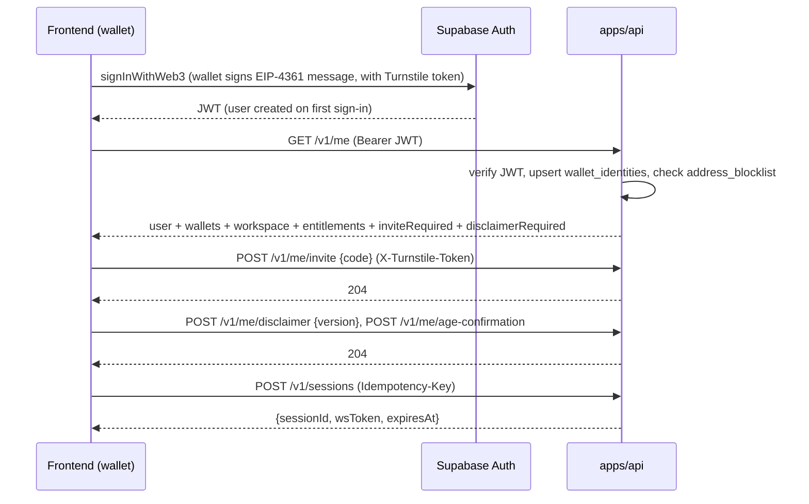
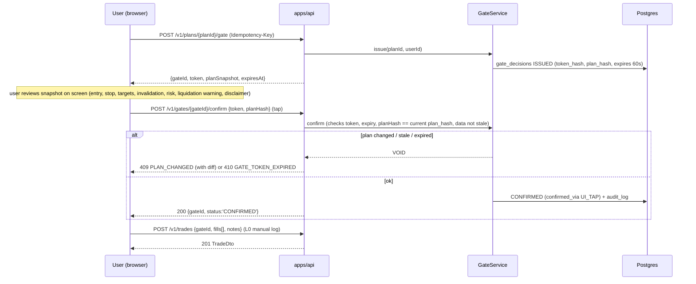

# A07: API Specification (REST + WebSocket)

**Set:** A (full product) | **Status:** Planning document, v2.0, 2026-10-10 (wallet-first auth, Explain, voice, crypto billing; PSP webhooks and country-specific items removed)
**Depends on:** A02 (WebSocket protocol, session model), A03 (licensing gate), A04 (setups, gate, trades), A05 (chat, narratives, Explain), A06 (tables). **Feeds:** the frontend team (you, later), B04 (MVP subset).

> This is the contract between backend and any frontend. Types are Zod-first in `packages/contracts`; OpenAPI is generated from them (`nestjs-zod` + `@nestjs/swagger`), so the code blocks here are illustrative shapes, not a second source of truth.

---

## 1. Conventions

| Topic | Rule |
|---|---|
| Base URL | `https://api.<domain>/v1` (REST), `wss://api.<domain>/ws` (Socket.IO namespace `/ws`) |
| Auth | `Authorization: Bearer <Supabase JWT>` obtained by **wallet sign-in** (Sign-In With Ethereum or Solana, both EIP-4361 style) or by an optional email/OAuth login that was linked to the same account. Verified through the `AuthProvider` interface (JWKS). WebSocket uses a short-lived `wsToken` (A02 section 4) |
| Content | `application/json; charset=utf-8`. Binary frames only on the WebSocket; images only on `POST /v1/explain` (multipart) |
| Time | REST: ISO-8601 UTC strings (`2026-10-10T14:05:00Z`). WebSocket: epoch milliseconds (A02). Both are UTC. Candle times are candle **open** time |
| Prices | JSON **numbers** at instrument precision. (Never strings; the engine never emits more decimals than `pricePrecision`.) Token amounts for billing are **strings** of atomic units (they exceed 2^53) |
| IDs | uuid strings; instrument canonical ids are readable (`BINANCE:PERP:BTCUSDT`); engine/ref ids (`L7`, `Z3`, `E41`) are opaque short strings scoped to an `analysis` snapshot |
| Errors | RFC 9457 `application/problem+json` (section 11) |
| Pagination | Cursor-based: `?limit=50&cursor=<opaque>`; response `{ items, nextCursor }`. Max `limit` 200 |
| Idempotency | `Idempotency-Key: <uuid>` **required** on `POST` endpoints with side effects (create session, gate confirm, create trade, create invoice, Explain). Server stores key + request hash for 24 h; same key + same body returns the stored response; same key + different body returns `409 IDEMPOTENCY_CONFLICT` |
| Correlation | Client may send `X-Correlation-Id`; server always returns one (`X-Correlation-Id`) and logs/traces with it (A08) |
| Rate-limit headers | `RateLimit-Limit`, `RateLimit-Remaining`, `RateLimit-Reset`, and `Retry-After` on 429 |
| Versioning | Additive changes (new fields, new events, new enum values for *outputs*) stay in `v1`. Clients must ignore unknown fields. Breaking change means `/v2`. WS handshake carries `schemaVersion` |
| Validation | Zod on every request; unknown body properties rejected for writes, allowed on reads (forward compat) |
| CORS | Allowlist of frontend origins; no wildcard with credentials |
| Caching | `GET` analysis endpoints return `ETag`; `If-None-Match` supported (cheap polling for non-WS clients) |
| Step-up | Sensitive actions (unlink wallet, delete account, add an exchange key, change payout-relevant settings) require a **fresh sign-in**: the JWT `iat` must be under 5 minutes old, otherwise `401 STEP_UP_REQUIRED`; the client repeats the wallet signature and retries |
| Bot check | `POST /v1/me/invite` and wallet sign-in are protected by Cloudflare Turnstile (verified by Supabase captcha settings for sign-in, and by the header `X-Turnstile-Token` for the invite endpoint) |

**Access classes:** `PUBLIC` (no auth), `USER` (valid JWT + accepted disclaimer + redeemed invite while the closed beta is on, section 3), `USER+FEATURE:<flag>` (entitlement), `ADMIN` (role claim `admin` + separate guard + audit log).

---

## 2. Endpoint index

| Area | Method and path | Class | Purpose |
|---|---|---|---|
| Health | `GET /healthz`, `GET /readyz` | PUBLIC | Liveness, readiness (DB reachable) |
| Status | `GET /v1/status` | PUBLIC | Feed, AI and voice-server health summary for the status banner |
| Me | `GET /v1/me` | USER* | Bootstraps the account: profile, wallets, workspace, entitlements, disclaimer and invite state (*works before disclaimer/invite). Upserts the wallet mirror and runs the blocklist check |
| | `PATCH /v1/me` | USER* | Locale, timezone, display name |
| | `POST /v1/me/invite` | USER* | Redeem an invite code (closed beta) |
| | `POST /v1/me/disclaimer` | USER* | Accept current disclaimer version |
| | `POST /v1/me/age-confirmation` | USER* | 18+ self-attestation |
| | `DELETE /v1/me` | USER (step-up) | Account deletion request (A09) |
| Wallets | `GET /v1/me/wallets` | USER | Linked wallets |
| | `POST /v1/me/wallets` | USER (step-up) | Register a wallet the user just linked through Supabase (the API verifies the identity in the JWT, never trusts a body address) |
| | `POST /v1/me/wallets/{id}/primary` | USER | Make a linked wallet primary |
| | `DELETE /v1/me/wallets/{id}` | USER (step-up) | Unlink (refused for the last login method) |
| Email | `GET /v1/me/email` | USER | `{ linked, verified }` only. Adding or changing email is done by the client with Supabase `updateUser` (confirmation mail), then `GET /v1/me` reflects it |
| Markets | `GET /v1/venues` | USER | Venues, which are analysis venues, health |
| | `GET /v1/instruments` | USER | Supported instruments (filters: venue, marketType, assetClass) |
| | `GET /v1/instruments/resolve?q=&venue=&price=` | USER | Alias resolver for the manual picker, OCR and Explain (price disambiguates spot/perp and USD/USDT) |
| | `GET /v1/instruments/{id}` | USER | Spec, calendar, effective licence class, attribution |
| | `GET /v1/instruments/{id}/status` | USER | Feed status, last candle time, data quality, cross-check state |
| | `GET /v1/instruments/{id}/candles` | USER (licence-gated) | Raw candles; **403 `FEED_LICENSE_RESTRICTED`** unless the effective class (view `instrument_license`) is `DISPLAY_OK` |
| Sessions | `POST /v1/sessions` | USER | Create session, returns `wsToken` |
| | `GET /v1/sessions`, `GET /v1/sessions/{id}` | USER | History and detail |
| | `POST /v1/sessions/{id}/ws-token` | USER | Refresh socket token |
| | `POST /v1/sessions/{id}/end` | USER | End session |
| Explain | `POST /v1/explain` | USER+FEATURE:explain | One-shot "Explain this chart" (multipart image, SSE response). Also available inside a session over the socket |
| | `GET /v1/explain`, `GET /v1/explain/{id}`, `DELETE /v1/explain/{id}` | USER | Own Explain history (text answers only; images are never stored) |
| Voice | `GET /v1/voice/config` | USER+FEATURE:voice | Allowed engine tiers, model URLs and hashes for the browser, server-STT availability, language list, per-day limit |
| | `GET /v1/voice/glossary` | USER | Symbol and SMC-term list used by the client-side transcript correction |
| Analysis | `GET /v1/instruments/{id}/analysis?tf=&include=` | USER | Latest `MarketFacts` snapshot (structure, zones, liquidity, bias, context levels, setups, warnings) |
| | `GET /v1/instruments/{id}/analysis/events?tf=&since=` | USER | Engine events (BOS/CHoCH/sweeps) |
| Setups | `GET /v1/setups` | USER | List (filters: instrument, state, template, grade, from/to) |
| | `GET /v1/setups/{id}` | USER | Detail incl. reason codes, features, plan, historical stats |
| | `GET /v1/setups/{id}/history` | USER | State transitions |
| | `GET /v1/setups/rejected?instrumentId=&from=` | USER | "Why nothing?" feed |
| Stats | `GET /v1/stats/cohorts` | USER | Base-rate cohorts (`sufficient` only unless `?all=true` for admin) |
| Risk | `GET/PUT /v1/risk-profile` | USER | Account risk settings (incl. default leverage and taker fee) |
| | `POST /v1/risk/size` | USER | Position-size and liquidation-distance preview from plan + profile (stateless calc) |
| Gate | `POST /v1/plans/{planId}/gate` | USER | Issue gate token (starts confirmation) |
| | `POST /v1/gates/{gateId}/confirm` | USER | Confirm (idempotent). **REST only; there is no socket or voice path** |
| | `POST /v1/gates/{gateId}/decline` | USER | Decline |
| Trades | `POST /v1/trades` | USER | Manual trade log (L0), requires confirmed gate for plan-based entries |
| | `GET /v1/trades`, `GET /v1/trades/{id}` | USER | List/detail |
| | `PATCH /v1/trades/{id}` | USER | Update recorded stop/targets/notes (records only) |
| | `POST /v1/trades/{id}/close` | USER | Record close |
| | `GET /v1/trades/{id}/events` | USER | Position monitor events |
| Journal | `GET /v1/journal`, `POST /v1/journal`, `GET/PATCH/DELETE /v1/journal/{id}` | USER | Entries, notes, tags |
| | `GET /v1/journal/summary` | USER | Own process stats (reason codes, counts, outcomes) |
| | `POST /v1/journal/export` | USER | Async export job (CSV/JSON) |
| Chat | `GET /v1/chat/threads`, `GET /v1/chat/threads/{id}/messages`, `DELETE /v1/chat/threads/{id}` | USER | History management (delete is real deletion) |
| | `POST /v1/chat/threads/{id}/messages` | USER | Send message, SSE stream (fallback when no socket) |
| Feedback | `POST /v1/feedback` | USER | Thumbs/comments on narratives, messages, setups, Explain answers |
| Notifications | `GET /v1/notifications`, `POST /v1/notifications/{id}/read`, `GET/PUT /v1/notification-prefs` | USER | In-app and (only if an email is linked) email prefs |
| Billing | `GET /v1/billing/plans` | USER | Plans, prices in USD, accepted chains and assets |
| | `GET /v1/billing/subscription` | USER | Current plan and period end |
| | `POST /v1/billing/invoices` | USER+FEATURE:payments | Create an invoice (exact amount, address, expiry) |
| | `GET /v1/billing/invoices`, `GET /v1/billing/invoices/{id}` | USER | History; polling for status (`OPEN`, `PAID`, `EXPIRED`, `UNDERPAID`, `OVERPAID`, `MANUAL_REVIEW`) |
| Exchange links | `POST/GET/DELETE /v1/exchange-connections` | USER+FEATURE:exchange_readonly | Read-only exchange API keys for L1 position monitoring (A04 section 11) |
| Admin | see section 9 | ADMIN | Ops, strategy versions, venue terms, flags, kill switch, blocklist |

There are **no payment-provider webhooks**: confirmation comes from our own chain watcher (A08 section 7).

---

## 3. Auth, disclaimer, invite and entitlement flow



- All `USER` endpoints except `/v1/me*` and `/v1/status` return **`403 INVITE_REQUIRED`** (while the closed beta flag `signup.open` is off), then **`403 DISCLAIMER_REQUIRED`** until the current `disclaimer_version` is accepted (A09 makes this mandatory before any analysis is shown), then `403 AGE_CONFIRMATION_REQUIRED`.
- A blocked wallet (sanctions list or abuse) gets **`403 ADDRESS_BLOCKED`** on every call, including `/v1/me`, with no detail about which list (A09).
- Entitlement checks use `entitlements.limits/features` (A06). Typical failures: `ENTITLEMENT_REQUIRED` (feature), `INSTRUMENT_NOT_ENTITLED`, `SESSION_LIMIT_REACHED`, `DAILY_LIMIT_REACHED` (Explain, chat, voice).
- Email is never required. `GET /v1/me` returns `email: null` for wallet-only users, and every feature works without it; email only adds recovery and optional notifications.

```ts
interface MeResponse {
  user: { id: string; displayName: string|null; locale: string; timezone: string; createdAt: string };
  wallets: { id: string; chain: 'evm'|'solana'; address: string; primary: boolean; linkedAt: string }[];
  email: { address: string; verified: boolean } | null;
  workspace: { id: string; plan: 'free'|'pro'|'team' };
  entitlements: { limits: Record<string, number>; features: Record<string, boolean> };
  invite: { required: boolean; redeemed: boolean };
  disclaimer: { required: boolean; currentVersion: string; acceptedVersion: string|null };
  ageConfirmed: boolean;
}
```

**Wallet rules.** The body of `POST /v1/me/wallets` carries no address: the API reads the linked Web3 identity from Supabase for the caller and mirrors it, which prevents claiming someone else's address. Unlinking the only login method is refused (`LAST_LOGIN_METHOD`). A wallet that is already linked to another account returns `409 WALLET_ALREADY_LINKED`. Account recovery for wallet-only users is the wallet itself (or a linked second wallet or email); we cannot recover an account when the user has lost every linked method, and the UI says so at signup.

---

## 4. Markets and analysis

### 4.1 Venues and instruments

```ts
interface VenueDto { id: 'BINANCE'|'BYBIT'|'OKX'|'COINBASE'|'KRAKEN'; name: string; analysis: boolean; status: 'LIVE'|'DEGRADED'|'DOWN' }
interface InstrumentDto {
  id: string; canonical: string;                  // 'BINANCE:PERP:BTCUSDT'
  venue: VenueDto['id']; marketType: 'SPOT'|'PERP'; display: string;
  assetClass: 'CRYPTO'|'FX';                      // FX is never returned at launch
  base: string; quote: string; pricePrecision: number; tickSize: number;
  supportedTimeframes: Timeframe[];
  access: { rawDataAllowed: boolean; attribution?: string };   // from the instrument_license view
}
GET /v1/instruments?venue=BINANCE&marketType=PERP    -> { items: InstrumentDto[], nextCursor }
GET /v1/instruments/resolve?q=BTCUSDT.P&venue=BINANCE&price=64210.5
     -> { candidates: { instrument: InstrumentDto; score: number; why: ('VENUE_TEXT'|'PERP_MARKER'|'QUOTE'|'PRICE_PROXIMITY')[] }[], ambiguous: boolean }
GET /v1/instruments/{id}/status
     -> { feed: 'LIVE'|'DEGRADED'|'STALE'|'CLOSED'; lastClosedCandle: { tf: '1m'; openTime: string }; dataQuality: 'OK'|'SUSPECT'|'GAPPED';
          crossCheck: 'AGREE'|'DIVERGENT'|'UNAVAILABLE'; provider: string }
```

`GET /v1/instruments/{id}/candles?tf=15m&from=&to=&limit=` exists for completeness and for `DISPLAY_OK` instruments only; otherwise `403 FEED_LICENSE_RESTRICTED` (A03 section 2.3). The UI never depends on it. `feed: 'CLOSED'` never occurs for crypto (24/7) and is reserved for the forex seam.

### 4.2 Analysis snapshot (the main read)

`GET /v1/instruments/{id}/analysis?tf=15m&include=structure,zones,liquidity,context,setups,bias`

```ts
interface AnalysisResponse {
  snapshotId: string; asOf: string;             // last processed candle close
  instrumentId: string; strategyVersionId: string;
  dataQuality: 'OK'|'SUSPECT'|'STALE'|'GAPPED'; warnings: WarningCode[];
  htfBias: { tf: Timeframe; trend: 'BULL'|'BEAR'|'RANGE'; lastBreak: BreakFact|null };
  structure?: { tf: Timeframe; trend: Trend; swings: SwingFact[]; breaks: BreakFact[]; range: DealingRangeFact|null };
  zones?: ZoneFact[];                            // FVG and OB with state
  liquidity?: LevelFact[];                       // pools, session highs/lows
  context?: { openLevels: LevelFact[]; weekend: boolean; session: 'ASIA'|'LONDON'|'NY_AM'|'OFF' };   // daily/weekly/monthly opens, UTC sessions
  setups?: SetupFact[];                          // ARMED/TRIGGERED with scores and stats
  narrative?: { id: string; source: 'LLM'|'TEMPLATE'; content: NarrativeContent; generatedAt: string };
  attribution?: string;
}
```

- This is the same `MarketFacts` shape the AI sees (A01 section 7, A05 section 4.2) plus UI conveniences. Derived analysis always carries prices; **raw OHLC** is the licence-restricted part.
- `ETag` = snapshot hash; clients poll with `If-None-Match` and get `304`.
- During `STALE` the response still returns the last snapshot with `dataQuality: 'STALE'` and no new `ARMED`→`TRIGGERED` transitions after the stall (A03 section 6.1).

### 4.3 Setups

```ts
interface SetupDto {
  id: string; template: 'T1'|'T2'|'T3'; direction: 'LONG'|'SHORT';
  instrumentId: string; entryTf: Timeframe; biasTf: Timeframe;
  state: 'REJECTED'|'ARMED'|'TRIGGERED'|'EXPIRED'|'INVALIDATED'|'RESOLVED';
  grade?: 'A'|'B'|'C'; score?: number;
  reasonCodes: string[];                         // for REJECTED / downgrades
  components: { kind: string; id: string; label: string }[];
  plan?: TradePlanDto;                           // present when state in ARMED|TRIGGERED
  historical: HistoricalStatDto | null;          // null with reason INSUFFICIENT_HISTORY
  confidence: 'LOW'|'MEDIUM'|'HIGH';
  createdAt: string; updatedAt: string;
}
interface HistoricalStatDto {
  n: number; rate: number; ci95: [number, number]; source: 'LIVE_SHADOW'|'BACKTEST';
  window: { from: string; to: string }; disclaimerKey: 'HISTORICAL_NOT_FORECAST';
}
interface TradePlanDto {
  planId: string; planVersion: number; planHash: string;
  entry: { top: number; bottom: number; refPrice: number; basis: string };
  stop: { price: number; basis: string };
  targets: { id: string; price: number; rr: number; label: 'TP1'|'TP2' }[];
  invalidation: { level: number; rule: string };
  scenarios: { primary: ScenarioDto; alternate: ScenarioDto };
  assumptions: { spread: number; slippage: number; feeBps: number };
  risk?: RiskCheckResultDto;                     // when the user has a risk profile
  warnings: ('LIQUIDATION_BEFORE_STOP'|'CORRELATED_EXPOSURE'|'DAILY_LIMIT_NEAR'|'WEEKEND_THIN_LIQUIDITY')[];
  disclaimers: string[];                         // keys; frontend renders fixed text
}
```

Every plan includes the **alternate scenario** and an **invalidation** field; the schema rejects a plan without them (A04 section 10.2). Probabilities appear only inside `historical` and only when the cohort is `sufficient`.

---

## 5. Sessions

```ts
POST /v1/sessions   (Idempotency-Key required)
body:  { instrumentId?: string; tf?: Timeframe; mode?: 'FEED'|'APPROX';
         capture?: { surface: 'TAB'|'WINDOW'|'SCREEN'|'NONE'; webgpu: boolean } }
201:   { sessionId: string; wsToken: string; wsTokenExpiresAt: string; wsUrl: string;
         limits: { maxSessionMinutes: number; dailyAiBudgetUsd: number; explainPerDay: number; voicePerDay: number };
         initial: AnalysisResponse | null }
errors: DISCLAIMER_REQUIRED, SESSION_LIMIT_REACHED, INSTRUMENT_NOT_ENTITLED, BUDGET_EXCEEDED
```

`initial` returns the latest analysis for the chosen/last-used instrument so the UI is useful immediately (A02 section 2.1). `POST /v1/sessions/{id}/ws-token` issues a fresh 5-minute token for reconnects. Only one controlling socket per session (A02); a second `session.start` gets `SESSION_CONTROLLER_TAKEN` unless `takeover:true`. Capture is entirely client-side: the server receives text hints (`context.hint`), never a video stream (A02 section 3).

---

## 6. Explain this chart, voice, gate, trades, risk

### 6.1 Explain (one-shot)

```text
POST /v1/explain            Content-Type: multipart/form-data           (Idempotency-Key required)
  parts: image (png|jpeg|webp, <= 3 MB, <= 2,400 px long edge)         [processed in memory only; never stored]
         meta  (JSON): { ocr?: OcrContext; instrumentHint?: string; tfHint?: Timeframe; question?: string; lang?: string; inputMode?: 'text'|'voice' }
200 text/event-stream:
  event: stage   data: { stage: 'RESOLVING'|'FACTS_READY'|'READING_IMAGE'|'WRITING'; instrumentId?: string }
  event: chunk   data: { delta: string }
  event: done    data: { explainId, mode: 'GROUNDED'|'APPROXIMATE', feedMatch: {status, deltaPct?}, refs: FactRef[],
                         content: ExplainOutput, usage: UsageSummary, disclaimerKey }
  event: error   data: ApiProblem
```

- **GROUNDED** mode uses engine facts for the resolved instrument (`ChartFacts`); **APPROXIMATE** mode (unsupported instrument, or `FEED_MISMATCH`) is image-only with no plan and no probabilities and says so (A05 section 8.4).
- The same service answers the socket path (`explain.request`, A02 section 4), so behaviour is identical.
- Limits (defaults): 3 per day on the free plan, 6 per minute, 3 MB, cost estimate shown to the client when the daily budget is low. Failures: `IMAGE_TOO_LARGE` (413), `UNSUPPORTED_IMAGE` (415), `NOT_A_CHART` (422), `DAILY_LIMIT_REACHED` (429), `BUDGET_EXCEEDED` (402), `AI_TEMPORARILY_UNAVAILABLE` (503).
- `GET /v1/explain` lists the user's own answers (text, metadata, no image); `DELETE /v1/explain/{id}` deletes one. Retention is 90 days (A06 section 10).

### 6.2 Voice

Speech-to-text runs **in the browser** by default (A02 section 6). The API provides configuration and the optional server fallback; it never stores audio.

```ts
GET /v1/voice/config -> {
  tiers: { id: 'whisper-web'|'moonshine-web'|'parakeet-server'|'whispercpp-server';
           kind: 'BROWSER'|'SERVER'; model: string; url?: string; sha256?: string; langs: string[] }[];
  server: { available: boolean; maxUtteranceSec: 30 };
  limits: { utterancesPerDay: number };
  pushToTalkDefault: true;
}
GET /v1/voice/glossary -> { version: string; symbols: string[]; terms: { phrase: string; canonical: string }[] }
```

Voice enters the system as an ordinary chat message (`chat.send` with `inputMode:'voice'`) or as a command (`voice.command`), after the J6 router has classified it. **No voice path exists for `gate.confirm`, trade logging, risk changes, deletion, payments or wallet linking**: those endpoints are REST-only, and the router answers "please do that on screen" (`VOICE_FORBIDDEN_ACTION`). The database also refuses a gate confirmation that did not come from a UI tap (A06 section 6).

### 6.3 Gate flow



```ts
POST /v1/plans/{planId}/gate    -> 201 { gateId: string; token: string; expiresAt: string; plan: TradePlanDto }
POST /v1/gates/{gateId}/confirm  body { token: string; planHash: string } -> 200 { gateId; status: 'CONFIRMED' }
POST /v1/gates/{gateId}/decline  body { reason?: string } -> 200
```

The gate token is shown once, stored only as a hash, bound to `(userId, planId, planHash)`, single-use, 60 s TTL. Server-side confirm re-reads the **current** plan hash and the instrument's feed status; mismatch or staleness voids the token.

### 6.4 Trade log (L0) and position sources (L1)

```ts
POST /v1/trades   (Idempotency-Key required)
body: { gateId?: string;                 // required when logging from a plan
        instrumentId: string; direction: 'LONG'|'SHORT';
        entry: { time: string; price: number; size?: number; feeQuote?: number };
        leverage?: number; stop?: number; targets?: number[]; notes?: string }
201: TradeDto { id, status: 'OPEN', source: 'MANUAL', planId?, setupId?, ... }

PATCH /v1/trades/{id}        body { stop?, targets?, notes? }   // updates the *record*; never touches an exchange
POST  /v1/trades/{id}/close  body { time, price, reason: 'TP'|'SL'|'MANUAL'|'LIQUIDATED'|'EXPIRED'|'UNKNOWN' } -> computes realizedR (net of fees)
```

Contract statements: (a) logging a trade does not send anything to an exchange or wallet; (b) a plan can be logged **only** via a confirmed gate; a free-form manual trade (no plan) is allowed and flagged `planId: null`.

**L1 (read-only monitoring, M7):** `POST /v1/exchange-connections {venue, apiKey, apiSecret, label}` (step-up) encrypts the key server-side, verifies by calling the venue that the key has **no trade or withdrawal permission** (otherwise `400 KEY_TOO_PERMISSIVE`, nothing stored), and returns `{id, scope:'READ', verifiedAt}`; the secret is never returned. For on-chain perps, `ONCHAIN_READONLY` monitoring uses a **wallet the user has linked and signed with**, never an arbitrary address, so the feature cannot be used to watch someone else.

L2 (user-authorized routing) would add `POST /v1/gates/{gateId}/route` behind `FEATURE:exchange_trade` and a legal-review flag (A04 section 11.2); it is deliberately absent from v1. For on-chain venues, L2 means the user's wallet signs each order; we never hold keys.

### 6.5 Risk

```ts
PUT /v1/risk-profile  body RiskProfileDto { balance?, riskPerTradePct, dailyLossLimitPct?, defaultLeverage?, takerFeeBps }   -> 200
POST /v1/risk/size    body { planId: string; riskPct?: number; leverage?: number }
                      -> { units: number; riskAmount: number; notional: number; feesQuote: number; liquidationPrice?: number; warnings: RiskWarning[] }
```

`risk/size` is a pure calculation and is labeled "illustrative arithmetic, not a recommendation" in its response (`disclaimerKey`). The liquidation price is an approximation (isolated margin, generic maintenance rate) and is labeled as such (A04 section 10).

---

## 7. Journal, chat, notifications, billing

**Journal:** entries are created automatically (setup shown, rejected, gate, trade, Explain) and manually (notes). `GET /v1/journal?kind=&setupId=&tag=&from=&to=` returns entries with embedded plan snapshots (never images). `GET /v1/journal/summary?from=&to=` returns the user's own process statistics (counts by reason code, rule adherence, outcomes for logged trades, shadow outcomes of setups they saw). `POST /v1/journal/export` returns `202 {jobId}`; the result arrives as a `notification` with a short-lived download link.

**Chat:** primary path is the WebSocket (`chat.send` with `inputMode`, A02). REST history endpoints support the sidebar. `POST /v1/chat/threads/{id}/messages` streams Server-Sent Events (`event: chunk`, `event: done`, `event: retract`) for clients without a socket. A message that contains something that looks like a seed phrase or private key is **not sent to any model and not stored**; the response is `422 SECRET_DETECTED` with a short safety message (A05 section 12). Rate limits and budgets apply identically.

**Notifications:** `GET /v1/notifications?status=PENDING|READ`, `PUT /v1/notification-prefs` (channels per event type: setup armed on watched instrument, position near stop/target, session budget, weekly review, invoice status). The EMAIL channel can be selected only when an email is linked and verified.

**Billing (crypto, prepaid, no auto-renew):**

```ts
GET  /v1/billing/plans -> { plans: { id: 'pro'|'team'; priceUsdPerMonth: number }[];
                            accepts: { chainId: string; chain: string; asset: 'USDC'|'USDT'; contract: string }[] }
POST /v1/billing/invoices   (Idempotency-Key, step-up)  body { plan: 'pro'|'team'; periodMonths: 1|3|12; chainId: string; asset: 'USDC'|'USDT' }
  -> 201 { id, status: 'OPEN', chainId, asset, contract, amountAtomic: string, decimals: number, payTo: string, reference?: string,   // amount includes a unique sub-cent suffix (EVM)
           expiresAt: string, instructions: { exactAmountRequired: true } }
GET  /v1/billing/invoices/{id} -> { status, confirmations, txHash?, paidAt?, subscription?: { periodEnd: string } }
```

The user pays from any wallet by sending the **exact** token amount to `payTo` before `expiresAt`; the watcher matches by exact amount on the treasury address (EVM) or by reference key (Solana) and waits for the confirmation depth for the chain (A08 section 7). Overpayment and underpayment never auto-refund; they go to `MANUAL_REVIEW` with a stated support path. Pricing is shown in USD; the invoice fixes the token amount, so there is no exchange-rate risk after creation. No fiat processor is used.

---

## 8. WebSocket contract additions

A02 section 4 defines the envelope, client events (`session.start`, `context.set`, `context.hint`, `frame.submit`, `explain.request`, `chat.send`, `voice.*`, ...) and the core server events (`session.state`, `context.updated`, `price.tick`, `candle.update`, `analysis.update`, `setup.event`, `narrative.*`, `explain.stage/chunk/done`, `chat.*`, `voice.partial/final`, `frame.result`, `warning`, `budget.update`, `error`). Additions and clarifications for the full pipeline:

```ts
type ServerEventAdditions =
  | ServerEnvelope<'feed.status',      { instrumentId: string; status: 'LIVE'|'DEGRADED'|'STALE'|'CLOSED'; since: number }>
  | ServerEnvelope<'engine.revision',  { instrumentId: string; tf: Timeframe; fromTime: number; retractedIds: string[]; addedIds: string[] }>   // A04 section 12 recompute
  | ServerEnvelope<'position.event',   { tradeId: string; type: 'near_stop'|'near_target'|'tp_hit'|'sl_hit'|'thesis_degraded'|'invalidated'|'stale_data'|'liquidation_risk'; atCandle?: number }>
  | ServerEnvelope<'gate.state',       { gateId: string; status: 'ISSUED'|'CONFIRMED'|'DECLINED'|'EXPIRED'|'VOIDED'; voidReason?: string }>
  | ServerEnvelope<'chat.retract',     { messageId: string; reason: 'POLICY_FILTER' }>
  | ServerEnvelope<'notification',     { notificationId: string; type: string; payload: unknown }>
  | ServerEnvelope<'invoice.state',    { invoiceId: string; status: string; confirmations?: number }>
  | ServerEnvelope<'narrative.done',   { narrativeId: string; content: NarrativeContent; source: 'LLM'|'TEMPLATE'; refs: FactRef[]; disclaimerKey: string }>;
```

Notes:

- **There is no client event that confirms a gate, logs a trade, changes risk, deletes data or pays.** Those are REST calls. `voice.command` for any of them returns `{ ok:false, error: VOICE_FORBIDDEN_ACTION }`.
- `narrative.chunk` from A02 is **optional**; because narratives are validated whole before substitution (A05 section 6), the default is a single `narrative.done` carrying `content`. `explain.chunk` and `chat.chunk` do stream, because they are validated in segments with the retract mechanism (A05 section 6.1).
- `price.tick` and `candle.update` are emitted only when `instrument.access.rawDataAllowed` is true (A03 section 2.3). For restricted instruments the client uses its own chart for raw prices and gets `analysis.update` only.
- Subscription model: a session is bound to one `(instrumentId, tf)` context plus the HTF set required for bias. `context.set` or an accepted `context.hint` changes it; the server joins/leaves the Socket.IO rooms `inst:{instrumentId}` and `session:{sessionId}`.
- Every persisted event type is listed in `session_events` for resume (A06); high-rate events (`price.tick`, `candle.update`) and streaming deltas are never persisted and are recovered by a fresh `analysis.update` with full `facts` after resume.

**Mapping from internal events to client events**

| Internal (A03/A04) | Client event |
|---|---|
| `feed.status` | `feed.status`, plus `warning FEED_STALE` on STALE |
| `candle.closed` then engine step | `analysis.update` (diff), `setup.event`, optionally `candle.update` |
| `engine.revision` | `engine.revision` then full `analysis.update` |
| `setup.scored/armed/triggered/...` | `setup.event` |
| narrative generated | `narrative.done` |
| `position.*` | `position.event` and `notification` |
| `gate.*` | `gate.state` |
| `payment.*` (watcher) | `invoice.state` and `notification` |

---

## 9. Admin API (role `admin`, audited)

| Endpoint | Purpose |
|---|---|
| `GET /v1/admin/feeds` | Venue health, stream owners, DQ incidents, geo-block status |
| `GET /v1/admin/dq-incidents`, `POST /v1/admin/dq-incidents/{id}/close` | Data-quality workflow |
| `POST /v1/admin/venues/{id}/terms` | Record a `venue_terms` decision (URL, summary, decision, reviewer, counsel flag); this is what flips an instrument from `INTERNAL_ONLY` to `DISPLAY_OK` |
| `PATCH /v1/admin/venues/{id}` | Enable/disable a venue, promote to analysis venue |
| `POST /v1/admin/instruments`, `PATCH /v1/admin/instruments/{id}` | Instrument master and aliases |
| `POST /v1/admin/strategy-versions` | Create (immutable) version from config |
| `POST /v1/admin/strategy-versions/{id}/activate` | Switch active version per environment |
| `POST /v1/admin/backtests`, `GET /v1/admin/backtests/{id}` | Queue and read backtest runs |
| `GET /v1/admin/calibration`, `POST /v1/admin/cohorts/{id}/status` | Review and mark cohorts `UNDER_REVIEW` |
| `GET /v1/admin/ai-costs?from=&to=&groupBy=` | Cost by job/model/data class/workspace |
| `GET /v1/admin/ai-spend`, `PUT /v1/admin/ai-spend/cap` | Global daily AI spend vs cap (A06 `ai_global_ledger`) |
| `POST /v1/admin/flags/{key}` | Feature flags and rollout percentage (`signup.open`, `payments.enabled`, `voice.server_stt`, ...) |
| `POST /v1/admin/kill-switch` `{scope:'AI'|'EXPLAIN'|'IMAGE_READ'|'VOICE_SERVER'|'CHAT'|'SIGNUP'|'ALL_SESSIONS'}` | Immediate degrade without redeploy |
| `POST /v1/admin/blocklist/import`, `POST /v1/admin/blocklist` | Load a public sanctions address list; add/remove manual entries |
| `GET /v1/admin/invoices?status=MANUAL_REVIEW`, `POST /v1/admin/invoices/{id}/resolve` | Resolve over/under-payments |
| `GET /v1/admin/users/{id}`, `POST /v1/admin/users/{id}/entitlements`, `POST /v1/admin/users/{id}/block` | Support tooling |
| `POST /v1/admin/invites` | Create invite codes |

Every admin call writes `audit_log`. Admin routes are served on the same app but behind IP allowlist (or Cloudflare Access, free tier) + role + a second header secret; moving them to a separate app is a post-MVP hardening option.

---

## 10. Rate limits (defaults, per authenticated user unless noted)

| Class | Limit | Notes |
|---|---|---|
| Read (`GET`) general | 120/min | ETag reduces cost |
| Analysis polling | 30/min per instrument | Prefer WebSocket |
| Instrument resolve | 60/min | |
| Session create | 10/hour | Plus concurrent session cap per plan |
| Context hints (WS) | max 1 accepted per 2 s; 60/min | A02 section 3 |
| Explain | 6/min; free 3/day | Plus AI budget (A05 section 9.3) |
| Voice utterances (WS) | 30/min; free 60/day | Server-STT fallback has its own CPU limiter (A08) |
| Chat messages | 10/min; free 40/day, paid 200/day | Plus AI budget |
| Gate issue | 20/hour | Prevents plan-spam; every issue is audited |
| Trade log writes | 60/hour | |
| Invoices | 5/hour | |
| Export | 3/day | |
| Unauthenticated | 30/min per IP | `/status`, `/healthz` |
| Sign-in (Supabase) | Supabase's Web3 limit (default example 30 per 5 min per IP **[verify]**) plus Turnstile | A08 section 2 |

Implementation: in-memory token buckets at MVP (single process), Valkey-backed sliding window in the full version (A08). Limits live in config and per-plan `entitlements.limits`. Abuse-triggered temporary blocks are rows in `abuse_flags` keyed by salted hashes, not raw IPs.

---

## 11. Errors

`Content-Type: application/problem+json`

```json
{
  "type": "https://docs.<domain>/errors/plan-changed",
  "title": "Plan changed",
  "status": 409,
  "code": "PLAN_CHANGED",
  "detail": "The setup moved since you opened it. Review the updated plan.",
  "correlationId": "7c1f...",
  "extras": { "diff": { "stop": { "from": 64120.5, "to": 64134.0 } } }
}
```

| `code` | HTTP | Meaning |
|---|---|---|
| `AUTH_REQUIRED` / `TOKEN_EXPIRED` | 401 | Missing/invalid JWT or wsToken |
| `STEP_UP_REQUIRED` | 401 | Sensitive action needs a fresh wallet signature (JWT older than 5 minutes) |
| `FORBIDDEN` | 403 | Role/tenant mismatch |
| `ADDRESS_BLOCKED` | 403 | Wallet is on a sanctions or abuse list (no further detail) |
| `INVITE_REQUIRED` | 403 | Closed-beta gate: redeem an invite code first |
| `DISCLAIMER_REQUIRED` / `AGE_CONFIRMATION_REQUIRED` | 403 | Accept the disclaimer / confirm 18+ first |
| `KILL_SWITCH_ACTIVE` | 503 | An admin kill switch disabled the requested capability |
| `ENTITLEMENT_REQUIRED` | 402/403 | Plan lacks the feature |
| `INSTRUMENT_NOT_ENTITLED` | 403 | Instrument not available to this workspace |
| `FEED_LICENSE_RESTRICTED` | 403 | Raw data not allowed for this instrument |
| `WALLET_ALREADY_LINKED` | 409 | Address belongs to another account |
| `LAST_LOGIN_METHOD` | 409 | Cannot unlink the only way to sign in |
| `VALIDATION_FAILED` | 422 | Body/query invalid; `extras.issues` |
| `SECRET_DETECTED` | 422 | Message looks like a seed phrase or private key; nothing was sent or stored |
| `NOT_A_CHART` | 422 | Explain image does not look like a price chart |
| `IMAGE_TOO_LARGE` / `UNSUPPORTED_IMAGE` | 413 / 415 | Explain upload limits |
| `NOT_FOUND` | 404 | |
| `CONFLICT` / `IDEMPOTENCY_CONFLICT` | 409 | |
| `PLAN_CHANGED` | 409 | Gate confirm saw a different plan hash |
| `GATE_TOKEN_INVALID` / `GATE_TOKEN_EXPIRED` | 403 / 410 | |
| `VOICE_FORBIDDEN_ACTION` | 403 | A voice command tried an on-screen-only action |
| `STT_UNAVAILABLE` | 503 | No speech engine available on device or server |
| `FEED_STALE` | 409 | Action refused because data is stale (for example gate confirm) |
| `ANALYSIS_UNAVAILABLE` | 503 | Engine not yet warmed up for the instrument |
| `SESSION_NOT_ACTIVE` / `SESSION_CONTROLLER_TAKEN` / `SESSION_LIMIT_REACHED` | 409 | |
| `KEY_TOO_PERMISSIVE` | 400 | Exchange key can trade or withdraw; refused |
| `INVOICE_EXPIRED` / `INVOICE_NOT_PAYABLE` | 410 / 409 | Billing |
| `RATE_LIMITED` | 429 | With `Retry-After` |
| `DAILY_LIMIT_REACHED` | 429 | Per-feature daily cap (Explain, chat, voice) |
| `BUDGET_EXCEEDED` | 402 | Per-user AI budget exhausted (deterministic features continue) |
| `AI_TEMPORARILY_UNAVAILABLE` | 503 | Global daily AI cap reached or all providers down; templates still work |
| `INTERNAL` | 500 | Never leaks internals; correlation id only |

---

## 12. Implementation notes (NestJS)

| Concern | Approach |
|---|---|
| Structure | One Nest module per area (`auth`, `wallets`, `markets`, `sessions`, `analysis`, `setups`, `explain`, `voice`, `gate`, `trades`, `risk`, `journal`, `chat`, `payments`, `exchange-links`, `admin`, `gateway`) |
| Guards | `JwtAuthGuard` (AuthProvider), `BlocklistGuard`, `InviteGuard`, `DisclaimerGuard`, `WorkspaceGuard`, `EntitlementGuard(feature)`, `LicenseGuard(instrument)`, `StepUpGuard`, `AdminGuard` |
| Interceptors | `CorrelationIdInterceptor`, `IdempotencyInterceptor` (table `idempotency_keys`), `ETagInterceptor`, `ProblemFilter` |
| Uploads | `POST /v1/explain` uses a memory-only multipart parser with a hard size cap; temp files disabled; request-body logging disabled for this route (A02 section 3.5). A CI test fails if an upload buffer reaches any persistence API |
| Validation | `nestjs-zod` pipes; DTOs inferred from `packages/contracts` |
| Docs | OpenAPI JSON at `/v1/openapi.json`; used to generate a TypeScript client for the frontend |
| Gateway | `@nestjs/websockets` with Socket.IO adapter; one gateway class; handlers are thin and delegate to services |
| Testing | Supertest contract tests per endpoint; WS tests with `socket.io-client`; a contract-compat test fails the build if `packages/contracts` changes shape without a version bump; negative tests for every "forbidden by voice" action and for `SECRET_DETECTED` |

(`idempotency_keys` is defined in A06 section 8.1, with a 24 h purge job.)

---

## 13. Assumptions

1. The frontend uses the generated TypeScript client and the shared Zod contracts, and Supabase's JS client for wallet sign-in, linking and optional email.
2. A single API version at launch; no public third-party API in v1 (no API keys for customers).
3. Webhook delivery to user-owned endpoints (Discord/Telegram/webhooks) is out of scope; in-app and (optional) email notifications only.
4. Supabase Web3 sign-in supports linking additional wallets to an existing user (`linkIdentity`) **[verify in a scratch project]**; if not, the fallback is signing a message with the second wallet and storing the proof ourselves.

## 14. Open questions

1. **SSE fallback for chat:** needed at all? Default: build WebSocket chat first, SSE later if mobile/proxy issues appear.
2. **Public API for power users** (BYO key, read analysis JSON)? Default: no; it creates a licensing redistribution risk (A03).
3. **GraphQL?** Default: no; REST + WS with generated types is enough and cheaper to secure.
4. **Which chains and stablecoins to accept first?** Default: USDC on one low-fee EVM chain plus USDC on Solana (two watchers). More chains are config, not code (A08 section 7).
5. **Should free users get Explain at all, given abuse risk?** Default: yes, 3 per day behind the invite gate and the global daily AI cap; reduce to 1 or require email verification if abuse appears.
