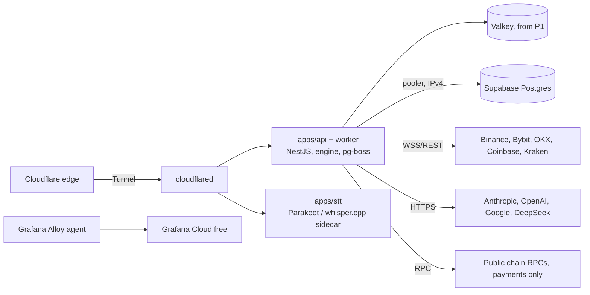

# A08: Platform Concerns (Security, Hosting, Observability, Scaling, Cost)

**Set:** A (full product) | **Status:** Planning document, v2.0, 2026-10-10 (rebuilt for the "pay only for Supabase and AI" rule: free compute, free edge, free observability, wallet-first security, crypto billing)
**Depends on:** A01 (stack, cost policy), A03 (feeds), A05 (AI cost), A06 (tables), A07 (API). **Feeds:** A09 (compliance), A10 (milestones), B02 (MVP stack and cost).

> Prices and free-tier limits come from vendor pages and articles found by web search on 2026-10-10 and are tagged **[verify]** where I did not read the vendor's own page. Totals are planning ranges, not quotes. Unit assumptions are the ones from A01: **10 session-hours per user per month, 5% peak concurrency.**
>
> **The honest headline:** with the rule "only Supabase and AI models cost money", fixed infrastructure is about **$25 per month** (Supabase Pro) plus a domain if you want one. Everything else is free tier or open source, and **the free compute VM is the weakest link in the whole plan** (section 1.3). AI is the real cost.

---

## 1. Hosting and environments

### 1.1 Decision

| Layer | Choice | Cost | Rejected | Why |
|---|---|---|---|---|
| App compute (API, worker, engine, STT sidecar, queue) | **Oracle Cloud Always Free Ampere A1 VM** (2 OCPU, 12 GB RAM, up to 200 GB block storage in total across free volumes) in a **non-US** region, Docker Compose | **$0** | Railway, Render, Fly.io, AWS/GCP paid, Vercel/serverless for the API | Needs 24/7 outbound WebSockets to exchanges, in-memory engine state and a CPU sidecar for speech-to-text. Oracle is the only mainstream free tier with enough RAM for that. Serverless suits none of it. Railway and similar are paid and break the cost rule. **Risk: section 1.3** |
| Database + Auth | **Supabase** (Pro $25/month from beta; Free while building) | **Paid (allowed)** | Railway Postgres, Postgres on the same VM, self-hosted Supabase | Scored in A01 section 5.2 (102 vs 74 vs 51 vs 53). Keeps data away from the free VM's fate |
| Edge, DNS, TLS, WAF, bot check | **Cloudflare Free**: DNS, proxy, **Tunnel** (`cloudflared`, outbound-only, no open inbound ports, no public IP needed), **Turnstile** | $0 | Exposing the VM directly | DDoS absorption, free TLS, WebSocket proxying supported. Mind its idle timeout (about 100 s **[verify]**) vs our 20 s Socket.IO ping |
| Frontend hosting (out of scope here) | Cloudflare Pages (free) | $0 | | |
| Container registry + CI | **GitHub Container Registry** + **GitHub Actions** | $0 (public repo, or private within free minutes **[verify]**) | | |
| Backups/object storage | **Cloudflare R2** (10 GB free) and Oracle Object Storage (20 GB, free-only tenancy) **[verify]** | $0 | | Encrypted dumps only |
| Region | One region; **co-locate VM and Supabase** (worker-to-DB latency is on the hot path). Pick the VM region **first**: it must not be blocked by the venues (Binance blocks US IPs; test all five from the candidate region in spike S2) and Oracle's home region **cannot be changed after signup** | | Multi-region | Single region until paying users demand otherwise |

**Process layout on the VM** (one Docker Compose project, one image for api+worker built from the monorepo):

**Memory budget on 12 GB** (my estimates; spike S7 measures them):

| Process | Estimate |
|---|---|
| API + worker (Node 22, engine state for about 30 instruments x several timeframes, Socket.IO) | 1.0 to 1.8 GB |
| STT sidecar, Parakeet TDT 0.6B int8 resident (or whisper.cpp small) | 1.5 to 2.5 GB |
| Valkey (from P1), Caddy/cloudflared, Alloy agent, OS | 1.0 to 1.5 GB |
| Staging stack (second compose project, small) | 1.0 to 1.5 GB |
| **Total** | **about 5 to 7 GB, leaving headroom** |

### 1.2 Environments

| Env | Purpose | Data feed | AI | Cost |
|---|---|---|---|---|
| `local` | docker-compose (Postgres, optional Valkey), Supabase CLI | `replay` adapter over golden datasets | Mock LLM + recorded fixtures | $0 |
| `ci` | GitHub Actions ephemeral services (Postgres 16 for migrations and the smoke test) | `replay` | Mock | free minutes |
| `staging` | Real deploy on the **same VM** (separate compose project and ports), a separate Supabase Free project, smoke tests, demo for testers | Live crypto (low symbol count) + replay | Real, tiny budget cap | $0 |
| `prod` | Customers | Live venues | Real | section 8 |

The `replay` adapter (A03) makes staging and CI independent of any live data, and lets you demo "a live session" deterministically. Staging shares the VM's fate with prod; that is accepted at this stage.

### 1.3 The free-compute risk and the fallback ladder

Facts: Oracle's Always Free Arm allowance was cut to **2 OCPU / 12 GB** in June 2026 (it used to be 4 / 24) and Oracle reclaims instances it judges idle (CPU, network and, for Arm shapes, memory utilization all under 20% at the 95th percentile for 7 days) **[verify the exact current rule]**. Capacity for new Arm instances can also be unavailable in popular regions at signup. A free account can be terminated for policy reasons with little recourse.

| Risk | Likelihood (my judgement) | Mitigation |
|---|---|---|
| Idle reclaim | Low for this workload: continuous WebSocket traffic keeps network utilization up, resident models and engine state keep memory above 20% | Dashboard on the three utilization numbers; if any is trending toward 20%, run a harmless synthetic load. Optionally convert the account to pay-as-you-go while staying inside Always Free limits, which Oracle's documentation says removes reclaim for Always Free resources **[verify; it needs a card on file, so you decide]** |
| Out of Arm capacity at signup | Medium | Try again at off-peak hours; choose the home region by capacity and venue reachability together |
| Account termination or VM loss | Low-medium | **Everything is reproducible**: the VM is a Docker Compose project; secrets are SOPS-encrypted in the repo; state lives in Supabase; backups go to R2. A replacement VM is up in under 2 hours |
| Venue geo-block of the VM's IP range | Medium (venues change policy) | Spike S2 tests from the VM region before commitment; adapters degrade per venue; a second venue carries the load |

**Fallback ladder (in order of cost; each step needs your approval only where marked):**

1. Second Oracle account or region (free; Arm capacity permitting).
2. A spare machine you own (an old laptop or mini-PC) running the same Compose project, reached through the **same Cloudflare Tunnel** (outbound-only, so no router changes). Free, but depends on your power and internet.
3. **(Needs your approval; breaks the $0 rule)** a small VPS in the roughly $4 to $6 per month class **[verify]**. This is the sensible production move once there are paying users, and it is still far cheaper than Railway-style metered hosting.

### 1.4 Release and rollback on the VM

GitHub Actions builds an image, pushes it to GHCR, then deploys over SSH (`docker compose pull && docker compose up -d`) behind a health check. Rollback is redeploying the previous image tag. Migrations run first, are forward-only and backward compatible for one release (A06 section 12).

---

## 2. Security

### 2.1 Threat model (top items)

| Threat | Impact | Mitigation |
|---|---|---|
| Stolen or leaked JWT / wsToken | Session hijack | Short-lived wsToken (5 min, bound to session+user), JWT verified via JWKS, `exp`/`aud` checks, per-socket origin check, **step-up fresh signature** for sensitive actions (A07 section 1) |
| Phishing for wallet signatures / fake site | Account takeover, loss of funds | We only ever ask for the EIP-4361 sign-in message (domain-bound, nonce, expiry), **never** a transaction approval or token allowance; the UI states this; the app domain is shown in the signing message; payment is a plain transfer the user sends themselves |
| Seed phrase or private key pasted into chat or voice | Catastrophic for the user | Client-side and server-side detectors block it **before any model or database sees it** (`SECRET_DETECTED`, A05 section 12) |
| Cross-tenant data access (IDOR) | Journal/trade leak | `WorkspaceGuard` on every route, repository methods require `workspaceId`, RLS second lock, automated cross-tenant tests in CI |
| Prompt injection via screen content, OCR text or chat | Policy bypass, bad output | A05 section 6.4: image and OCR text are data, never instructions; AI process has no side-effect tools; output validators |
| Image/audio upload attacks | RCE, DoS | Magic-byte sniffing, size/dimension caps, decode in a sandboxed worker with limits, memory-only handling, never executed (A02 section 9) |
| Abuse of free accounts (Sybil) and AI budget | Cost blowup | Section 2.3 |
| Data-license violation (redistributing raw feed) | Legal | Licence guard reads the `instrument_license` view; contract tests; no raw endpoints for restricted instruments |
| Exchange-key theft (L1/L2) | Financial harm | Envelope encryption, read-only scope verified at connect and refused if permissive (`KEY_TOO_PERMISSIVE`), no withdrawal-capable keys, revocation UI, decrypt only inside one worker module, audit log, external review before enabling |
| Gate bypass (order without confirmation) | Liability | Type-level gate (A04 section 11.1), **database constraints** (voice cannot confirm; token at most 120 s), integration test on the module graph, audit log |
| Payment confusion (wrong amount/chain, reorg) | Lost revenue or double credit | Exact-amount matching, per-chain confirmation depth, idempotent `(chain, tx_hash, log_index)`, `MANUAL_REVIEW` state instead of guessing |
| Dependency compromise | RCE | Lockfile, Dependabot, `pnpm audit` in CI, CodeQL, pin GitHub Actions by SHA |
| Secrets in repo | Credential leak | `gitleaks` pre-commit + CI; secrets are **SOPS + age** encrypted files (both open source) decrypted on the VM at deploy |
| DDoS | Outage | Cloudflare proxy, per-IP limits on unauthenticated endpoints, WS connection caps per user |
| PII in logs / LLM prompts | Privacy breach | Pino redaction paths (and a drop-list for `image`, `frame`, `bytes`, `audio`, `buffer`), no emails or wallet addresses in prompts (A05 section 12) |

### 2.2 Controls

| Area | Decision |
|---|---|
| **AuthN** | Supabase Auth **Sign-in with Web3** (Ethereum and Solana, EIP-4361). Email (magic link) and OAuth are optional extra login methods, never required. Wallet sign-in requires Turnstile (Supabase captcha setting). Several wallets can be linked to one account |
| **MFA / step-up** | Wallets already provide possession-based authentication. Sensitive actions (unlink wallet, delete account, add an exchange key, create an invoice) require a **fresh signature within 5 minutes**. Admin role additionally needs a **hardware-wallet-backed address** on an allowlist plus Cloudflare Access in front of `/v1/admin` **[verify the free plan covers your user count]** |
| **AuthZ** | Role claim (`user`, `admin`) in JWT app_metadata; workspace membership in DB; `AdminGuard` additionally requires allowlist and writes audit rows |
| **Sanctions / blocklist** | Public sanctions address lists (for example the OFAC SDN digital-currency addresses) are imported into `address_blocklist`; a blocked wallet is refused at `/v1/me` with no detail. This is a compliance control, not a guarantee (A09) |
| **Transport** | TLS terminates at Cloudflare and at `cloudflared`; HSTS; secure WS only; origin is reachable only through the Tunnel |
| **Secrets** | SOPS + age files in the repo (public key only in CI), private age key held by you and on the VM; separate keys per environment; rotated on a schedule; local uses `.env.local` from `env.example`, validated at boot by a Zod env schema in `packages/config` |
| **Encryption at rest** | Supabase disk encryption (provider default). Application-level **envelope encryption** for `exchange_connections.secret_ciphertext`: per-record data key (AES-256-GCM) wrapped by a key-encryption key held in the VM's secret store (MVP) and optionally a cloud KMS later; `key_id` supports rotation |
| **DB roles** | `api_rw`, `worker_rw`, `readonly_analytics`, `migrator`. The decrypt function lives in one small module imported only by the exchange adapter |
| **Input hardening** | Zod validation, body size limits (Explain image 3 MB, nothing else over 64 KB), `helmet`, strict CORS, request timeouts |
| **Logging** | Pino with redaction (`authorization`, `token`, `secret`, `signature`, emails, full wallet addresses shown as first 6 + last 4); log retention 14 days at Grafana Cloud free; audit log in DB for security events |
| **Privacy by design** | Zero retention of frames and audio (A02), on-device OCR and STT, chat deletable, journal and Explain history exportable and deletable (A09) |
| **Pen test** | Self-run OWASP ZAP baseline in CI on staging from M5; external review before L1/L2 features and before taking payments at scale |

### 2.3 Abuse and Sybil resistance (the price of "no email required")

Wallet accounts are free to create, so **a free AI allowance can be farmed by scripts** (Supabase itself warns about this for Web3 sign-in). No single control is enough, so they stack. The first four are free and in the MVP.

| # | Control | Effect |
|---|---|---|
| 1 | **Closed beta by invite code**, `signup.open` flag, invites issued by hand or by trusted users | Caps account creation rate to what you hand out |
| 2 | **Cloudflare Turnstile** on sign-in and on invite redemption | Stops naive scripts |
| 3 | **Per-IP, per-device-hash and per-ASN limits** (salted hashes in `abuse_flags`), Supabase's own sign-in rate limit | Slows farms; privacy-preserving |
| 4 | **Tiny free budget per account** ($0.05 per day, 3 Explains per day, A05 section 9.3) and **a global daily AI spend cap** (`ai_global_ledger`, default set by you; section 8.4). When the cap trips, AI features degrade to templates and overlays until 00:00 UTC | The hard backstop: **the worst case is the cap, not the number of accounts** |
| 5 | Optional **verified-human step to raise limits**: link an email, or hold a funded wallet (a one-time on-chain balance check, never stored) | Raises limits for real users without blocking newcomers |
| 6 | **Paid plan** removes free-tier limits and has per-user budgets | Natural price barrier |
| 7 | Anomaly alerts: new accounts per hour, AI cost per account, Explain per IP | Early warning |

Rejected: requiring on-chain history as a gate (excludes legitimate new users and is invasive), phone verification (cost and privacy), and CAPTCHA on every request (user-hostile).

---

## 3. Background jobs and scheduling

MVP uses `pg-boss` (jobs live in Supabase Postgres); the full version uses BullMQ on Valkey on the same VM (A01 section 5.5). Same job names, same handlers behind a `JobQueue` interface.

| Job | Schedule / trigger | Owner module |
|---|---|---|
| `md.maintain-partitions` | Daily 02:00 UTC (`maintain_partitions()` in A06) | market-data |
| `md.refresh-instruments` | Daily (venue instruments endpoints, writes `instrument_versions` on change) | market-data |
| `md.reconcile-htf` | Nightly | market-data |
| `md.backfill` | On gap/reconnect | market-data |
| `md.rotate-connections` | Before the 24 h venue WebSocket limit | market-data |
| `engine.snapshot` | Each 1h close + shutdown | analysis |
| `engine.determinism-check` | Nightly (replay last 7 days) | analysis |
| `outcomes.resolve` | Each candle close for ARMED setups | outcomes |
| `stats.refresh-cohorts` | Nightly | outcomes |
| `stats.calibration` | Nightly | outcomes |
| `ai.weekly-review` | Weekly, per active user (batch API) | narrative |
| `ai.evals-nightly` | Nightly on staging | evals |
| `sanctions.refresh` | Daily: import public list into `address_blocklist` | compliance |
| `retention.purge` | Daily: `retention_purge()` (A06 section 10) | platform |
| `payments.watch` | Every 15 s per chain (EVM log scan with cursor; Solana reference lookup) | payments-watcher |
| `payments.expire` | Every minute | payments-watcher |
| `notify.dispatch` | Continuous | notify |
| `journal.export` | On request | journal |
| `usage.rollup` | Hourly: session-hours, AI cost per workspace, global ledger | platform |
| `backup.dump` | Weekly: encrypted `pg_dump` to R2 and Oracle storage | platform |

Reliability rules: jobs are idempotent (deterministic ids, A03), have retry with backoff and a dead-letter queue, and emit metrics (duration, failures). Cron-like jobs use a single scheduler to avoid double-firing across replicas.

---

## 4. Scaling plan (triggers, not guesses)

### 4.1 Capacity model

At 10,000 users and 5% concurrency: **about 500 concurrent sessions**.

| Load | Calculation | Result |
|---|---|---|
| Sockets | 500 | Trivial for Node |
| Context hints (OCR text) | 500 sessions x at most 1 per 2 s | A few hundred small messages per second at the extreme; negligible |
| Explain images | 500 x 3 per hour = 1,500/hour = 0.4/s, up to 3 MB each, memory-only | Transient memory spikes of tens of MB; **LLM rate limit and cost are the limit, not bandwidth** |
| Server-side STT (fallback only) | 500 sessions x 20 utterances/hour = 2.8/s if everyone used it; realistic fallback share 10 to 30% = 0.3 to 0.8/s. Parakeet int8 is reported at a real-time factor of about 0.03 to 0.05 on a desktop CPU **[verify; Arm 2-core will be slower]** | A few hundred ms CPU per utterance; limiter with a queue; **spike S3 measures it on the VM** |
| LLM calls | A05 section 3 workload: about 40 calls per session-hour = about 5.6/s at 500 sessions | **Likely the first limit:** provider rate-limit tiers **[verify your tier]** |
| Engine | 20 to 50 instruments x a few TFs, microsecond steps | Negligible CPU |
| DB writes | candles about 20/min + events + `ai_calls` about 5.6/s + `voice_events` about 3/s | Trivial |
| Narrative calls | Shared per instrument (A05 section 9.1) | Bounded by instruments, not users |

**Conclusion:** the bottlenecks, in order, are (1) LLM rate-limit tiers and cost, (2) the single free VM (a single point of failure and a memory ceiling), (3) venue connection limits per IP, (4) database connections. CPU is not an early concern.

### 4.2 Phases

| Phase | When | Change | Cost impact |
|---|---|---|---|
| **P0** single process (MVP) | up to about 100 concurrent sessions | api+worker in one Nest app on the free VM, pg-boss, in-memory bus and rate limits | $0 |
| **P1** add Valkey | first multi-instance need, or in-memory limits become awkward | Valkey container on the same VM: BullMQ, Socket.IO adapter, rate limits | $0 |
| **P2** shard workers | more than about 50 core instruments, or ingest lag p95 above 150 ms | Instrument-hash stream ownership via leases (A03 section 8) | A second node: **leaves the $0 rule (approval)** |
| **P3** replicate API | above about 1,000 concurrent sockets or zero-downtime deploys needed | N API replicas; Socket.IO Valkey adapter; **WebSocket-only transport** so sticky sessions are not needed | Paid nodes (approval); revenue exists by then |
| **P4** isolate heavy work | backtests/evals starve the live path | Separate `backtest` worker on a different node, or run backtests in GitHub Actions on a schedule (free) | $0 if done in CI |
| **P5** data tier | candle volume above hundreds of instruments or 1s data | Move only `candles` to ClickHouse/TimescaleDB (A01 section 5.3) | Paid or self-hosted |

Load testing: `k6` (WebSocket) scripts that simulate 100/500/1,000 sessions sending hints and occasional Explains against staging with the mock LLM, run before any phase change.

---

## 5. Observability

### 5.1 Stack and cost

| Concern | Tool | Cost |
|---|---|---|
| Logs | Pino JSON to stdout; **Grafana Alloy** agent ships to **Grafana Cloud free** (about 50 GB logs, 14 days **[verify]**) | $0 |
| Metrics | OpenTelemetry/Prometheus metrics to Grafana Cloud free (about 10k active series **[verify]**; keep labels low-cardinality: per venue and per job, never per user) | $0 |
| Traces | OpenTelemetry to Grafana Tempo, sampled 10%; 100% for errors and gate flows | $0 within the free quota |
| Errors | **Sentry Developer plan (free, about 5k errors/month** **[verify]**); alternative: self-hosted GlitchTip (open source) on the VM | $0 |
| Uptime / status | UptimeRobot free or Better Stack free for pings; a public status page with **Upptime** on GitHub Pages | $0 |
| Product analytics | None at MVP. If wanted later: self-hosted Plausible/Umami (open source) or PostHog free tier | $0 |

If Grafana Cloud's free quota is exceeded, the exit path is Prometheus + Loki + Grafana on the VM (about 1 GB of RAM).

### 5.2 Correlation

`correlation_id` is created at the **candle close** (engine path) or at the **user message/hint/Explain** (user path) and carried through events, logs, `ai_calls`, and API responses (A07). One search by id reconstructs "why did this overlay/narrative/alert appear".

### 5.3 Key metrics and alerts

| Domain | Metric | Alert |
|---|---|---|
| Feed | Candle lag (venue close to DB), per instrument and venue; feed status; reconnect count; `GEO_BLOCKED` incidents; cross-check divergence rate | lag p95 over 5 s for 5 min; `STALE` over 2 min; any `GEO_BLOCKED` |
| Engine | Step duration p95; recompute count; determinism-check mismatches; engine faults | any mismatch or fault pages |
| Realtime | Active sockets; reconnect rate; event send failures; hint accept/reject | reconnect rate over 10% |
| OCR/Context | Hint acceptance rate, `FEED_MISMATCH` rate, low-confidence rate, manual-picker fallback rate | mismatch over 5% sustained |
| Explain | Latency to first token, `NOT_A_CHART` rate, APPROXIMATE share, refusal rate, cost per Explain | p95 first token over 6 s |
| Voice | STT engine mix (web vs server), confidence distribution, server-STT queue depth and CPU, `LOW_CONFIDENCE` rate | server queue age over 5 s |
| AI | Cost per session-hour, retry/fallback rates, lexicon-retry rate, retraction rate, circuit breaker state, **global spend vs cap** | cost per hour over 2x baseline; breaker open over 10 min; spend over 80% of cap |
| Abuse | New accounts per hour, `abuse_flags` created, Turnstile failures, invite redemptions per code | 3x trailing median |
| Payments | Watcher lag per chain, unmatched transfers, invoices in `MANUAL_REVIEW`, RPC errors | lag over 2 min; any `MANUAL_REVIEW` older than 24 h |
| API | RED (rate, errors, duration) per route; 5xx | 5xx over 1% for 5 min |
| DB | Connections, slow queries, partitions ahead, size vs plan | fewer than 2 free future partitions; size over 70% of plan |
| VM | CPU, memory, network, disk, and the **three Oracle idle-reclaim utilization numbers** | memory or CPU p95 trending under 25% for 5 days (reclaim guard) |
| Queues | Depth, age of oldest, failures, DLQ size | age over 5 min on live queues |

### 5.4 SLOs (targets)

| SLO | Target |
|---|---|
| API availability (monthly) | 99.5% at launch **on a single free VM, which is an aspiration, not a promise** (99.9% is a P3+ goal). No SLA is offered to users |
| Overlay update after candle close | p95 under 500 ms end to end (150 ms engine path, A04; rest transport) |
| Data freshness | 99% of closed candles in DB within 5 s of venue close for core instruments |
| Chat first token | p95 under 2 s |
| Voice: end of speech to transcript | p95 under 1.5 s on-device (WebGPU), 2.5 s on the server fallback (A02 section 8) |
| Gate correctness | 0 orders or trade records without a confirmed gate (invariant, not SLO) |

### 5.5 Runbooks (write before launch)

Feed down or geo-blocked; venue terms change; LLM provider outage (kill switch + fallback); global AI cap tripped; DB connection exhaustion; engine fault on an instrument; **VM lost or reclaimed (rebuild from Compose, secrets and last dump)**; bad deploy rollback; leaked secret rotation; payment mismatch and manual refund; wallet-signing phishing report; data-deletion request.

---

## 6. CI/CD and release

```mermaid
flowchart LR
  PR[Pull request] --> CI[Lint + typecheck + unit + contract tests]
  CI --> DB[Migrations + SQL smoke test on Postgres 16]
  DB --> GR[Engine golden replay + no-lookahead property tests]
  GR --> EV[AI evals on mock + prompt-diff check + no-frame-persistence test]
  EV --> MERGE[Merge main]
  MERGE --> IMG[Build image, push to GHCR]
  IMG --> STG[Deploy staging over SSH + db:migrate]
  STG --> SMK[Smoke + k6 mini + ZAP baseline]
  SMK --> APPROVE{Manual approve}
  APPROVE --> PROD[Deploy prod]
  PROD --> CANARY[Watch SLO dashboards 30 min]
```

- GitHub Actions; pnpm + Turborepo cache.
- Migrations: forward-only, expand/contract (A06 section 12); staging first.
- Feature flags (`feature_flags` table) gate risky features (exchange links, L2, payments, server STT, new strategy versions); strategy versions have their own activate step (A07 section 9).
- Rollback: redeploy the previous image tag; DB changes are backward compatible for one release.
- Versioning: `git` tags `vX.Y.Z`; changelog; engine golden file changes require a new `strategy_version` in the same PR (A04 section 15.2).
- Dependabot weekly.

---

## 7. Billing and plans (on-chain, prepaid, no processor)

| Item | Decision |
|---|---|
| Payment rail | **Stablecoin transfers (USDC first, USDT optional) on one low-fee EVM chain and on Solana.** The user sends the exact amount from any wallet; our own watcher confirms it. No card processor, no merchant of record, no payment-provider webhooks, no fixed fees. The payer pays the network fee |
| Why this | Fits "no paid services", has no country dependence, and matches a wallet-first user base. **Costs:** no cards (some users will not use crypto), refunds are manual on-chain transfers, and tax and consumer rules are *your* responsibility without a merchant of record **[counsel/accountant]** |
| Invoice matching | **EVM:** one treasury address per chain (a wallet you control; no private key on the server) and an invoice-specific **exact amount** (price plus a unique sub-cent suffix, enforced unique among open invoices). **Solana:** Solana Pay style **reference key** on one receiving address. Both are idempotent on `(chain, tx_hash, log_index)` **[verify the Solana Pay reference approach and USDC mint addresses in spike S6]** |
| Confirmation | Per-chain depth in config (for example the chain's finalized/safe tag or N blocks; Solana `finalized`). Reorgs mark a payment `REORGED` and reverse the credit |
| Edge cases | Wrong amount, wrong token, late payment or sender mistakes go to `MANUAL_REVIEW`. We never auto-refund or auto-credit a guess |
| Free chain data | Public RPC endpoints of the chosen chains and a second provider as failover, polled with cursors (`chain_cursors`). Free rate limits **[verify]**; the watcher polls every 15 s, which is far below typical free limits |
| Plans (defaults, tunable in `entitlements`) | **Free:** closed beta access, 4 instruments, 30 session-hours/month, chat 40/day, Explain 3/day, voice 60/day, $0.05/day AI budget, no weekly review. **Pro (about $19 to $29/month, your call):** all supported instruments, 40+ session-hours, chat 200/day, Explain 30/day, weekly review, journal export, higher AI budget. **Team (later):** shared workspace |
| Periods | Prepaid 1, 3 or 12 months; no auto-renew; reminders at 7 and 1 days; grace of 3 days; then downgrade to Free (nothing is deleted) |
| Metering | Billable unit is not charged per hour; **session-hours are a fair-use cap** counted in `usage.rollup`. AI budget caps are separate and silent |
| Entitlement changes | Payment confirmation extends `subscriptions` and recomputes `entitlements` in one transaction, then emits `invoice.state` |
| Exit path | If crypto-only proves too narrow: BTCPay Server (MIT) self-hosted for more coins, or a merchant of record added alongside (it would be a paid vendor, so your approval) |

Heavy-user check: a user running 60 session-hours costs about $12 to $15 in AI at list (60 x $0.196 to $0.253) or about $9 optimized, so a Pro cap of about 40 hours keeps worst-case AI cost near $6 to $10 per user per month. Overage packs can be sold later.

---

## 8. Cost model (monthly USD)

Component prices: Supabase Pro $25 base with a $10 compute credit covering a Micro instance; larger compute adds about $10 per step **[verify]**; everything else $0 by policy; AI from A05 section 3 (stack S2r: Haiku reads/routes, Sonnet writes).

### 8.1 Fixed infrastructure

| Line | 100 users | 1,000 users | 10,000 users |
|---|---|---|---|
| Supabase (Pro + compute) | $25 | $25 to $60 | $150 to $450 |
| Compute (Oracle Always Free) | $0 | $0 | **a single free VM will not carry 500 concurrent sessions with fallback and redundancy; plan paid nodes (approval): about $40 to $150** |
| Edge, DNS, TLS, bot check (Cloudflare Free) | $0 | $0 | $0 |
| Observability (Grafana Cloud free, Sentry free, Upptime) | $0 | $0 | $0 to $60 if free quotas are exceeded |
| Email (optional, Brevo/Resend free SMTP) | $0 | $0 | $0 to $20 |
| Market data (public exchange feeds) | $0 | $0 | $0 **[verify venue terms, S5]** |
| Domain (optional; `*.pages.dev` works at MVP) | $0 | about $1 | about $1 |
| Chain RPC for payments (public endpoints) | $0 | $0 | $0 to $50 if rate limits bite |
| **Subtotal excluding AI** | **about $25** | **about $26 to $61** | **about $190 to $770** |

### 8.2 Variable: AI (A05 section 3, S2r)

| | 100 users | 1,000 users | 10,000 users |
|---|---|---|---|
| AI list (thinking 1.0x to 1.5x) | $196 to $253 | $1,956 to $2,534 | $19,556 to $25,344 |
| AI optimized (planning figure) | about $152 | about $1,521 | about $15,206 |
| Alternative stack S6 (DeepSeek text, if it passes the gates) | $69 to $88 | $685 to $876 | $6,853 to $8,759 |

### 8.3 Totals and per-user view

| | 100 users | 1,000 users | 10,000 users |
|---|---|---|---|
| **Total, S2r optimized to list** | **about $177 to $278** | **about $1,550 to $2,600** | **about $15,400 to $26,100** |
| **Per user per month** | $1.8 to $2.8 | $1.6 to $2.6 | $1.5 to $2.6 |
| Payment cost | $0 platform fee (payer pays network fee) | | |

**Reading it:** with the $0 rule, **AI is 85 to 99% of the bill**, and fixed infrastructure is negligible until the free VM must be replaced. The honest risks are not cost items: free-compute availability (section 1.3) and free-account abuse (section 2.3).

**Break-even:** at 1,000 users and about $2,000 of total cost, you need roughly 80 to 140 Pro subscribers at $19 to $25 (depending on price and AI cost) (no processor fee, only occasional network fees borne by the payer) if free users stay within the Free plan limits. A free user at the full cap can cost up to $0.05 x 30 = $1.50 per month in the worst case, which is why the global cap exists. Marketing and your time are not included.

### 8.4 Spend controls (defaults, all tunable)

| Control | Default | Where |
|---|---|---|
| Per-user daily AI budget | Free $0.05, Pro $1.00 | `entitlements.limits.daily_ai_budget_usd` |
| **Global daily AI cap** | **$10 per day during the closed beta** (about $300 per month worst case), raised deliberately | `ai_global_ledger.cap_usd` |
| Soft limit action | Chat to Haiku, no Sonnet escalation, Explain limited | A05 section 9.3 |
| Hard limit action | AI disabled for the user; engine, overlays and templates continue | A05 section 9.3 |
| Global cap action | Same, for everyone, until 00:00 UTC; admin alert | `AI_TEMPORARILY_UNAVAILABLE` |
| Provider-side limit | Set the provider's own monthly spend limit to the same number (Anthropic, OpenAI and Google consoles all offer one **[verify]**) | Provider consoles |

Costs I could not pin down: Supabase compute at 10k users (depends on query load), the real cost of replacing the free VM, free-tier changes at any vendor, and venue terms (S5).

---

## 9. Backup, DR and data lifecycle

| Item | Target / method |
|---|---|
| RPO / RTO | RPO 24 h on Supabase Pro daily backups (7-day retention); PITR is a $100/month add-on and is **not** assumed. RTO for the app tier: under 2 hours (recreate the Compose project on any Linux box); for the database: Supabase restore, hours |
| Logical backup | Weekly `pg_dump` of tenant, payment, statistics and strategy tables, encrypted with `age`, to R2 and Oracle storage; 90-day retention; restore tested quarterly |
| Infrastructure as code | The Compose files, Caddy/cloudflared config and SOPS-encrypted secrets are in the repo, so the VM is disposable |
| Candles | Re-fetchable from venues (lowest priority); bulk history from the exchanges' public data dumps for backfill **[verify terms]**; partitions older than 180 days archived to Parquet |
| DR drill | Restore to a scratch project quarterly; time it. Rebuild the VM from scratch twice before launch |
| User deletion | `DELETE /v1/me` (step-up) sets `deleted_at`, revokes sessions and wallet links, a job deletes journal, chat, Explain history, trades and voice metadata after 30 days (grace), keeps anonymized aggregate rows; **invoices and on-chain payment records are kept** (financial records, detached from the profile) **[counsel]**; export first if requested (A09) |
| Retention table | See A06 section 10 |

---

## 10. Admin and support tooling

MVP: Supabase Studio (read-mostly) + Grafana dashboards + the admin API (A07 section 9). Add a thin `/admin` UI when support volume demands it. Support-safe views never show exchange credentials; frames and audio do not exist to show.

---

## 11. Assumptions

1. You are the only on-call; therefore few moving parts and generous alerting thresholds (alerts to your phone via free tiers of the uptime tool).
2. Users are international and there is no country-specific business or payment path. Which jurisdiction operates the service and which users it accepts are decisions for counsel (A09), not for this document.
3. No SOC 2 or ISO 27001 in year one; controls above are chosen to make a later audit feasible.
4. The Oracle Always Free offer remains available and usable as described **[verify at signup]**.

## 12. Open questions

1. **Compute fallback approval:** are you willing to pay roughly $4 to $6 per month for a small VPS once real users arrive (default: yes, at that point, as a deliberate exception to the $0 rule)?
2. **Global AI cap:** the default is $10 per day in the closed beta. What monthly AI budget are you comfortable with?
3. **Pay-as-you-go conversion of the Oracle account** to reduce reclaim risk (needs a card on file but costs nothing inside the free limits **[verify]**)? Default: yes, if you are comfortable with it.
4. **Uptime promise:** 99.5% target, no SLA ("best effort" in the terms).
5. **Which chains and stablecoin first:** default USDC on one low-fee EVM chain plus USDC on Solana.

## Sources

- Oracle Cloud Infrastructure documentation, Always Free resources and idle-instance reclaim; InfoQ report on the June 2026 allowance change (accessed 2026-10-10) **[verify current]**
- Supabase pricing and compute add-ons; Supabase Web3 sign-in guide (accessed 2026-10-10)
- Cloudflare Free plan, Tunnel, Turnstile, R2 and Pages limits **[verify]**
- Grafana Cloud free tier, Sentry Developer plan, Upptime, SOPS and age project pages **[verify]**
- Solana Pay specification (reference keys) and EVM ERC-20 `Transfer` event semantics **[verify chain parameters in spike S6]**
