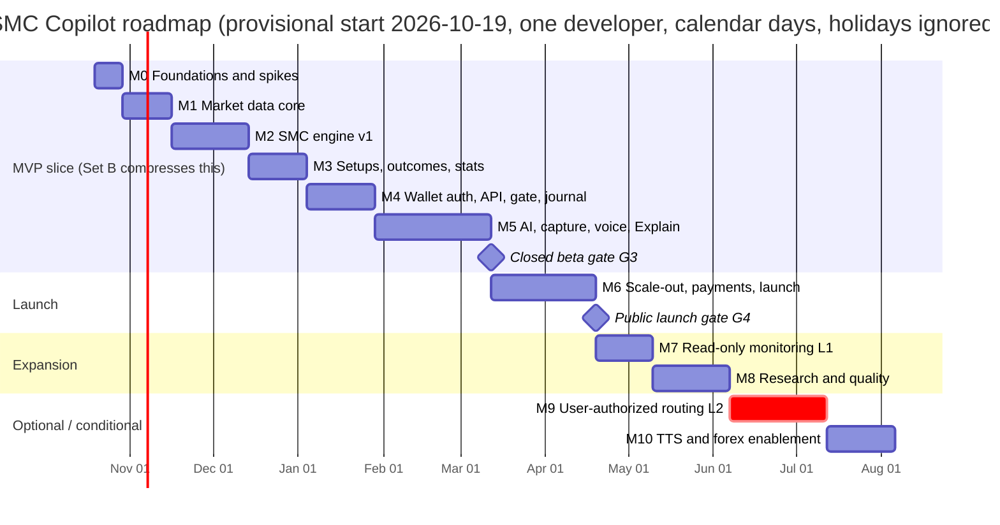
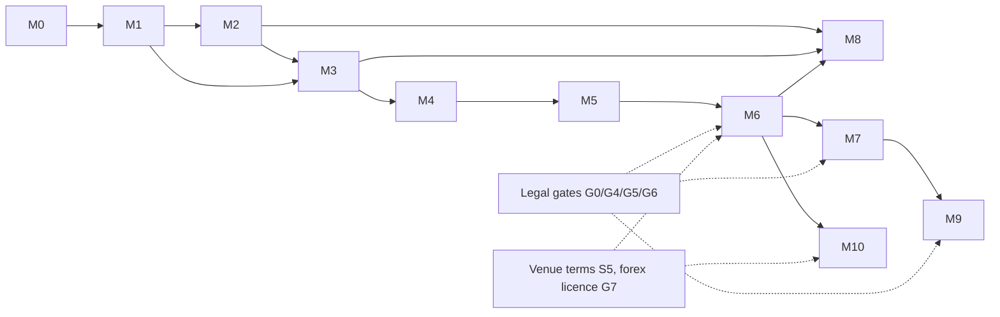

# A10: Milestone Roadmap (M0 to M10)

**Set:** A (full product) | **Status:** Planning document, v2.0, 2026-10-10
**Depends on:** every Set A document. **Feeds:** B05 (the MVP build plan is the first slice of this roadmap, compressed) and B06 (what is cut, and how it comes back).

> **What changed from v1.** Crypto first with forex deferred (M10); wallet-first identity; zero-cost infrastructure (A08); venue-direct market data with cross-checks (A03); on-device OCR, voice and Explain (A02, A05); crypto stablecoin billing with no processor (A08 section 7). M6 changed from "MoR billing" to "own payment watcher"; M10 changed from "LiveKit voice" to "TTS and forex enablement" because voice moved into M5.

> **Effort basis.** Estimates are in *person-weeks* for **one experienced full-stack TypeScript developer working full time** (about 30 focused hours per week after meetings, support, and context switching). Each milestone shows *likely (low to high)*. These are planning numbers from experience with comparable systems, not measurements; M0 and M1 are the calibration points for everything after them (section 5). Contingency of 25% on top of "likely" is stated separately, never hidden inside the numbers.

---

## 1. Roadmap at a glance

One developer works the milestones in sequence, so the chart is sequential even where the dependency graph below would allow overlap.

| # | Name | Likely (range) person-weeks | Cumulative likely | Gate at end |
|---|---|---|---|---|
| M0 | Foundations and risk spikes | 1.5 (1 to 2) | 1.5 | G0 |
| M1 | Market data core (5 venues) | 2.5 (2 to 3.5) | 4 | |
| M2 | SMC engine v1 | 4 (3 to 6) | 8 | **G1** engine faithfulness |
| M3 | Setups, scoring, plan, outcomes, stats | 3 (2.5 to 4.5) | 11 | **G2** no look-ahead, honest stats |
| M4 | Wallet auth, sessions, API, gate L0, journal | 3.5 (2.5 to 5) | 14.5 | |
| M5 | AI, on-device OCR, voice, Explain | 6 (5 to 8.5) | 20.5 | **G3** closed beta go/no-go |
| M6 | Scale-out, crypto payments, public launch | 5.5 (4.5 to 8) | 26 | **G4** public launch |
| M7 | Read-only monitoring (L1) | 3 (2 to 4) | 29 | **G5** legal and security |
| M8 | Research and quality platform | 4 (3 to 6) | 33 | |
| M9 | User-authorized order routing (L2), conditional | 5 (4 to 8) | 38 | **G6** legal opinion |
| M10 | TTS and forex enablement, optional | 3.5 (2.5 to 5) | 41.5 | **G7** forex data licence |

**Totals.**

| Span | Likely | Range | With 25% contingency |
|---|---|---|---|
| M0 to M5 (full Set A scope to closed beta) | 20.5 person-weeks | 16 to 29.5 | about 25.5 |
| M0 to M6 (to public launch) | 26 | 20.5 to 37.5 | about 32.5 |
| **Set B slice of M0 to M5** | **16 task weeks + 1 beta/buffer week** (B05) | | about 20 task weeks with contingency |

Set B reaches the same G3 gate by cutting 4.5 person-weeks of scope (table in section 1.1; the full list and the way back are in B06). The cut does not weaken any safety property: the human gate, zero retention, the licence view, the guardrails and the determinism checks are all in the MVP.

### 1.1 What the MVP slice cuts from M0 to M5

| Milestone | A10 likely | MVP (B05) | Cut | What is cut (returns in) |
|---|---|---|---|---|
| M0 | 1.5 | 1.0 | 0.5 | Second-region VM, scripted DR drill, Upptime status page (M6) |
| M1 | 2.5 | 2.0 | 0.5 | OKX, Kraken and Coinbase adapters; MVP runs Binance primary plus Bybit as the single cross-check (M6) |
| M2 | 4 | 3 | 1 | Labeled sample 30 charts becomes 20; two golden datasets (BTC, ETH) instead of four; scale-invariance suite (M8). **This is the first slip candidate.** |
| M3 | 3 | 2 | 1 | Backtest tooling stays a CLI with one cohort axis; calibration job basic (M8) |
| M4 | 3.5 | 3 | 0.5 | Admin endpoints beyond kill switch, flags, venue terms and blocklist; verified-human Sybil step (M6) |
| M5 | 6 | 5 | 1 | Server STT sidecar (Tier 2), hands-free voice mode, Explain APPROXIMATE mode, challenger-vendor adapters beyond one fallback (M6/M8) |
| **Total** | **20.5** | **16.0** | **4.5** | |

### 1.2 Dependency graph

**Critical path:** M0 to M1 to M2 to M3 to M4 to M5 (engine correctness and the data layer gate everything). M6's public-launch readiness also waits on non-code items: venue terms and legal review (start them in M0, not in M6).

### 1.3 Non-code lead-time actions (do on the day shown)

| When | Action | Why now |
|---|---|---|
| M0 day 1 | Read and record the terms of Binance, Bybit, OKX, Coinbase and Kraken market-data endpoints for a commercial analytics product (spike S5); insert evidence into `venue_terms` | Decides which instruments may ever show raw prices (`instrument_license`) |
| M0 day 2 | Book the lawyer scoping call for the week before G3 | Counsel calendars fill up; the question list is in A09 |
| M0 day 3 | Create the Oracle Cloud account and choose the home region after spike S2 (the region cannot be changed later); create the Cloudflare, Grafana, Sentry and GitHub resources | Free tiers have signup friction; the Oracle region is permanent |
| M1 | Set hard monthly spend limits at every AI vendor; create keys in a secrets store (SOPS + age) | A08 spend controls |
| M4 | Choose and test a treasury wallet (hardware wallet or multisig) for payments; nothing is deployed yet | S6 needs a real address on testnets |
| M5 | Draft ToS and Privacy from a reputable template; list sub-processors | A09 section 3 |
| M6 start | Counsel review of the crypto-payment and sanctions flow (A09 section 3.5); decide the operator jurisdiction | Gate G4 item |

---

## 2. Risk-first ordering and spikes

Do the scary unknowns early and cheaply. Spike numbers match the references in A02, A03, A05, A08 and A09 (note: "S1" to "S6" in A05 section 3 are cost stacks, not spikes; spike references always say "spike").

| Spike | Question | Time-box | Pass criterion | Fail response |
|---|---|---|---|---|
| **S1 OCR feasibility** | Does PaddleOCR via onnxruntime-web read symbol, venue, timeframe and last price from 40 screenshots of TradingView (dark/light), Binance, Bybit and MT5-style charts, within the A02 latency budget on a low-end laptop? | 1 day (M0; shares one test page with S3 and S4) | At least 90% symbol+timeframe correct, last price parsed correctly on at least 80%, median OCR under 500 ms per crop on WebGPU or WASM | Try the other OCR model size or a header-crop strategy; if still weak, the manual picker becomes the primary path and the vision LLM reads only inside Explain (hybrid still works, A01) |
| **S2 Venue endpoints and geo-block** | From the candidate VM region, can each venue's public WebSocket and REST deliver closed 1m candles with p95 lag under 3 s, and is the region not blocked (Binance blocks US IPs)? Record 24 h of raw frames per venue for fixtures | 1 day (M0), the 24 h capture runs in the background | p95 lag recorded; zero HTTP 451/403 from Binance and Bybit; fixtures committed | Choose a different Oracle region before signup; if no region is acceptable, use the fallback ladder in A08 section 1.3 |
| **S3 STT accuracy** | On a 200-phrase trading-jargon set (A02 section 6.3), how do Whisper (transformers.js, WebGPU), Moonshine and Whisper WASM compare, and is a server sidecar needed? | 1 day (M0; same test page as S1) | Word error rate and glossary-corrected command accuracy recorded per engine; chosen default engine per device class | If no browser engine reaches 90% command accuracy, Tier 2 sidecar moves from M6 into the MVP (adds 0.75 week) |
| **S4 Capture and WebGPU matrix** | Does `getDisplayMedia` plus the ROI sampler stay under the CPU/memory budget, and which browsers expose WebGPU for OCR and STT? | 0.5 day (M0, inside the S1/S3 page) | Capability matrix for Chrome, Edge, Firefox, Safari; frame crop under 200 KB, at most 1 per second | Document unsupported browsers; WASM path stays the floor |
| **S5 Venue terms** | Do the five venues' terms allow showing derived analytics, and raw candles, in a commercial product? | 0.5 day reading plus emails (M0), answers by M5 | Evidence rows in `venue_terms`; per-venue class set by the view | Unconfirmed venues stay `INTERNAL_ONLY`: overlays and analysis only, no raw price egress (this is the default and the product still works) |
| **S6 Payments rail** | On testnets, does exact-amount matching (EVM) and reference-key matching (Solana Pay) detect, confirm and survive a reorg in the watcher? | 3 days (start of M6) | Detect, confirm, underpay, overpay, duplicate and reorg cases all end in the right invoice state | Fall back to BTCPay Server (self-hosted) for the rail; adds about 1 week |
| **S7 VM capacity** | Does the Oracle Always Free A1 instance (2 OCPU, 12 GB after the June 2026 reduction) hold the Compose stack under a 20-session synthetic load without idle reclamation? | 1 day (M0) then re-check in M5 and M6 | Memory budget from A08 section 1.1 holds; CPU headroom at least 30%; keep-alive load keeps utilization above the reclaim threshold | Fallback ladder A08 section 1.3: second Oracle region, then a spare home machine behind the Cloudflare Tunnel, then a $4 to $6 VPS (needs your approval because it is an external cost) |

---

## 3. Milestones

### M0: Foundations and risk spikes (1.5 weeks; 1 to 2)

**Goal:** A working skeleton, a running free VM, and the cheap answers to the biggest unknowns.

**Tasks**
- Monorepo (pnpm, Turborepo, Biome, tsconfig base, Vitest) with the layout in A01 section 6 and the dependency lint rule (including `capture-kit -> contracts only`).
- `packages/contracts` skeleton (Candle, Timeframe, MarketFacts, ApiProblem, WS envelope, `ContextHint`, `SttEngineTag`).
- `packages/config` env schema (Zod); `infra/docker-compose.yml` (Postgres 16 for local, Caddy, app); GitHub Actions: lint, typecheck, test, SQL apply and smoke test on PG16.
- Oracle VM provisioned with Compose, Cloudflare Tunnel and DNS, SOPS + age secrets (A08 section 1).
- Supabase dev project (Free); apply `0001`, `0002`, `0009` with the smoke test; seed the 11 instruments.
- `apps/api` Nest skeleton: health endpoints, Pino, Sentry (free tier), correlation-id interceptor, JWT guard through `AuthProvider` (Supabase JWKS).
- Spikes S1 to S5 and S7 (about 5 working days in total, time-boxes in section 2; the browser spikes S1, S3 and S4 share one test page).

**Deliverables:** repo, CI green, VM reachable at the staging hostname, first migrations in the dev project, `docs/spikes.md` with a go/no-go line per spike, venue terms evidence rows, lawyer call booked.

**Dependencies:** none (decisions from A01 accepted).

**Acceptance criteria**
1. `pnpm i && pnpm turbo run build test` passes in CI on a clean clone; importing an app from a package fails lint.
2. `GET /healthz` returns 200 through the Cloudflare Tunnel on the Oracle VM; an invalid JWT returns problem+json 401.
3. Spikes S1 to S5 and S7 have recorded numbers and a decision each (gate **G0**: OCR vs manual primary, region, STT default).

**Risks:** over-engineering the skeleton (time-box to the week and a half); Oracle signup or capacity problems (start day 1, fallback ladder ready); Supabase Free pausing after inactivity (keep a weekly health call from CI until the Pro upgrade at M5).

---

### M1: Market data core (2.5 weeks; 2 to 3.5)

**Goal:** Trustworthy closed candles for the launch instruments from several independent venues, with failure handling (A03).

**Tasks**
- `MarketDataProvider` interface and adapters: Binance (spot and USD-M perp) WS+REST, Bybit, OKX, Coinbase (REST-polled for 1m), Kraken, `replay`; CCXT for REST metadata and backfill.
- Normalize + validate pipeline (V1 to V9; V7 same-market-type cross-check), quarantine table, flags, `dq_incidents`.
- 1m upsert and aggregation to 5m/15m/30m/1h/4h/1d with 00:00 UTC rollover; aggregation property tests.
- Gap detection, backfill job, reconnect with capped backoff and jitter, stale watchdog, `feed.status` events.
- Candle partitions (`ensure_candle_partition`, `maintain_partitions`), retention job.
- `StreamRegistry` (in-process) with reference counting; `/v1/venues`, `/v1/instruments`, `/v1/instruments/resolve` with price disambiguation.
- Licence wiring: every egress path reads `instrument_license`, never `instruments.license_class` (route-scan test).
- Warm-up history seeding; nightly HTF reconciliation (basic).

**Deliverables:** candles flowing live into Postgres for the 11 seeded instruments; admin CLI for backfill and reconcile; fixtures recorded in S2; test report.

**Dependencies:** M0.

**Acceptance criteria**
1. 72-hour soak: all seeded instruments, zero duplicate rows, zero unexplained gaps (each gap backfilled or classified).
2. Kill the socket mid-minute: within 60 s the stream reconnects, the gap is detected and backfilled, no duplicate candle.
3. Aggregated HTF candles match venue-native 1h/4h/1d within tolerance for 7 days.
4. p95 venue-close-to-DB lag under 3 s (target 1 s) from the chosen region.
5. A cross-check divergence beyond tolerance (injected in a test) produces a `dq_incident` and a `DEGRADED` status, not silent acceptance.

**Risks:** venue quirks (symbol formats, timestamps, rate limits) are handled by per-venue fixtures and adapter contract tests; Coinbase has no free 1m stream, so it polls REST and is cross-check only.

---

### M2: SMC engine v1 (4 weeks; 3 to 6)

**Goal:** A deterministic, no-look-ahead engine implementing A04 sections 3 to 7, plus a replay harness.

**Tasks**
- `packages/smc-engine`: candle window, ATR, confirmed swing pivots (internal/external), structure state (BOS/CHoCH, close-based, protected levels), FVG and OB lifecycles, liquidity pools and sweeps (including `weekendLiquidity` weighting and OPEN_LEVELS), dealing range with premium/discount/OTE, `htfAt(t)` MTF aggregator, UTC-fixed sessions.
- `step()` reducer, event ids, bounded state, snapshot serialization.
- `StrategyConfig` schema, `strategy_versions` immutability trigger, first config `smc-core v1`.
- `chartfacts` builder (the `ChartFacts` object used by Explain GROUNDED mode).
- Replay CLI (`pnpm engine:replay --dataset golden/btcusdt-2026q3`), golden-file CI check.
- Test suites: hand-drawn fixtures (about 30), no-look-ahead property test, determinism test, scale-invariance test, tie and gap edge cases, the A04 section 15.5 worked example as a fixture.
- Labeling exercise (30 charts) and precision/recall report (A04 section 15.4).
- Worker runner: consumes `candle.closed`, calls `step`, persists `engine_events`, writes `engine_snapshots`.

**Deliverables:** engine package with docs; golden datasets; labeling report; events visible in the DB for live instruments.

**Dependencies:** M1 (clean candles), A04 definitions.

**Acceptance criteria (gate G1)**
1. No-look-ahead property test passes on at least 1,000 random datasets and 3 real datasets.
2. Determinism: two full replays produce identical event-stream hashes; a nightly check job exists.
3. On your labeled sample: swing and BOS/CHoCH detectors at least 90% precision and recall; FVG at least 95% (mechanical); OB at least 70% agreement (inherently subjective; document the rest rather than chase it).
4. Engine step p95 under 20 ms for 4 instruments x 4 timeframes on the target VM (S7 hardware).
5. The A04 section 15.5 worked example reproduces exactly from the fixture.

**Risks:** SMC definitions are subjective and you will refine them (config-driven and versioned; label early; time-box tuning); scope creep into more concepts (the A04 list is the v1 scope).

---

### M3: Setups, scoring, trade plan, outcomes, stats (3 weeks; 2.5 to 4.5)

**Goal:** Turn structure into explainable, measurable setups with honest base rates (A04 sections 8 to 10, 13).

**Tasks**
- Setup templates T1 and T2; lifecycle and `setup_transitions`.
- Hard filters with reason codes (including `LIQUIDATION_BEFORE_STOP` and the weekend rules); soft features and grade; rule status handling.
- Trade plan builder (entry zone, stop, targets from liquidity, scenarios, invalidation), 5 bps taker fee in net R.
- Shadow outcome resolver with the pessimistic intrabar rule; `setup_outcomes` with `fees_r`.
- Cohort stats job (Wilson/Beta shrinkage), `cohort_stats` with `segment`, `setup_displays`; `HistoricalStat` API object; `sufficient` at n >= 30.
- Backtest runner v1 (CLI over replay, walk-forward split, trials count recorded in `backtest_runs`).
- Nightly calibration job (basic); risk calculation service (`risk/size` with leverage and liquidation distance).

**Deliverables:** setups appear in the DB live; a backtest report on 6 to 12 months of BTC and ETH; cohort table populated.

**Dependencies:** M2.

**Acceptance criteria (gate G2)**
1. Every setup row has reason codes (if rejected) or a full plan with invalidation and alternate scenario; the schema forbids otherwise.
2. Backtest and live replay produce identical setup lists on the same candles (shared code path proven by a test).
3. Outcome resolver unit tests cover: fill/no-fill, TP-then-SL, SL-then-TP, same-candle ambiguity (counted as SL), gap through stop, expiry, liquidation before stop.
4. Cohorts with n under 30 return `sufficient=false` and the API sends `historical: null`.
5. A one-page report with the trials count and a plain statement on whether any cohort clears the pre-registered criteria. **"No edge detected" is a valid outcome**; it changes positioning (explanation and journaling tool), not whether the milestone passes.

**Risks:** backtest overfitting (pre-registered criteria, locked test period); too few setups for stats (more instruments, longer history, report n honestly).

---

### M4: Wallet auth, sessions, API, WebSocket gateway, gate L0, journal (3.5 weeks; 2.5 to 5)

**Goal:** A frontend can run a full session against the backend with wallet-first identity (A02, A07).

**Tasks**
- Supabase Auth Web3 sign-in (Ethereum EIP-4361 and Solana), the `wallet_identities` mirror written by the API, optional email link/unlink, wallet link/unlink, primary wallet rule, step-up (`STEP_UP_REQUIRED`, fresh signature within 5 minutes) for sensitive actions, `address_blocklist` check.
- Invite codes, disclaimer and 18+ confirmation guards, Turnstile on sign-up, per-IP/device salted-hash counters, tiny free budget and the global AI daily cap plumbing (A08 section 2.3).
- REST endpoints per A07 (me, wallets, instruments, analysis, setups, sessions, risk, gate, trades, journal, feedback) with guards, idempotency, ETag, problem+json, OpenAPI generation.
- Socket.IO gateway: wsToken auth, rooms, `seq` plus `session.start { lastSeq }` resume, single-controller rule, backpressure, event mapping (A07 section 8).
- Session lifecycle service; gate service (token issue/confirm/void) enforcing the DB constraints (`confirmed_via='UI_TAP'`, life at most 120 s); trade log, position monitor v1, in-app notifications.
- Journal auto-entries; licence guard and entitlement guard; migrations `0003` to `0008` including RLS and cross-tenant tests.
- Minimal dev web page to drive the API (a tool, not the product frontend).

**Deliverables:** OpenAPI doc, generated TS client, Bruno collection, WS test client, e2e tests.

**Dependencies:** M3.

**Acceptance criteria**
1. E2E in CI: wallet sign-in (test wallet), accept disclaimer, redeem invite, create session, receive `analysis.update`, receive `setup.event`, issue gate, confirm by REST, log trade, receive `position.event`, end session.
2. Reconnect with `session.start { lastSeq }` replays missed events exactly once.
3. Gate invariants: no trade references a plan without a CONFIRMED gate; token single-use; plan-changed returns 409; stale feed blocks confirm; **a voice command can never confirm** (API test plus the DB constraint test).
4. Cross-tenant test: user A cannot read B's journal via the API or via PostgREST.
5. `FEED_LICENSE_RESTRICTED` returned for restricted instruments (contract test); no route returns raw candles for them (route-scan test).
6. A wallet-only account (no email) completes every flow above; adding and removing an email does not change the account.

**Risks:** Supabase Web3 behaviour for `auth.users` rows without email must be confirmed on a real project (the local PG16 tests cannot show it; verify in week 1 of M4); protocol churn when the frontend arrives (contracts package, version field, additive changes only).

---

### M5: AI, on-device OCR, voice, Explain (6 weeks; 5 to 8.5)

**Goal:** Explainable prose, grounded chat, voice, screen understanding and "Explain this chart", with the safety rails of A05, at the lowest cost that meets the quality bar.

**Tasks**
- `packages/ai`: provider adapters (Anthropic first; one fallback vendor; challenger adapters for Gemini, OpenAI and DeepSeek behind the bake-off gate), router with timeouts/retries/circuit breaker, cost meter, prompt registry with versions, data classes D0/D1/D2 and the provider policy check (`PROVIDER_BLOCKED_BY_POLICY`).
- Output pipeline: structured output + Zod validation, ref check, number scan, lexicon filter, `{{L:id}}` placeholder substitution, template fallback renderer (`GUARDRAIL_REJECTED` path).
- Jobs J1 to J8: narrative (event-driven, shared cache by facts hash), chat with the J6 voice router and rolling summary, rejected-setup explain, Explain J1 ImageRead plus J7 writer (SSE `POST /v1/explain`; SHARE and UPLOAD; GROUNDED and APPROXIMATE), weekly review stub, eval judge.
- `packages/capture-kit`: screen sampler with diff gating, OCR worker (PaddleOCR via onnxruntime-web), `context.hint` text-only payload, reconcile against the feed price (`FEED_MISMATCH`), manual picker always overrides.
- Voice: Silero VAD, push-to-talk, Whisper in the browser (transformers.js, WebGPU) with Moonshine/WASM fallback, glossary correction, command grammar, `voice_events`; hands-free opt-in; Tier 2 sidecar (`apps/stt`: Parakeet TDT 0.6B v3 or whisper.cpp) for devices that cannot run Tier 1.
- Seed-phrase and secret detector on all text inputs (`SECRET_DETECTED`); budgets (`ai_calls`, per-user daily ledger, `ai_global_ledger`) and kill switches.
- Evals: OCR set (start with 100 crops), STT set (200 phrases), narrative fixtures (100 `MarketFacts`), chat red-team (100 prompts), Explain set (50 charts with known facts), CI integration, latency and cost benchmarks.
- Disclaimer plumbing and first-run gate (API side); Supabase Pro upgrade for the beta.

**Deliverables:** working chat, narratives, voice and Explain in a session; eval report; measured cost per session-hour from real runs.

**Dependencies:** M4, spikes S1/S3/S4 results, vendor API keys.

**Acceptance criteria (gate G3: closed-beta go/no-go)**
1. Narrative eval: 0 banned-language outputs released, 100% reference integrity, at least 95% judged faithful on the 100 fixtures; hallucinated structure claims are a release blocker.
2. Chat red-team: 100% pass on the critical subset (no certainty language, no trade placement, no cross-user data, no voice-confirmed action), at least 95% overall.
3. OCR: symbol and timeframe at least 95% correct on supported platforms (or the manual picker is the declared primary path); false-lock rate under 1%; price mismatch flags correctly in the injected tests.
4. Voice: command accuracy at least 95% after glossary correction on the 200-phrase set for the default engine; push-to-talk end-to-end p95 under 2.5 s from release to on-screen transcript on the reference laptop; **no audio leaves the device in Tier 1** (network capture test).
5. Explain: every number in an answer traces to `ChartFacts` or a placeholder; in APPROXIMATE mode the answer says so and never states a level as fact; the writer stage never receives pixels (contract test).
6. Zero retention: the schema smoke test finds no image, frame or audio column; a runtime test confirms frames are discarded after reading.
7. Measured AI cost per session-hour within 1.5x of the A05 estimate (stack S2r about $0.20 to $0.25); if not, adjust routing and gating before beta.
8. With the LLM disabled by the kill switch, a session still shows all overlays, plans, stats and template text.
9. Legal prerequisites for beta complete (A09 section 9 "Closed beta" row): disclaimer flow, lawyer scoping call held, privacy/ToS drafts, age gate.

**Risks:** OCR or STT accuracy lower than hoped (spikes S1/S3 give the early signal; manual picker and typed input always work); cost over estimate (gating, narrative sharing, cheaper routing, global daily cap); WebGPU not available on tester machines (WASM floor, Tier 2 sidecar).

---

### M6: Scale-out, crypto payments, and public launch (5.5 weeks; 4.5 to 8)

**Goal:** Everything needed to take stablecoin payments safely from strangers, still on free infrastructure.

**Tasks**
- Split `api` and `worker` processes inside Compose; add Valkey on the VM; BullMQ job migration behind `JobQueue`; Socket.IO Redis adapter; stream leases (`stream_leases`) and instrument-hash ownership; Redis rate limiter. If the single VM is the bottleneck, apply the fallback ladder (A08 section 1.3) before adding anything paid.
- Remaining venue adapters in production, verified-human Sybil step, full admin API (venues, DQ incidents, flags, kill switch scopes, AI cost views).
- Apply `upgrade/0010_full_product_additions.sql`.
- **Spike S6, then payments:** invoices with exact-amount matching (EVM) and reference-key matching (Solana Pay), own watcher with chain cursors and reorg handling, `MANUAL_REVIEW` path, subscription-to-entitlement mapping, plan limits enforced (session-hours, chat/day, voice minutes, Explain/day), usage rollup job.
- Load test (k6) at 100/250/500 sessions with a mock LLM; fix findings.
- Grafana dashboards and alerts, Upptime status page, second-region VM image and scripted DR drill.
- Journal export, account deletion, DSAR process; retention jobs live (`retention_purge`, `maintain_partitions`).
- Legal: ToS, Privacy, sub-processor list; counsel review of the payment and sanctions flow (A09 section 3.5); operator jurisdiction decided; venue-terms evidence complete for every instrument shown with raw prices.
- Security: ZAP baseline clean, dependency audit, secrets rotation procedure, backup restore drill from encrypted `pg_dump`.
- Runbooks (A08 section 5.5).

**Deliverables:** production environment, status page, runbooks, pricing page content, launch checklist signed.

**Dependencies:** M5; non-code: venue terms and legal answers (S5, counsel).

**Acceptance criteria (gate G4)**
1. Load test: 250 concurrent sessions for 30 minutes at p95 overlay update under 500 ms and zero dropped sequence numbers (resume works) on the free VM; 500 sessions are a target on the fallback ladder, not a promise.
2. Payments e2e on testnet and then a mainnet dust payment: pay, underpay, overpay, duplicate, expired invoice, reorg; entitlements update within 2 confirmations; watcher restart resumes from `chain_cursors` without double-crediting.
3. Restore-from-backup drill completed with measured RTO under 4 h.
4. All A09 section 9 "Public launch" items checked; sanctions blocklist active.
5. 14 days of closed-beta data: no unresolved S1/S2 bugs, SLOs (A08 section 5.4) met, AI cost within the daily cap.

**Risks:** the free VM becomes the limit (fallback ladder, with your approval for any paid step); payment edge cases (MANUAL_REVIEW plus BTCPay Server as the exit path); regulatory classification of accepting crypto (counsel).

---

### M7: Read-only monitoring (L1) (3 weeks; 2 to 4)

**Goal:** Auto-journal and monitor from the user's real positions without placing orders (A04 section 11).

**Tasks**
- `PortfolioReadPort` with exchange read-only adapters (Binance, Bybit, OKX per their terms) and an on-chain read adapter for a wallet the user has linked and signed with.
- `exchange_connections` envelope encryption, server-side verification that keys are read-only (keys with trade or withdraw rights are refused), revoke flow, step-up required.
- Import job mapping exchange fills to `trade_records` (`source=EXCHANGE_READONLY` or `ONCHAIN_READONLY`) with plan-matching heuristics and user confirmation.
- Position monitor on imported trades; security review and pen test; DPIA and privacy policy update.

**Deliverables:** feature-flagged L1; security report.

**Dependencies:** M6, legal check (G5).

**Acceptance criteria (gate G5)**
1. Credentials never appear in logs, responses or frames (automated scan).
2. A key with trade or withdraw rights is rejected at connect time; verified with a canary key per venue.
3. Import is idempotent; duplicates impossible by the (venue, external id) key.
4. Self-run or external pen test with no open high findings.

**Risks:** venue API terms and rate limits; decrypting secrets only inside the worker (design in A08 section 2).

---

### M8: Research and quality platform (4 weeks; 3 to 6)

**Goal:** Improve the engine and the stats rigorously, and widen coverage.

**Tasks**
- Backtest tooling maturity: parameter sweeps with trial counting, bootstrap CIs, walk-forward, report generator; scale-invariance suite.
- Calibration dashboards; `UNDER_REVIEW` workflow for drifting cohorts.
- Internal labeling tool; precision/recall tracking per detector version.
- Strategy v2: T3 higher-timeframe POI template, killzone refinement, optional news filter (calendar source **[verify licence]**).
- Weekly AI review job (batch, strongest model) and journal summary improvements.
- Bake-off of challenger models (Gemini, GPT, DeepSeek) per job using the eval sets; promote a challenger only if it passes the same gates and the provider policy check.
- More crypto instruments; more languages for narratives and the voice glossary (separate evals).

**Deliverables:** research playbook, versioned strategy v2 with documented evidence, calibration reports.

**Dependencies:** M3 (stats), M6 (production data accumulating).

**Acceptance criteria**
1. A new strategy version can be created, backtested with pre-registered criteria, shadow-run in production, and promoted or rejected without code edits to the pipeline.
2. A calibration report shows reliability by cohort for at least 60 days of live-shadow data.
3. The weekly review output passes the A05 safety checks (no advice-like language, evidence ids exist).

**Risks:** chasing optimization (pre-registration and trial counting); labeling time.

---

### M9: User-authorized order routing (L2), conditional (5 weeks; 4 to 8)

**Goal:** Only if legal review (G6) clears it: send an order on the user's own account after the human gate (A04 section 11, A09 section 6).

**Tasks:** `OrderPort` and adapters (one exchange with a trade-only key, plus a per-order wallet-signature path for on-chain venues), a router service constrained by a `ConfirmedGateRequest` type, per-order caps, paper-trading mode, reconciliation job, kill switch, incident runbook, staged rollout, legal text updates, pen test.

**Dependencies:** M7, legal opinion, insurance decision.

**Acceptance criteria:** all A09 L2 pre-conditions; zero orders without a confirmed gate under fault injection; reconciliation detects 100% of injected mismatches; 4 weeks of paper trading incident-free before real accounts.

**Risks:** regulatory classification and liability. **Decision rule:** if counsel says licence or registration is required and disproportionate, drop M9.

---

### M10: TTS and forex enablement, optional (3.5 weeks; 2.5 to 5)

**Goal:** Two independent options, each shippable alone. Neither is needed for the crypto-first launch.

**Option A, spoken replies (about 1 week):** Kokoro TTS (open source, runs in the browser or on the STT sidecar), opt-in, same guardrails as text (the TTS input is the validated output only). Acceptance: spoken replies never contain text that failed the guardrails; a mute toggle is always visible.

**Option B, forex enablement (about 2.5 weeks, gated by G7):**
- Choose a data source whose licence allows display (a paid licence is an external cost: **needs your approval**, A03 section 2.3). Until then forex stays out; the product remains crypto-only.
- Add an FX market calendar (the `market_calendars` table is already generic; seed an `FX_WEEK` row with the 17:00 New York rollover and holidays), an FX adapter replacing `fx-stub`, pip/lot arithmetic in the risk service, session definitions for FX, and instrument seeds with `asset_class = 'FX'`.
- Re-run the M2 labeling and M3 outcome studies on FX data before enabling any FX setup template; FX cohorts start with n = 0.

**Dependencies:** M6; G7 (forex data licence) for option B.

**Acceptance criteria (B):** adding FX required no change to the engine's pure core (only config, calendar and adapter); the engine golden tests for crypto are unchanged; FX instruments stay `INTERNAL_ONLY` until a licence row exists in `venue_terms`.

**Risks:** licence cost, which is why this is last; FX session and rollover conventions differ and need their own fixtures.

---

## 4. Decision gates summary

| Gate | After | Question | If red |
|---|---|---|---|
| G0 | M0 | Spikes show OCR, STT, venues and the free VM are workable? | Manual picker primary; different region; Tier 2 STT into MVP; fallback ladder |
| G1 | M2 | Engine matches your definitions and is deterministic? | Fix definitions before building on them |
| G2 | M3 | Outcomes and stats trustworthy (no look-ahead)? Edge or no edge, we know honestly | Reposition if no edge is detected; do not claim one |
| G3 | M5 | Safe and affordable enough for invited testers? | Delay beta; fix guardrails and cost |
| G4 | M6 | Legal, venue terms, payments and reliability ready for strangers? | Stay in beta; keep unconfirmed venues INTERNAL_ONLY |
| G5 | M7 | Safe to hold read-only exchange credentials? | Do not ship L1 with keys; wallet-link read path only |
| G6 | M9 | Legal clears routing? | Cancel M9 |
| G7 | M10-B | A forex data licence exists and is affordable? | Stay crypto-only |

---

## 5. Estimation notes and calibration

- **Calibrate early:** after M1, compare actual to estimate. If M1 took more than 1.5x, scale the remaining estimates by that factor and re-plan scope with B06's cut list.
- **Biggest uncertainty items:** M2 (subjective definitions, tuning), M5 (OCR/STT accuracy, six sub-systems), M6 (payments, legal waiting time).
- **Parallelism:** a second developer helps most on M4 (API/gateway) in parallel with M3, on M5 (capture-kit/voice in parallel with the AI pipeline) and on M6 (payments in parallel with load tests); it does not speed M2.
- **Contingency:** 25% on top of "likely" (stated in section 1, never added silently).
- **Not in these estimates:** the frontend (separate effort), marketing, customer support, content (docs, onboarding videos), and the two holiday weeks (Dec 21 to Jan 1), which B05 excludes from its calendar.
- **Dates:** the Gantt ignores holidays and is sequential; B05 has the day-by-day calendar for the MVP slice.

## 6. Assumptions

1. One developer, full-time focus, no steep learning curve on NestJS and Supabase (you already use them); browser ML (onnxruntime-web, transformers.js) is new and is covered by spikes S1, S3 and S4.
2. Frontend work proceeds in parallel by you or a collaborator using the contracts from M4 onward.
3. Supabase, Oracle Cloud's free tier, Cloudflare's free tier and the AI vendors remain available at the quoted prices; the fallback ladder exists for the free VM only.
4. Operator jurisdiction is undecided; every legal step is jurisdiction-neutral until you choose (A09).

## 7. Open questions

1. **Start date and weekly hours** (default: 2026-10-19, 30 h/week).
2. **Will a collaborator build the frontend?** Default: yes, from M4.
3. **Is a closed beta without payments acceptable at M5?** Default: yes, free beta with a manual cohort and invite codes.
4. **M9 (routing):** default is "do not plan staff time until legal says yes".
5. **Forex timing (M10-B):** default is "after public launch and only with a licence you approve"; no forex work is scheduled before then.
6. **Paid fallback for the free VM:** default is to ask you before any paid step; none is assumed.
