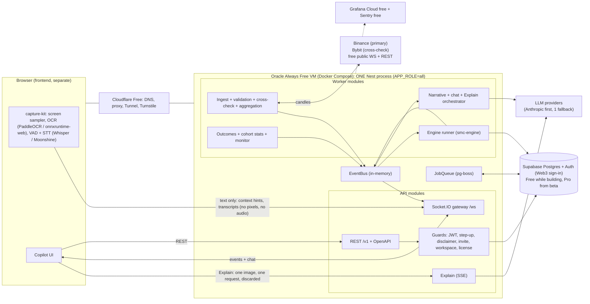
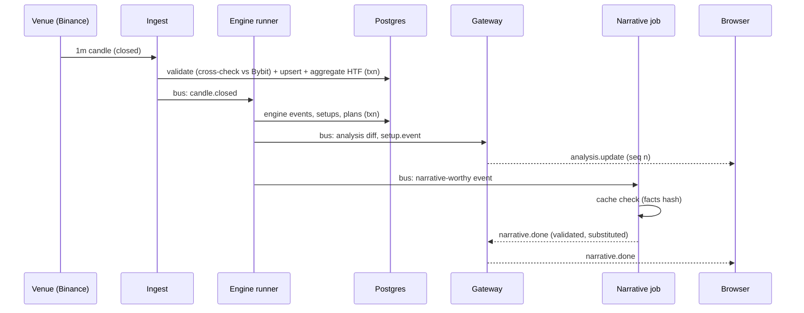
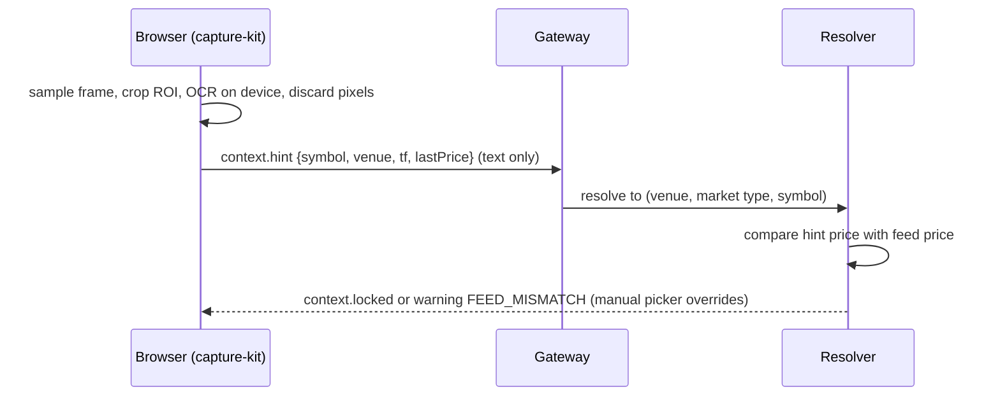

# B02: MVP Architecture and Stack (with monthly cost)

**Set:** B (shippable MVP) | **Status:** Planning document, v2.0, 2026-10-10
**Relationship to Set A:** Same design, fewer moving parts. Every simplification below keeps the Set A **seam** (an interface, a table or an env switch), so growth is a deployment change rather than a rewrite (B06).
**Read with:** B01 (scope), B03 (schema), B04 (API), B05 (plan), A01 (decisions and the Supabase comparison), A08 (hosting, security, cost).

> **The $0 rule.** The only things that cost money are **Supabase** (database and auth) and **AI model usage**. Everything else is free or open source: Oracle Cloud Always Free VM, Cloudflare Free, GitHub, Grafana Cloud free, Sentry free, exchange public market data, open-source OCR and speech models running in the user's browser. Where a free service has a real risk, the risk and the fallback are written down (A08 section 1.3); a paid fallback is never assumed without your approval.
> Prices were collected by web search on 2026-10-10 and are tagged **[verify]** where I did not read the vendor's own page.

---

## 1. Architecture in one picture



**Single deployable, single database, no cache server.** One container runs everything; Supabase provides Postgres and Auth. The only background infrastructure is `pg-boss`, which lives in the same Postgres. No speech-to-text sidecar exists in the MVP: all transcription runs in the browser (Tier 1, A02 section 6.3), and the sidecar arrives with M6 if testers' devices need it.

**What leaves the browser.** Text only: OCR hints (symbol, venue, timeframe, last price), voice transcripts, typed messages. The single exception is **Explain**, where the user explicitly sends one image to a one-shot request that is read by the model and discarded (A02 section 3.5). No audio ever leaves the device in Tier 1.

---

## 2. Design decisions specific to the MVP

| Decision | Choice | Set A target | Seam that keeps the door open |
|---|---|---|---|
| Compute | **Oracle Always Free A1 VM** (2 OCPU, 12 GB), one Compose project | Same VM with Valkey and the STT sidecar, then paid nodes if load demands | Everything is a container; the VM is replaceable (A08 section 1.3) |
| Deployables | **One process**: `apps/api` with `APP_ROLE=all` (API + worker modules) | Two processes (`api`, `worker`) | `apps/worker/main.ts` exists and imports only worker modules; `APP_ROLE` is a config switch |
| Event bus | `InMemoryEventBus` (typed EventEmitter wrapper) | Valkey streams / pub-sub | `EventBus` interface (`publish`, `subscribe`); handlers are idempotent |
| Jobs | **pg-boss** | BullMQ on Valkey | `JobQueue` interface: `enqueue`, `schedule`, `process`; job names and payload schemas identical |
| Rate limiting | In-memory token buckets | Valkey sliding window | `RateLimiter` interface |
| Stream ownership | In-process `StreamRegistry` with refcounts | Postgres leases (`stream_leases`, upgrade 0010) | `StreamOwnership` interface; local impl always "owns" |
| Venues | Binance primary, **Bybit** as the single cross-check (same market type, rule V7) | Add OKX, Coinbase, Kraken | Venue rows and aliases already seeded; adapters are the only missing part |
| Realtime | Socket.IO, WebSocket-only transport | Same + Valkey adapter | One-line change at gateway bootstrap |
| Auth | Supabase Auth Web3 (Ethereum + Solana), wallet-first, email optional, behind `AuthProvider` | Same + step-up for sensitive actions | Interface already portable (A01 section 5.4) |
| Identity data | `wallet_identities` mirror table written by the API | Same | Keeps product logic independent of `auth.users` internals |
| LLM | Anthropic primary, one fallback vendor wired | Multi-vendor router, bake-off per job | `LlmRouter` is final-shape from day one (A05 section 10) |
| Speech and OCR | In-browser only (Tier 1) | Adds server STT sidecar (Tier 2) | `SttEngineTag` already includes the server engines; flag `voice.server_stt` is off |
| Billing | None (invite-only beta) | On-chain stablecoin invoices (upgrade 0010) | `entitlements` drives all limits today |
| Admin | Admin API + Supabase Studio | Admin UI | n/a |
| Forex | Not present | Enabled in M10 | `asset_class` and `market_calendars` are generic; `FX_STUB` venue is disabled (B06) |

**The rule for B05:** any code that would be different in the full product goes behind one of these interfaces on day one. Anything else is written once.

---

## 3. Monorepo, runtime and libraries

### 3.1 Layout (subset of A01 section 6)

```text
smc-copilot/
├─ apps/
│  ├─ api/            # NestJS app: REST + gateway; APP_ROLE=all also boots worker modules
│  └─ worker/         # entrypoint only (unused until M6)
├─ packages/
│  ├─ smc-engine/     # pure TS reducer (no Nest, no I/O), includes chartfacts
│  ├─ contracts/      # Zod schemas: REST DTOs, WS events, LLM outputs, MarketFacts, voice and OCR payloads
│  ├─ market-data/    # binance, bybit, replay adapters + aggregate(); okx/coinbase/kraken/fx-stub are empty stubs
│  ├─ capture-kit/    # BROWSER library: sampler, OCR worker, VAD + STT workers, glossary, command grammar
│  ├─ ai/             # router, prompts (versioned), validators, templates, cost meter
│  ├─ db/             # drizzle schema, migrations (set-b/sql), seeds
│  ├─ config/         # tsconfig, biome, env schema
│  └─ testing/        # golden datasets, replay harness, fixtures, OCR and voice eval sets
├─ infra/             # docker-compose (app, caddy, cloudflared, alloy), CI, backup scripts, SOPS-encrypted env
└─ docs/              # these planning documents
```

Dependency rules unchanged from A01 (engine, market-data, ai, db and capture-kit depend on `contracts` only; apps depend on packages; packages never depend on apps).

### 3.2 Versions and libraries

| Concern | Choice |
|---|---|
| Runtime | Node.js 22 LTS, TypeScript 5.x (strict), ESM |
| Framework | NestJS 11 (`@nestjs/core`, `@nestjs/platform-express`, `@nestjs/websockets`, `@nestjs/platform-socket.io`; scheduling by pg-boss) |
| HTTP adapter | Express (default); switch to Fastify only if profiling shows a need |
| Validation/contracts | Zod + `nestjs-zod`; OpenAPI via `@nestjs/swagger` |
| Auth | Supabase Auth (Web3: Ethereum EIP-4361, Solana); JWT verified through JWKS; `viem`/`siwe` and `@solana/web3.js` only for step-up signature checks and wallet-link flows |
| DB access | Drizzle ORM + `postgres` (postgres.js) with `prepare: false` for the transaction pooler; raw SQL for partition and upsert-heavy paths |
| Jobs | `pg-boss` (session pooler or direct connection **[verify]**) |
| Realtime | Socket.IO v4, `transports: ['websocket']`, `perMessageDeflate: false` |
| Explain | `POST /v1/explain` over SSE; `sharp` to validate and downscale the one uploaded image in memory |
| Browser ML | `onnxruntime-web` with PaddleOCR models; `@huggingface/transformers` (Whisper, WebGPU, WASM fallback); Moonshine; Silero VAD (all open source, run locally in the browser) |
| Time/sessions | UTC-fixed sessions (crypto); `luxon` for display only |
| LLM SDKs | `@anthropic-ai/sdk`; one fallback vendor SDK behind our adapters |
| Logging/telemetry | Pino (+ `nestjs-pino`), OpenTelemetry, Sentry free tier, Grafana Alloy to Grafana Cloud free |
| Testing | Vitest, Supertest, `socket.io-client`, Postgres 16 service container in CI, Playwright for the capture-kit smoke test, k6 for a smoke load script |
| Tooling | pnpm, Turborepo, Biome, Lefthook, gitleaks, Dependabot, SOPS + age for secrets |
| Payments | none in MVP |

### 3.3 Connection model (a common source of "it works locally")

| Use | Connection | Why |
|---|---|---|
| App queries (Drizzle) | Supabase **transaction pooler** (port 6543), `prepare: false`, pool max 10 | Many short queries; protects connection limits |
| pg-boss and migrations | **Session pooler** (port 5432 on the pooler host) or direct connection | Needs session features (advisory locks, long transactions) |
| IPv6 note | Supabase direct connections are IPv6; Oracle VMs can have IPv6 but check it in spike S7; otherwise use the session pooler for DDL and pg-boss **[verify current Supabase networking docs]** | |
| Total | api pool 10 + pg-boss 4 + migration runner transient | Well under Pro's pooler limits |

**Region:** the VM and the Supabase project are placed in the same region or the nearest pair (worker-to-DB latency is on the hot path, target under 10 ms, measured in spike S7). The region is chosen **after** spike S2 shows that Binance and Bybit are reachable from it (Binance blocks US IPs).

---

## 4. Process design inside the single service

| Concern | Design |
|---|---|
| **Event loop discipline** | Engine steps are microseconds to milliseconds; LLM calls are async I/O; `sharp` runs on libuv threads and only for Explain. Alert if event-loop lag p99 exceeds 100 ms. CPU-heavy work (backtests, golden replay) runs only as separate CLI processes, never inside the server |
| **Startup order** | 1) env validation; 2) DB connect + `maintain_partitions`; 3) load strategy version(s) and engine snapshots; 4) replay candles since each snapshot; 5) start venue streams (Binance, then Bybit) after replay; 6) open HTTP/WS; 7) readiness = `/readyz` returns 200 only when engine warm-up finished |
| **Shutdown** | SIGTERM: stop accepting sessions, flush event batches, write engine snapshots, close venue sockets, drain WS (clients re-send `session.start` with `lastSeq`) |
| **Deploys** | GitHub Actions builds an image to GHCR, then `docker compose pull && up -d` behind a health check; expect a 5 to 20 s blip; sockets reconnect and resume (nothing lost). Rollback = previous image tag. Deploy outside the London and New York killzones when testers are active |
| **State on restart** | Engine state from snapshots; sessions are in the DB and sockets resume; in-memory token buckets reset (acceptable); `pg-boss` jobs persist |
| **Hot-loop writes** | Candle upsert + event insert in one transaction per candle close; AI calls logged asynchronously (best effort, buffered) |
| **Sizing** | The whole stack must fit the VM's memory budget (A08 section 1.1): API+worker 1.0 to 1.8 GB, Caddy/cloudflared/Alloy/OS about 1 GB, staging stack about 1 GB; total about 3 to 4 GB of 12 GB in the MVP (no sidecar, no Valkey) |
| **Single point of failure** | Yes, accepted for a beta. Mitigations: health check auto-restart, snapshots, status page, alerts to your phone, no durable state on the VM, replacement VM in under 2 hours (A08 section 1.3) |

### 4.1 Key flows (condensed; full detail in A02, A03, A04, A05)





---

## 5. Environments and CI/CD (MVP subset of A08)

| Env | What | Notes |
|---|---|---|
| local | `docker compose up` (Postgres 16), `pnpm dev`, `APP_ROLE=all`, replay adapter, mock LLM | Run `set-b/sql/apply.sh <url> --with-shims` |
| ci | GitHub Actions with a Postgres 16 service | Lint, typecheck, unit, golden replay, contract tests, SQL apply and smoke test, capture-kit tests |
| staging | Second Compose project on the same VM + a Supabase Free project | Live crypto, tester-only; AI budget capped; shares the VM's fate (accepted) |
| prod | Compose project on the VM + Supabase **Pro** from the closed beta | Beta |

Pipeline: PR → lint, typecheck, unit, engine golden replay and no-look-ahead property tests, SQL apply on a clean DB, mock-LLM evals → merge → deploy staging + migrate → smoke test → manual promote to prod. Feature flags (`feature_flags`) and the admin kill switch handle risky features without redeploys. Rollback = redeploy previous image (migrations are forward-compatible for one release).

---

## 6. Configuration (validated at boot with Zod)

| Variable | Purpose |
|---|---|
| `APP_ROLE` | `all` (MVP) / `api` / `worker` |
| `DATABASE_URL`, `DATABASE_URL_SESSION` | Pooled app URL; session/direct URL for pg-boss and migrations |
| `SUPABASE_URL`, `SUPABASE_JWKS_URL`, `SUPABASE_JWT_AUD` | JWT verification via JWKS |
| `WS_TOKEN_SECRET` | Signs 5-minute wsTokens |
| `BINANCE_WS_URL` (default `data-stream.binance.vision`), `BYBIT_WS_URL` | Feeds |
| `ANTHROPIC_API_KEY`, `FALLBACK_LLM_PROVIDER`, `FALLBACK_LLM_API_KEY` | LLMs |
| `AI_MODEL_IMAGE_READ`, `AI_MODEL_NARRATIVE`, `AI_MODEL_CHAT`, `AI_MODEL_ROUTER`, `AI_MODEL_EXPLAIN` | Model ids as config (switchable without a code deploy) |
| `AI_DAILY_BUDGET_DEFAULT_USD`, `AI_GLOBAL_DAILY_CAP_USD` | Cost guards (the global cap is the last-resort circuit; default $10/day in the beta) |
| `TURNSTILE_SECRET`, `ABUSE_HASH_SALT` | Sign-up bot check and salted-hash abuse counters (A08 section 2.3) |
| `SENTRY_DSN`, `OTEL_EXPORTER_OTLP_ENDPOINT` | Observability |
| `ADMIN_IP_ALLOWLIST`, `CORS_ORIGINS` | Hardening |
| `LOG_LEVEL`, `NODE_ENV` | Runtime |

Secrets are SOPS + age encrypted in the repo and decrypted on the VM at deploy time; `.env.example` is committed, real `.env` never.

---

## 7. Monthly cost (USD)

Assumptions: 10 session-hours per tester per month; AI per session-hour from A05 section 3 (stack S2r: $0.196 to $0.253 list, about $0.152 with planned optimizations); Supabase Pro $25 (A01 section 5.2); everything else $0.

| Line | Build phase (weeks 1 to 11) | Build phase (weeks 12 to 16) | Closed beta (30 testers) | MVP stack at 100 users |
|---|---|---|---|---|
| Supabase | $0 (Free projects) | $25 (Pro from W12 D5) | **$25** | $25 |
| Compute (Oracle Always Free) | $0 | $0 | **$0** | $0 |
| Cloudflare, GHCR, GitHub Actions | $0 | $0 | $0 | $0 |
| Market data (Binance, Bybit public) | $0 | $0 | $0 | $0 |
| OCR, voice, VAD (open source, run in the user's browser) | $0 | $0 | $0 | $0 |
| LLM: product usage | $0 to $10 (your own testing) | $20 to $50 | **$46 to $76** (300 session-h) | **$152 to $253** (1,000 session-h) |
| LLM: evals (weekly + on prompt/model change) | $0 to $10 | $20 to $40 | $20 to $40 | $20 to $40 |
| Email (optional; wallet sign-in needs none; Brevo/Resend free SMTP if offered) | $0 | $0 | $0 | $0 |
| Observability (Sentry, Grafana Cloud, Upptime) | $0 | $0 | $0 | $0 |
| Domain (optional; `*.pages.dev` works) | $0 to $1 | $0 to $1 | $0 to $1 | $0 to $1 |
| **Total per month** | **about $0 to $20** | **about $65 to $115** | **about $91 to $141** | **about $197 to $318** |

Cross-check against A08 section 8: at 100 users A08 shows $177 to $278 including optimization; the MVP row is higher because it adds $20 to $40 of evals, which A08 treats separately.

One-off costs (not monthly): lawyer scoping and document review, a few hundred to a few thousand USD **[verify local rates]** (A09 section 2.3). This is a service, not infrastructure; it is the one cost I would not skip.

**Cost guardrails (so the beta cannot surprise you):**

- Free-plan limits per tester (from the `handle_new_user()` defaults in B03): 3 Explain/day, 40 chat messages/day, 60 voice utterances/day, AI budget $0.05/day; redeeming an invite code merges the code's `grants` into the tester's entitlements (default: AI budget $1.00/day).
- **Global daily AI cap** (`ai_global_ledger.cap_usd`, default **$10/day** during the beta, about $300/month worst case) trips the AI kill switch automatically; set the same limit in each AI vendor's console as a second wall.
- Gate on the voice path: speech-to-text costs nothing (browser), but every transcript that reaches the chat model costs tokens; the chat daily limit protects this.
- A free wallet account is free to create, so abuse is bounded by the invite code in the beta and by Turnstile, per-IP/device counters and the tiny free budget afterward (A08 section 2.3).

Cost sensitivity: if Explain's image read escalates to a larger model on 25% of requests, Explain cost per request rises from about $0.01 to about $0.02 (small). If narratives are not shared across users (a bug), narrative cost scales per user: keep the `facts_hash` cache-hit rate as a dashboard metric (target above 60% with 5+ concurrent users on the same instrument).

---

## 8. Alternatives considered for the MVP

| Alternative | Rejected because |
|---|---|
| Railway, Render, Fly.io for compute | Metered or paid; the $0 rule picks the Oracle free VM, with a written fallback ladder |
| Railway Postgres or self-hosted Postgres instead of Supabase | Scored in A01 section 5.2 (Supabase 102, Railway 74, self-host 51/53); you operate backups, pooling, auth and upgrades yourself, and Supabase Auth Web3 removes the wallet-login build |
| Serverless functions (Vercel/Lambda) for the API | Long-lived sockets and in-memory engine state; cold starts |
| Supabase Edge Functions for logic | Portability (A01 section 5.4) and no long-lived streams |
| Redis/Valkey from day one | An extra process to run and secure with no benefit at 10 concurrent sessions |
| In-process timers instead of pg-boss | Loses durability of backfill and outcome jobs across restarts |
| Two services from day one | More deploy surface for no capacity benefit now |
| Server-side OCR/STT in the MVP | CPU and memory on the free VM, plus audio and image transport; browser-side keeps privacy and cost at zero. Tier 2 stays an upgrade |
| Hosted vision model for every frame | Cost and privacy; on-device OCR reads the context, the vision model is only used for Explain |
| Paid market-data aggregators | Violates the $0 rule; venue feeds are free and cross-check each other |
| Mongo/ClickHouse for candles | Volume is under 1 GB per year (B03 section 7) |
| Managed Kafka/NATS | Overkill |
| Next.js API routes as the backend | Not the stated stack; harder to host long-lived streams |

---

## 9. Risks specific to this architecture (and mitigations)

| Risk | Mitigation |
|---|---|
| Free VM unavailable, reclaimed or terminated | Everything reproducible from the repo; state in Supabase; backups to R2; fallback ladder (second Oracle region, a spare machine through the same Cloudflare Tunnel, then a cheap VPS only with your approval); spike S7 and the utilization dashboard |
| One process crash drops all sessions | Fast auto-restart, snapshots, client auto-resume, status banner |
| Explain image handling starves the gateway | One image at a time per user, size cap, concurrency limit, event-loop lag alert, early move to `APP_ROLE=worker` |
| Browser ML does not run on a tester's device | Manual picker and typed chat always work; WASM fallback; capability check reported at session start; Tier 2 server STT is the upgrade |
| OCR or STT less accurate than assumed | Spikes S1/S3 give the number in week 1; manual picker is a first-class path; correction UI for transcripts |
| Venue geo-blocks the VM's IP range | Spike S2 before choosing the region; Bybit carries the load if Binance fails; adapters degrade per venue |
| Venue terms forbid display of raw prices | Default is `INTERNAL_ONLY` through the licence view; the product shows overlays and analysis only until a `venue_terms` row says otherwise |
| Pooler misconfiguration (prepared statements) | `prepare:false`, a startup self-test query, documented in the runbook |
| Free wallet accounts are cheap to farm | Invite codes in the beta, Turnstile, hashed per-IP/device counters, tiny free budget, global daily cap (A08 section 2.3) |
| Over-engineering the seams | Each seam is an interface with exactly one implementation now; no speculative features |

---

## 10. Assumptions

1. Beta traffic: at most 10 concurrent sessions, 20 to 50 testers.
2. Oracle Always Free Arm capacity is obtainable in a region that Binance and Bybit do not block, and the VM and Supabase can be placed within about 10 ms of each other **[verify with a ping test in week 1]**.
3. Testers use a recent desktop Chromium-based browser (WebGPU where available, WASM otherwise).
4. You (or a collaborator) supply a minimal frontend; the backend ships an HTML dev client.

## 11. Open questions

1. **Supabase region and VM region pair** (default: choose by spike S2 and S7 results, not by preference).
2. **Staging on the same VM** (default, free) or a separate account (more isolation, more signup friction).
3. **Custom SMTP?** Wallet sign-in needs none; only if users link an email and you want confirmation mails. Default: leave the email path on Supabase's built-in sender for the beta and configure free SMTP before public launch **[verify rate limits]**.
4. **Which wallet connect library** for the frontend (outside the backend scope; the backend only verifies EIP-4361 and Solana sign-in messages).

## Sources

- Supabase pricing, connection modes and Web3 auth (A01 section 5; A07 section 3) **[verify]**
- Oracle Cloud Always Free limits and idle-reclaim rule, June 2026 reduction (A08 section 1.3) **[verify]**
- Cloudflare Tunnel and Turnstile free tiers (A08 section 1.1) **[verify]**
- AI cost model: A05 section 3; fixed cost model: A08 section 8
