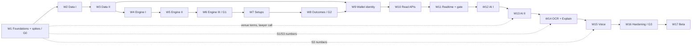

# B05: MVP Build Plan (17 weeks, day by day)

**Set:** B (shippable MVP) | **Status:** Planning document, v2.0, 2026-10-10
**Relationship to Set A:** A compressed execution of A10 milestones M0 to M5 (20.5 likely person-weeks in A10; **16 build weeks plus 1 beta/buffer week here**, because scope is cut per B01 section 4 and A10 section 1.1). Gates G0 to G3 are the A10 gates.
**Read with:** B01 (scope and stories U1 to U18), B02 (stack), B03 (schema), B04 (contracts and build weeks), A04/A05 (engine and AI specs), B06 (what to cut if you slip).

> **Assumptions behind the dates:** one experienced full-stack TypeScript developer, about 30 focused hours per week, starting Monday **2026-10-19**, with a two-week holiday break (Dec 21 to Jan 1) left out of the count. "Day" means one focused working day; at 20 hours per week multiply the calendar by 1.5. Every step has an **acceptance criterion (AC)** that is testable, so "done" is not a feeling.
>
> **How honest is "17 weeks"?** It is the nominal plan: 16 task weeks, 1 week of beta launch with slack. The v2 additions (wallet auth, multi-venue validation, browser OCR, voice, Explain, free-VM operations) cost about 3 weeks more than the v1 plan of 14, and v1's own 14 weeks were optimistic. Three weeks are tight by design (W1 spikes, W6 engine fidelity, W14/W15 browser ML). With the 25% contingency recommended in A10 section 1, plan for **about 21 weeks (closed beta in late March 2027)** and treat 17 as the best case. If you need a firm date, apply the B06 cut list rows 1 to 4 at the end of W3 instead of hoping.

---

## 0. How to run the plan

| Practice | Rule |
|---|---|
| Weekly rhythm | Monday: 30-minute plan from this document, update the task list. Friday: 30-minute demo to yourself (short screen capture), update the variance table (section 16), commit notes in `docs/weekly/` |
| Definition of done (any step) | Code merged to main; tests that prove the AC exist and pass in CI; types strict; logs/metrics added where the step touches runtime behaviour; the relevant doc line updated if a decision changed |
| Order of work | Risk first (A10 section 2): spikes and venue-terms reading in week 1; engine correctness before API polish; AI after the deterministic product works with the LLM off; browser ML after the server contract is stable |
| Variance check | End of week 3: compare actual to plan. If more than 1.5 days behind, apply the first rows of the B06 cut list immediately; do not wait until week 10 |
| Scope discipline | Anything not in B01 section 3 goes to `docs/backlog.md`, not into the sprint |
| Daily habit | Run the golden replay and the full test suite before each commit to main once the engine exists (week 4+) |
| Free-tier discipline | Check the three Oracle utilization numbers and the Supabase DB size every Friday (A08 section 1.3) |

External actions with long lead times (do on the day shown, even though they are not code):

| Week/day | Action |
|---|---|
| W1 D1 | Read and record Binance and Bybit market-data terms for a commercial analytics product (spike S5); send the written questions; book a lawyer scoping call for W16 (A09 section 2.3) |
| W1 D2 | Create the Oracle Cloud account (home region is permanent: choose after S2 results, so create the account on D3 if D2 is not enough); create Cloudflare, Grafana, Sentry, GitHub resources |
| W2 D1 | Create the Anthropic API key + one fallback LLM key; set a hard monthly spend limit at each vendor; create the Supabase dev project |
| W9 D1 | Draft ToS/Privacy from a reputable template; list sub-processors (A09 section 3.2); pick the public sanctions-address source for the blocklist (A09 section 3.5) |
| W12 D5 | Switch Supabase to Pro (so backups and no-pause hold during the beta) |
| W16 D1 | Prepare tester invite list (20 to 50) and generate real invite codes |

---

## Week 1 (Oct 19 to Oct 23): Foundations, free VM and risk spikes [A10 M0, gate G0]

**Goal:** Skeleton, CI, a reachable free VM, and the cheap answers to the biggest unknowns. **This is the tightest week; a day of overrun is expected and is absorbed in W2 D1.**

| Day | Tasks | Acceptance criterion |
|---|---|---|
| D1 | Monorepo (pnpm, Turborepo, Biome, tsconfig base, Vitest, Lefthook, gitleaks); package skeletons per B02 section 3.1 (including `capture-kit`); dependency lint rule; GitHub Actions: lint, typecheck, test, SQL apply on a Postgres 16 service (`apply.sh --with-shims` plus `tests/b03_smoke_test.sql`); S5 reading and emails | `pnpm i && pnpm turbo run build lint test` green on a clean clone; importing `apps/*` from a package fails lint; CI runs the SQL smoke test green |
| D2 | Oracle VM (Ampere A1, 2 OCPU / 12 GB) in a candidate non-US region, Docker, Compose project, Cloudflare Tunnel, DNS, SOPS + age; Nest `apps/api` skeleton with `/healthz`, Pino, correlation id | `GET /healthz` returns 200 at the staging hostname through the Tunnel with no inbound ports open; redeploy by `docker compose pull && up -d` works |
| D3 | **Spike S2:** from the VM, open Binance (`data-stream.binance.vision`) and Bybit WS + REST, record 24 h of raw frames (background), measure p95 close-to-receive lag, check for HTTP 451/403; **Spike S7:** memory/CPU baseline and ping to a Supabase project in the nearby region; decide the final regions | Lag p95 recorded; zero geo-block responses; DB round trip under 10 ms or region changed; capture running |
| D4 | **Spikes S1 + S4 (one test page):** `getDisplayMedia` + ROI + diff gate; PaddleOCR via onnxruntime-web on 40 screenshots (TradingView dark/light, Binance, Bybit); WebGPU/WASM capability matrix on Chrome, Edge, Firefox, Safari | Written result: symbol+timeframe accuracy %, last-price parse %, median OCR ms per backend, frame size under 200 KB at 1 frame per second max |
| D5 | **Spike S3:** the same page loads Whisper (WebGPU) and Moonshine/Whisper-WASM; run the 200-phrase trading-jargon set (recorded by you, 2 accents if possible); write `docs/spikes.md`; **gate G0 decision** | WER and glossary-corrected command accuracy per engine and device; G0: go / adjust (OCR primary vs manual primary; default STT engine; Tier 2 into the MVP if no browser engine reaches 90%) |

**Week deliverables:** CI + staging VM, `docs/spikes.md`, venue-terms reading done, lawyer call booked.

---

## Week 2 (Oct 26 to Oct 30): Market data I [A10 M1 part 1]

**Goal:** Venue adapters, normalization, validation and storage of 1-minute candles.

| Day | Tasks | Acceptance criterion |
|---|---|---|
| D1 | Absorb W1 overrun; Supabase dev project; `apply.sh` on it; `packages/config` Zod env schema; JWT guard via `AuthProvider` (JWKS); `MarketDataProvider` interface and `RawCandle`/`Candle` types; `replay` adapter reading JSONL; download 3 months of BTCUSDT and ETHUSDT 1m from Binance public REST for local testing (Vision-dataset terms: local testing only) | Replay emits candles in order at configurable speed; dataset checksums recorded; invalid JWT returns problem+json 401 |
| D2 | Binance adapter: spot and USD-M perp WS `@kline_1m` (closed flag), REST klines for history; reconnect with capped backoff + jitter; status events | Mock-WS test: reconnect after drop, no duplicate emission, only `closed=true` forwarded; spot and perp never share a series |
| D3 | Normalize + validate pipeline (V1 to V9), quarantine writes, flags bitmask, unit tests with the S2 fixtures | Table-driven tests for every rule; invalid OHLC goes to `candle_quarantine` with a reason; zero false rejects on 3 months of replay data |
| D4 | Bybit perp adapter (BTC, ETH); cross-check comparator (V7, same market type only); `dq_incident` on divergence | Injected divergence beyond tolerance opens a `dq_incident` and flips status to DEGRADED; a spot-vs-perp comparison is refused by construction (test) |
| D5 | Candle upsert (write-then-publish) with `ON CONFLICT`; `StreamRegistry` (refcounted, in-memory); `POST /v1/admin/venues/{id}/terms` writing `venue_terms`; wire `instrument_license`; guarded candles route returning `FEED_LICENSE_RESTRICTED` | 24-hour run on staging: row counts match expectations; replay twice leaves row count and hashes unchanged; with no terms row the candles route returns 403; with a `DISPLAY_OK` terms row (test fixture) it returns data |

**Week deliverables:** Live 1m candles for 6 Binance instruments plus Bybit cross-check in the staging DB; adapter and validator suites.

---

## Week 3 (Nov 2 to Nov 6): Market data II [A10 M1 part 2]

**Goal:** Higher timeframes, gap handling, staleness, history seeding. Start the soak test.

| Day | Tasks | Acceptance criterion |
|---|---|---|
| D1 | `aggregate()` pure function for 5m/15m/1h/4h/1d (00:00 UTC rollover); property tests | Aggregated candles match a reference implementation on random streams; month-boundary and leap-day fixtures pass |
| D2 | HTF persistence on each 1m close; `PENDING`/`INCOMPLETE` handling for missing constituents; flag propagation | HTF candle never emitted `CLOSED` with a missing constituent |
| D3 | Gap detection, `candle_gaps`, backfill job via pg-boss, history seeding for warm-up windows (A03 section 7) | Kill the socket mid-minute in a test: gap detected, backfilled within 60 s, no duplicates |
| D4 | Stale-feed watchdog, `feed.status` events, `GET /v1/instruments/{id}/status`, `GET /v1/status`, `GET /v1/admin/feeds`; instruments list and `resolve` (alias + `symbol_search_keys` + price disambiguation); nightly HTF reconcile (basic) command | Simulated silence of 20 s triggers DEGRADED, then STALE per thresholds; resolve returns the perp for `BTCUSDT.P` and flags ambiguity for bare `BTCUSD` with a price near the perp |
| D5 | **Soak test start (72 h)**; variance review #1 against this plan | Soak running on staging; variance table updated; decision recorded: apply B06 cuts or continue |

**Week deliverables:** Reliable candle layer; soak in progress (check results Monday).

---

## Week 4 (Nov 9 to Nov 13): Engine I: swings and structure [A10 M2 part 1]

**Goal:** The reducer skeleton, deterministic swings and BOS/CHoCH, and the test harness that guards every later rule.

| Day | Tasks | Acceptance criterion |
|---|---|---|
| D1 | Review soak results (fix findings); `smc-engine` skeleton: `EngineState`, `step()`, candle window, ATR(14), event ids, bounded state; `StrategyConfig` Zod schema; load `smc-core v1` | Soak: zero duplicates, all gaps explained; `step()` returns deterministic output for a toy dataset |
| D2 | Swing pivots (internal L=R=3, external L=R=10) with tie rule and `confirmedAt` | Hand-drawn fixtures (10) pass; pivot confirmed exactly R bars later |
| D3 | Structure state: trend init, BOS, CHoCH (close-based), protected level logic, buffer, multi-break flag, gap-break flag | 12 fixtures cover bull/bear BOS and CHoCH, wick-vs-close, gap open, double break |
| D4 | **No-look-ahead property test** (truncate future; events up to t identical) and **determinism test** (two runs, same hash); replay CLI `pnpm engine:replay` | Property test passes on 1,000 random datasets; CLI prints event-stream hash and counts |
| D5 | Engine runner in the worker modules: consume `md.candle.closed`, call `step`, persist `engine_events` in the same transaction, snapshots on 1h close | Staging produces swings/BOS/CHoCH events live for BTCUSDT perp; restart restores from snapshot without duplicate events |

**Week deliverables:** Structure engine with property tests; live events in the DB.

---

## Week 5 (Nov 16 to Nov 20): Engine II: zones, liquidity, ranges [A10 M2 part 2]

**Goal:** FVG, order blocks, liquidity pools and sweeps, premium/discount, context levels.

| Day | Tasks | Acceptance criterion |
|---|---|---|
| D1 | FVG detection and lifecycle (`OPEN`, `TESTED`, `FILLED`, `INVERTED`), size filter | 10 fixtures; lifecycle transitions emit events with the causing candle |
| D2 | Order blocks: origin search window, displacement requirement, zone basis, lifecycle (`FRESH`, `TESTED`, `MITIGATED`) | 10 fixtures; OB chosen deterministically when several candidates exist |
| D3 | Liquidity pools (EQH/EQL tolerance, swing highs/lows, previous day/week, session highs/lows), sweep vs run logic with `sweepConfirmBars` delay, `weekendLiquidity` weighting | Sweep stamped at confirmation bar; spike-flagged candle cannot be the sole sweep basis; weekend weighting fixture passes; 10 fixtures |
| D4 | Dealing range, equilibrium, premium/discount, OTE band; sessions module (UTC-fixed Asia/London/NY AM); `OPEN_LEVELS` (daily/weekly/monthly opens) | `premiumDiscount()` fixtures; session boundaries and opens correct on week/month/year rollovers |
| D5 | Integration: full per-TF state, snapshot size check, bounded-memory test (24 h replay at speed) | State size under a documented cap; memory flat across a 30-day replay; all earlier property tests still pass |

**Week deliverables:** Complete per-timeframe structure engine.

---

## Week 6 (Nov 23 to Nov 27): Engine III: MTF, golden data, labeling [A10 M2 end, gate G1]

**Goal:** Multi-timeframe bias with correct alignment, golden datasets, `ChartFacts`, and measured fidelity to *your* SMC definitions. **Second tightest week; if it overruns, spend the W17 buffer, not later weeks.**

| Day | Tasks | Acceptance criterion |
|---|---|---|
| D1 | MTF state: `htfAt(t)`, bias resolution (1d+4h), processing order across timeframes | Shuffled-arrival test yields identical output; LTF never sees an HTF candle that closes after it |
| D2 | Golden datasets (BTCUSDT and ETHUSDT 3 months) and CI golden-replay job; benchmark script; `chartfacts` builder (the object Explain will use) | CI fails on any event-stream hash diff; step p95 under 20 ms for 4 instruments x 4 timeframes on the VM; `ChartFacts` JSON validates against the contract |
| D3 | **Labeling day:** label 20 charts (swings, BOS/CHoCH, FVG, OB) in a simple JSON format (spreadsheet + screenshots is fine) | 20 labeled samples committed; second labeling pass on 8 charts agrees with the first at least 90% |
| D4 | Detector precision/recall report vs labels; adjust definitions or config (new `strategy_versions` row if config changes; admin endpoints to create and activate versions); A04 section 15.5 worked example added as a fixture | Report in `docs/engine-fidelity.md`: swings/BOS/CHoCH at least 90% precision and recall, FVG at least 95%, OB at least 70% agreement (**gate G1**); the worked example reproduces exactly |
| D5 | Fix top 3 disagreements; document remaining subjective differences; buffer for overruns | G1 recorded as pass/adjust; if "adjust", spend today and note the slip in the variance table |

**Week deliverables:** Engine v1 frozen as `smc-core v1` (or v2 if config changed), fidelity report.

---

## Week 7 (Nov 30 to Dec 4): Setups, filters, scoring, plan [A10 M3 part 1]

**Goal:** Turn structure into explainable setups with plans.

| Day | Tasks | Acceptance criterion |
|---|---|---|
| D1 | Setup lifecycle state machine and persistence (`setups`, `setup_transitions`); T2 (BOS, pullback to POI) detector | Fixtures produce the expected candidate with components list; transitions logged with candle times |
| D2 | T1 (sweep, CHoCH, retest) detector; expiry and invalidation handling | Fixtures for T1 pass; expired and invalidated paths tested |
| D3 | Hard filters with reason codes; soft features and grade; rule status handling (`HYPOTHESIS` weights) | Each filter has a rejecting test with the right code; scores reproduce for identical inputs |
| D4 | Trade plan builder: entry zone, stop (invalidation + buffer + spread), TP1/TP2 from liquidity, primary + alternate scenario; taker fee in net R; `LIQUIDATION_BEFORE_STOP` warning from leverage | Property test: no generated plan lacks invalidation or alternate scenario; RR derived from levels (never chosen); liquidation fixture warns |
| D5 | Wire into the engine runner; `session_setup_views` basis; live staging check; replay comparison between live code path and CLI | Same candles produce identical setup lists via the live runner and the replay CLI (test) |

**Week deliverables:** Setups and plans appearing live in the staging DB.

---

## Week 8 (Dec 7 to Dec 11): Outcomes, stats, backtest, risk [A10 M3 part 2, gate G2]

**Goal:** Honest numbers.

| Day | Tasks | Acceptance criterion |
|---|---|---|
| D1 | Shadow outcome resolver (fill model, pessimistic intrabar rule, fees, expiry, liquidation before stop) | Unit tests: fill/no-fill, TP-then-SL, SL-then-TP, same-candle ambiguity counted as SL, gap through stop, expiry, liquidation |
| D2 | Cohort stats job (Wilson + Beta shrinkage, `sufficient` at n >= 30, `segment`), `setup_displays` logging, `HistoricalStatDto` mapping | n=29 returns `historical: null` + `INSUFFICIENT_HISTORY`; n=40, 16 wins gives rate 0.400, CI about 0.26 to 0.55 |
| D3 | Backtest CLI: walk-forward split, trials counter, costs, bootstrap CI, writes `backtest_runs` | Run on 6 to 12 months of BTCUSDT and ETHUSDT completes and stores results; live-replay equivalence test passes |
| D4 | Risk service (`risk/size` with leverage, liquidation distance, rounding to lot step, warnings), nightly calibration job (basic reliability table), `dq_incidents` open/close | Position-size unit tests including rounding; calibration SQL runs on synthetic data |
| D5 | One-page backtest/outcomes report with trials count and pre-registered criteria; **gate G2** | G2 pass if: no look-ahead tests green, equivalence holds, report exists. "No edge detected" is a valid result and goes into the report as-is |

**Week deliverables:** Stats and backtest report; the engine side of the product is complete.

---

## Week 9 (Dec 14 to Dec 18): Wallet identity, gates, admin basics [A10 M4 part 1]

**Goal:** Wallet-first sign-in, invite/disclaimer/age gates, wallet management, abuse controls. **Verify on the real Supabase project in D1 how a Web3 user without email appears in `auth.users` (the local PG16 tests cannot show it).**

| Day | Tasks | Acceptance criterion |
|---|---|---|
| D1 | Supabase Auth Web3 enabled for Ethereum and Solana on the dev project; test wallets sign in; `GET /v1/me` bootstrap; `wallet_identities` mirror upsert; `address_blocklist` check; ToS/Privacy draft, sanctions source chosen | Wallet-only sign-in yields a JWT, a profile, a personal workspace and an entitlements row via the trigger even though `email` is null; blocked test address returns `ADDRESS_BLOCKED`; if Supabase's behaviour differs from the assumption, the adjustment is written to `docs/spikes.md` the same day |
| D2 | `InviteGuard`, `DisclaimerGuard`, `AgeGuard`, `WorkspaceGuard`; `POST /v1/me/invite` with Turnstile header; `/me/disclaimer`; `/me/age-confirmation`; invite `grants` merged | U1: invalid/used code rejected; feature endpoints return `INVITE_REQUIRED` / `DISCLAIMER_REQUIRED` / `AGE_CONFIRMATION_REQUIRED` until satisfied; redeemed code raises the daily AI budget (tests) |
| D3 | Wallet endpoints: list, link (identity read from JWT, no body address), primary, unlink with `LAST_LOGIN_METHOD`; step-up (JWT `iat` under 5 minutes) for link/unlink/delete; email status endpoint | U2: linking someone else's address is impossible by construction (test); sensitive call with an old JWT returns `STEP_UP_REQUIRED`; adding and removing an email never changes `user.id` |
| D4 | Admin: invites, blocklist import (public sanctions list), user lookup/entitlements/block, audit log writes; abuse counters (`abuse_flags`, salted hashes of IP/device), Turnstile verification on sign-up and invite | Admin calls require role + allowlist + header + write `audit_log`; repeated sign-ups from one hashed subject trip a temporary flag in a test |
| D5 | RLS migration `0008` verified on the real Supabase project (policies, revokes); cross-tenant tests (API + simulated authenticated role); wallet-only e2e skeleton | Cross-tenant suite green in CI and on the dev project; wallet-only e2e reaches "session creatable" |

**Week deliverables:** Identity, gates and admin basics; wallet-only account proven.

---

## Week 10 (Jan 4 to Jan 8): Read APIs, sessions REST [A10 M4 part 2]

> The calendar skips **Dec 21 to Jan 1** (two holiday weeks, not counted). If you work through them, pull every date from Week 10 onward forward by two weeks.

**Goal:** All REST read paths and session creation, with guards and contracts.

| Day | Tasks | Acceptance criterion |
|---|---|---|
| D1 | Venues, instruments, resolve (price disambiguation), detail endpoints; `LicenseGuard` reading `instrument_license`; entitlement limits plumbing | `rawDataAllowed=false` for all instruments when `venue_terms` is empty; resolve returns spot vs perp candidates with reasons; route-scan test passes |
| D2 | Analysis snapshot builder (`MarketFacts` view), ETag, `analysis/events` | U5: ETag 304 works; `asOf` equals the last processed candle; spot/perp never mixed in one snapshot |
| D3 | Setups endpoints (list/detail/history/rejected), cohort stats endpoint | U6/U7: setup DTO enforces plan invariants; `historical` null when insufficient |
| D4 | Sessions REST (create/list/get/ws-token/end), idempotency interceptor, initial analysis in the create response, in-memory rate limiter | U3: `initial` analysis p95 under 500 ms; same `Idempotency-Key` returns the identical response; a different body returns `IDEMPOTENCY_CONFLICT` |
| D5 | Risk endpoints; OpenAPI + TS client generation in CI; Bruno collection; problem+json filter complete | CI regenerates the client; a breaking contract change fails CI; the collection runs green against staging |

**Week deliverables:** Read-complete REST API, generated client.

---

## Week 11 (Jan 11 to Jan 15): Realtime, gate, trades, journal [A10 M4 part 3]

**Goal:** Full session experience over the socket plus the human-in-the-loop path.

| Day | Tasks | Acceptance criterion |
|---|---|---|
| D1 | Socket.IO gateway: wsToken auth, rooms, single-controller rule, `seq` + `session_events` persistence, `session.start { lastSeq }` resume, backpressure (coalescing) | Reconnect replays exactly the missed events once; second tab gets `SESSION_CONTROLLER_TAKEN` |
| D2 | Facts diff builder, `analysis.update`, `setup.event`, `feed.status`, `warning`, `engine.revision`; connect to the event bus | U5: `analysis.update` within 500 ms p95 of a closed candle (replay at 60x) |
| D3 | Gate service (issue/confirm/decline/void), audit log, types preventing order creation without a confirmed gate; DB constraints exercised (`confirmed_via='UI_TAP'`, life at most 120 s) | Tests: single-use token, expiry, plan-changed, stale-feed block; no code path creates `trade_records.plan_id` without `CONFIRMED`; a direct SQL insert of a non-UI confirmation fails |
| D4 | Trades API, position monitor, in-app notifications (`notification`, `position.event`) | U12/U13: logging from a gate works; `position.event` fires on near-stop/TP/SL/thesis-degraded/liquidation-risk in replay tests |
| D5 | Journal auto-entries + notes/tags/summary; feedback endpoint; wallet-only e2e extended through trade and journal; HTML dev client | U14: rejected setups appear with reason codes; the dev client completes the full flow with AI off and no email |

**Week deliverables:** Deterministic product fully usable end to end (AI off). Run **U1 to U7, U12 to U15** acceptance tests.

---

## Week 12 (Jan 18 to Jan 22): AI I: router, guardrails, narratives, budgets [A10 M5 part 1]

**Goal:** Grounded narratives with safety rails and measurable cost.

| Day | Tasks | Acceptance criterion |
|---|---|---|
| D1 | `packages/ai`: provider adapters (Anthropic + one fallback), `LlmRouter` with timeouts/retries/circuit breaker, cost meter writing `ai_calls` (with `data_class`), prompt registry with versions | Fault-injection tests: 429/5xx/timeouts move down the chain; breaker opens and half-opens; cost recorded per call |
| D2 | Output pipeline: structured output + Zod, ref check, number scan, lexicon filter, `{{L:id}}` placeholder substitution, repair-retry-then-template; seed-phrase/private-key detector (`SECRET_DETECTED`) on every text input | Validators reject seeded bad outputs (unknown id, price literal, banned phrase) in a corpus of 50 cases; 20 seed-phrase and key patterns are caught, 20 ordinary sentences with BIP-39 words are not |
| D3 | Template fallback renderer; narrative job (event-driven, min interval, `facts_hash` cache, shared across sessions) | Kill switch on → template narrative still delivered; cache hit rate visible in metrics |
| D4 | Narrative eval harness (100 `MarketFacts` fixtures incl. edge cases) + cross-vendor judge script; run and iterate the prompt | 0 banned-language releases, 100% reference integrity after retry, at least 95% judged faithful |
| D5 | Budgets: per-user daily ledger, soft/hard limits, `budget.update`, **`ai_global_ledger` cap and automatic kill switch**; admin kill-switch, flags, ai-spend, ai-costs endpoints; **switch Supabase to Pro** | Hard limit disables AI features only; the global cap trips in a test; U17/U18: effective in under 10 s |

**Week deliverables:** Narratives in sessions; eval report v1.

---

## Week 13 (Jan 25 to Jan 29): AI II: chat, data classes, cost measurement [A10 M5 part 2]

**Goal:** Chat with the full safety net, provider data-policy enforcement, and the first real cost number.

| Day | Tasks | Acceptance criterion |
|---|---|---|
| D1 | Chat: J6 router (scope + voice-command classification), answering models, streaming with placeholder buffer, rolling summary, `chat.retract`, REST SSE fallback | U8/U9: grounded answers (refs valid); "should I buy?" returns the `PERSONAL_ADVICE_REQUEST` handling without an imperative |
| D2 | Chat red-team set (100 prompts) with assertions; injection fixtures (including text arriving via OCR hints and Explain questions) | 100% on the critical subset (no certainty language, no trade placement, no cross-user data, no voice-confirmed action), at least 95% overall; OCR `OTHER` text never reaches a prompt (test) |
| D3 | Data classes D0/D1/D2 and the provider policy check (`PROVIDER_BLOCKED_BY_POLICY`); provider retention settings recorded per vendor; per-IP/device free-budget counters wired to AI routes | An image-bearing request (D2 class) is refused for a vendor not marked acceptable; counters throttle a scripted multi-account farm in a test |
| D4 | Scripted 1-hour session (replay-driven: narratives + 25 chat turns) with real models; measure cost per session-hour; tune gating/routing | Measured cost within 1.5x of the A05 estimate; breakdown by job recorded |
| D5 | Fix and tune; **lawyer scoping call** (booked in W1); notes stored; fallback-vendor drill (disable primary mid-session) | Call notes and action items listed; the session continues on the fallback with a `warning AI_DEGRADED` |

**Week deliverables:** Narratives + chat with guardrails; eval report v2; measured cost.

---

## Week 14 (Feb 1 to Feb 5): Capture-kit OCR and Explain [A10 M5 part 3]

**Goal:** Context from text read on the user's device, and "Explain this chart" with zero retention. **Tight: the browser work and the server work meet this week.**

| Day | Tasks | Acceptance criterion |
|---|---|---|
| D1 | `capture-kit`: screen sampler (ROI, diff gating, rate cap), OCR Web Worker (PaddleOCR via onnxruntime-web, WebGPU with WASM fallback), model caching; `OcrContext` classification | Playwright test: on recorded screenshots the worker returns an `OcrContext`; the main thread is never blocked more than 50 ms; capability report sent at session start |
| D2 | Server side of `context.hint`: re-derive symbol/venue/tf/price with server parsers, alias resolver, 2-hint rule, reconcile against the feed price (0.15% core tolerance), `FEED_MISMATCH` with nearest candidate; manual picker override | U4: correct instrument locks within 2 hints; a perp-priced hint on a spot chart produces `FEED_MISMATCH` with the right suggestion; flapping hint test holds the context |
| D3 | OCR eval on 100 crops; threshold tuning; "no pixels leave the device" network-capture test | Symbol and timeframe at least 95% on supported platforms (or the picker is declared primary); false-lock rate under 1%; capture shows zero image payloads during a normal session |
| D4 | Explain: `POST /v1/explain` (multipart, in-memory `sharp` validation, size/dimension caps), `ChartFacts` for the resolved instrument, J1 ImageRead (strict schema), J7 writer that never sees pixels, SSE stages/chunks/done; socket path `explain.request` | U11: on 10 charts the answer's numbers all trace to `ChartFacts` or placeholders; an unsupported instrument returns the clear message; a non-chart image returns `NOT_A_CHART` |
| D5 | Explain evals (50 charts with known facts); `no-frame-persistence` CI test; schema scan for image/audio columns; UPLOAD mode (paste/drop/pick); limits and budgets | Faithfulness at least 95% on the set; runtime test finds the image nowhere on disk or in the DB; logs and Sentry scrubbed (test) |

**Week deliverables:** OCR context lock and Explain working end to end; eval report v3.

---

## Week 15 (Feb 8 to Feb 12): Voice [A10 M5 part 4]

**Goal:** Push-to-talk voice in the browser with a glossary-corrected transcript and strict action limits. **Tight: model packaging and device variance.**

| Day | Tasks | Acceptance criterion |
|---|---|---|
| D1 | Silero VAD + push-to-talk capture worklet; Whisper Web Worker (transformers.js, WebGPU); model download with `sha256` check and cache; `GET /v1/voice/config` | A spoken sentence is transcribed on the reference laptop; model files verified by hash; mic permission denial yields `MIC_PERMISSION_DENIED` and typed input |
| D2 | Moonshine / Whisper-WASM fallback; capability-based engine selection; `SttEngineTag` reporting | On a machine without WebGPU the fallback works; selection logged in `voice_events`; `STT_UNAVAILABLE` leads to a typed-input banner |
| D3 | Glossary service (`GET /v1/voice/glossary`: symbols + SMC terms), client-side correction, command grammar ("explain this chart", "next setup", "mute", ...), `voice.command` with the J6 router, `voice_events` writes | "bee tee see perp" becomes BTC perp; forbidden commands ("confirm the trade", "delete my account") return `VOICE_FORBIDDEN_ACTION` with an on-screen prompt; transcript always visible and editable |
| D4 | Voice evals on the 200-phrase set per engine; end-to-end latency measurement; **Playwright network capture proving no audio payload leaves the device** | Command accuracy at least 95% after correction for the default engine; push-to-talk release-to-transcript p95 under 2.5 s on the reference laptop; zero audio bytes on the wire |
| D5 | Combine voice + Explain ("explain this chart" by voice), typed fallbacks, error copy; fold OCR/STT/Explain evals into the scheduled CI job; update `docs/spikes.md` with final numbers | Voice-triggered Explain works end to end; evals run nightly in CI with results stored |

**Week deliverables:** Voice working; every AI-adjacent eval automated.

---

## Week 16 (Feb 15 to Feb 19): Hardening and beta preparation [A10 M5 end, gate G3]

**Goal:** Production readiness for 20 to 50 testers.

| Day | Tasks | Acceptance criterion |
|---|---|---|
| D1 | Production Compose project on the VM + Supabase Pro; secrets (SOPS), region check, CORS, Cloudflare in front; run migrations on prod; **remove the dev invite code**; create real invite codes; load the sanctions blocklist | `readyz` green on prod; smoke test (dev client full flow, wallet-only) passes against prod; `DEV-BETA-0001` does not exist |
| D2 | Observability: Grafana dashboards (feed lag, engine step, sockets, AI cost, queue depth, Oracle utilization), Sentry alerts, status page (Upptime), phone alerts for STALE/engine fault/5xx/VM down | Alerts fire in a staged failure drill (kill the Binance adapter; kill-switch the AI; stop the VM container); thresholds from A08 section 5.3 |
| D3 | Runbooks: feed outage, AI outage, VM loss and rebuild, rollback, key rotation, DB connection exhaustion, deletion request; `DELETE /v1/me` job (U16); backup restore drill from the encrypted `pg_dump` in R2 onto a scratch Supabase project | Restore completed; RTO measured and recorded; VM rebuild from the repo timed; runbooks in `docs/runbooks/`; a test account's data is gone after the deletion job |
| D4 | Security pass: dependency audit, gitleaks, ZAP baseline against staging, route scan for raw-data leaks, log redaction test; k6 smoke (20 sessions with mock LLM) | No high findings open; 20-session smoke holds p95 overlay under 500 ms with 0 dropped seq |
| D5 | Gate G3 review against B01 section 6 checklist; legal prerequisites check (A09 section 9 closed-beta row); beta brief + interview script ready | Every item checked or a written exception; **G3: go / no-go** |

**Week deliverables:** Production environment, runbooks, beta brief, G3 decision.

---

## Week 17 (Feb 22 to Feb 26): Closed beta launch and buffer

**Goal:** Real users on the system, with slack to absorb slips from any earlier week.

| Day | Tasks | Acceptance criterion |
|---|---|---|
| D1 | Invite the first 10 testers; watch dashboards continuously; hot-fix loop | First 10 users complete wallet sign-in, invite, disclaimer and a first session without operator help, or friction is logged |
| D2 | Triage day-1 issues; fix the top 3; invite the next batch (up to 30) | No open S1 (data loss, wrong-tenant, gate bypass, frame/audio retention) bugs; S2 count trending down |
| D3 | Run weekly metrics SQL for H1 to H8 (B01 section 1); review a sample of narratives/chats with consent | Metrics work; sample review notes filed; red-team additions made |
| D4 | Buffer: overrun from earlier weeks, or fix-forward | Whatever is slipping is finished; variance table finalized |
| D5 | Beta week-1 review: decide continue/adjust; schedule weekly calls; write the 4-week beta exit criteria into the repo | Written decision rules; next-4-week plan |

**Week deliverables:** Beta running; 4-week evaluation plan.

---

## 15. Dependency map for the plan

Parallelism if you add a collaborator: frontend work can begin at W10 against the generated client; a second developer would most usefully take W14 and W15 (browser OCR/voice) while you finish W12 and W13, which removes about two weeks from the critical path.

## 16. Variance table (fill in weekly)

| Week | Planned days | Actual days | Variance | Cause | Action |
|---|---|---|---|---|---|
| 1 | 5 | | | | |
| 2 | 5 | | | | |
| 3 | 5 | | | | |
| ... | | | | | |

Rules: if cumulative variance exceeds 3 days at any Friday, apply B06 cut-list rows in order (B06 section 4) before starting the next week.

## 17. Risks to this plan

| Risk | Early signal | Response |
|---|---|---|
| Engine definitions take longer to settle | W4 fixtures keep changing | Freeze v1 at W6 even if imperfect; record disagreements; improve in v2 after beta |
| OCR less accurate than hoped | W1 D4 under 80%, or W14 D3 under 95% | Make the manual picker the declared primary path; ship OCR as an optional assist (W14 D1 to D3 shrink by about 2 days) |
| Browser speech models unreliable on tester devices | W1 D5 best engine under 90% command accuracy | Move the Tier 2 server sidecar into the MVP (adds about 3 days) or ship typed chat plus push-to-talk as "beta" |
| Oracle free VM unavailable or reclaimed | Signup capacity errors in W1; utilization trending under 20% | Retry off-peak; synthetic load; fallback ladder (A08 section 1.3); a paid step needs your approval |
| Venue quirks or geo-blocks | W2 slips; S2 shows 451/403 | Change region before the permanent Oracle choice; if only one venue is reachable, run with it alone (B06 cut list row 9 drops the cross-check and relies on V1 to V6 and spot/perp sanity checks) |
| Supabase Web3 behaves differently for email-less users | W9 D1 | Switch to the documented fallback: SIWE verified by our API and a custom JWT via the Supabase JWT secret path, or custom claims; costs about 2 days (decision recorded in `docs/spikes.md`) |
| Venue terms forbid derived display | S5 answers | Instruments stay `INTERNAL_ONLY`; nothing in the code path changes |
| Other time off or travel | Any week with under 3 working days | The calendar already excludes Dec 21 to Jan 1; for other gaps, slide later dates and use the W17 buffer first |
| Legal answers change scope | W13 D5 call | Adjust disclaimers and positioning, not code |
| AI cost above plan | W13 D4 measurement | Increase gating, route more to the cheaper model, lower caps |

## 18. Assumptions

1. Start date 2026-10-19 and 30 focused hours per week.
2. Anthropic (and the chosen fallback vendor), Binance, Bybit, Supabase, Oracle's free tier and Cloudflare remain available on the quoted plans.
3. The frontend is handled in parallel or after; the dev HTML client suffices to test everything (the capture-kit tests run in Playwright).
4. You can record the 200 test phrases and gather the 100 OCR screenshots and 50 Explain charts yourself (about half a day each, spread across W1, W14 and W15).

## 19. Open questions

1. **Start date and hours per week** (changes all calendar dates).
2. **Which two dates are fixed external commitments** (a demo or announcement) so the plan can be back-scheduled?
3. **Do you want a collaborator for the frontend from W10?** Default: yes.
4. **Which fallback AI vendor** wires first (Google, OpenAI, DeepSeek)? Default: whichever passes the W12 eval at the lowest cost; DeepSeek only for non-image jobs and only after its data policy check.
